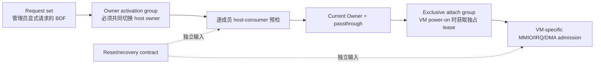

# ESXi 8.0.3 DirectPath owner activation、重启与依赖租约实测报告

日期：2026-07-18

范围：只记录 ESXi 8.0.3 build 24280767 的公开接口和授权嵌套实验环境中的外部可观察行为，
不推导 VMware 私有代码。实验使用 QEMU 构造 PCIe/legacy PCI 拓扑，并在 ESXi 内通过
ESXCLI、vSphere SOAP API、VM power-on fault、`vmkernel.log` 和 `vmware.log` 交叉验证。
机器可读摘要见
[`esxi8-passthru-activation-20260718-summary.json`](esxi8-passthru-activation-20260718-summary.json)。

## 1. 结论先行

1. `passthruEnabled`/Configured Owner 是期望状态，`passthruActive`/Current Owner/driver 才是
   生效状态；两者可以分离。
2. 重启不是由 FLR、class code 或 BAR 大小静态决定。它只是“持久化了精确 early-boot owner
   claim，且该 claim 能在 native consumer 之前成功”的一种执行路径。
3. 持久 vSwitch consumer 是本次 ESXi 8.0.3 实测的硬拒绝：`--apply-now` 和普通 deferred
   请求都失败且不写入 desired state。Broadcom 的 busy HBA 案例不能泛化为“busy 都可重启修好”。
4. `dependentDevice` 同时影响 host owner 切换和 VM admission，但不能简单等同于一个 reset
   domain。至少要区分显式 request set、owner activation group 和 exclusive attach group。
5. ESXi 8.0.3 存在 request-target 不对称：共享 bridge dependency 时，请求空闲 function 会
   自动扩展并切换整个组；显式请求忙 function 或显式列出整个组却会失败。
6. Qman 不应复制这个风险行为。参考实现采用：先扩展完整 owner group，再预检每个成员；任何
   持久宿主消费者都拒绝。VM admission 再对 exclusive attach group 获取独占 lease，同 VM
   多 function 也不默认合并 lease。

## 2. 三种集合不是一回事



- **Request set**：本次 ESXCLI/API 请求明确列出的设备。
- **Owner activation group**：一次 host owner transaction 实际会共同解绑/绑定的成员。
- **Exclusive attach group**：VM power-on 时不能被两个 assignment 同时占用的资源边界。
- **Reset/recovery contract**：FLR、PM reset、bridge reset 及其覆盖范围；它影响恢复能力，但不
  单独决定上面三个集合，也不单独决定是否需要重启。

VMware 的 `dependentDevice` 是很重要的公开提示，但本轮实测证明不能把它机械映射成唯一的
`resetDomain`。Qman inventory 因而分别保存 `ownerActivationGroup`、
`exclusiveAttachGroup`、`resetDomain` 和 `physicalIsolationDomain`。

## 3. 实验拓扑

### 3.1 PCIe 对照拓扑

两个 function 位于同一个外层 QEMU Root Port 下，但 ESXi 返回不同 dependency：

```text
0000:01:00.0 -> Dependent Device Address 0000:00:08.0
0000:01:00.1 -> Dependent Device Address 0000:01:00.1
```

`.1` 被配置为 `vmnic2 -> vSwitchBusy -> BusyPG -> vmk1`，`.0` 保持空闲。

### 3.2 Legacy bridge 共享 dependency 拓扑

```text
QEMU q35 Root Port
  -> pcie-pci-bridge 0000:01:00.0
     -> multifunction e1000e 0000:02:01.0 / 0000:02:01.1
```

两个 function 都返回：

```text
Dependent Device Address: 0000:01:00.0
Reset Method: Bridge reset
```

`.1` 同样被 `vSwitchBusy` 持久占用，`.0` 空闲。

## 4. Owner activation 与重启实锤

### 4.1 独占 endpoint 的 deferred request 和真实 host reboot

对专用 PCIe endpoint `0000:01:00.1` 执行不带 `--apply-now` 的 enable：

```text
esxcli hardware pci pcipassthru set -d 0000:01:00.1 -e true
exit=0

Configured Owner: VM Passthru
Current Owner:    VMkernel
Module Name:      ne1000
```

随后真实重启 ESXi host；uptime 归零，且同一 BDF 变为：

```text
Configured Owner: VM Passthru
Current Owner:    VM Passthru
Module Name:      pciPassthru
```

因此 O03/O07 已本地闭环：deferred request 只写 desired state，成功的 early-boot claim 才改变
effective owner。这里没有任何 BAR、class code 或 FLR 变化。

### 4.2 持久 vSwitch consumer 不是“重启可修”的通用 Busy

直接请求被 `vSwitchBusy` 使用的 `0000:01:00.1`：

```text
esxcli hardware pci pcipassthru set -d 0000:01:00.1 -e true -a
exit=1
Device ownership cannot be changed to passthru as it is used by
vswitch vSwitchBusy for uplink vmnic2
```

不带 `-a` 的 deferred 请求也返回 `exit=1`，Configured/Current Owner 均保持 native；请求是
原子的，没有留下待重启状态。移除 `vmk1`、port group、vSwitch consumer 后，对同一 BDF 的
`--apply-now` 立即成功。因此 blocker 是当前持久 host consumer，不是设备静态 capability。

Broadcom KB 434815 记录了 HBA storage path 的 Busy/重启路径，但本地 vSwitch A/B 证明不同
consumer class 可以采用不同策略。Qman 必须按 consumer provenance 建模，不能写成
`if busy: REBOOT_REQUIRED`。

## 5. Dependency group 的 request-target 不对称

### 5.1 不同 dependency 的 PCIe sibling

在 `.1` 仍被 vSwitch 占用时，对 dependency 不同的空闲 `.0` 执行 `--apply-now` 成功：

```text
01:00.0 -> VM Passthru / pciPassthru
01:00.1 -> VMkernel / native driver
```

这否定了“同 slot 或 multifunction sibling 必然共同 owner-switch”的简单规则。

### 5.2 共享 bridge dependency 的 legacy sibling

同一状态下得到以下矩阵：

| 显式 request set | 结果 | 实际 owner 变化 |
| --- | --- | --- |
| 仅空闲 `.0` | 成功 | `.0`、`.1` 都自动变为 passthrough；原 vSwitch 保留但 uplink 被移除 |
| 仅忙 `.1` | 失败 | 两者均不变 |
| 显式 `.0,.1` | 失败 | 两者均不变 |

SOAP `HostPciPassthruSystem.UpdatePassthruConfig` 与 ESXCLI 一致：显式 request set 含忙 `.1`
时返回 `vmodl.fault.InvalidArgument`，fault key 为
`vim.hostd.pcipassthru.vswitchUplink.failed`；仅请求空闲 `.0` 时 API 成功并自动扩展到两者。

这组外部现象支持如下黑盒模型：ESXi 8.0.3 先预检**显式 request set**，再扩展实际 owner
activation group。这里只描述实验现象，不声称 VMware 内部实现一定按该顺序编码。

同一共享组上，仅对空闲 `.0` 发 deferred request 也会把两者 desired owner 都设为 passthrough，
current owner 仍为 native；真实 host reboot 后两者都由 `pciPassthru` claim。vSwitch、BusyPG 和
`vmk1` 对象仍存在，但 uplink 为空。

这个行为对通用平台过于激进。Qman 的安全分歧是：

```text
requested = validate_explicit_request(request)
owner_group = expand_owner_activation_group(requested)
require owner_group.complete
preflight_every_member(owner_group)
if any member has persistent host use:
    deny(PERSISTENT_HOST_USE)
```

Qman 永不通过请求另一个 sibling 来静默拆除 network、storage 或 management consumer。

## 6. VM admission 的独占 lease

使用正确的 vSphere static backing 字段后，针对共享 `dependentDevice` 的 `.0/.1` 运行：

| Case | 结果 |
| --- | --- |
| VM-A 绑定 `.0` | power-on 成功 |
| A 运行时，VM-B 绑定 `.1` | 失败：`AH Failed to find a suitable device for pciPassthru0` |
| A power-off 后再次启动 B | 成功 |
| 单个 VM 同时绑定 `.0` 和 `.1` | 第二项失败：`AH Failed to find a suitable device for pciPassthru1` |

这证明共享 dependency 在 VM admission 阶段形成 exclusive lease；lease 在 VM power-off 后释放，
而且 ESXi 对此拓扑并未因为两个 function 属于同一 VM 就自动合并 lease。

测试还发现一个容易制造假阴性的 API 细节：`VirtualPCIPassthrough.DeviceBackingInfo.deviceId`
应传不含 `0x` 的十六进制字符串，例如设备 ID `0x10d3` 应传 `"10d3"`，不是十进制字符串
`"4307"`；后者会写出错误 VMX ID 并触发 AH selection failure。自动化脚本已固定该转换。

## 7. Qman 对标合同

### 7.1 Host activation planner

```text
function planActivation(snapshot, requestedBdfs, mode):
    requested = resolveExactIdentity(requestedBdfs)
    group = expandOwnerActivationGroups(requested)
    require group.complete and generationIsCurrent(snapshot)

    for member in group:
        require member.capable and member.adminEnabled
        require noForeignLease(member)
        if member.hostCritical or member.persistentHostUse:
            return DENIED
        if member.ownerUnknown:
            return DENIED

    if every member already owned by VFIO:
        return ALREADY_ACTIVE
    if mode is not DEFER_TO_REBOOT and every transition member canQuiesceNow:
        return LIVE_APPLY
    if mode explicitly allows deferred and exactBootClaimProven(group):
        return REBOOT_REQUIRED
    return DENIED
```

`REBOOT_REQUIRED` 只有在显式 maintenance/deferred transaction 且 exact boot claim 已证明时才可
返回：调用方可以主动选择 deferred，即使设备当前空闲；也可以在 transient live blocker 下明确
允许 fallback。普通 live-only 请求不自动降级为重启，persistent host use 始终拒绝。重启后必须
读回完整组的 owner/driver；不匹配就 FAILED/quarantine。

### 7.2 VM admission

```text
function admitVm(selectedDevices, vm):
    attachGroups = expandExclusiveAttachGroups(selectedDevices)
    require no duplicate attachGroup in selectedDevices
    atomicallyLeaseAll(attachGroups, vm, epoch)
    validateMmioIrqDmaAndGuestTopology(vm, selectedDevices)
    launchAndVerifyRuntimeBinding()
```

默认禁止一个 VM 内重复使用同一 exclusive attach group。只有在特定硬件、reset、DMA isolation、
错误恢复和 teardown 都经过 qualification 后，policy 才能为精确设备型号放开，不能按 class
或厂商全局放开。

### 7.3 Guest topology 与 hotplug 边界

本文的 guest topology 指冷启动后 VM 内可见的 PCI/ACPI root、root port/bridge、BDF、桥窗口、
ACPI `_CRS` 和 BAR 地址。它不是宿主物理拓扑，也不表示 runtime hotplug。Qman 不支持直通设备
热插拔，因此只需冻结 cold-boot guest ABI，并在 API、scheduler、launcher 和 QMP 四层拒绝
运行中 `device_add/device_del`。

## 8. 原始产物完整性

原始日志保存在授权实验机的 `_artifacts/vmware-directpath-runs/`，不提交凭据、管理地址或完整
运行日志到公共仓库。以下 SHA256 可校验关键产物：

| 产物 | SHA256 |
| --- | --- |
| `20260718-esxi8-owner-activation-v1/O03-deferred-before-reboot.txt` | `9929da1e5f1aad6fae9021a0afac64807a21fc64e1db299da0780ed77347d8fb` |
| `20260718-esxi8-owner-activation-v1/O07-post-reboot.txt` | `236f743a9e538b8d8c614f015809014575bcb85bdd095b76879c5e7739c9ece2` |
| `20260718-esxi8-owner-activation-v1/O04-busy-apply-now.txt` | `4f6beb6b45398d56ca0f0f4ebd6e2f48d549d376be141003c13ed4ed1717028b` |
| `20260718-esxi8-owner-activation-v1/O04-idle-apply-now-same-bdf.txt` | `b1f6a3cb7ece4cd1f3619a2cf7fde9570ffb2d3faa1d5507cf23380a180796b2` |
| `20260718-esxi8-owner-activation-v1/O04-busy-deferred-before-reboot.txt` | `49052bd0aa4e62d42f7d8b5c1aca4a75624e365c401ae7a7fc6ce4e2555b3e83` |
| `20260718-esxi8-owner-activation-v1/O05-sibling-busy-apply-fn0.txt` | `6d11e1ad6acae43e3384d6bd4cbe9cfbf406aee1cfb2e167524a52bef4bf6c5c` |
| `20260718-esxi8-owner-activation-legacy-v2/L04-enable-fn0-shared-bridge-sibling-busy.txt` | `88f668890d41afd76baba4a7f56d34edf8a6d4e0d618c79626eac36659aa3a2d` |
| `20260718-esxi8-owner-activation-legacy-v2/L11-api-explicit-request-set-busy-check.txt` | `71bac2e114ed9fec3c02fde2b1ce7d9a4185b17c5fe420029d438d25f7524efc` |
| `20260718-esxi8-owner-activation-legacy-v2/L15-post-real-reboot.txt` | `ae98e272ce55eae5f159d2a6eb6f34c96136b5e583603aae99f9ed64bfa24f8c` |
| `20260718-esxi8-owner-activation-legacy-v2/L20-shared-dependent-admission-two-vms-correct-id.json` | `6a51b1bb04ee1aae5ed6aa2a75b49c4fc3133d688b39b3936d6ffb74ad677a89` |
| `20260718-esxi8-owner-activation-legacy-v2/L22-shared-dependent-lease-release-and-same-vm.json` | `7c41f54341aeea47f0464c5f8c13856d2fc59c740b6d4d67b0560f063b3eb119` |
| `20260718-esxi8-owner-reproducer-v3/R01-snapshot-fixed/result.json` | `88bee5263f85dd91e628024829ced09999b6d12bdd4df8c1d78be7c04fe6946f` |
| `20260718-esxi8-owner-reproducer-v3/R04-admission-pair-phase-logs/result.json` | `3bd4c9c052cbdb9e8af8e89fccaac71a8d9b1d8037ed484e53ff302f1ce5bfb1` |

## 9. 复现索引

新的统一入口是
[`test_esxi_owner_activation.py`](../vmware-esxi8-lab/test_esxi_owner_activation.py)：

```text
# 只读 inventory 快照
python3 test_esxi_owner_activation.py snapshot \
  --host <ESXI> --target 0000:02:01.0 --output <DIR>

# SOAP request-set A/B；只有显式 --execute 才会修改 host owner
python3 test_esxi_owner_activation.py api-set \
  --host <ESXI> --target 0000:02:01.0 --observe 0000:02:01.1 \
  --enable --apply-now --execute --output <DIR>

# 两 VM 与同 VM shared-dependent admission；自动清理临时 VM
python3 test_esxi_owner_activation.py admission-pair \
  --host <ESXI> --target 0000:02:01.0 --target 0000:02:01.1 \
  --datastore <DATASTORE> --execute --output <DIR>
```

脚本拒绝 ESXi build/system UUID 不匹配、管理 BDF、重复 target 和未带 `--execute` 的 mutation。完整外层 QEMU 拓扑及
vSwitch 构造步骤见 [`vmware-esxi8-lab/README.md`](../vmware-esxi8-lab/README.md)。

统一 runner 已在同一 ESXi 8.0.3 legacy overlay 上重新执行：R01 同时读到两个 function
capable/enabled/active、相同 `dependentDevice=0000:01:00.0`、Current/Configured Owner 均为
passthrough，并确认全部 CLI 采集命令成功；R04 的 verdict 为 `pass`，结果内直接保存
`pciPassthru0` 跨 VM 冲突和 `pciPassthru1` 同 VM 冲突的两条 AH marker。临时 VM 在 finally 后
均不存在。实跑还修复了两个自动化问题：ESXi 8.0.3 不支持 `hardware pci list -d`，现改为一次
inventory 后按 BDF 切块；admission 在 maintenance mode 时现于创建 VM 前明确拒绝。

## 10. 仍需物理硬件 qualification 的边界

- 本轮重启、vSwitch Busy、dependency expansion 和 VM lease 均已在 ESXi 8.0.3 实际运行，
  但 endpoint 是 QEMU 虚拟设备。
- 真实 HBA storage path、GPU audio/function coupling、vendor FLR/PM reset 副作用、DPC/AER
  recovery、宿主 boot-critical 设备仍需物理 host qualification。
- SR-IOV PF/VF、ATS/PASID/PRI、peer-to-peer DMA 和真实 RMRR/IVMD 约束不能由简化 QEMU
  endpoint 证明。
- 本地结果足以冻结控制面 fail-closed 语义，但不能替代硬件型号级 HCL/errata 数据库。

## 11. 再检视后的剩余对标项

### 11.1 仍可由软件闭环，属于 Qman 实现工作

1. **Inventory/group builder**：把 host facts、`dependentDevice` 对照、VFIO affected set、ACS
   provenance 和 qualification rule 编译为四类独立 group，并带 generation/hash；不能让管理员手填。
2. **Owner executor**：实现 durable journal、全组 consumer preflight、driver override/bind、逆序
   rollback、read-back commit 和 quarantine。当前仓库已有 planner，不等于 executor 已交付。
3. **Early-boot agent**：实现签名 exact identity/path/owner-group manifest、initramfs/kernel claim、
   reboot 后 reconcile；没有这条链时产品必须返回 `BOOT_CLAIM_UNSUPPORTED`，不能提示“重启试试”。
4. **Attach lease coordinator**：对 `exclusiveAttachGroup`、physical isolation 和 reset affected set 做
   原子 multi-key CAS、epoch/fencing、power-off release 和 crash reconcile。
5. **Static/Dynamic transaction integration**：Static 固定 device identity；Dynamic 在每次 power-on
   先求 candidate，再获取上述 lease、计算实际 BAR/MMIO envelope、写 runtime binding，power-off
   清除。两者复用同一安全事务 core。
6. **QEMU/firmware admission**：把现有 BAR allocator 接到真实 launcher，生成 root/bridge window、
   OVMF/SeaBIOS 参数，并在 QMP/HMP/guest `_CRS`/BAR 读回不匹配时回滚。
7. **产品负向门**：snapshot/suspend/live migration/runtime passthrough hotplug、raw QMP
   `device_add/device_del`、未证明的 P2P/INTx/SR-IOV/RMRR profile 必须在 API 到 launcher 全链拒绝。
8. **多 host fencing**：Dynamic/HA 需要线性一致 lease store 和 host power fencing；两台嵌套 ESXi
   可以验证编排状态机，但不能替代真实 BMC/fencing SLA。

### 11.2 必须由真实硬件 qualification，QEMU 不能消除

- GPU 多 function/音频耦合、HBA active storage path、NIC firmware 与 boot-critical consumer 的
  实际 owner/reset 副作用。
- FLR/PM/SBR/DPC 是否真正清除 DMA、doorbell、firmware 和错误状态；QEMU reset callback 只证明
  调用路径。
- 功能型 SR-IOV PF/VF、ATS/PASID/PRI、真实 RMRR/IVMD、peer DMA、INTx 电气路由和 Option ROM。
- Correctable/Non-Fatal 之外的 fatal AER/NMI/host recovery；任何 destructive injection 都需独立
  故障域和 fencing。

### 11.3 已冻结的非目标

- 不还原 VMware 私有算法，只对公开 API 和外部现象建模。
- 不要求 stock QEMU 逐字复制 VMware guest PCI root/BDF；Qman 冻结自己的 cold-boot guest ABI。
- 不支持 passthrough runtime hotplug。这里的 guest topology 只指冷启动后的 PCI/ACPI/BAR 布局。

## 12. 官方公开接口

- [ESXCLI 8.0.3 hardware pci pcipassthru](https://developer.broadcom.com/xapis/esxcli-command-reference/8.0.3/namespace/esxcli_hardware.html)
- [HostPciPassthruInfo 8.0U3](https://developer.broadcom.com/xapis/vsphere-web-services-api/8.0U3/vim.host.PciPassthruInfo.html)
- [HostPciPassthruSystem 8.0U3](https://developer.broadcom.com/xapis/vsphere-web-services-api/8.0U3/vim.host.PciPassthruSystem.html)
- [VirtualPCIPassthrough.DeviceBackingInfo](https://developer.broadcom.com/xapis/vsphere-web-services-api/latest/vim.vm.device.VirtualPCIPassthrough.DeviceBackingInfo.html)
- [Broadcom KB 309986](https://knowledge.broadcom.com/external/article/309986/configuring-vmdirectpath-io-passthrough.html)
- [Broadcom KB 434815](https://knowledge.broadcom.com/external/article/434815/hba-adapter-hba355i-registers-as-storage.html)
