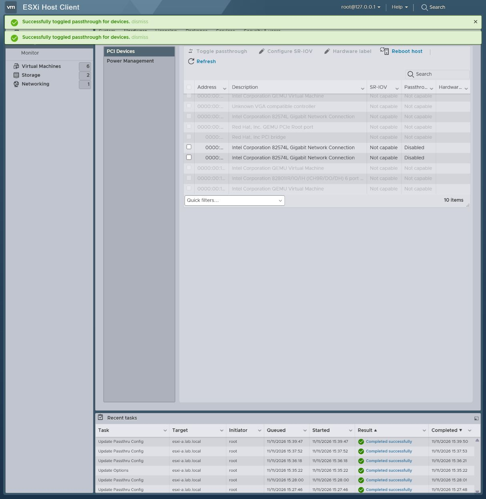

# VMware PCI 依赖的启用、禁用、分配和开机验证

后续已建立 [PCIe 多功能设备的成功对照](../vmware-pci-multifunction-fix-20261111/README.md)：同 VM 双设备成功、跨 VM 第二台失败。下文保留传统 PCI 桥场景的历史观察，不把该旧场景改写为成功。

2026 年 11 月 10—11 日，在 ESXi 8.0.3 build-24280767、Host Client 2.18.0-23593406 和 vCenter 8.0.3 build-24674346 上，验证了同一传统 PCI 桥下的两个合成 PCI Function：A=`0000:02:01.0`，B=`0000:02:01.1`。

**单独启用 A 会启用 A、B；单独禁用 A 或 B，也会共同禁用两者。** 主机侧联动不等于自动共同分配给 VM：两套界面均允许分别保存单设备配置，但第二台 VM 开机失败，交换顺序结果相同。同 VM 配置 A+B 也开机失败，因此本轮没有建立共同分配后正常运行的正例。

[机器摘要](summary.json) · [环境与源镜像哈希](environment.json) · [逐文件 SHA-256 和来源](manifest.json) · [离线核验脚本](verify_bundle.py)

## 主机启用与禁用

| 操作 | ESXi API | Host Client UI | vCenter API | vCenter UI |
| --- | --- | --- | --- | --- |
| 只启用 A | A、B 都启用 | 点击 A 即联选 B，提交后两者 Active | A、B 都启用 | 只勾选 A，B 未选中；提交后两者 Enabled |
| 只禁用 A | A、B 都禁用 | 点击 A 即联选 B，提交后两者 Disabled | A、B 都禁用 | 只勾选 A，B 未选中；提交后两者最终 Disabled |
| 只禁用 B | A、B 都禁用 | 点击 B 即联选 A，提交后两者 Disabled | A、B 都禁用 | 只勾选 B，A 未选中；提交后两者最终 Disabled |

API 请求使用 `UpdatePassthruConfig`、`applyNow=true`。单设备禁用请求的 `ids` 只有 A 或 B，未由脚本补齐另一项。每次独立用例先恢复两项 enabled/active 均为 true，再提交单项 false。禁用后两者的 `passthruEnabled`、`passthruActive` 均为 false；ESXCLI 的 Configured Owner、Current Owner 均为 `VMkernel`，Module Name 为 `ne1000`。主机启动时间保持相同，观察到的是本次运行中的切换。

禁用补充验证在**没有运行中的直通 VM**时进行；它不能回答设备被运行 VM 占用时是否拒绝、延迟或影响该 VM。关闭主机直通也不等于从 VM 配置中删除 PCI device，本轮未将两者混为一项操作。

关键回执：

| 路径 | 仅 A 请求 | 仅 B 请求 |
| --- | --- | --- |
| ESXi API 禁用 | [请求及前后状态](raw/disable/esxi-single-disable-disable-a.json) | [请求及前后状态](raw/disable/esxi-single-disable-disable-b.json) |
| vCenter API 禁用 | [请求及前后状态](raw/disable/vcenter-single-disable-disable-a.json) | [请求及前后状态](raw/disable/vcenter-single-disable-disable-b.json) |
| Host Client 操作后读回 | [A 操作后](raw/disable/esxi-host-ui-a-disabled.json) | [B 操作后](raw/disable/esxi-host-ui-b-disabled.json) |
| vCenter 操作后读回 | [A 操作后](raw/disable/vcenter-vc-ui-a-disabled.json) | [B 操作后](raw/disable/vcenter-vc-ui-b-disabled.json) |

启用的单项请求见 [ESXi](raw/esxi/api-02-enable-only-a.json) 和 [vCenter](raw/vcenter/api-01-host-enable-a.json)。界面联选差异见 [Host Client 启用前](screenshots/esxi/03-select-a-auto-selects-b.jpg)、[vCenter 启用前](screenshots/vcenter/04-only-a-selected.jpg)、[Host Client 禁用 B 前](screenshots/disable/host-04-select-b.jpg) 和 [vCenter 禁用 B 前的 DOM](screenshots/disable/vc-04-only-b-selected.txt)。这些步骤未观察到独立的依赖确认弹窗。



### vCenter 列表更新滞后

禁用 A 后，成功提示已说明禁用，但表格 DOM 一度仍将 A、B 标为 Enabled；一次 Refresh 后的早期采样也仍是旧值。同期后端已是两项 false 和 VMkernel。后续 DOM 读到两行 Disabled，没有再次切换开关。完整页面重载会将筛选恢复为 Passthrough-enabled devices，因此空列表也不能直接当作两行 Disabled 的证据；切回 All PCI devices 后才保存最终 DOM 状态。

对应证据为 [成功提示截图](screenshots/disable/vc-03-a-disable-complete.jpg)、[旧 Enabled 行的 DOM](screenshots/disable/vc-03-a-disable-complete.txt)、[Refresh 后的早期 DOM](screenshots/disable/vc-03b-after-refresh.txt)、[最终 Disabled 行的 DOM](screenshots/disable/vc-03e-all-devices-disabled.txt)，以及 [vCenter 双属性读回](raw/disable/vcenter-vc-ui-a-refresh-check.json) 和 [直连 ESXi 交叉核对](raw/disable/esxi-vc-ui-a-direct-check.json)。禁用轮次的 vCenter 截图视口较小，未完整露出 A、B 两行；配对 DOM 保留了行状态，不把截图当作两行文字可见的证明。`host.config.pciPassthruInfo` 与 `pciPassthruSystem.pciPassthruInfo` 的后续采样一致；没有在旧值仍显示时采到足够数据定位是哪一层缓存。

只选 B 的后端结果同样为共同禁用。最终 DOM 观察两行均 Disabled，但该最后时点未另存截图；[操作员转录](raw/disable/ui-final-observation.json)明确标明其证据类型。没有连续采样 UI 状态变化时刻，不报告具体延迟，也不把后续刷新当成必需条件或已证实的根因。

## 分配、保存与开机

以下结果在 ESXi API、Host Client UI、vCenter API、vCenter UI 四条路径分别执行。界面操作有截图、DOM 文本和任务读回，未用直接 API 操作代替界面证据。

| 操作 | 四条路径的观察 |
| --- | --- |
| A 添加到 VM-A，B 添加到 VM-B | 均保存成功，分别读回 1 个静态设备 |
| A、B 都添加到 VM-BOTH | 保存成功，读回 2 个静态设备 |
| VM-A 先开机，再启动 VM-B | A 成功，B 失败 |
| 关闭 A，VM-B 先开机，再启动 VM-A | B 成功，A 失败 |
| 其他测试 VM 关闭，同 VM A+B 开机 | 失败，日志指向第二个直通设备 |

两套 UI 添加一个设备后都没有自动添加另一个。展开设备行只有通用的直通操作限制，未观察到依赖专门警告。vCenter Device Selection 同时提供静态设备和 Dynamic DirectPath IO，本轮选择静态 `DeviceBackingInfo`。vCenter UI 的开机任务为 `Datacenter.ExecuteVmPowerOnLRO`，直接 API 为 `VirtualMachine.powerOn`。

| 证据 | Host Client | vCenter |
| --- | --- | --- |
| 单设备编辑 | [A 展开详情](screenshots/esxi/06-vm-a-expanded-before-save.jpg) | [A 只有一个设备](screenshots/vcenter/07-vm-a-one-device-before-save.jpg) |
| 双设备保存读回 | [API 读回](raw/esxi/ui-both-saved.json) | [API 读回](raw/vcenter/ui-both-saved.json) |
| A 运行时 B 失败 | [任务及状态](raw/esxi/ui-b-while-a.json) | [任务及状态](raw/vcenter/ui-b-while-a.json) |
| B 运行时 A 失败 | [任务及状态](raw/esxi/ui-a-while-b.json) | [任务及状态](raw/vcenter/ui-a-while-b.json) |
| 同 VM A+B 失败 | [任务及状态](raw/esxi/ui-same-vm-both.json) | [最终任务及状态](raw/vcenter/ui-same-vm-both-final.json) |

任务报告 `DevicePowerOn` 失败；VM 日志原文为 `AH Failed to find a suitable device`，见 [ESXi B 失败摘录](log-excerpts/esxi-ui-b-while-a.txt)、[vCenter B 失败摘录](log-excerpts/vcenter-ui-b-while-a.txt) 和 [同 VM 双设备摘录](log-excerpts/vcenter-ui-same-vm-both.txt)。本轮没有出现可据以报告的 `Device ... is already in use` 错误，也不能仅凭这些故障文本确定 DMA、ACS 或复位机制中的哪一项是直接原因。

### 为什么同 VM 共同分配仍然失败

共同分配满足依赖规则中的一项必要条件，不保证这个合成拓扑满足其余硬件与驱动条件。本轮同 VM 正对照失败，不能据此得出“VMware 不允许把依赖设备放进同一台 VM”。也不能仅凭不同 VM 中第二台失败，就认定已验证了跨 VM 分配规则的拦截：同一个设备初始化问题可能影响两种放置方式。

2026-11-11 复核原始 Host Client 同 VM 日志，找到更具体的失败阶段。以下时间均为 UTC，VMX world 为 `207713`：

| 时间 | 原始观察 |
| --- | --- |
| 2026-11-10 17:21:00.874 | vmware.log：`Registered a PCI device for 0000:02:01.0`，A 已注册 |
| 17:21:00.877 起 | vmkernel：B 反复出现 `Expected no IOMMU domain for 0000:02:01.1, got Success`，每次随后销毁 B 的初始化记录 |
| 17:21:07.382 | vmware.log：`AH Failed to find a suitable device for pciPassthru1`，接着 DevicePowerOn 失败 |
| 17:21:11.430—11.435 | vmkernel：对 A 执行 `Disable Domain`，随后销毁 A 的初始化记录 |

见 [注册及开机失败摘录](log-excerpts/esxi-ui-same-vm-initialization.txt) 和 [IOMMU 检查及清理摘录](log-excerpts/esxi-ui-same-vm-iommu.txt)。这将诊断从通用开机错误推进到 B 的 IOMMU 域关联检查；其中 `got Success` 是警告中的检查返回结果，不能读作 B 初始化成功。

传统 PCI 桥共享 requester ID，与上述现象相符；A 建立关联后，B 未按同 VM 共享域路径成功处理，是待验证解释。现有日志没有给出域 ID、归属比较或对照结果，不能进一步认定 QEMU 缺陷、ESXi 缺陷或某项配置是根因。后续需在干净启动下对照相同设备的 PCIe/传统 PCI 桥放置，并反转同 VM 内的设备添加顺序，先建立一个依赖关系明确且同 VM 可成功的正对照。未在本次日志复核中重启实验或执行这些新用例。

### 是否可能部分成功

同 VM 开机过程存在“A 已注册、B 失败、整机开机失败”的部分进展，并有 A 的后续清理记录。这不等于运行中的 VM 可以只使用其中一项，也不证明所有资源的清理都具有原子性。

主机切换直通是另一条操作路径。现有启用记录未观察到 A/B 混合的最终状态；补充脚本的状态轮询从 `UpdatePassthruConfig` 返回后开始，且未注入中途故障。因此没有验证调用执行中的瞬态、故障后部分成功或事务回滚原子性。VM 开机的部分初始化现象不能作为主机开关部分成功的证据。

## 实验范围与规范依据

实验为 Windows → WSL2 → QEMU/KVM → ESXi → 空 EFI 测试 VM。外层 4 vCPU、8192 MiB；内层 VM 为 1 vCPU、768 MiB、vmx-20、全额内存预留。没有 guest OS I/O 负载。

测试拓扑为 PCIe root port `0000:00:08.0` → PCIe-to-PCI bridge `0000:01:00.0` → 两个 e1000e Function（`8086:10d3`）。API 与 ESXCLI 均报告共同 dependentDevice 为该桥，Reset Method 为 Bridge reset，FPT Sharable 为 true。管理网卡 `0000:00:05.0` 不在测试集合中。原始设备信息见 [PCI 清单](raw/esxi/preflight-pci.txt)。QEMU 为有实验补丁的 11.0.2，二进制哈希与基盘哈希保存在环境记录中；本包不分发虚拟磁盘或 VMware 安装介质。

[Broadcom KB 312208](https://knowledge.broadcom.com/external/article/312208)要求总线级复位相关 Function、存在功能依赖的 Function，以及传统 PCI 桥后的相关 Function 共同分配；功能依赖需要通过 `passthru.map` 声明。这是产品要求，与本轮界面表现分开理解。它也解释了为什么保存配置成功不足以证明独立使用。

[HostPciPassthruInfo](https://developer.broadcom.com/xapis/vsphere-web-services-api/latest/vim.host.PciPassthruInfo.html)将 dependentDevice 定义为需由 VMkernel 解除占用的设备，可能是桥；[UpdatePassthruConfig](https://developer.broadcom.com/xapis/vsphere-web-services-api/latest/vim.host.PciPassthruSystem.html#updatePassthruConfig)描述对依赖设备更新启用状态。这些公开 API 页是 latest 文档，2026-11-11 查阅；它们不替代所测 8.0.3 build 的实测回执。

本轮证明该合成拓扑存在主机模式联动，以及配置保存后在开机阶段暴露失败。没有建立同 VM 合并成功的正对照，不能扩展成所有设备或所有 ESXi 版本的结论，也不构成真实硬件的隔离、复位、稳定性或性能资格验证。

## 排除的试验与无效采样

- 功能依赖补充试验写入 `1af4 1041 default false` 后重启，规则消失，两项设备仍 shareable。`/bootbank` 指向临时目录，日志报告启动盘和持久存储问题，状态为 `SETUP_INVALID_BOOTBANK_VOLATILE`。见 [验证记录](raw/excluded-functional/policy-validation.json)、[重启前规则](raw/excluded-functional/map-before-reboot.json)、[重启后规则](raw/excluded-functional/map-after-reboot.json)、[bootbank 摘录](log-excerpts/excluded-volatile-bootbank.txt)。这不是“已声明功能依赖但产品未执行”的证据。
- Host Client 首次关机截图没有证明任务完成，后续采样与 API 确认替代它；vCenter 一次导航打开旧 VM 编辑器，被对象校验拦住并取消；初次空 VM 创建因 PBM 服务失败，发生在 PCI 分配前，恢复服务后才开始矩阵。
- vCenter 同 VM 开机的早期回执仍 running，以 `ui-same-vm-both-final.json` 为准。禁用 UI 的部分早期文件名/笔记过早称为完成，时间线保留更正；本文引用实际状态和最终证据。

[Host Client 时间线](raw/esxi/ui-timeline.jsonl)、[vCenter 时间线](raw/vcenter/ui-timeline.jsonl)和[禁用补充时间线](raw/disable/ui-timeline.jsonl)保留采样修正。逐步截图不等于连续操作录像。

## 复现与证据完整性

三个有效轮次分别为 `20261110-esxi8-dependency-interaction-v1`、`20261111-vcenter8-dependency-ui-v1`、`20261111-esxi8-dependency-disable-v1`。来源映射保留在 manifest 中，实验关联 `VMW-DEP-001` / `VMW-OWNER-002`；不因此自动关闭产品或物理硬件验证门禁。

复现需自行具备相同软件、实验镜像、QEMU 补丁、测试拓扑和授权凭据。先确认设备依赖和目标 UUID/build，再依次执行单项主机切换、单设备配置、两种开机顺序、同 VM 对照。禁用的两个方向必须各自重建两项 Active 的起点，不能在首次已经禁用后直接测试另一个方向。每次同时记录请求、配置状态、实际 owner 和页面内容。

[脚本快照说明](source-snapshots/README.md)列出脚本用途及依赖；它们是最终实验辅助代码，含本机路径和身份约束，不是可直接用于任意主机的工具。公开包保留必要的任务回执和日志摘录，没有包括凭据、会话 cookie、完整宿主机日志或虚拟磁盘。日志摘录附原文件哈希与行号；三个主机快照移除了无关 VM 清单，其余原始回执的复制/转换方式逐文件记录。

离线核验不连接实验服务、不修改主机：

```console
python evidence/vmware-dependency-ui-20261111/verify_bundle.py
```

它检查文件哈希、关键状态断言、相对链接及辅助脚本语法。哈希证明归档字节的一致性，不能独立证明硬件行为真实发生；行为判断仍须结合请求、时间、任务状态、截图和原生日志。

临时测试 VM 已清理，最终设备已禁用直通。实验 overlay 和 VCSA 恢复点保留；资源收尾结果见 [机器摘要](summary.json)。
