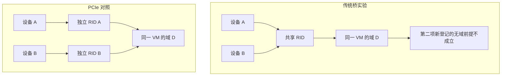

# VMware PCI 直通原理与竞品分析

技术决策版 1.0　｜　资料核对日期 2026 年 11 月 14 日

适用读者为产品、架构、研发和测试团队。本文用于判断直通能力的实现要求、竞争差异和商业表述边界，主线覆盖设备发现、资格、依赖、主机切换、静态和动态分配、VM 启动、设备运行、释放恢复与迁移。这里的动态指开机时选择设备，不代表设备运行中自动更换。

**主要判断：VMware 将直通作为贯穿主机与 VM 的资源管理能力。** 一个设备从被发现到业务可用，需要通过多次不同范围的检查。我们的对标重点应是完整依赖范围、运行时占用与失败恢复，而不能停留在给 QEMU 增加一个 PCI 设备参数。[C01][C28]

**需要同时保留三个结论。** 第一，既有文档、实验和汇编已能解释普通 DirectPath 的核心判定机制。第二，传统桥共享 DMA 身份场景暴露了所测版本的初始化兼容性问题，不能据此推导所有 VMware 直通都不可靠。第三，Enhanced DirectPath 已形成另一条设备合作与生命周期支持路线，普通直通的迁移限制不能覆盖整个 VMware 产品组合。[C07][C24][C29]

本报告给出原理模型及判断依据。没有新增物理设备资格认证、性能对比或生产验收；模型中的调度与事务建议也不冒充已经获取的 VMware 源码。

## 1 分析范围与证据使用

### 1.1 版本和产品路线

| 对象 | 本报告能确认的范围 | 不能外推的范围 |
| --- | --- | --- |
| ESXi 8.0 U3b build 24280767 | 核心管理库和内核静态分析；多数配置、开机、动态分配及生命周期实验 | 不代表所有 8.x 配置与物理设备 |
| vCenter 8.0.3 build 24674346 | 既有 UI、placement、迁移和关机迁移实验 | 不代表完整集群调度实现 |
| ESXi 8.0 U3k build 25595708 | 传统桥失败复现及选定域检查分支 | 未复核本报告全部管理与调度路径 |
| ESX 9.1.0.0100 build 25433460 | 同上，另有原生 PCI e1000 控制 | 不能替代最新版验证 |
| ESX 9.1.1.0100 build 25782009 | 前序记录列出的版本；未取得介质 | 修复状态未知，不形成运行结论 |
| Enhanced DirectPath | 官方 2026 年说明中的框架与条件化能力 | 本项目没有该路线的实机验收 |

普通静态直通、Dynamic DirectPath 和 Enhanced DirectPath 必须分开对标。硬件可用性还受服务器、设备、固件、guest OS、guest 驱动和具体操作组合影响；本文不建立一个只按产品名称打勾的支持清单。[C24][C29][C30]

### 1.2 证据分类

| 标记 | 证明对象 | 使用限制 |
| --- | --- | --- |
| 官方说明 | 产品公开契约、API 字段和声明的功能 | 不证明内部算法和本机运行结果 |
| 运行实测 | 指定 build、设备模型、拓扑下发生的行为 | 合成或嵌套环境不等于物理资格认证 |
| 汇编核对 | 精确二进制中的字段、调用、比较和分支 | 不提供源码注释、历史设计意图和完整并发规范 |
| 分析判断 | 将多项证据连接起来的因果解释 | 必须保留假设和适用范围 |
| 我方设计 | 对 Qman 等目标平台的建议 | 不是已交付的产品能力 |

正文的 C 编号对应附录的结论登记表；每项都有来源、版本范围和不成立的外推。完整来源及文件摘要见随附 sources.json、claims.json 和 manifest.json。证据类型不能互相替代：配置保存成功不是开机证据，开机成功不是业务 I/O 证据，复位函数被调用不是设备状态确已清除的证据。[C01][C19]

## 2 总体架构与状态模型

### 2.1 四层职责

**硬件与固件层**提供 PCI Function 身份、BAR、DMA 请求者身份、拓扑、ACS 和复位能力。它决定软件能够安全拆分资源的物理前提。

**ESXi 主机层**发现设备，维护驱动与 owner，判断 IOMMU 和 ACS 条件，生成依赖代表，并控制映射和设备复位。管理库与内核各自承担不同检查。

**VM 与 VMX 层**保存静态设备引用或动态选择条件，在启动时登记实际设备，建立该 VM 的内存和设备映射，并处理启动失败及释放。

**vCenter 与集群层**把可分配硬件纳入主机选择和操作检查。公开对象能显示候选及绑定，但不能据此声称已掌握全局求解、并发预留、重试或故障接管算法。[C11][C12][C14][C23]

### 2.2 状态不能压缩成一个可用标志

| 状态或判断 | 回答的问题 | 典型证据 |
| --- | --- | --- |
| 受支持 | 厂商是否承诺该组合和操作 | 兼容目录、版本与设备要求 |
| 已发现 | 主机是否枚举到该 Function | PCI inventory、配置空间 |
| Capable | 当前软件认为直通是否可能 | passthruCapable、管理库谓词 |
| Enabled | 管理员是否配置为直通 | configured owner、配置回执 |
| Active | 当前 owner 和驱动是否已生效 | runtime owner、驱动、active 读回 |
| 可分配 | 此时是否有满足依赖与占用条件的资源 | 开机分配结果、owner 冲突检查 |
| 已分配 | 哪个实际设备已关联到哪台 VM | 运行绑定、Dynamic assignedId |
| 功能可用 | guest 能否完成所需业务 | 驱动、DMA、IRQ、业务 I/O |
| 可安全回收 | 是否能交给下一使用者 | 停止访问、映射处理、复位、恢复验证 |

这些状态不是一个永不回退的单向列表。Active 设备可能忙碌或失去响应；候选仍可被发布，但当前分配可能失败；VM 关闭后也不代表相关设备立即恢复健康。[C08][C13][C20][C21]


## 3 VMware 如何判定设备具备直通资格

### 3.1 已核对的核心谓词

在 build 24280767 的 libvmkctl.so 中，IsPassthruCapable 的普通返回路径包含四项：全局 disablePciPassthrough 未禁用、inIommuScope 为真、meetsPassthruAcsReq 为真、passthruDependent 不是无效值。三份相关二进制中的 35 个函数和选定指令、调用及重定位，已经完成 121 项静态核对。[C02]

```text
功能开关允许
    且 IOMMU 覆盖该设备
    且 ACS 策略接受该路径
    且内核给出有效依赖代表
        → 核心 capable 谓词通过
```

inIommuScope 的内核提供者同时检查 IOMMU 已启用和设备被该 IOMMU 实现支持。因此“BIOS 菜单打开”“CPU 支持虚拟化”或“设备有复位方法”都不能单独替代这个条件。[C03]

meetsPassthruAcsReq 通过 PCIE_EnforceACS 产生。代码会检查相关上游路径和 ACS 控制状态，也有结果缓存及策略例外。于是 capable 是当前软件策略的判断，不能直接当作物理 ACS 隔离能力的认证。[C04]

### 3.2 资格和宿主用途检查的边界

启动盘、系统保留设备以及仍被网络用途占用的设备，会在后续 owner 验证或切换路径受到限制。它们影响最终能否启用，但不都出现在上述四项核心谓词内。此前将这些条件合在一起的外部模型，应当作为实验归纳阅读，不能当作内部函数的等价源码。[C02][C09]

资格也不是 VID:DID 白名单的同义词。既有控制实验保持 ID 不变，通过改变 IOMMU、拓扑、复位和 ACS 条件使 capable 翻转；Type-0 实验端点修改 class code 后仍可通过，而真实 Type-1 桥即使报告 FLR 也未通过。这里支持的是“结构角色与隔离条件影响准入”，并不认证这些合成端点的生产兼容性。[C02][C30]

### 3.3 对产品判断的意义

对外支持目录应与运行时 capable 分开。前者回答“我们承诺哪些组合”，后者回答“当前主机能否尝试分配”。如果只用一个布尔字段，用户会把某次枚举或配置成功误解为正式支持，研发也会把硬件资格问题误当成界面问题。[C01][C28]

## 4 依赖如何产生及为何表现为双向约束

### 4.1 四种不同来源

| 来源 | 原理 | 对分配或操作的影响 |
| --- | --- | --- |
| Requester-ID 别名 | 多个 Function 的 DMA 在上游共享身份 | 不能任意配置为不同 DMA 地址空间 |
| ACS 与设备间访问路径 | 不同 RID 仍可能存在绕过 IOMMU 的互访 | 独立 RID 不等于独立安全边界 |
| 复位影响 | FLR 与总线或链路复位覆盖范围不同 | 能独立映射，不一定能独立启停或恢复 |
| 功能依赖 | 设备内部共享固件或状态 | 可能需要厂商规则或显式声明 |

因此，同一插槽、同一个上游桥、同一个 dependentDevice、同一个 DMA RID 不是可以随意互换的概念。每种关系回答的问题不同。[C05][C26]

### 4.2 已还原的依赖代表计算

VMKPCIPassthru_GetDeviceDependencies 输出一个代表性的 packed SBDF。其相关分支考虑最高层别名桥、显式多功能依赖标志、是否有独立复位能力以及父设备；再比较相关拓扑候选的 bus 字段选出代表。它不是直接返回所有成员的列表。[C05]

登记阶段会计算目标的代表，再查找具有相同代表的其他登记。于是 A 和 B 的约束可以这样产生：

```text
dep(A) = X，dep(B) = X
    A 登记时能查到属于 X 的 B
    B 登记时也能查到属于 X 的 A
```

普通路径中，相同 VMM owner world 允许继续，不同 owner 则拒绝。这足以产生对称占用限制，无需先假定系统存储了两条方向相反的依赖边。[C06]

### 4.3 共同管理不等于所有成员都显示在 guest 中

宿主需要交出哪些设备、VM 实际呈现哪些设备、当前操作会复位哪些设备，必须分别记录。已有单项设备能够启动的控制实验说明：检查相关设备的 owner 和占用，不等于配置列表中必须出现该组每一个 BDF。未使用的成员也不能被当成不受约束的空闲资源。[C06][C25]

### 4.4 passthru.map 的作用

该文件参与复位方法选择和多功能共享属性。shareable 输入会影响内核的多功能依赖字段，设置时还检查当前 Function 的多功能 Header 标志和 PCIe 类型。所测 build 的 D3D0 判断要求先显式选择该方法，再检查 PM 能力；不能从“存在 PM capability”直接推导默认采用 D3D0。[C05]

文件声明不会改变桥的物理 DMA 身份。传统桥用例设置 default false、重启并确认底层值生效后仍失败；因此该共享属性修改没有解决该用例的域初始化冲突。其他复位选择没有在这一用例中被完整穷举。[C07]

## 5 主机模式切换如何判定

### 5.1 配置写入与当前生效分开

Enabled 表示配置意图，Active 需结合当前 owner 和驱动确认。既有同 build 实验分别观察到立即重绑定成功，以及仅写入配置、经过真实主机重启才生效的路径。因此，重启与否不是单凭 class、BAR 或 FLR 就能决定的固定属性。[C08]

| 操作结果 | 直接观察 | 产品解释 |
| --- | --- | --- |
| 立即生效 | 无主机重启，runtime owner 和驱动切到直通 | 当前条件允许解除宿主使用并重绑定 |
| 延后生效 | configured owner 已变化，runtime owner 保持 native | 仍需后续生效步骤，不能当作可立即开机 |
| 拒绝 | Busy 用途存在，请求失败且状态未变 | 先消除用途冲突，不应一概提示重启 |
| 已经生效 | 期望 owner 与当前 owner 一致 | 仍要检查 VM 占用与设备健康 |

### 5.2 依赖展开的时机影响用户结果

7 月的受控实验中，共享 bridge dependency 的 A 空闲、B 被 vSwitch 使用。仅显式请求 A 时两项被联动切换；显式请求 B 或 A、B 时失败。11 月的管理库分析又显示，配置函数会根据代表反向查找成员并逐项写入。[C09]

这些证据支持“显式目标检查与依赖展开范围可能不同”的解释，但尚未还原 hostd 全部调用顺序。商业报告应将它描述为所测路径的行为差异，不能写成所有版本都存在同一个 UI 缺陷。[C09][C25]

对我方，建议先展开完整受影响集合，再检查每个成员的管理网、存储、启动用途和其他占用；预检结果应随拓扑变化而失效。该建议是我方设计要求，不是已证实的 VMware 全局事务算法。[C28]

### 5.3 部分成功和补偿

汇编中存在逐成员配置写入，以及异常后的补偿遍历。由此能确认软件尝试清理已处理项，但不能证明外部观察不到中间状态，也不能证明任何混合初始状态或补偿失败都能自动恢复。配置联动、故障补偿和事务原子性应分别验收。[C10]

## 6 静态与动态直通如何选择设备

### 6.1 绑定方式不同

| 维度 | Fixed 或静态 DirectPath | Dynamic DirectPath |
| --- | --- | --- |
| 持久配置 | 具体设备地址及宿主身份相关字段 | 允许的设备属性与可选标签 |
| 何时确定实际设备 | 配置指向具体设备，开机再次核验 | 开机时解析实际候选 |
| 运行结果 | 使用该具体设备 | assignedId 表示选中设备 |
| 资源不足 | 固定资源不可用则失败 | 没有满足全部条件的组合则失败 |
| 关机后 | 配置仍保留固定引用 | assignedId 按 API 契约清空，选择条件保留 |
| 目标主机变化 | 原引用通常需要重新处理 | 可在目标主机重新匹配，但须满足实际资源条件 |

Dynamic 的 allowedDevice 可以限定 vendor、device 及可选 subsystem、revision；customLabel 进一步约束选择。相同标签只是匹配条件，不应被我方产品当成固件、性能或业务功能完全等价的证明。[C11][C12]

### 6.2 候选列表不是可启动承诺

Assignable Hardware 发布候选信息与维护运行绑定，但“列表里有两个设备”不能保证有两份独立可分配资源。两项可能共享依赖范围，其中一项被占用或异常会影响另一项。[C13][C14]

已有双设备请求实验中，blocker 占用一个候选后，目标 VM 返回 NoCompatibleHost，缺失项为 pciPassthru1；释放 blocker 后原配置能够取得两项并启动。这个结果证明本用例不会重复使用同一资源或静默少配，不能进一步证明调度器采用某种全局最优算法。[C14]

### 6.3 先确定实际组合再计算资源需求

异构 BAR 实验保持 VM 的持久 MMIO 设置不变。选到 1 GiB 设备时采用低地址窗口；该设备被占用后选到 2 GiB 设备，窗口转到高地址，并且两次 guest 均启动。由此支持“实际选中设备影响最终 MMIO 规划”，而不是简单按候选集合最大 BAR 固定预留。[C15]

可以用以下概念模型解释动态分配。它是分析模型，不是已还原的调度源码：

```text
按配置条件发现候选
    → 排除不满足资格、用途、健康或依赖占用的候选
    → 寻找能同时满足本 VM 所有设备请求的组合
    → 按实际组合验证内存、BAR、RMRR 和设备布局
    → 在执行时重新核验并建立绑定
```

## 7 VM 启动为何需要多层准入

### 7.1 启动判定包含哪些问题

| 判定层 | 需要回答的问题 | 失败的典型含义 |
| --- | --- | --- |
| 配置匹配 | 请求的身份、模式、标签与设备是否对应 | 没有合适候选或配置失效 |
| 主机准备 | IOMMU、设备存在、owner 与驱动是否就绪 | 设备未准备好，或已变化 |
| 依赖占用 | 同依赖代表是否已有其他 VM 的登记 | 不同 BDF 仍可能相互冲突 |
| VM 内存 | 设备 DMA 所需的内存前提是否满足 | 不能建立所需映射 |
| 地址资源 | BAR 类型、对齐、桥窗口及 RMRR 是否可容纳 | 设备存在但 VM 地址空间放不下 |
| 设备初始化 | 域状态、复位、IRQ 和设备状态是否接受 | 前面通过，初始化仍失败 |

官方配置要求包含完整内存预留；所测登记入口还检查 pinnedMainMem 和 preallocGuestMem 相关标志。公开配置字段与内部标志的全部生成关系没有在本轮逐一还原。[C16]

核心登记路径再次检查 IOMMU 启用、设备存在和覆盖；普通 FPT 前置回调检查相关端点的宿主 owner，并核对请求身份。随后才进入同依赖代表的活动登记比较。[C03][C06]

### 7.2 MMIO 不能仅按 BAR 总和判断

BAR 需求包括大小、32/64 位限制、对齐、可预取属性和桥窗口布局。内存预留解决的是 guest RAM 的可映射性，MMIO 窗口解决的是设备寄存器地址空间，两者不能替代。[C17]

既有 8、32、64 GiB BAR 样本验证过成功和窗口不足的负例。64 GiB 样本仅开启 use64bitMMIO 仍失败，显式足够的窗口后才启动。该结果只能支持指定配置，不能据此给所有设备硬编码一个默认窗口或宣称已经得到 VMware 完整分配公式。[C17]

RMRR 则是另一类约束：设备涉及宿主保留内存范围时，映射还需与 VM 的物理内存布局相容。实验观察过自动调整 PCI hole 的成功路径，也观察过不支持的重叠范围在更早阶段被拒绝；应记录实际失败阶段，不能把所有 RMRR 问题都称为 guest 驱动故障。[C18]

### 7.3 同组同 VM 仍可能失败的已知实例

传统桥场景中，A、B 共用 DMA 身份。A 的激活改变整组域状态；B 属于同一 VM，可以通过 owner 检查，但普通新登记仍要求无客体域，于是拒绝。PCIe root port 对照保留独立身份，避开了这条状态冲突路径。[C07]

这一结论属于所测实现的初始化兼容性缺口。它既不能被简化为“硬件共享身份必然不支持同 VM”，也不能直接升级为 Broadcom 已确认的缺陷编号。较新两个 build 的同场景仍复现，但未取得的最新版状态未知。[C07][C29]




## 8 启动完成以后还需要验证什么

VM 处于 poweredOn 只说明 hypervisor 的启动任务达到相应状态。guest 是否看到设备、驱动是否加载、MSI 或 INTx 是否正常、DMA 是否访问预期内存、业务是否达到要求，仍是分开的结果。[C19]

既有样本中，部分 EDU 与 e1000e 路径已有 guest heartbeat、DMA 或 IRQ 证据；另有 INTx 路径出现 guest 可见路由但没有功能流量。11 月的依赖与新版复测则使用空 EFI VM，不包含 guest 业务负载。把这两类实验合成一个“已验证 I/O”的结论，会超出证据。[C19]

VM 启动后也应面对设备消失、重置异常、IOMMU fault 和链路变化。对于未知状态，我方应保持设备占用或进入恢复状态，直到能证明它可供下一使用者使用。这里是产品执行要求，不能用配置清单已经清空来代替。[C20][C21][C28]

## 9 释放与故障恢复如何影响下一次分配

### 9.1 删除旧映射不等于设备已经完全停机

既有 VT-d/EDU 采样中，VM 关闭后发生 context 与 IOTLB 失效处理，设备请求者从 guest domain 回到宿主 identity domain；同一个 IOVA 不再到达原 guest backing，但后续受控 DMA 探针仍能产生访问。这个样本证明旧 guest 映射被撤离，不能证明设备已失去所有 DMA 能力。[C20]

因此，释放判断要同时考虑谁还能发起访问、旧映射如何处理、设备是否完成所需复位，以及下一次使用是否成功。状态清除涉及设备内部和外部接口，虚拟复位回调不能替代物理硬件验证。[C20][C30]

### 9.2 一项异常可以影响健康同组成员

本次重新核对了 2026 年 8 月的故障注入回执：在 PowerOff 过程中，只让 EDU 端点的配置读取返回全一，保持同组 e1000e 和桥可读。PowerOff 成功，API 仍发布 capable、enabled、active 和动态候选，但健康 sibling 的新 VM 启动失败。恢复 EDU 响应后，不重启 ESXi/QEMU，新分配和 guest DMA 又成功。[C13][C21]

这支持组级暂停分配的外部现象。它不证明 VMware 暴露了名为 quarantine 的持久状态，也不证明真实设备返回了某种特定硬件复位错误。报告中的故障手段和结论必须连在一起引用。

### 9.3 我方需要的恢复闭环

建议把恢复完成定义为：受影响成员集合已确定、占用归属可解释、旧使用者不能继续访问、必要复位和驱动恢复完成，并通过新的分配与相应功能检查。不同故障应有不同恢复动作；不能统一承诺重新开机或主机重启一定修复。[C28]

## 10 迁移与高可用的竞争边界

### 10.1 普通动态直通解决的是重新选择设备

所测普通静态和动态直通的 live vMotion 均被拒绝，普通 VM 的迁移控制成功；Dynamic 关机后迁到另一主机，再开机重新解析 assignedId 则成功。这个证据区分了“冷态重新绑定”和“携带正在运行的设备状态迁移”。[C22]

官方资料描述了 Dynamic DirectPath 与 DRS 初始放置、HA 的结合。这里的原理是目标主机重新满足设备需求，不等于正在运行的硬件状态可被任意转移。本项目的手工关机迁移与宿主恢复实验，不作为 HA 自动故障切换全链路验收。[C23]

### 10.2 Enhanced DirectPath 必须单独评估

VMware 2026 年官方说明将 Enhanced DirectPath 描述为面向硬件支持虚拟设备的扩展框架，部分合格设备可保留迁移、挂起等生命周期操作；文中明确各设备可用功能不同。该路线不能从普通 FPT 的实验结果直接推出，当前也没有本项目的对应实测。[C24]

| 比较对象 | 设备选择特点 | 运行中迁移的本报告结论 |
| --- | --- | --- |
| 普通静态 DirectPath | 固定物理引用 | 所测配置拒绝 |
| Dynamic DirectPath | 按属性在开机时选设备 | 所测配置拒绝；冷态重选成功 |
| Enhanced DirectPath | 依赖设备及框架能力 | 官方按设备声明部分支持；未实测 |

商业比较应按同一路线、同设备和同操作进行。不能拿我们基础 VFIO 方案去宣称等价 Enhanced 的状态迁移能力，也不能说“VMware 直通统一不支持 vMotion”。[C24][C28]

## 11 用户交互与错误解释

### 11.1 哪些时点已有实际观察

| 时点 | 已有观察 | 结论边界 |
| --- | --- | --- |
| 主机启用直通 | Host Client 对已识别依赖自动联选，后端状态共同变化 | 绑定所测版本、拓扑和描述标志 |
| 主机禁用直通 | 只请求一个成员时，两项共同禁用 | 不证明调用内部没有部分状态 |
| 向两台 VM 保存不同 BDF | 配置可以分别保存 | 不表示可以同时运行 |
| 两台 VM 先后启动 | 后启动者可因共同依赖失败 | 与配置保存阶段分开记录 |
| 同一 VM 配两项 | PCIe 对照成功，传统桥实例失败 | 必须说明依赖类型和拓扑 |

新版本是否具有完全相同的弹窗、补选和保存时机，不能用旧版本 UI 补证。管理库存在某个校验函数，也不等于所有 API、Host Client 和 vCenter 路径都在同一按钮之前调用它。[C25]

### 11.2 一个错误文字可能对应多个原因

| 错误或状态 | 能定位到什么 | 不能直接推导什么 |
| --- | --- | --- |
| DevicePowerOn 失败 | 设备启动阶段未完成 | 不能单独确定是占用、MMIO、域状态还是复位 |
| AH 找不到合适设备 | 分配链没有取得可用资源 | 不等于机器上没有相同 ID 的设备 |
| 已有 IOMMU 域检查失败 | 已定位的普通新登记前提不满足 | 不能泛化为所有 IOMMU 错误的根因 |
| Enabled 但未 Active | 配置意图与当前状态分离 | 不保证重启一定能生效 |
| assignedId 清空 | 当前动态绑定字段为空 | 不证明 DMA 停止或相关组已健康 |

对我方，界面应显示设备选择条件、必须共同处理的成员、当前所有者、失败阶段和恢复条件。分配前可以做预检，执行时仍要再次核验；为减少用户试错而前置解释，不意味着后端可以省略检查。[C13][C25][C28]

## 12 对我们平台的竞争判断

### 12.1 应对标的能力与可争取的改进

| 维度 | VMware 已有证据 | 我方应达到的要求 | 可验证的改进方向 |
| --- | --- | --- | --- |
| 资格发现 | API 与精确谓词，且有运行控制 | 支持目录和实时资格分离 | 给出可解释的拒绝原因 |
| 依赖管理 | 共同代表、联动与占用限制 | 管理实际受影响集合 | 选择前展示完整影响与用途 |
| 静态与动态 | 固定绑定及开机选择均有证据 | 配置意图与运行绑定分离 | 按组合解释资源不足 |
| VM 地址规划 | 异构候选和大 BAR 有成功及负例 | 依据实际设备计算资源 | 避免靠反复修改参数试错 |
| 失败恢复 | 有清理、组级阻止分配和恢复实例 | 不把关机完成当健康恢复 | 明确故障范围和恢复回执 |
| 生命周期 | 普通路线有限制，Enhanced 条件化扩展 | 按设备和操作声明支持 | 从可验收的有限组合做起 |

表中的我方要求和改进方向是设计目标，不是现有产品优势。当前公开参考代码、设计文档和组件测试不能替代目标产品的绑定、运行、故障恢复和物理资格证明。[C28]

### 12.2 ACS override 是我们已有部署约束

项目记录将 ACS override 长期开启作为当前部署条件。补丁改变后的 kernel IOMMU group 用于 VFIO 操作，安全分配仍需不被补丁缩小的物理隔离域、Requester-ID alias 与其他依赖。已有参考扫描器和原生/生效 ACS 来源字段，不代表完整的内核原生 shadow-domain 接口及物理验证已经闭环。[C26][C28]

DPDK 本身不普遍要求 ACS override。旧现场存在同一 X722 部分 Function 留给宿主、部分给 VFIO 的使用方式，但没有找到关闭 override 后的对应原生分组和失败回执，因此具体必要性仍需控制实验。mlx5 宿主 DPDK 可采用保留内核驱动的路径；把 PF/VF 交给 KVM VM 则仍属于另一条 VFIO 分配路径。[C27]

### 12.3 可以采用与不应采用的表述

**可以采用的结论：** 所测 VMware 普通直通把资格、主机状态、依赖占用和 VM 初始化分层判定；动态候选可以在开机时重选；对物理隔离、复位和生命周期的支持需要限定设备及版本。传统桥失败是一项有明确触发条件的实现兼容性发现。[C01][C07][C12]

**目前不能采用的结论：** 我方已全面优于 VMware；VMware 所有设备依赖都能自动发现；所有依赖都会在保存前拦截；主机联动绝对原子；最新版已经修复或仍未修复；任意直通设备都支持迁移。这些说法均超出当前证据。[C10][C24][C25][C29]

## 13 产品决策与验收建议

### 13.1 先做能够证明完整性的基础范围

优先形成一个明确的服务器、设备、固件、kernel、QEMU、guest 与操作组合，完整验证固定分配、实际 I/O、关机释放和重复分配。其价值是把失败归属与恢复条件做实，而不是先扩大允许选择的设备数量。[C28][C30]

在基础范围上增加动态选卡时，需要验证多个设备请求的组合满足、依赖冲突、候选耗尽、资源规划和失败回退。最后再评估冷态迁移、HA 对接或具备设备状态迁移支持的路线，不能把它们合成一个“动态直通支持”选项。[C14][C15][C23][C24]

### 13.2 关键验证应覆盖正例和反例

| 验证主题 | 必须观察的结果 |
| --- | --- |
| 资格边界 | 相同 ID 下改变 IOMMU、ACS、复位条件，解释资格变化 |
| 依赖选择 | 单项、整组、同 VM、跨 VM、交换启动顺序 |
| 宿主切换 | 有用途和无用途、立即和延后生效、重启后读回 |
| 动态组合 | 候选耗尽、释放恢复、相同 ID 不同 BAR、共享依赖负例 |
| 中途失败 | 第二项失败、补偿失败、进程崩溃及并发竞争 |
| 设备运行 | guest 驱动、IRQ、DMA 和业务结果分别证明 |
| 释放恢复 | 旧访问结束、映射处理、复位清理、新使用者功能正常 |
| 跨版本 | 相同硬件和场景重复，记录 build 与功能路线 |

### 13.3 尚不能关闭的原理问题

尚未完整还原 hostd/vCenter 保存配置与调度调用图；未确认全局候选排序、公平性和跨设备事务语义；未完成所有复位与释放异常状态机；没有生产硬件上的 ACS/P2P、IRQ、电气复位和敏感状态清除资格结论；Enhanced DirectPath 缺少本项目实测。这些缺口应对应明确样本和通过条件，而不是通过扩大文档篇幅来消除。[C28][C30]

## 附录一 结论登记表

| 编号 | 结论 | 证据类型 | 来源 | 范围与限制 |
| --- | --- | --- | --- | --- |
| C01 | 资格 生效 分配与功能可用分层 | 官方说明 / 运行实测 / 分析判断 | D02, R01, R07, R11 | 普通 DirectPath 与所列实验；不是统一状态机源码 |
| C02 | 核心 capable 谓词有四项条件 | 汇编核对 / 运行实测 | B01, R05 | 24280767 libvmkctl 普通返回路径；hostd 完整包装与异常路径未穷尽 |
| C03 | IOMMU 启用与设备覆盖独立核验 | 汇编核对 / 运行实测 | B01, R05 | 24280767；不以 BIOS 菜单或虚拟化 CPU 特性替代 |
| C04 | ACS 结果包含软件策略 | 汇编核对 / 运行实测 | B01, R05 | 24280767 ACS 路径及 A/B；不是硬件隔离认证 |
| C05 | 依赖代表综合多类约束及 map 属性 | 汇编核对 / 官方说明 | B01, D01 | 24280767 普通依赖计算；未命名全局策略分支仍有范围限制 |
| C06 | 共同代表产生对称 owner 限制 | 汇编核对 / 运行实测 | B01, R02 | 普通 FPT 登记路径；不是所有依赖模式的一张通用图 |
| C07 | 传统桥在同 VM 存在初始化状态冲突 | 汇编核对 / 运行实测 / 分析判断 | R03, R04, B01 | 所列合成桥 build 与模型；非厂商确认缺陷编号 无物理全称结论 |
| C08 | 主机配置与运行生效可以分离 | 官方说明 / 运行实测 | D02, D03, R06 | 24280767 激活与重启实验；重启不是所有 Busy 的修复 |
| C09 | 用途检查和依赖展开可产生请求不对称 | 运行实测 / 汇编核对 / 分析判断 | R06, B01 | 指定 vSwitch/shared bridge 案例；hostd 全部调用顺序未还原 |
| C10 | 逐项配置及补偿不证明原子性 | 汇编核对 | B01 | 24280767 配置 owner 路径；无中途故障注入和并发线性化证明 |
| C11 | 静态直通保存具体设备引用 | 官方说明 / 运行实测 | D07, R08 | 普通静态 backing；不证明同 BDF 更换设备的全部检测机制 |
| C12 | 动态直通开机解析实际设备 | 官方说明 / 运行实测 | D04, D05, R07, R08 | API 7.0 起相关字段及基线实验；不等于运行中热换卡 |
| C13 | 候选发布不等于当前可分配 | 官方说明 / 运行实测 | D06, R11 | 24280767 故障释放实验；不声称存在公开 quarantine 状态 |
| C14 | 多个请求需要同时有足够独立资源 | 运行实测 / 分析判断 | R08, R07 | 候选耗尽与共享依赖负例；未证明全局最优 solver |
| C15 | 实际候选影响 MMIO 规划 | 运行实测 / 分析判断 | R07 | 1/2 GiB 异构 BAR 单变量控制；不是完整固件 allocator 反编译 |
| C16 | 启动需要设备 DMA 所需内存前提 | 官方说明 / 汇编核对 | D08, B01 | 官方内存预留要求与 24280767 标志检查；未穷尽 UI 到内存标志的全部生成逻辑 |
| C17 | BAR 放置还涉及对齐 类型和窗口 | 运行实测 / 分析判断 | R10, D09 | 8/32/64 GiB 及 aggregate 样本；不是任意拓扑的最大值或普遍默认公式 |
| C18 | RMRR 与 VM 布局存在独立相容性条件 | 运行实测 / 汇编核对 | R10, B01 | 指定 DMAR 与内存重叠样本；失败可能在 host boot 或 VM 开机等不同阶段 |
| C19 | poweredOn 不等于设备业务功能可用 | 运行实测 / 分析判断 | R10, R02, R04 | 已有 guest I/O 与空 EFI 用例对照；没有通用物理性能结论 |
| C20 | 撤离 guest 映射不等于所有 DMA 停止 | 运行实测 / 分析判断 | R09 | VT-d/EDU 释放采样；非物理设备敏感状态清除验证 |
| C21 | 异常成员可阻止健康同组成员再分配 | 运行实测 / 分析判断 | R11 | 受控配置读取全一注入；不是物理 typed reset-error 或内部状态枚举证明 |
| C22 | 普通直通 live 迁移与冷态重选不同 | 运行实测 | R08 | 24280767 与 vCenter 24674346；不覆盖 Enhanced 或厂商设备迁移路线 |
| C23 | Dynamic 对接初始放置和 HA 属官方能力 | 官方说明 / 分析判断 | D11, R08 | 公开路线说明及本地冷迁移控制；本项目未完成 HA 自动故障切换全链路 |
| C24 | Enhanced DirectPath 按设备扩展生命周期 | 官方说明 | D10 | 官方 2026 文章的设备条件化说明；未实测 不复制所有设备功能格为当前支持目录 |
| C25 | 前端提示 保存与执行结果必须分阶段 | 运行实测 / 分析判断 | R01, R02, B01 | 指定 Host Client/vCenter 记录；没有证明所有版本交互相同 |
| C26 | ACS override 后操作组不是物理安全证明 | 我方设计 / 官方说明 | P01, P02, D12 | 项目长期 override 部署前提；参考估算和已构建补丁不等于完整生产事实接口 |
| C27 | DPDK 并不普遍依赖 ACS override | 官方说明 / 旧回执复核 / 分析判断 | D13, D14, P03 | 不同 PMD 与历史 X722/ConnectX 场景；没有 override-off 对照 不确认原始部署必要性 |
| C28 | 参考实现不等于目标产品已交付能力 | 我方设计 / 分析判断 | P01, P02 | 公开仓库当前参考设计和组件记录；未审计私有生产实现或实际交付版本 |
| C29 | 较新版本只复核了特定失败路径 | 运行实测 / 汇编核对 | R04 | 25595708 与 25433460 的传统桥控制；25782009 无介质 其他路径不外推 |
| C30 | 商业支持与物理资格仍需明确组合 | 官方说明 / 分析判断 | D01, R05, R10, P01 | 支持契约与实验边界；没有性能优势或任意硬件支持证明 |


## 附录二 来源与复核入口

**[D01] [VMDirectPath 平台与设备要求](https://knowledge.broadcom.com/external/article/312208)**　官方说明。支持契约；不能替代 exact-build 运行与物理资格验证。

**[D02] [HostPciPassthruInfo](https://developer.broadcom.com/xapis/vsphere-web-services-api/latest/vim.host.PciPassthruInfo.html)**　官方说明。字段含义；9.1 新字段不倒推到 8.0 基线。

**[D03] [HostPciPassthruSystem](https://developer.broadcom.com/xapis/vsphere-web-services-api/latest/vim.host.PciPassthruSystem.html)**　官方说明。主机配置接口；不证明事务原子性。

**[D04] [DynamicBackingInfo](https://developer.broadcom.com/xapis/vsphere-web-services-api/latest/vim.vm.device.VirtualPCIPassthrough.DynamicBackingInfo.html)**　官方说明。选择条件与运行 assignedId 契约。

**[D05] [AllowedDevice](https://developer.broadcom.com/xapis/vsphere-web-services-api/latest/vim.vm.device.VirtualPCIPassthrough.AllowedDevice.html)**　官方说明。设备匹配字段；不披露选择顺序。

**[D06] [HostAssignableHardwareManager](https://developer.broadcom.com/xapis/vsphere-web-services-api/latest/vim.host.AssignableHardwareManager.html)**　官方说明。候选与 binding 接口；不是可用性或全局 solver 证明。

**[D07] [静态 DeviceBackingInfo](https://developer.broadcom.com/xapis/vsphere-web-services-api/latest/vim.vm.device.VirtualPCIPassthrough.DeviceBackingInfo.html)**　官方说明。BDF 与宿主身份相关字段。

**[D08] [配置 DirectPath 设备](https://knowledge.broadcom.com/external/article/309986)**　官方说明。配置步骤和内存预留；具体 UI/build 需实测。

**[D09] [MMIO 不足导致开机失败](https://knowledge.broadcom.com/external/article/323402)**　官方说明。操作指导；不是完整地址分配算法。

**[D10] [Enhanced DirectPath 官方介绍](https://blogs.vmware.com/cloud-foundation/2026/04/20/why-enhanced-directpath-wins-for-high-performance-apps/)**　官方说明。2026-04-20 文章，文内注明 2026-06-29 更新；功能按设备有条件提供，本项目未实测。

**[D11] [NVIDIA Dynamic DirectPath 与初始放置](https://networking-docs.nvidia.com/sol/howto-configure-nvidia-network-device-in-directpath-io-and-dynamic-directpath-io-passthrough-modes-on-vmware-esxi-7-0)**　官方说明。vSphere 7 路线说明；不证明本项目完成 HA 自动恢复验收。

**[D12] [Linux VFIO 文档](https://docs.kernel.org/driver-api/vfio.html)**　官方说明。原生分组与所有权概念；ACS override 后还需独立安全事实。

**[D13] [DPDK mlx5 驱动说明](https://doc.dpdk.org/guides/platform/mlx5.html)**　官方说明。宿主 mlx5 PMD 路径；不等于 VM PCI 直通路径。

**[D14] [DPDK 20.11 Linux 驱动说明](https://doc.dpdk.org/guides-20.11/linux_gsg/linux_drivers.html)**　官方说明。固定旧版的 VFIO 分组与驱动接管要求。

**[B01] [直通资格与依赖的 121 项汇编核对](https://github.com/JoJoJoinme/pci-mmio-notes/blob/0d2a328fd4ada8ae5f5f20b890929d0b4d36cc96/evidence/vmware-pci-admission-assembly-20261114/README.md)**　项目证据。ESXi 24280767；35 个函数，限定普通 FPT 与选定管理路径。

**[R01] [主机与 VM 配置 UI 实测](https://github.com/JoJoJoinme/pci-mmio-notes/blob/0d2a328fd4ada8ae5f5f20b890929d0b4d36cc96/evidence/vmware-dependency-ui-20261111/README.md)**　项目证据。旧版 Host Client/vCenter API/UI 与传统桥场景。

**[R02] [PCIe 多功能成功对照](https://github.com/JoJoJoinme/pci-mmio-notes/blob/0d2a328fd4ada8ae5f5f20b890929d0b4d36cc96/evidence/vmware-pci-multifunction-fix-20261111/README.md)**　项目证据。同 VM 成功、跨 VM 后启动者失败；空 EFI 启动验证。

**[R03] [传统桥根因与映射对照](https://github.com/JoJoJoinme/pci-mmio-notes/blob/0d2a328fd4ada8ae5f5f20b890929d0b4d36cc96/evidence/vmware-legacy-bridge-cause-20261112/ROOT-CAUSE-STATUS.md)**　项目证据。同一 VM 的域初始化冲突；未完成保留共享身份后的修复。

**[R04] [较新 build 复核](https://github.com/JoJoJoinme/pci-mmio-notes/blob/0d2a328fd4ada8ae5f5f20b890929d0b4d36cc96/evidence/vmware-passthrough-version-review-20261113/README.md)**　项目证据。25595708 与 25433460 复现；25782009 未取得介质。

**[R05] [资格外部观察矩阵](https://github.com/JoJoJoinme/pci-mmio-notes/blob/0d2a328fd4ada8ae5f5f20b890929d0b4d36cc96/vmware-esxi8-passthru-capable-observed-model.md)**　项目证据。23 项历史资格样本；外部模型不能作为内部等价代码。

**[R06] [主机激活与 Busy 实测](https://github.com/JoJoJoinme/pci-mmio-notes/blob/0d2a328fd4ada8ae5f5f20b890929d0b4d36cc96/evidence/esxi8-passthru-activation-20260718.md)**　项目证据。24280767 嵌套环境；原文原子性表述仅限该次拒绝未改状态，不推广。

**[R07] [动态异构 BAR 控制](https://github.com/JoJoJoinme/pci-mmio-notes/blob/0d2a328fd4ada8ae5f5f20b890929d0b4d36cc96/evidence/esxi8-dynamic-envelope-20260711-summary.json)**　项目证据。1/2 GiB 选择与 MMIO 变化；有共享依赖负例。

**[R08] [候选耗尽与迁移控制](https://github.com/JoJoJoinme/pci-mmio-notes/blob/0d2a328fd4ada8ae5f5f20b890929d0b4d36cc96/evidence/esxi8-vmotion-20260711-summary.json)**　项目证据。普通/静态/动态 live vMotion 对照及 Dynamic 冷迁移。

**[R09] [DMA 释放采样](https://github.com/JoJoJoinme/pci-mmio-notes/blob/0d2a328fd4ada8ae5f5f20b890929d0b4d36cc96/evidence/esxi8-edu-dma-teardown-20260714-summary.json)**　项目证据。虚拟 VT-d/EDU；旧 guest 映射撤离不等于全部 DMA 停止。

**[R10] [MMIO 与运行生命周期实验汇总](https://github.com/JoJoJoinme/pci-mmio-notes/blob/0d2a328fd4ada8ae5f5f20b890929d0b4d36cc96/vmware-esxi8-directpath-local-results.md)**　项目证据。历史多场景汇总；不得把某个 I/O 正例传播到全部新实验。

**[R11] [释放故障影响健康同组成员](https://github.com/JoJoJoinme/pci-mmio-notes/blob/main/evidence/vmware-directpath-principles-20261114/observations/release-fault-review.json)**　旧回执复核。复核 2026-08-02 原始回执；只读重新整理，没有新故障注入。

**[P01] [Qman 实现蓝图](https://github.com/JoJoJoinme/pci-mmio-notes/blob/0d2a328fd4ada8ae5f5f20b890929d0b4d36cc96/qman-directpath-implementation-blueprint.md)**　我方设计。公开参考设计与组件状态；不是私有目标产品能力证明。

**[P02] [QEMU 与 Qman 静态动态直通设计](https://github.com/JoJoJoinme/pci-mmio-notes/blob/0d2a328fd4ada8ae5f5f20b890929d0b4d36cc96/qemu-static-dynamic-directpath-design.md)**　我方设计。含 ACS override 双边界与实现缺口；不是生产已验收。

**[P03] [历史宿主 DPDK 接管上下文](https://github.com/JoJoJoinme/pci-mmio-notes/blob/main/evidence/vmware-directpath-principles-20261114/observations/host-dpdk-context.json)**　旧回执复核。X722 分工和 mlx5 场景；没有证明关闭 override 必然失败。

本文是供内部产品和架构评审使用的技术分析。对外引用应保留所引用结论的产品路线、版本、硬件范围和证据类型；原始二进制、安装介质、凭据及完整反汇编不随报告分发。
