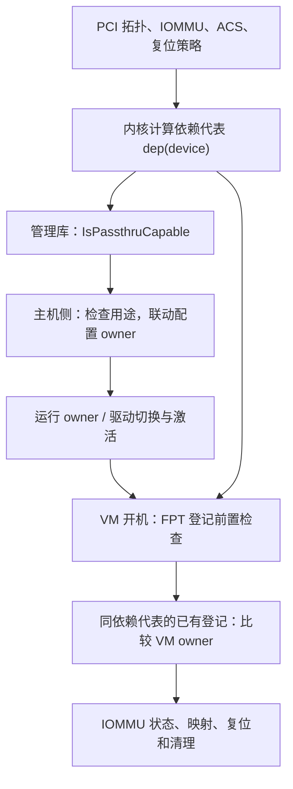

# ESXi PCI 直通资格、依赖与开机检查：汇编核对

研究日期：2026-11-14。主体版本：**ESXi 8.0 U3b / build 24280767**。

**可直通资格、主机模式切换、某台 VM 的实际占用，是分开的检查。** 此次从同 build 的 `libvmkctl.so`、vmkernel 和 PCIPassthru 模块定位了相关谓词、依赖代表的计算、配置联动和开机时的所有者比较。这里的“互相依赖”主要表现为两个设备算出同一依赖代表，而不是已经证明存在一张逐对保存 A↔B 的关系表。

本报告是对合法本地副本的只读分析。函数名来自符号表，外部调用通过重定位或 PLT/GOT 核对，条件通过实际比较和跳转核对；说明性伪代码不是 VMware 源码。旧有运行矩阵用于交叉验证，本轮没有重启主机、改设备配置或进行新的 I/O / 故障注入实验。

## 1. 先分清三种“能用”

| 问题 | 主要证据入口 | 不能替代的后续条件 |
| --- | --- | --- |
| 这个设备是否具备直通资格？ | `PciDeviceImpl::IsPassthruCapable()` | 不代表可以切走正在使用的启动盘、网卡，也不代表某台 VM 能启动 |
| 主机是否配置并激活了直通模式？ | configured owner、runtime owner、依赖联动 | 不代表没有其他 VM 占用 |
| 当前 VM 能否登记、映射并使用它？ | FPT 前置检查、登记表、owner world、IOMMU 域状态、复位等 | 不代表通过了真实设备 I/O 和故障恢复验收 |

API 本身区分 `passthruCapable`、`passthruEnabled`、`passthruActive`；`dependentDevice` 的定义涉及需要从 VMkernel 解除占用的设备，也可能是桥。[官方 API](https://developer.broadcom.com/xapis/vsphere-web-services-api/latest/vim.host.PciPassthruInfo.html)

下面是分层关系，不是声称已经还原 hostd、vCenter、UI 的完整调用栈：



## 2. `passthruCapable` 的核心谓词

`libvmkctl.so` 的 `PciDeviceImpl::IsPassthruCapable()` 位于 `0x4c2438`，长度 174 字节。普通返回路径可以概括为：

```text
如果 disablePciPassthrough：false
如果 inIommuScope 为 false：false
如果 meetsPassthruAcsReq 为 false：false
读取 passthruDependent
如果依赖结果是无效 SBDF 哨兵：false
否则：true
```

这里并没有直接遍历 VM 的设备清单，也没有在这个函数内比较其他 VM 的所有者。

| 条件 | 汇编如何确认 | 进一步含义 |
| --- | --- | --- |
| 全局功能禁用 | 对象 `+0x77` 的检查；`SetFromSBDF()` 从 `disablePciPassthrough` 运行值写入同一字段 | 是软件开关，不是 PCI capability bit |
| 设备处于 IOMMU 覆盖范围 | GOT 引用明确指向 VSI `inIommuScope` | 内核提供者先检查 `IOMMU_IsIommuEnabled()`，再检查 `IOMMU_IsDeviceSupported()` |
| ACS 策略通过 | VSI `meetsPassthruAcsReq` | 内核调用 `PCIE_EnforceACS()`，还包含缓存与策略例外 |
| 有效依赖结果 | VSI `passthruDependent`，再调用四字段全为 `0xffffffff` 的判定辅助函数并取反 | 依赖代表可以是自己或上游桥；没有有效结果会使资格失败 |

VSI 提供者 `Hardware_PCIPassthruDependentGet()` 会把内核依赖查找失败转成全一的 SBDF 哨兵。因此上层最后一个条件不是“必须依赖另一台设备”，而是“内核能否给出有效的直通依赖边界”。

**需要修正旧外部模型的表达边界：** [7 月的外部可观察模型](../../vmware-esxi8-passthru-capable-observed-model.md)是实验归纳，不是内部谓词。启动盘保护、系统保留用途等确实影响能否启用直通，但本次定位显示它们出现在后续 owner 验证/切换函数中，不能全部硬塞进 `IsPassthruCapable()` 的四项条件。

## 3. 依赖代表是怎样算出来的

核心函数是 `VMKPCIPassthru_GetDeviceDependencies()`，位于 vmkernel `0x4200001a0e38`。它输出一个 packed SBDF，不是完整设备列表。

其关键输入有三类：

1. **Requester-ID 相关边界。** 调用 `IOMMU_GetReqIdDependencies()`；后者查找 `PCI_GetTopmostAliasingBridge()`。沿父链遇到具有别名作用的桥时记住它，继续向上查找；没有这类桥时使用设备本身。
2. **显式多功能依赖。** 读取内部多功能依赖标志。标志为真时使用父设备作为一个候选边界；没有父设备则返回错误。
3. **复位相关边界。** 在通常的复位检查分支调用 `PCI_HasFuncIndependentReset()`。不能独立复位，并且当前 Function 有多功能标志或不是 PCIe endpoint 时，纳入父设备边界。

函数最后通过候选 SBDF 的 bus 字段比较选出代表。它操作的是相关拓扑链上的候选，不是通用的任意图最小公共祖先算法，也不是 Linux `iommu_group` API。

该函数另有一个 `configOption` 全局值等于 1 时跳过部分复位判断的分支。本轮没有可靠还原该项的选项名，不把它写成可推荐的配置开关。入口还会排除带内部结构标志 `0x2` 的对象；真实 Type-1 桥不可作为 payload 的历史负例与此路径相符，不能据此将 class code `0604` 一概判为不支持。

必须区分三个数字：

| 对象 | 传统桥实验里的值 | 用途 |
| --- | --- | --- |
| A / B 的配置地址 | `02:01.0` / `02:01.1` | 找具体 Function |
| 内核/API 的依赖代表 | `01:00.0` | 找共同处理范围及占用冲突 |
| QEMU 模型送给 IOMMU 的 DMA 代理身份 | `02:00.0` | 本场景的实际 DMA 翻译身份 |

因此，`dependentDevice` 不能直接当作设备发出的 DMA RID。

### 为什么表现为双向依赖

```text
dep(A) = X
dep(B) = X

登记 A：查找 dep(其他设备) == X 的已有登记
登记 B：也查找 dep(其他设备) == X 的已有登记
```

两边都会遇到对方，因而形成对称的占用限制。并不需要先保存一条 A→B，再保存一条 B→A。这里只描述已核对的普通路径，不宣称 ESXi 所有依赖类型都采用同一表示。

## 4. `passthru.map` 插入在哪一层

这次在管理库定位到了真实的文件解析器和回写路径：

```text
LoadPassthruMap()
  → 按 VID:DID / 通配规则保存 resetMethod 与 fptShareable
  → RestoreResetAttr() / RestoreFptShareableAttr()
  → 对应 VSI setter
  → 内核复位选择 / 多功能依赖字段
  → 影响依赖代表的计算
```

解析器将 `flr / d3d0 / link / bridge` 分别映射为方法值 `1 / 2 / 3 / 4`。这些数值是这个 build 的内部枚举，不能与其他层的 owner 数值混用。

`Hardware_PCIPassthruShareableSet()` 把 shareable 输入取反，再传给 `PCI_SetMultiFuncDependency()`。后者会检查**当前 Function** 的多功能 Header 标志，并检查 PCIe endpoint 类型，才写入依赖标志。此前为 Function 1 补充 `multifunction=on` 后行为变化，因而有了具体代码上的解释；这不是“某个位自动修复了 IOMMU”。

又找到一个能够解释早期复位实验的条件：**`PCI_HasD3D0Reset()` 的入口要求已配置方法值为 2，然后才查 PM capability。** 仅有 PM capability，并不意味着默认策略会自动选 D3D0。这与早期“有 PM / 有 D3hot 模型但默认仍报告 Reset=None”的现象相容。这里是静态解释，尚未新增指定 `d3d0` 后的实际开机或 I/O 试验；文件声明也不能创造设备本来没有的复位能力。

`PCI_HasFuncIndependentReset()` 的位运算把方法 `1、2、5、6` 归入独立复位分支；link / bridge 方法不在其中。即使存在独立复位，显式功能依赖和 DMA 身份依赖仍可要求共同管理。

对原传统桥故障，已有实验明确验证过 `8086 10d3 default false` 持久化、重启及底层值生效，双设备仍在相同域检查处失败。[生效回执](../vmware-legacy-bridge-cause-20261112/raw/control-map-effective.json)、[失败矩阵](../vmware-legacy-bridge-cause-20261112/raw/nonshareable-results.json)

这两项事实没有矛盾：map 能影响复位选择和功能依赖声明，但不能改写桥的物理 DMA 身份，也没有修复该新登记分支的生命周期冲突。

## 5. 主机启用、禁用时怎样联动

管理库里可以看到三个不同工作：

- `ValidateOwnerToPassthru()` 检查全局禁用、启动设备、capable、ESXio 系统保留状态和有效依赖。
- `SwitchOwnerToPassthru()` 还存在网络使用检查；错误路径明确关联设备仍被 vSwitch/uplink 使用。
- `SetConfiguredDeviceOwner()` 根据依赖代表找到相关设备，逐项调用 `SetConfiguredDevOwnerNoDeps()` 写入配置。后者写的是 ConfigStore 的 owner 值，不能把这一刻直接描述为硬件已完成重绑定。

`GetDependentChildDevices()` 会枚举设备并查询其依赖代表，反向找出代表指向当前对象的成员；因此输入 A 可以展开成 A、B 的共同配置范围。`SwitchOwnerToVmkernel()` 也进入相同的配置 owner 函数，解释了此前只禁用一项时两项共同变化的结果。[主机切换实测](../vmware-pci-multifunction-fix-20261111/README.md#主机模式联动)

本次通过 C++ vtable 重定位确认了这些间接调用的目标，而不是只凭字符串或虚调用偏移猜测。

**关于部分成功：** 该配置函数是逐成员写入，并保存一个已处理集合；异常路径中存在逐成员补偿写入。补偿目标由请求 owner 选择相反值，不能假设它是对任意混合初始状态的逐项快照恢复。仅凭这段代码不能证明对外原子性、无短暂中间态、补偿绝不失败，也不能代替中途故障注入实验。

禁用验证 `ValidateOwnerToVmkernel()` 会检查目标是否正被 VM 以直通方式使用。整个 UI/API 调用是否在某个按钮前执行哪一个验证入口，仍以具体路径的运行记录为准；未把管理库中存在函数等同于所有前端均调用它。

## 6. VM 开机时怎样重新检查

### 6.1 内存与 IOMMU 条件

`PCIPassthruRegisterDevice()` 先检查 VM 内存相关标志；失败日志对应 `pinnedMainMem` 和 `preallocGuestMem`。普通物理 PCI 请求继续进入 `PCIPassthruRegisterDeviceInt()`，后者再次检查 IOMMU 启用、设备存在及设备被 IOMMU 支持。

这里的内存标志条件不应简单改写成某个 UI 字段的唯一等价式；具体 VM 配置如何产生这些标志属于另一层。

### 6.2 FPT 前置检查：设备是否已交出宿主使用

模式分发表中的普通 FPT 前置回调是 `PCIPassthruFPTAllowPassthru()`：

```text
找到设备与依赖代表
若代表是自身：检查自身 runtime host owner
若代表是桥：枚举桥下设备，检查所考虑端点的 runtime host owner
核对请求中的宿主身份和非零 VID / DID
```

该路径要求所检查端点的内核 runtime owner 枚举为 1；失败日志表示设备未启用直通。管理库配置 owner 使用的是另一套枚举（1 为 VMkernel，2 为 passthrough），**不能把两层同一个数字当成相同含义**。

宿主身份比较存在特殊输入分支，VID / DID 为零也有相应例外；它们是内部调用约定，本报告不把它们作为用户配置绕过建议。

### 6.3 登记检查：同依赖组是否已有另一个 VM

`PCIPassthruRegisterDeviceInt()` 在配置锁保护的路径中按 SBDF 查询登记表，然后计算目标依赖代表。目标依赖不是自身时，枚举其他 PCI 设备：

```text
对每个其他设备 other：
    若 dep(other) != dep(target)：跳过
    查询 other 的登记对象
    若没有活动登记 / 命中相应例外标志：跳过
    若登记对象的 owner world == 当前 VMM owner world：继续
    否则：返回冲突
```

匹配 owner 的跳转位于模块 `0x4e80`；不同 owner 路径选择状态 `0x0bad0004`。这里比较的是 VMM world 所有者，不是 vCenter 的 VM 名字或 managed-object ID。

**这解释了“两个地址分别保存到两台 VM 后，后开机者失败”。** 保存引用与运行时资源占用是不同层次；本轮没有反汇编 hostd 的完整 VM 配置保存路径，不能据此编造保存阶段统一拦截规则。

同时，以上几段检查的是相关端点的宿主 owner、活动 VM owner 和依赖代表，不等同于“VM 的设备配置列表必须出现依赖组每一个 BDF”。前序单设备 A、单设备 B 能开机的控制实验也说明，两者必须区分。[原控制矩阵](../vmware-legacy-bridge-cause-20261112/raw/native-mf-results.json)

### 6.4 同一 VM 通过 owner 检查后，仍可能失败

后续仍有登记状态、guest vIOMMU、RMRR 与 VM 内存关系、IOMMU 域、设备初始化及复位等分支。已有域查询的位置是 `0x53da`，比较条件是 `0x0bad0003`；普通新登记分支只接受无客体域状态。

因此，本次传统桥用例的失败顺序是：

1. A、B 已处于可用的宿主直通模式。
2. A 先登记成功，后续激活使共享身份相关设备一起进入该 VM 的域。
3. B 的依赖 owner 检查并不排斥同一 VM。
4. 但 B 作为新 SBDF 登记时，已有域条件仍被拒绝。
5. 开机失败并清理，整组映射回到基线。

**依赖检查通过，不等于每个成员的初始化前提都成立。** 这个区分是传统桥故障的核心。[机制与静态核对](../vmware-legacy-bridge-cause-20261112/ROOT-CAUSE-STATUS.md)

后续 `PCIPassthruEnablePCIDevice()`、`PCIPassthruSetAddressDomain()` 会进入 IOMMU 切域路径；复位和释放函数还会处理设备状态、引用、映射及相应复位。本文确认这些调用点及主要相关条件，没有把全部异常恢复状态机都还原成完整规范。

## 7. ACS 判定本身也受软件策略影响

`PCIE_EnforceACS()` 沿上游拓扑检查相关 PCIe 类型，读取 ACS capability/control，使用设备 quirk 提供的控制寄存器偏移，并检查不同类型所需的控制位。它还包含结果缓存，以及 `disableACSCheck`、`disableACSCheckForRP` 分支。

因此，`meetsPassthruAcsReq=true` 只能说明该 build 当前软件策略接受此路径；不能不加条件地翻译成“硬件具备完整 ACS”。旧有严格检查/例外策略 A/B 也观察到 capable 随之变化。[旧观察模型](../../vmware-esxi8-passthru-capable-observed-model.md)

对我们平台尤其重要：既定部署长期启用 Linux ACS override。`kernelIommuGroup` 只能作为 VFIO 操作单位，分配范围仍须结合不受 override 缩小的 physical isolation domain、Requester-ID alias、复位与功能依赖。此次没有推翻已有双边界设计，也不把 VMware 的 ACS 例外与 Linux override 当成完全相同的实现。[现有设计](../../qemu-static-dynamic-directpath-design.md#52-acs-override-的强制约束)

## 8. 验证与范围

公开包包含三份 ELF 的精确 SHA-256、35 个函数的范围/摘要、选定的调用、GOT/vtable 重定位和关键条件字节，以及只读复核工具；不包含 VMware 二进制、完整反汇编、安装介质或凭据。

- [静态事实清单](static-facts.json)
- [管理库提取来源](source-provenance.json)
- [核对回执](verification.json)
- [只读复核程序](verify_static.py)
- [逐文件 SHA-256 清单](manifest.json)

持有对应合法副本的人可运行，无需加载 VMware 代码或启动虚拟机：

```console
python verify_static.py --kernel <decompressed-k.b00> --pcip <PCIPassthru-ELF> --vmkctl <libvmkctl.so>
```

复核的是具体二进制事实；代码解释依赖对控制流的审阅。它不是新的物理 I/O 验收，不证明配置操作原子性，也不证明厂商已经确认本次兼容性缺陷。

8.0 U3k 与 9.1.0.0100 的前序复核只覆盖了选定的已有域拒绝分支及对应运行复现，**没有把本报告整套管理库/依赖逻辑跨版本逐一验证**。最新版未取得的介质也没有补造结论。[新版证据范围](../vmware-passthrough-version-review-20261113/README.md)

下一步若要扩大结论，应优先补 hostd 到上述管理库的实际调用关系、逐成员切换中断的补偿结果、完整复位/释放状态机，以及真实硬件上的隔离和 I/O。不要把增加更多截图当作这些内部机制缺口已被填补。
