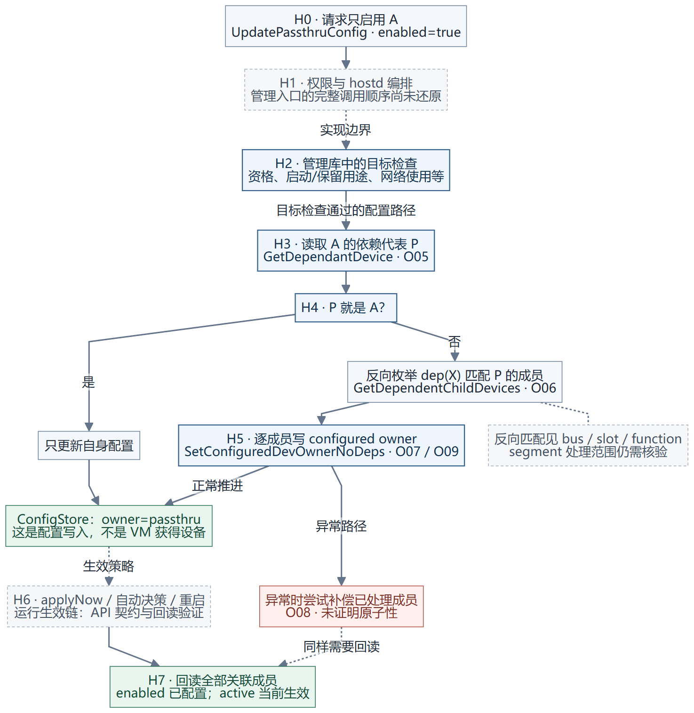

# 主机 API 启用直通：从一个设备请求到依赖成员的配置

**API 启用直通的作用，是让设备及必要的依赖成员进入主机的直通配置/运行状态；它不把设备分配给某台 VM，也不替代 VM 开机时的 owner 和地址域检查。**

下面分别标出公开 API 契约、管理库指令事实和已有实验结果。管理库分析固定为 ESXi `24280767`；hostd 把 API 请求分派到各管理入口的完整调用图尚未还原，因此图中的虚线不能理解成已逐指令验证的调用边。



<a id="contract"></a>
## 1. API 收到什么请求

入口是 `HostPciPassthruSystem.UpdatePassthruConfig(config[])`，要求 `Host.Config.PciPassthru` 权限。下面是既有实验所使用的请求含义示例：

```json
{
  "config": [
    {
      "id": "0000:01:00.0",
      "passthruEnabled": true,
      "applyNow": true
    }
  ]
}
```

它只请求 A；请求体没有 VM 标识。`config[]` 是配置项数组，也不表示列表外的依赖设备不会受影响。官方接口描述明确提到依赖设备的启用状态更新。[UpdatePassthruConfig](https://developer.broadcom.com/xapis/vsphere-web-services-api/latest/vim.host.PciPassthruSystem.html#updatePassthruConfig)

接口正常返回没有逐设备结果对象。不能把“调用没报错”当成“依赖成员已全部即时生效”的完整证明，必须重新读取成员状态。

<a id="validation"></a>
## 2. 改 owner 前有哪些检查

管理库里可见两个入口。这里分别列出，避免把它们拼成一个未经证明的固定 hostd 调用顺序。

| 入口 | 代码中直接可见的检查 | 证据 |
| --- | --- | --- |
| `ValidateOwnerToPassthru` | 功能未全局禁用；不是启动设备；`IsPassthruCapable` 为真；不是 ESXio 保留设备；能取得有效依赖代表对象 | [O01–O04](../vmware-pci-assembly-dossier-20261114/03-owner-transitions.md)、[E01/E02](supplement/README.md) |
| `SwitchOwnerToPassthru` | 再检查 capable；configured owner 尚不是 passthru；不是启动设备；检查目标设备名是否已被虚拟交换机/uplink 使用；通过后调用 `SetConfiguredDeviceOwner(2)` | [E03–E06](supplement/README.md) |

第一行最后的“依赖检查”是：`GetDependantDevice` 返回的对象不能是空指针。它不是在这里递归调用所有成员的完整资格验证，也不是检查成员属于哪台 VM。第二行网络检查能看到网络信息收集、设备名查找及拒绝日志；本次没有还原其中每个网络对象虚表槽的名称，不能扩大成已证明覆盖所有网络消费者。

还有一个产品语义细节：`SwitchOwnerToPassthru` 对“已经配置为直通”有抛异常分支。但 API 上层可能先过滤或做其他处理，**不能由这个内部函数单独断言重复 API 请求必然失败或必然幂等**。

<a id="expand"></a>
## 3. 怎样从 A 找到需要联动的成员

`SetConfiguredDeviceOwner(requestedOwner)` 的核心是先查代表，再反向找成员：

1. 通过 `GetDependantDevice(A)` 读取 `passthruDependent`，把四字段结果转换成管理设备对象 P。
2. 比较 P 与 A 的设备地址字符串。如果 P 就是 A，走自身配置更新。
3. 如果 P 不是 A，对 P 调用 `GetDependentChildDevices`：枚举 PCI 设备 X，求 `dep(X)`，匹配 P 的地址字段，将匹配项加入成员容器。
4. 遍历这个容器：当前 configured owner 已等于请求值的成员跳过写入；其余成员调用 `SetConfiguredDevOwnerNoDeps(requestedOwner)`。

在已测 segment 0 的例子里，可以读成：

```text
只请求 A → dep(A) = P
           dep(A) = P ┐
           dep(B) = P ┴→ 反向找到 A、B → 逐项写 owner=passthru
```

这不是“按相邻 BDF 自动猜另一个网口”，也不是不断查 `A → B → A` 的递归。关联来自内核依赖代表；其计算包含 Requester alias、功能与复位候选，见[依赖代表设计](README.md#dependency)。

**字段边界：**O06 的反向匹配直接比较 bus、slot、function，没有看到 segment 比较。上面的 P 相等是帮助理解 segment 0 实验的简称；不能把代码写成完整 SBDF 四字段等值，更不能在没有枚举范围证据时就宣称跨 segment 缺陷。[O05–O07 与虚表证据](../vmware-pci-assembly-dossier-20261114/03-owner-transitions.md)

**检查覆盖边界：**逐成员写入调用的是 `NoDeps`。不能仅凭目标 A 已通过启动盘/网络检查，就宣称所有反向展开的成员都逐项经过同样检查。hostd 是否先对它们逐项验证，仍是未闭合的调用关系；本图不冒充这个缺口已经解决。

<a id="configuration"></a>
## 4. 写入的具体是什么

`SetConfiguredDevOwnerNoDeps` 将目标 owner 组织为 `OWNER_PASSTHRU` 或 `OWNER_VMKERNEL`，再经 `SetValueToCS` 写入 ConfigStore 的 owner 配置。此管理库枚举 `2=passthru、1=VMkernel`。[O09 写入点](../vmware-pci-assembly-dossier-20261114/snippets/O09.asm) · [O11 枚举](../vmware-pci-assembly-dossier-20261114/snippets/O11.asm)

这是持久配置的证据，不能把这一条写操作等同于设备已经完成驱动解绑、复位、重新绑定或切换到某台 VM 的 IOMMU 域。后者是不同层次的操作；本次没有补造 runtime rebind 的完整函数链。

<a id="apply-now"></a>
## 5. 什么时候生效，怎样确认成功

`applyNow` 从 API 7.0 起用于表达是否要求无需重启 ESX 生效。未设置时，官方说明根据 `deviceRebindWithoutRebootSupported` 自动决定：能即时应用则应用，否则重启后生效。不能仅凭请求 `true` 推定硬件一定支持即时切换，也不能从文档补造所有失败/回退情形。[HostPciPassthruConfig](https://developer.broadcom.com/xapis/vsphere-web-services-api/latest/vim.host.PciPassthruConfig.html)

调用后，应刷新/重新读取整个影响范围：

| 回读信息 | 要回答的问题 |
| --- | --- |
| `passthruCapable` | 设备当前资格是否成立？ |
| `dependentDevice` | 当前依赖代表是什么，有没有变化？ |
| `passthruEnabled` | 用户期望的直通配置是否已经设置？ |
| `passthruActive` | 当前运行状态是否已经进入直通？ |

官方旧字段说明用“enabled + rebooted”描述 active；与后来新增的 `applyNow` 合看，应保留“已配置”与“当前生效”的差别，不能理解成任何 active=true 都必然经历了本次重启。既有实验就观察到了即时生效。[HostPciPassthruInfo](https://developer.broadcom.com/xapis/vsphere-web-services-api/latest/vim.host.PciPassthruInfo.html)

<a id="observed"></a>
## 6. 我们实际看到的是什么

已有 `2026-11-11` 的同一组回执记录：A=`01:00.0`、B=`01:00.1`，两者代表均为 root port `00:08.0`。

| 请求 | 请求前 A/B | API 结果 | 请求后 A/B |
| --- | --- | --- | --- |
| 只设置 A，enabled=true，applyNow=true | enabled/active 均为 false | success | 两者 enabled/active 均为 true |
| 只设置 A，enabled=false，applyNow=true | enabled/active 均为 true | success | 两者 enabled/active 均为 false |

所以“只请求 A，A/B 配置联动并即时生效”有该实验的前后状态支持，既不是只看 HTTP 成功，也不是仅靠函数名猜测。[原始 API 回执](../vmware-pci-multifunction-fix-20261111/raw/native-mf-owner-results.json)

禁用入口 `SwitchOwnerToVmkernel` 把目标值 `1` 交给同一个依赖展开写入器，因此也有联动；另有 `ValidateOwnerToVmkernel` 的 VM 使用拒绝路径。完整 API 对这些入口的编排仍按前述证据边界处理。[O16/O17](../vmware-pci-assembly-dossier-20261114/03-owner-transitions.md)

<a id="partial-failure"></a>
## 7. 一个成员成功、另一个成员失败时怎么办

逐成员写入中存在异常补偿：对已处理容器写回相反 owner 值。启用请求的补偿值是 VMkernel；但代码没有逐项保存并恢复任意原始状态，原本就等于目标值的成员也会进入处理容器。[O07 主循环](../vmware-pci-assembly-dossier-20261114/snippets/O07.asm) · [O08 补偿](../vmware-pci-assembly-dossier-20261114/snippets/O08.asm)

因此，代码存在逐步推进和补偿，不能宣称这是外界看不到中间态的原子事务。既有正常调用没有观察到部分成功；中途故障、补偿自身失败和并发读取行为尚未做故障注入验证。API 成功后要回读，API 报错后同样要回读完整成员状态。

<a id="boundary"></a>
## 8. 和 VM 开机检查的分工

```text
主机 API：目标是否能切换？关联成员有哪些？配置写入和运行生效到哪一步？
VM 开机：所需设备是否已交给直通？相关活动 owner 是否冲突？地址域是否允许本次登记？
```

主机 enabled/active 为 true，并不表示某台 VM 已经取得使用权。配置阶段找到的依赖代表，可以在开机阶段再次用于跨 VM 仲裁，但两阶段读取的 owner 类型和解决的问题不同。[返回开机检查链路](README.md#power-on)
