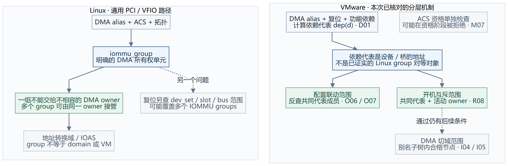

# VMware 的“分组”和 Linux IOMMU group 到底有什么区别

**最容易误解的一点：我们从 VMware 读到的 `dependentDevice`，并不是 Linux `iommu_group` 的另一个名字。** Linux group 主要表达 DMA 隔离与所有权的最小边界；本次还原的 VMware 依赖代表还会吸收复位、功能依赖，并在不同操作中展开成不同的设备范围。

这不表示 VMware 内部没有其他分组对象，而是现有 API、汇编和实验没有证明存在一个与 Linux group 一一对应、承担全部这些职责的统一对象。因此下面分别比较机制，不用“VMware group N”这个未经证实的名称。

范围：VMware 固定为 ESXi `24280767` 的已核对路径；Linux 固定为上游 `v6.6` 的通用 PCI 分组、VFIO 路径。其他 IOMMU 后端可能有额外规则；我们的 ACS override 补丁单独讨论。

需要看每个循环、提前返回和递归调用时，读 **[Linux 分组详细流程图及与 VMware 的逐项对照](05-linux-iommu-group-flow.md)**。本章先解释对象含义，下一章展开算法。

图中的虚线表示职责之间的关联，不表示它们是同一个对象或直接函数调用。

## 1. 先问三个不同问题

| 问题 | 例子 | 所需要的范围 |
| --- | --- | --- |
| 能不能把 DMA 访问隔开？ | A 能否冒用 B 的身份，或绕过 IOMMU 直接访问 B？ | DMA 隔离边界 |
| 操作 A 会不会影响 B？ | 复位 A 是否会把 B 一起复位？ | 复位/功能依赖范围 |
| 现在归谁使用？ | A 已被 VM1 使用，VM2 还能不能申请 B？ | 运行所有权与仲裁范围 |

**同一个 DMA group 内不能可靠分隔，不等于所有共同复位的设备必然属于同一个 DMA group。** 这是理解两个实现差别的起点。

## 2. Linux：先形成明确的 DMA 所有权单元

### 2.1 group 是一个真实内核对象，不是地址字符串

Linux 有 `struct iommu_group`、设备成员关系和 group ID；用户可以通过设备的 `iommu_group` sysfs 链接查看成员。这个数字不是 PCI BDF，不是硬件 Requester ID，也不是 IOMMU 页表/域的编号。

一个 group 表示：在内核当前拓扑与隔离判断下，成员不能作为互不信任的独立 DMA owner 分开交付。多个 group 则可以被同一 owner 使用，并在受支持的路径共享地址转换上下文。**group ≠ VM，也不等于 domain。** [Linux VFIO 文档](https://docs.kernel.org/6.6/driver-api/vfio.html)

### 2.2 通用 PCI 分组算法怎样形成它

这里有两种不同的隔离障碍：一是 A/B 的 DMA 使用同一个 Requester ID，IOMMU 难以按来源区分；二是身份虽不同，A 到 B 的同级访问却可能在桥/交换机内部完成，没有经过预期的 IOMMU 检查。分组需要同时考虑两者；“BDF 不同”只能说明配置地址不同。

`pci_device_group()` 的顺序可简化为：

1. **先找 DMA alias。** 不只看设备自己的 BDF，也枚举它实际可能使用的其他 Requester ID，以及上游桥造成的别名；命中已有组就沿用。
2. **沿上游查隔离路径。** 若上游路径不能通过所请求的 ACS 判断，继续向上扩大考察范围；遇到已建立的组可以并入。
3. **处理相互 alias 的设备。** 即便 BDF 不同，实际 DMA 身份关联也不能拆开。
4. **处理没有隔离的同槽多功能成员。** 如果 Function 之间没有满足要求的 ACS 隔离，把相关成员纳入同一组。
5. 没有找到需要共享的组，才分配新 group。

它不是简单地“同一 bus 一组”，也不是只看有没有 ACS capability。源代码中的 `REQ_ACS_FLAGS` 是 SV/RR/CR/UF，具体 ACS 判断还包含类型规则和 quirks。[Linux v6.6 分组代码](https://github.com/torvalds/linux/blob/v6.6/drivers/iommu/iommu.c#L1521-L1707)

对于 PCIe-to-PCI 桥，Linux 的 `pci_for_each_dma_alias()` 明确加入桥下总线的 `devfn=0` 代理身份。例如桥下 bus 为 `02`，就会考虑 `02:00.0`；它不要求真的枚举出一个这个地址的网卡 Function。这与我们 VMware 案例里看到的代理 RID 是同一类硬件约束。[Linux alias 枚举](https://github.com/torvalds/linux/blob/v6.6/drivers/pci/search.c#L28-L119)

### 2.3 “一组一个 owner”不等于所有成员都必须显示给客户机

传统 VFIO group 接口与 device cdev / IOMMUFD 接口都保留 group 的 DMA 所有权约束。某成员留在会使用 DMA 的普通宿主驱动中，会影响整组交出；无宿主驱动的桥等情况不能机械地要求绑定到 vfio-pci。

一个 owner 接管 group 后，可以只把所需设备呈现给客户机。其他成员不得同时被不相容的 DMA owner 使用，但“未向客户机呈现”与“分给另一 VM 使用”是两回事。也不能仅凭打开设备 fd 就认为已取得全部 DMA 使用权限。[VFIO group 与 cdev 说明](https://docs.kernel.org/6.6/driver-api/vfio.html)

### 2.4 共享复位是另一套检查

Linux v6.6 的 VFIO PCI 还有 `dev_set` 和 slot/bus hot reset 检查。`vfio_pci_dev_set_resettable()` 检查要复位的范围；执行 hot reset 时继续检查受影响设备是否处于调用者提供的 groups 或相应 IOMMUFD 所有权范围内。

这段代码本身就说明：**一个复位范围可以需要检查多个 IOMMU group。** “A、B 不在同一 group”不能证明复位 A 不影响 B，也不能证明可以任意独立启停两台 VM。[VFIO 复位范围及所有权检查](https://github.com/torvalds/linux/blob/v6.6/drivers/vfio/pci/vfio_pci_core.c#L2402-L2537)

## 3. VMware：已见的是依赖代表、操作范围和地址域三层

### 3.1 `dep(A)` 输出一个代表地址，原因可以不止 DMA

`VMKPCIPassthru_GetDeviceDependencies` 从三个来源选代表：

- Requester / DMA alias：最上层别名桥，或设备自身。
- 显式功能依赖：满足相应字段条件时，纳入父设备。
- 复位依赖：进入所示复位分支且不能独立复位，再结合 Function 多功能位 / endpoint 类型，可能纳入父设备。

最终是本函数的 bus 字段选择算法，不是输出一个 Linux group 对象。`dep(A)=P`、`dep(B)=P` 表明这段算法把它们归到同一代表；**仅凭代表相同，不能知道关联来自 DMA、复位还是功能依赖。** [D01–D06 依赖构造](../vmware-pci-assembly-dossier-20261114/02-dependency-construction.md)

### 3.2 不同阶段展开出的范围还不完全一样

| VMware 操作 | 怎样找相关设备 | 实际限制什么 |
| --- | --- | --- |
| 主机 API 写 owner 配置 | 查代表，再反向找以它为代表的设备；所见管理库匹配 bus/slot/function | 哪些设备配置一起进入/退出直通 |
| 开机 FPT 宿主 owner 预检查 | 代表为自身时查自身；否则检查代表桥下相关节点，结构桥有跳过分支 | 相关设备是否已经由宿主交给直通 |
| 开机活动 owner 扫描 | 比较 packed 依赖代表，再检查活动登记及例外标志 | 同代表的有效活动登记是否属于另一 VMM/world |
| IOMMU 切域 | 从设备扩大到最上层 aliasing bridge 的子树，再筛选符合条件的节点 | 哪些设备的软件域状态和 DMA 映射一起变化 |

依据分别为 [O05–O09](../vmware-pci-assembly-dossier-20261114/03-owner-transitions.md)、[R04/R05/R08](../vmware-pci-assembly-dossier-20261114/04-vm-admission.md)、[I04/I05/I09](../vmware-pci-assembly-dossier-20261114/05-domain-lifecycle.md)。管理库反向匹配的 segment 范围、特殊登记分支等边界仍按原证据保留。

因此不能把“主机勾选时联动的一组”“开机互斥的一组”“DMA 切域的一组”统称为一个已经证明成员完全相同的 VMware IOMMU group。

### 3.3 代表相同也不自动要求全部成员都在 VM 配置里

开机 R08 扫描会跳过无活动登记的成员，允许同 owner 继续；它阻止的是所检查的相关成员出现另一个活动 owner，并不是核对当前 VM 配置包含了全部成员。代表等于自身时还会跳过该段扫描。

随后已有域检查 I01 又是另一关。因此，同一 owner 通过，不代表整个 VM 必然启动成功。这正是之前传统桥实验的关键：A 激活时扩大切域范围，B 新登记时被已有域前提挡住。[同 VM 失败链路](README.md#same-vm)

## 4. 用三个场景比较，才不会把概念混在一起

下面 Linux 结果是基于固定源码和明确条件的推演；没有冒充在同一实验拓扑上新采集了 Linux sysfs 分组。VMware 实测与条件推演分别标明。

| 场景与前提 | Linux v6.6 通用路径 | VMware 已见路径 | 对使用者的意义 |
| --- | --- | --- | --- |
| **DMA 无法区分：**A/B 在 PCIe-to-PCI 桥下，存在共同代理 RID | alias 参与分组，A/B 不能据不同 BDF 就拆成独立 DMA owner | alias 桥进入依赖代表；实际切域还会扩大至相关子树。本实验同 VM 第二项新登记失败 | 双方都处理该硬件约束；本次 VMware 初始化失败不证明 Linux 的整组路径必然失败或必然成功 |
| **DMA 可分，复位不可分：**A/B 无 alias、各自及上游满足 ACS，只有共享复位；VMware 进入 D01 的相关复位分支 | 可以形成不同 DMA groups；hot reset 仍需覆盖和授权整个影响范围 | 复位候选可能让 A/B 共同依赖父设备；R08 可据此拒绝不同活动 VM owner | Linux 的 group 边界可能比 VMware 此处的依赖范围小，但不能据此宣称可任意独立启停 |
| **缺少 ACS 路径隔离：**无别名，但上游端口不满足所需 ACS | 通常扩大/合并隔离范围；能否由一个 owner 接管还要满足其他 VFIO 条件 | ACS 是单独的 capable 关口；未获策略例外时可直接不合格。不能假定一定改为“扩大组后放行” | 两边对不合格隔离条件的处理方式不同；启用 bypass 也不增加真实隔离 |

第二行最能解释差别：**Linux 两个 group 与 VMware 同一个依赖代表，可以同时是符合各自定义的结果。** 一个在表达 DMA 所有权边界，另一个还吸收了共同复位的约束。

## 5. 对我们的 ACS override 环境意味着什么

至少应保留下面四项，分别用于不同决策：

| 我们记录的对象 | 用途 |
| --- | --- |
| 当前 kernel IOMMU group | 按实际 Linux/VFIO 接口申请和释放资源 |
| 原始 DMA 隔离范围 | 判断哪些设备不能分给不同信任方；不能被 override 缩小 |
| 复位影响范围 | 判断启停、恢复、重置会影响哪些设备 |
| 功能依赖范围 | 满足硬件/驱动共同使用约束 |

ACS override 改的是软件有效 ACS 判断，因此可能改变第一项；它不改变物理同级访问通道，也不消除 DMA alias，更不会把共享复位变成独立复位。实际分配、启动、复位分别按这些约束求所需范围，避免把一个 group ID 当作全部证明。[本仓库补丁](../../kernel-patches/0001-PCI-expose-ACS-override-provenance.patch)

对竞争分析，建议用“DMA 隔离单元、配置联动范围、开机互斥范围、复位范围”四个维度写对照，避免一句“VMware 和 Linux 的 IOMMU group 不同”掩盖具体差异。

[ACS 拒绝、类型规则与 quirk 的具体细节](03-acs-rule-details.md) · [主机 API 链路](02-host-api-enable.md) · [返回主设计文档](README.md)
