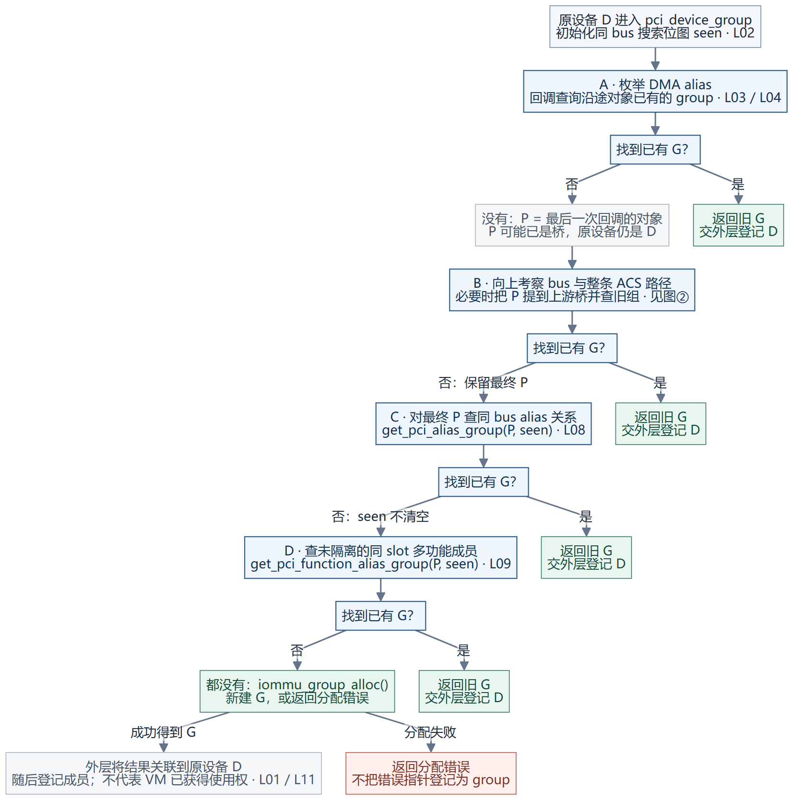
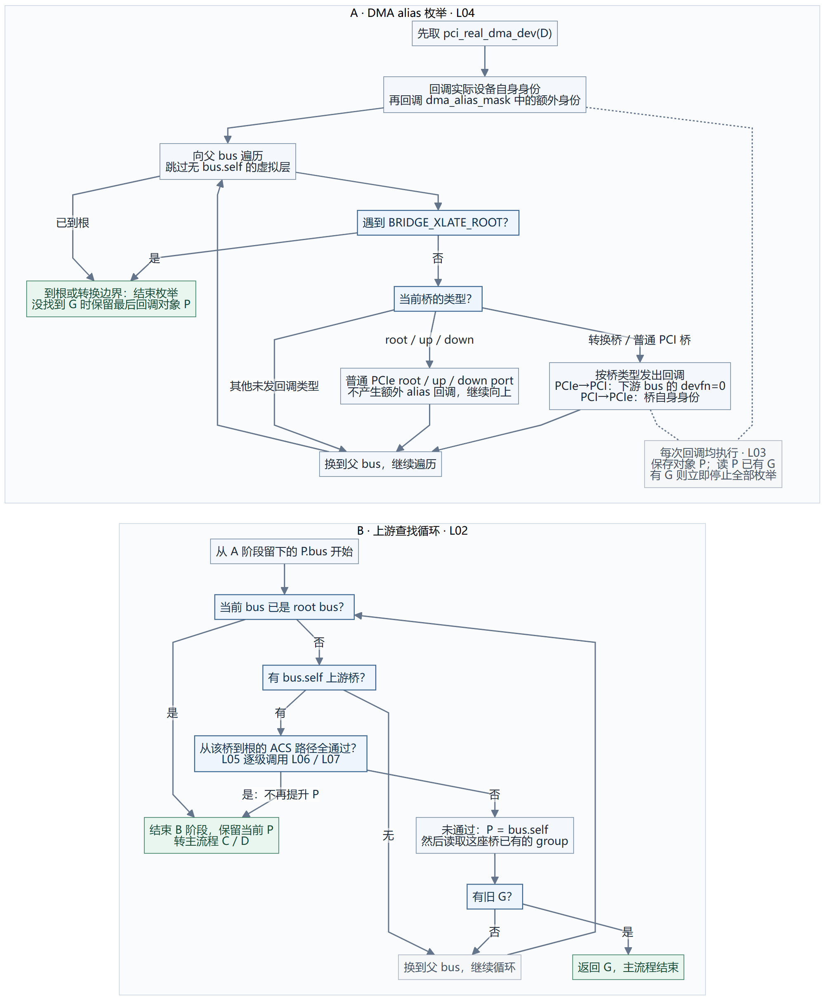
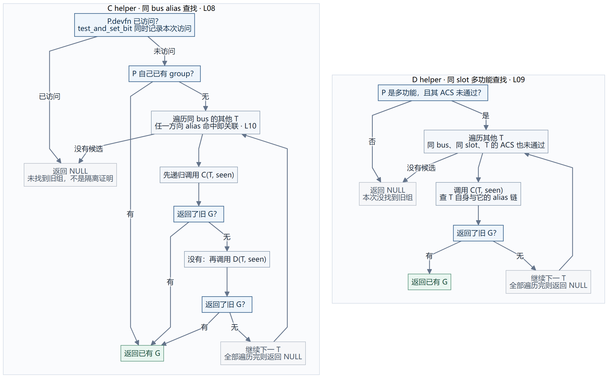
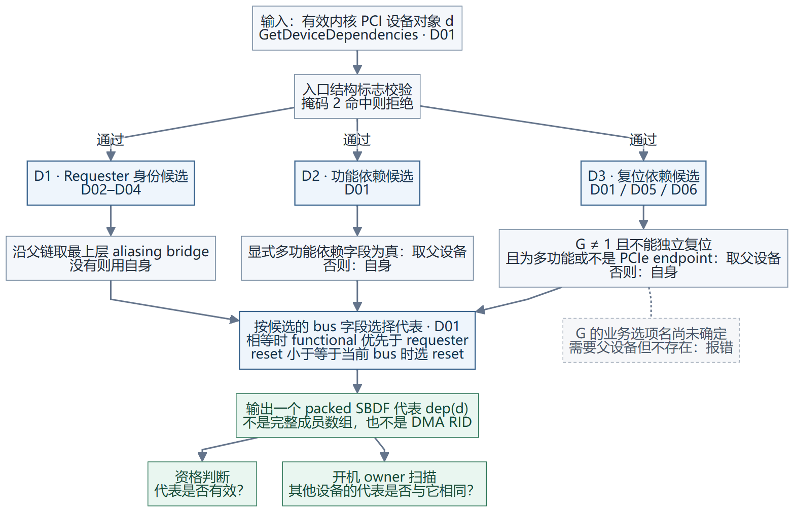

# Linux IOMMU group 分组流程：逐步展开，并与 VMware 对照

**Linux 这段算法做的是“为当前设备找到已有 group，或者新建一个 group”。它不是每次直接算出一个完整成员列表。** 关联设备随后通过相同查找规则复用 group，成员登记由外层完成。理解这一点，再看循环与提前返回就容易了。

固定版本：Linux 上游 `v6.6`；VMware 对照为 ESXi `24280767` 的 D01–D06 汇编。Linux 图是源码控制流重建，例子是有明确前提的演算，没有新增同拓扑实机分组测试。完整职责区别见[上一章](04-linux-groups-vs-vmware-dependencies.md)。

| 阅读顺序 | 看什么 | 图文件 |
| --- | --- | --- |
| ① 主流程 | 什么情况下返回旧组，什么时候新建 | [SVG](diagrams/06-linux-group-main.svg) · [PNG](diagrams/06-linux-group-main.png) · [Mermaid](diagrams/06-linux-group-main.mmd) |
| ② 纵向查找 | DMA alias 枚举、上游 ACS 路径及游标移动 | [SVG](diagrams/07-linux-alias-and-upstream.svg) · [PNG](diagrams/07-linux-alias-and-upstream.png) · [Mermaid](diagrams/07-linux-alias-and-upstream.mmd) |
| ③ 横向查找 | 同 bus alias 递归、同 slot 多功能成员、去重位图 | [SVG](diagrams/08-linux-peer-recursion.svg) · [PNG](diagrams/08-linux-peer-recursion.png) · [Mermaid](diagrams/08-linux-peer-recursion.mmd) |
| ④ VMware 对照 | 三类候选怎样选成一个代表地址 | [SVG](diagrams/03-dependency.svg) · [PNG](diagrams/03-dependency.png) · [Mermaid](diagrams/03-dependency.mmd) |

<a id="entry"></a>
## 1. 分组何时发生，输入和输出分别是什么

分组位于 IOMMU 的设备探测路径，并不是到 VM 开机才第一次决定。这里的调用关系为：

```text
__iommu_probe_device(原设备 D)
  → iommu_init_device(D, ops)
    → 后端 probe_device / 关联 IOMMU
    → ops->device_group(D)
      → 本版 Intel / AMD 的 PCI 分支：pci_device_group(D)
    → D->iommu_group = 返回的 group
  → 建立设备与 group 的 sysfs/成员记录
  → 后续默认域设置等步骤
```

Intel 的 `intel_iommu_device_group()` 与 AMD 的 `amd_iommu_device_group()`，对 PCI 设备都转到这里的 `pci_device_group()`；非 PCI 分支不同。不要与附近的 `generic_device_group()` 混淆，后者直接分配新组。[Intel](https://github.com/torvalds/linux/blob/v6.6/drivers/iommu/intel/iommu.c#L4491-L4496) · [AMD](https://github.com/torvalds/linux/blob/v6.6/drivers/iommu/amd/iommu.c#L1959-L1965) · [公共探测](https://github.com/torvalds/linux/blob/v6.6/drivers/iommu/iommu.c#L482-L532)

外层若已经看到 `D->iommu_group`，会跳过重复探测。因此这张图不表示每次 VM 开机都重新生成 group。

| 图中的符号 | 含义 |
| --- | --- |
| **D** | 原始目标设备，外层最终给它登记 group |
| **P** | 算法的查找游标，起初与 D 有关，但可以移动到桥；不要始终把它理解为 D |
| **G** | 已经存在的 `iommu_group` 对象，不是某台 VM，也不是硬件域编号 |
| **T** | 横向扫描中的另一 PCI 设备 |
| **seen** | 本次搜索的 256 位 devfn 访问位图；两个递归 helper 共用 |

`pci_device_group()` 返回旧 G、新分配的 G，或错误指针。外层把返回值关联给原始 D；不是把 D 改成 P。group ID 来自 `ida_alloc()`，不由 BDF 直接编码。外层探测锁用于串行化相应探测操作；不把它扩大为整个 VM 启停过程的原子保证。[入口与关联](https://github.com/torvalds/linux/blob/v6.6/drivers/iommu/iommu.c#L388-L425) · [ID 分配](https://github.com/torvalds/linux/blob/v6.6/drivers/iommu/iommu.c#L929-L949)

<a id="main-flow"></a>
## 2. 主流程：四处可以返回旧组，最后才新建



图中的 A/B/C/D 对应四个阶段；每次找到旧组都会立即返回，不再执行后面的阶段。图中“新建”可能因分配失败返回错误指针；非 PCI 输入在函数入口被拒绝。

| 阶段 | 实际动作 | 提前结束条件 | 没找到时保留什么 |
| --- | --- | --- | --- |
| A 纵向 alias | `pci_for_each_dma_alias(D, get_pci_alias_or_group, &data)` | 某次回调对应的 PCI 对象已有 group | `P = data.pdev`，即最后一次回调看到的对象 |
| B 上游隔离路径 | 从 `P->bus` 向上，检查上游桥到根的 ACS 路径；未通过则把 P 提到该桥并查旧组 | 提升后的 P 已有 group | 通过隔离路径或到根后，保留当前 P |
| C 同 bus alias 图 | `get_pci_alias_group(P, seen)` | 在相互 alias 的关系中找到旧组 | seen 不清空 |
| D 未隔离的同槽功能 | `get_pci_function_alias_group(P, seen)` | 相关 Function 或其 alias 链中找到旧组 | 仍没有，则 `iommu_group_alloc()` |

这里没有 VM 名称、VM 内存、FLR 或 bridge-reset 方法检查。那些是其他阶段的问题。主流程的源代码为 [L02：`pci_device_group`](https://github.com/torvalds/linux/blob/v6.6/drivers/iommu/iommu.c#L1643-L1704)。

<a id="vertical"></a>
## 3. A/B 展开：先处理身份别名，再处理上游隔离



先看上半部 A，再看下半部 B；它们对应主流程中不同的两个阶段。

### A. DMA alias 枚举不是简单地用数字 RID 查一张 group 表

`pci_for_each_dma_alias()` 按以下顺序发出回调：

1. 先用 `pci_real_dma_dev()` 得到实际 DMA 设备，并回调其自身身份。
2. 若存在 `dma_alias_mask`，逐项回调额外的 devfn 身份。
3. 向上遍历父 bus：没有 `bus->self` 的虚拟层跳过；遇到 `PCI_DEV_FLAGS_BRIDGE_XLATE_ROOT` 则停止向上枚举。
4. 根据桥类型决定是否发出代理身份回调。

| 上游节点 | 这次枚举怎样处理 |
| --- | --- |
| PCIe root / upstream / downstream port | 在此枚举中继续向上，不额外发出该端口的 alias 回调 |
| PCIe → PCI/PCI-X bridge | 回调桥对象，携带桥下总线、devfn=0 的代理身份 |
| PCI/PCI-X → PCIe bridge | 回调桥对象，携带桥本身的身份 |
| 非 PCIe 桥 | 根据 bridge-alias 标志，使用桥下 devfn=0 或桥自身身份 |

例如 PCIe-to-PCI 桥下 bus=02，代理身份可为 `02:00.0`；不要求真实枚举出一个此地址的 Function。以上按源代码明确覆盖的桥分支说明，不为未列出的类型补造回调。[L04：枚举器](https://github.com/torvalds/linux/blob/v6.6/drivers/pci/search.c#L28-L114)

**本用途的回调 `get_pci_alias_or_group()` 只做两件事：保存当前 PCI 对象到 `data.pdev`，读取该对象现有的 group；找到就令枚举停止。它没有使用参数中的数值 `alias` 去查一张 RID→group 表。** 因而后续 P 可能变成桥对象。[L03：6 行回调](https://github.com/torvalds/linux/blob/v6.6/drivers/iommu/iommu.c#L1619-L1627)

### B. ACS 判断是整条路径，不只是一个端口

主循环从 `P->bus` 开始：

```text
对于当前 bus：
    已到 root bus → 结束这一阶段
    没有 bus.self → 换父 bus
    从 bus.self 到根的 ACS 路径全部通过 → break，P 不再提升
    否则 P = bus.self
         P 已有 group → 返回它
         没有 → 换父 bus 继续
```

顺序非常重要：**先判断路径，再决定是否把 P 提到桥。** 不能把它反写成“先把 P 设为这座桥，无论 ACS 是否隔离”。[L02，1671–1683 行](https://github.com/torvalds/linux/blob/v6.6/drivers/iommu/iommu.c#L1671-L1683)

`pci_acs_path_enabled(start, NULL, flags)` 从 start 开始逐级调用 `pci_acs_enabled()`；某一级失败就返回 false，走到根且都通过才返回 true。这里传入的要求是 SV、RR、CR、UF，即 `0x1d`。[L05：整条路径](https://github.com/torvalds/linux/blob/v6.6/drivers/pci/pci.c#L3666-L3684)

`pci_acs_enabled()` 仍不是“capability/control 必须无条件等于 0x1d”：

- 设备特例若给出有效结论，先采用它。
- 普通 PCI 与所列转换桥等类型返回 false；root/downstream port 检查 ACS 设置。
- 某些其他 PCIe 类型仅在多功能时检查；单功能可按类型规则通过。
- 寄存器 helper 先确认存在 ACS capability，再以 `flags &= (capability | EC)` 处理适用位，最后检查 control；这是 v6.6 的实际条件，不能只画成 `control & 0x1d == 0x1d`。

源码：[L06 类型与 quirk](https://github.com/torvalds/linux/blob/v6.6/drivers/pci/pci.c#L3593-L3655) · [L07 适用位与控制值](https://github.com/torvalds/linux/blob/v6.6/drivers/pci/pci.c#L3556-L3575)。

<a id="horizontal"></a>
## 4. C/D 展开：同 bus alias 递归与同 slot 多功能查找



左右两栏是两个互相调用的 helper。图中的“递归调用”节点保留调用含义，不把所有回边跨栏连在一起；**返回 NULL 只表示这次搜索没找到已有组，不是证明设备可独立使用。**

### C. `get_pci_alias_group(P, seen)`

1. 对 `P.devfn & 0xff` 做 `test_and_set_bit`；访问过就返回 NULL，避免循环。
2. 查 P 自己的 group；有则立即返回。
3. 枚举同一个 bus 对象上的其他设备 T。只处理 `pci_devs_are_dma_aliases(P,T)` 为真的成员。
4. 对 T 先递归查 alias helper；没找到旧组，再查多功能 helper；两者都没有，继续下一 T。
5. 都查完仍没有，返回 NULL。

别名谓词检查两个方向的 `dma_alias_mask`，以及一方是否是另一方的 `pci_real_dma_dev()`，这些条件之间是 OR：**任一方向命中即可，不要求两边同时记录对方。** 它不是比较“两个 BDF 看起来很像”，也没有在这里调用 ACS 判断。[L08 递归](https://github.com/torvalds/linux/blob/v6.6/drivers/iommu/iommu.c#L1574-L1608) · [L10 别名关系](https://github.com/torvalds/linux/blob/v6.6/drivers/pci/pci.c#L6557-L6565)

### D. `get_pci_function_alias_group(P, seen)`

1. 若 P 不是多功能，或者 P 的 ACS 判断通过，直接返回 NULL。
2. 枚举其他 T：必须同 bus、同 slot，且 T 的 ACS 判断也未通过。
3. 对满足条件的 T 调用 alias helper；找到 G 就返回，全部找不到则 NULL。

**因此不是“同 slot 的 Function 一律同组”。** 这里还看双方有效 ACS 判断，并继续查相关 alias 关系。[L09 多功能查找](https://github.com/torvalds/linux/blob/v6.6/drivers/iommu/iommu.c#L1540-L1563)

两个 helper 共用主流程初始化的 `u64 devfns[4]`，即 256 位空间，阶段 C→D 时不清空。该位图服务于同 bus 的 devfn 搜索；不能解释成整个 PCI 系统只用低 8 位 BDF 做全局去重。

<a id="walkthrough"></a>
## 5. 顺着图走一遍：两个尚未分组的多功能成员

这是源码演算。假设 A/B 同 bus、同 slot，设备描述均完整；双方都未通过 endpoint ACS 隔离，没有额外 DMA alias；上游桥到根路径通过 ACS。开始时 A/B 都没有 group。

| 时刻 | 顺着图发生什么 | 结果 |
| --- | --- | --- |
| 先探测 A | A 阶段没有找到旧组；B 阶段路径通过，P 保持 A；C/D 虽能搜索 B，但 B 也没有组 | 最后新建 G1，外层把原始 A 登记进去 |
| 再探测 B | 前两阶段仍无旧组；D 阶段找到同槽且未隔离的 A，再调用 C helper | C 读到 A 已有 G1，返回 G1；外层把 B 也登记到 G1 |

**第一次新建 G1，不代表系统已经判定 A 永久独立。** B 后来会复用它。这里的 G1 是示意名字，实际数字由分配器产生。

再看桥 alias 的短路例子：若桥 P 已有 G7，A 的 alias 枚举对 P 发出回调时就读到 G7，于是 A 阶段立即返回；后面 ACS 与横向 helper 都不再执行。B 也可同样复用 G7。这个例子明确假设桥已有组，不捏造桥探测失败等情况下的结果。

<a id="override"></a>
## 6. 我们默认开启的 ACS override 会改到哪些判断点

本仓库补丁让 `pci_acs_enabled()` 优先采用 native 结论，不满足时再判断 override 来源。因此可能改变：

| 图上的位置 | 可能发生的变化 |
| --- | --- |
| B 阶段的上游路径判断 | 路径变为软件“通过”，提前结束提升 P 的循环 |
| D helper 对 P 的入口判断 | P 被认为满足 ACS，直接返回 NULL |
| D helper 对其他 T 的筛选 | T 被认为满足 ACS，从这次搜索中跳过 |

但它没有改写 A 阶段的 DMA alias 枚举，也没有改写 C helper 的显式 alias 关系谓词。**所以 override 可能拆小由 ACS 判断导致的组，不能据此声称所有 DMA alias 都会消失。** 复位与功能依赖也不随之消失。[补丁](../../kernel-patches/0001-PCI-expose-ACS-override-provenance.patch)

上述是源码插入点分析，当前实际运行内核是否加载了该补丁，需要另采运行证据；我们不能用 override 后的 group 单独证明物理隔离。

<a id="vmware-comparison"></a>
## 7. 和 VMware 逐步对照



| 对照位置 | Linux v6.6 本流程 | VMware 已还原流程 |
| --- | --- | --- |
| 入口/结果 | 设备探测时为 D 找旧 G 或新建 G；外层关联成员 | `GetDeviceDependencies(d)` 输出一个 packed SBDF 代表，后续操作再展开成员 |
| Requester 关系 | 枚举自身、显式 alias、相关上游桥；回调查现有 group，可提前返回 | 沿父链找最上层 aliasing bridge，作为候选；没有则自身 |
| 上游 ACS | 参与是否继续提升 P，以及多功能成员筛选 | `PCIE_EnforceACS` 是 capable 的另一关；D01 并不沿用 Linux 这条 ACS→group 构造流程 |
| 横向搜索 | 有同 bus alias 的递归和同 slot 未隔离 Function 搜索，使用 seen 去重 | D01 没有对应的已有 group 递归查找；它计算候选代表。其他阶段有代表反向成员枚举 |
| 功能依赖 | 本 helper 的 multifunc/ACS 条件不能等同于任意硬件功能依赖声明 | 显式多功能依赖字段可直接把父设备纳入候选 |
| 复位依赖 | 本分组函数没有 FLR/bridge-reset 判断；VFIO 另查复位范围 | 在相关条件分支中直接进入代表候选计算 |
| 汇总方式 | 优先复用找到的 G；都没有再分配 G | 比较候选的 bus 字段选代表，相等时也有确定选择顺序 |
| 运行能否使用 | group 已形成，不等于 DMA owner 已取得、复位已获准或 VM 已启动 | 代表已算出，不等于配置已生效、活动 owner 无冲突或已有域检查通过 |

VMware D01 的复位分支仍保留未知名值 `G=configOption+0x1b8`：`G!=1`、不能独立复位，再结合多功能位 / endpoint 类型决定是否用父设备。不能为方便对照而删掉这个前提。[VMware 逐段证据](../vmware-pci-assembly-dossier-20261114/02-dependency-construction.md)

如果 A/B 的 DMA 能隔开但复位不能独立，Linux 可以有两个 DMA groups，复位时另查整个影响范围；VMware 在满足上述复位依赖条件时，可以直接形成同代表并在开机时限制不同活动 owner。反过来，共同代表也可能来自 DMA alias。**对比时应先问约束来自哪一层，再看成员范围，不先比较“组的大小”。**

<a id="source-index"></a>
## 8. 源码和图节点索引

所有 Linux 图节点都有 `Lxx` 来源标识；[linux-flow-evidence.json](linux-flow-evidence.json)记录源文件 blob SHA-1、文件 SHA-256、函数行号、片段哈希以及节点映射。`v6.6` 是明确版本，不能套用到未知补丁的运行内核。

| ID | 函数/范围 | 用途 |
| --- | --- | --- |
| L01 / L11 | `iommu_init_device` / 公共 probe 整合片段 | 后端入口、关联原设备和成员登记 |
| L02 | `pci_device_group` | 四阶段主流程 |
| L03 / L04 | `get_pci_alias_or_group` / `pci_for_each_dma_alias` | 回调及 alias 枚举顺序 |
| L05 / L06 / L07 | `pci_acs_path_enabled` / `pci_acs_enabled` / `pci_acs_flags_enabled` | 路径、类型特例、适用位与 control |
| L08 / L09 / L10 | 两个横向 helper / `pci_devs_are_dma_aliases` | 递归、Function 筛选和双向 alias 关系 |
| L12 / L13 / L14 | `generic_device_group` / Intel / AMD 包装 | 避免混淆每设备新组与 PCI 分组入口 |

[返回分组含义对照](04-linux-groups-vs-vmware-dependencies.md) · [返回设计文档入口](README.md)
