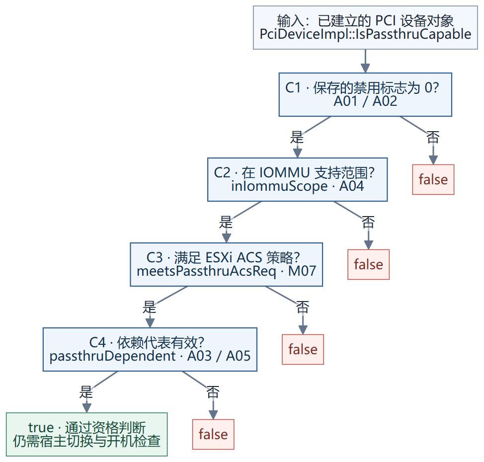
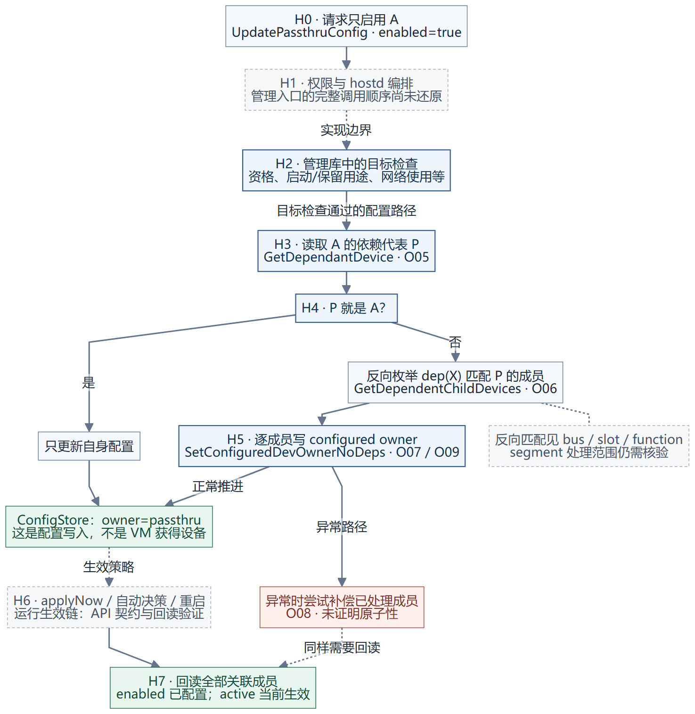
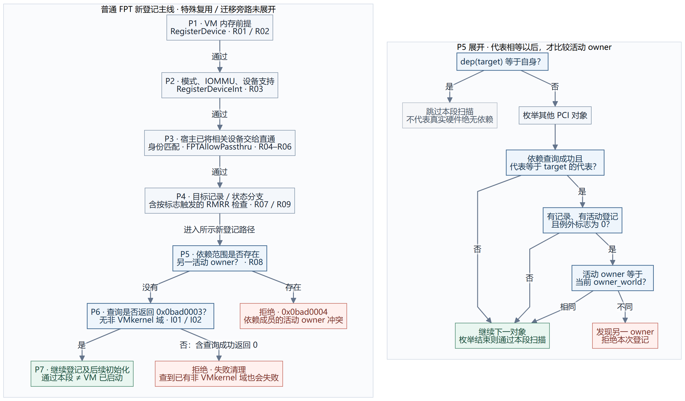
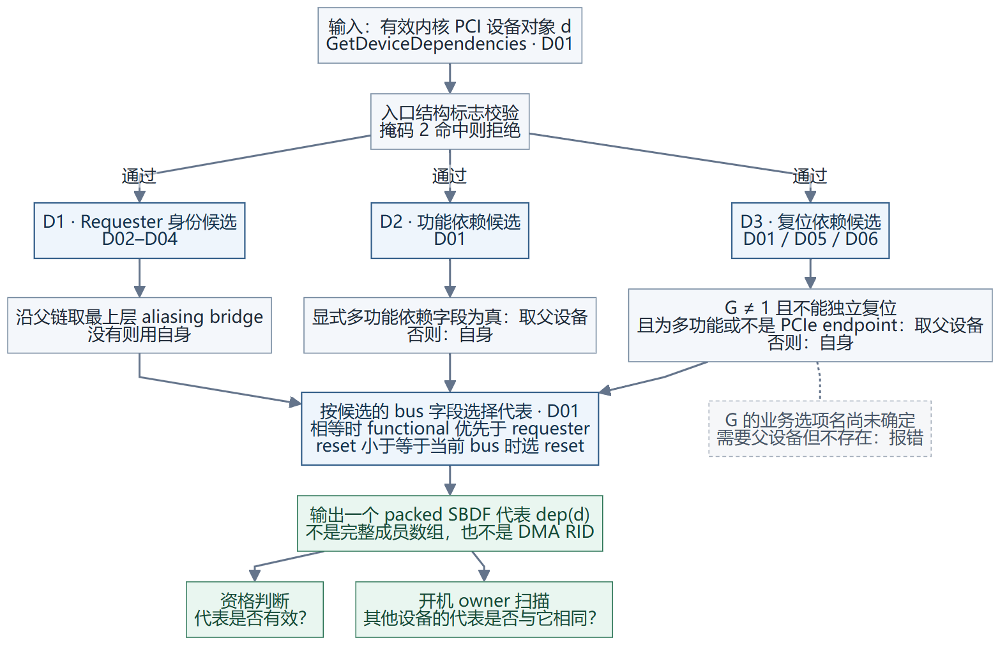

# VMware PCI 直通：资格判断与开机依赖检查设计视图

这份文档把已经核对的汇编转换成可评审的设计：**先判定设备具备直通资格；开机时再检查宿主是否释放设备、依赖成员由谁使用，以及地址域状态是否允许本次登记。** 三者分别有自己的条件，不能合并成一个“可用”布尔值。

阅读顺序：资格判断 → 主机 API 启用 → VM 开机检查；需要理解“为什么这两个设备会被归到一起”，再看依赖计算图。`A01`、`R08` 等编号链接汇编证据，新增 Linux 分组图中的 `Lxx` 链接固定版本源码。

若困惑是“VMware 的分组与 Linux IOMMU group 是不是一回事”，先读[分组、复位范围与依赖代表的对照](04-linux-groups-vs-vmware-dependencies.md)。ACS 中按类型检查、quirk 与 bypass 的细节另见[具体规则](03-acs-rule-details.md)。

要沿代码逐步对比，直接读 **[Linux IOMMU group 详细流程与 VMware 对照](05-linux-iommu-group-flow.md)**：主流程、纵向 alias/ACS、横向 alias/Function 递归三张新图，附逐步演算。

| 你关心的问题 | 设计入口 | 可单独查看的图 |
| --- | --- | --- |
| `passthruCapable` 怎样算出来？ | [一、资格判断](#capable) | [SVG](diagrams/01-capable.svg) · [PNG](diagrams/01-capable.png) · [Mermaid 源文件](diagrams/01-capable.mmd) |
| API 只启用 A，如何检查并联动依赖？ | [二、主机 API](#host-api) | [SVG](diagrams/04-host-api-enable.svg) · [PNG](diagrams/04-host-api-enable.png) · [Mermaid 源文件](diagrams/04-host-api-enable.mmd) |
| VM 开机时怎样检查依赖？ | [三、开机检查链路](#power-on) | [SVG](diagrams/02-power-on.svg) · [PNG](diagrams/02-power-on.png) · [Mermaid 源文件](diagrams/02-power-on.mmd) |
| 两个 BDF 怎样被识别为有关联？ | [四、依赖代表计算](#dependency) | [SVG](diagrams/03-dependency.svg) · [PNG](diagrams/03-dependency.png) · [Mermaid 源文件](diagrams/03-dependency.mmd) |
| VMware 的关联范围与 Linux group 有何不同？ | [分组对照与三个场景](04-linux-groups-vs-vmware-dependencies.md) | [SVG](diagrams/05-groups-vs-dependencies.svg) · [PNG](diagrams/05-groups-vs-dependencies.png) · [Mermaid 源文件](diagrams/05-groups-vs-dependencies.mmd) |
| Linux 具体按什么顺序找 group？ | [详细流程与源码索引](05-linux-iommu-group-flow.md) | [主流程 SVG](diagrams/06-linux-group-main.svg) · [纵向查找 SVG](diagrams/07-linux-alias-and-upstream.svg) · [横向递归 SVG](diagrams/08-linux-peer-recursion.svg) |

**证据范围：**这是依据 ESXi 8.0 U3b / build **24280767** 二进制重建的设计视图，不是 VMware 源码或官方架构图。资格函数有完整函数证据；开机图聚焦普通物理 PCI 的 FPT 新登记分支，保留已知条件分支，未展开所有特殊模式、迁移和复用路径。本次整理没有新增实机测试。完整指令、机器字节、重定位与既有运行记录在[汇编证据文档集](../vmware-pci-assembly-dossier-20261114/README.md)。

<a id="architecture"></a>
## 先分清三个数据，以及两个使用者

| 名称 | 直白解释 | 在哪里使用 |
| --- | --- | --- |
| **设备地址 SBDF** | 要操作的具体 PCI Function；包含 segment、bus、slot、function | 查设备对象、登记表 |
| **依赖代表 `dep(d)`** | 内核为设备选出的一个代表地址；可以是自己，也可以是上游桥 | 资格判断要求它有效；开机时用代表相等关联不同设备 |
| **IOMMU 地址域** | 设备 DMA 所使用的地址转换上下文；本文查询的是软件域指针 | 开机新登记检查、后续激活与切域 |

另有两种“归谁使用”，名字相似，含义不同：

- **宿主 owner：**设备现在交给 VMkernel，还是交给直通。它不说明具体哪台 VM 正在用。
- **活动登记 owner：**已经登记使用设备的 VMM/world 标识。开机时拿它与当前请求者比较，不是比较 vCenter 的 VM 名称。

本例传统桥下，A/B 的设备地址是 `02:01.0 / 02:01.1`，依赖代表是 `01:00.0`，DMA 代理身份是 `02:00.0`。三个地址承担不同职责，不能因为地址不同就认为能独立使用，也不能把依赖代表直接当成 DMA Requester ID。[字段与调用证据](../vmware-pci-assembly-dossier-20261114/02-dependency-construction.md)

<a id="capable"></a>
## 一、`passthruCapable`：设备是否具备直通资格



### 输入、输出和四个条件

实现位置是管理库 `libvmkctl.so` 的 `PciDeviceImpl::IsPassthruCapable`。输入为已建立的设备对象，输出为布尔值；完整函数仅 174 字节。它按照图中的顺序短路判断：前一项失败就不继续后续资格检查。[A01 完整函数](../vmware-pci-assembly-dossier-20261114/snippets/A01.asm)

| 关口 | 允许继续的精确条件 | 业务含义与边界 |
| --- | --- | --- |
| C1 禁用标志 | 对象保存的 `disablePciPassthrough` 值为 0 | 主机级直通功能禁用开关没有关闭直通；这一步不按设备型号查黑名单。值由 `SetFromSBDF` 保存，不是每次调用都重读。[解释](01-qualification-explained.md#disable-switch) |
| C2 IOMMU 范围 | `inIommuScope != 0` | IOMMU 已开启，且该设备被 IOMMU 实现判定为受支持；可以理解为它的 DMA 能否纳入 IOMMU 管理，不是网卡 HCL 查询。[解释](01-qualification-explained.md#iommu-scope) |
| C3 ACS 策略 | `meetsPassthruAcsReq != 0` | PCIe 路径被 ESXi 的隔离策略接受；含类型、quirk、缓存与软件例外。Linux 则将 ACS 与 alias/拓扑用于 group 构造，不能直接等同。[Linux 对比](01-qualification-explained.md#acs-comparison) |
| C4 依赖结果 | `passthruDependent` 不等于无效哨兵 | 读取 segment/bus/slot/function 四个 32 位字段；四项全为 `0xffffffff` 才是此处的无效值。代表等于自身仍然有效。 |

说明性伪代码，保留正常返回路径的语义：

```text
capable(d):
    if d.saved_disable_flag != 0: return false
    if VSI.inIommuScope(d) == false: return false
    if VSI.meetsPassthruAcsReq(d) == false: return false
    return VSI.passthruDependent(d) != INVALID_TUPLE
```

`VSI` 是管理库读取内核设备信息的接口。两次布尔读取检查的是输出缓冲中的值，不是直接把读取函数的返回码当成真假。读取异常如何向上层传播，不在这段正常返回伪代码中补造行为。

**`true` 到底承诺什么？**只承诺这四项资格条件成立。这个函数没有当前 VM 参数，也没有比较 VM owner；因此它不能承诺“现在可以给这台 VM 开机”。启动盘/宿主关键用途的限制在主机 owner 切换流程另查，BAR/MMIO、VM 内存和运行占用也不能由这个布尔值包办。[A02–A05、M07 解释](../vmware-pci-assembly-dossier-20261114/01-capable.md) · [ACS 策略细节](../vmware-pci-assembly-dossier-20261114/06-reset-map-acs.md) · [宿主切换限制](../vmware-pci-assembly-dossier-20261114/03-owner-transitions.md)

<a id="host-api"></a>
## 二、主机 API 启用直通：检查、依赖展开和生效



只请求 A 的 `UpdatePassthruConfig`，可能联动 B。管理库先求 A 的依赖代表 P；代表不是自身时，再枚举哪些设备的依赖代表匹配 P，对这些成员逐项写入 `OWNER_PASSTHRU` 配置。它没有把 A/B 自动加入某台 VM。

这条链路要分别看四件事：

1. **目标能否切换：**资格、启动/系统保留用途、网络占用等检查分布在不同管理入口中。
2. **哪些成员联动：**依赖代表 → 反向成员枚举 → 逐项写 configured owner；反向匹配的 segment 处理范围仍需核验。
3. **是否已经生效：**ConfigStore 写入与 runtime 生效是两个层次；`applyNow` 表达生效要求，必须回读 `passthruEnabled` 和 `passthruActive`。
4. **中途失败怎么办：**代码有补偿路径，但尚未证明原子性；报错后也要回读整个成员范围。

图中虚线标出尚未还原的 hostd 调用编排及 runtime rebind 链。不能由目标 A 的检查，直接宣称每个隐式联动成员都经过全部同样检查。上述范围与已有 API 前后回执见[主机 API 详细设计](02-host-api-enable.md)，新增六个窄汇编窗口见[补充证据](supplement/README.md)。

<a id="power-on"></a>
## 三、VM 开机：这次登记是否可以继续



图左是普通新登记路径的检查顺序；图右独立展开 P5 的依赖 owner 扫描，用“继续下一对象”省略循环回边。P1–P4 的失败出口未逐个绘出，只有通过才沿箭头前进。每个“继续”都只表示通过当前关口。

### 1. 完整链路中的位置

| 顺序 | 函数/层次 | 检查什么 | 不要误读成什么 |
| --- | --- | --- | --- |
| P1 | `PCIPassthruRegisterDevice` | VM 内存的两个前提字段；失败日志点名 `pinnedMainMem` / `preallocGuestMem` | 不能仅凭日志把字段偏移逐个强行命名。 |
| P2 | `PCIPassthruRegisterDeviceInt` | 模式范围、IOMMU 开启、设备存在且受支持；按模式调用预检查 | 不同设备模式不是统一走 FPT 的全部分支。 |
| P3 | `PCIPassthruFPTAllowPassthru` | 宿主已将需要检查的设备交给直通；宿主身份，以及请求中非零 VID/DID 的匹配 | 这时的 owner 不是具体 VM owner。身份检查有内部例外，图不把它们当成用户配置建议。 |
| P4 | 目标登记记录与状态分支 | 按 SBDF 查现有记录；按请求标志进行 RMRR 重叠检查 | RMRR 是这里的条件分支，不能放成 owner 扫描之后人人必经的一关。已有同 BDF 记录另有复用/迁移分支。 |
| P5 | **共同依赖代表的活动 owner 扫描** | 同代表设备的有效活动登记，是否属于另一 owner | 不要求每个依赖成员必须已经出现在当前 VM 配置中。 |
| P6 | **普通新登记的已有域检查** | 设备是否已经落入非 VMkernel 域 | 同 VM 通过 P5，不会自动豁免这一关。特殊选择器存在旁路，图的主线不覆盖它。 |
| P7 | 后续登记与初始化 | 继续资源建立；后续激活可调用地址域切换等流程 | 到这里不等于 VM 已开机，更不等于客户机 I/O 已成功。 |

原始证据：[R01–R09 开机登记](../vmware-pci-assembly-dossier-20261114/04-vm-admission.md) · [I01–I09 域生命周期](../vmware-pci-assembly-dossier-20261114/05-domain-lifecycle.md)。完整 VMX/hostd/vCenter 上层调用图尚未逐一还原，不能把此图宣传为所有产品层的完整实现。

### 2. 第一种依赖检查：宿主有没有释放设备

P3 先求 `dep(target)`：

- 如果代表就是自身，只检查目标的宿主 owner。
- 如果代表是外部设备，取得代表下的桥子树，检查相关节点的宿主 owner；结构上属于桥的对象有跳过分支。
- 被检查的 endpoint 必须处于直通 owner 状态。此处内核枚举值为 `1`；管理库配置枚举另用 `1=VMkernel、2=passthru`，两套数字不能混用。

所以，“A 被选进 VM”还不够：同一影响范围内的 B 若仍由宿主使用，可能在此处被挡住。这里的范围来自**桥下枚举**；下一关则通过**依赖代表相等**筛选，两个集合的计算方式也不同。[R04](../vmware-pci-assembly-dossier-20261114/snippets/R04.asm) · [R05](../vmware-pci-assembly-dossier-20261114/snippets/R05.asm)

### 3. 第二种依赖检查：同组是否已有另一 VM 在使用

P5 位于 `PCIPassthruRegisterDeviceInt`，核心逻辑可读成：

```text
target_dep = dep(target)
if target_dep == target.sbdf:
    skip_this_owner_scan
else:
    for each PCI object other:
        if dep_query(other) fails: continue
        if dep(other) != target_dep: continue
        record = lookup_registration(other.sbdf)
        if record is null: continue
        if record.active_registration is null: continue
        if record.exception_flag != 0: continue
        if record.active_registration.owner_world == current_owner_world:
            continue
        reject(0x0bad0004)
continue_to_later_checks
```

这回答了三个容易混淆的问题：

1. **为什么不同 PCI 地址也会冲突？**因为先比较 `dep(A)==dep(B)`，然后才比较活动 owner。
2. **为什么同一 VM 原则上能通过这一关？**代码明确允许相同 owner 继续；不是看到第二个成员就一律拒绝。
3. **它是否强制 A、B 同时填进 VM 配置？**此循环没有这种完整性判断。没有活动登记的成员会跳过。它阻止的是相同代表下出现不同活动 owner，不能据此声称它验证了全部设备都已配置。

`dep(target)==target` 只是本段扫描的跳过条件，不是对真实硬件“绝无依赖”的证明。`exception_flag` 的业务名称尚未确认，保留原边界，不擅自叫作“空闲”或“可共享”。[R08 完整循环](../vmware-pci-assembly-dossier-20261114/snippets/R08.asm)

### 4. 第三种检查：域状态是否适合新登记

P6 调用 `IOMMU_GetAddressDomain(target)`。下面是接口语义与本调用者的处理，必须一起看：

| 底层读出的软件域指针 | 查询返回 | 普通新登记检查的结果 |
| --- | --- | --- |
| 空指针，或者等于 VMkernel 域 | `0x0bad0003` | 允许继续 |
| 其他非空域指针 | `0`，即查询成功 | 拒绝，走警告和失败清理，选择 `0x0bad0005` |
| 其他查询错误 | 其他状态码 | 也不满足本关条件；原因不能统称为其他 VM 占用 |

看起来“查询成功反而失败”，是因为调用者想确认的是**尚未存在非 VMkernel 域**。找到一个域，反而违反它的新登记前提。这个关口没有再比较“这个域是否就是当前 VM 的域”。[I01 上层条件](../vmware-pci-assembly-dossier-20261114/snippets/I01.asm) · [I02 查询语义](../vmware-pci-assembly-dossier-20261114/snippets/I02.asm)

<a id="same-vm"></a>
### 5. 把传统桥失败放回这条链路

| 时间 | 同一 VM 中发生的动作 | 对下一步的影响 |
| --- | --- | --- |
| ① | A 通过登记，进入后续激活 | 激活与登记是不同调用点。 |
| ② | A 激活时调用 `IOMMU_SwitchAddressDomain` | 上游存在 aliasing bridge，切域范围扩为该桥子树内符合条件的节点；B 的域状态也被更新。 |
| ③ | B 进入新登记，检查共同代表的活动 owner | A 与 B 属于同一 VM，所以 P5 的 owner 比较允许继续。 |
| ④ | B 查询自身地址域 | 已有非 VMkernel 域，返回 `0`。 |
| ⑤ | P6 只接受 `0x0bad0003` | B 登记失败，最终 VM 开机失败。 |

这组证据支持的机制是：**上层逐个设备登记时，要求目标尚未进入非 VMkernel 域；下层激活一个设备，却可能提前改变整个别名范围内其他设备的域状态。两层的前提在此拓扑下不一致。** 不是 owner 检查认为“同一台 VM 也不允许”，也没有证据表明网卡发生了物理损坏。

换成 PCIe root port 后，本次对照保留独立的 DMA 身份，A 的切域不再以同样的别名范围提前占据 B 的状态，所以两个成员能继续初始化。共同复位依赖仍可能存在，因此“两项同 VM 成功”与“跨 VM 互斥”可以同时成立。这个替换是改变触发条件，不是修复 VMware 代码。[域读写与调用证据](../vmware-pci-assembly-dossier-20261114/05-domain-lifecycle.md) · [运行对照](../vmware-pci-assembly-dossier-20261114/07-runtime-and-versions.md)

既有实机记录中，8.0 U3k / `25595708` 与 9.1.0.0100 / `25433460` 也复现传统桥下同 VM 双设备失败；核对的是相关已有域保护分支，不是全部路径逐版本相同。9.1.1.0100 未取得介质，状态未知。未验证软件补丁，也没有厂商设计说明证明这是刻意禁止该拓扑，商业材料应写成“已复现的初始化限制与机制”，不要替厂商猜动机。[版本证据](../vmware-passthrough-version-review-20261113/README.md)

<a id="dependency"></a>
## 四、两个设备怎样得到共同依赖代表



`VMKPCIPassthru_GetDeviceDependencies(d)` 输出一个代表地址，不输出完整设备组。其输入为有效的内核 PCI 对象；结构标志掩码 `2` 命中时先拒绝，然后考虑三种来源：

| 来源 | 初始候选 | 何时扩大范围 | 想解决的问题 |
| --- | --- | --- | --- |
| D1 Requester 身份 | 自身 | 沿父链发现 aliasing bridge，取最上层该类桥 | 两个 Function 的 DMA 身份是否能被单独处理？ |
| D2 功能依赖 | 自身 | 显式多功能依赖字段为真，取父设备；没有父设备报错 | 两个 Function 在功能上是否需要共同使用？ |
| D3 复位依赖 | 自身 | 在 `G != 1` 分支，不能独立复位，且当前 Function 为多功能或不是 PCIe endpoint，取父设备；没有父设备报错 | 复位一个 Function 是否需要扩大影响范围？ |

`G` 是 `configOption+0x1b8` 读取值，其业务选项名未可靠确定。图中明确保留这个条件。独立复位谓词接受该实现中的方法枚举 `1/2/5/6`；PCIe endpoint 谓词要求端口类型查询成功且类型值 `<=1`。不把“有 PCIe capability”直接等同于满足该谓词。[D01、D05、D06 逐段解释](../vmware-pci-assembly-dossier-20261114/02-dependency-construction.md)

最后在这些来源于自身及父链的候选中，比较 **bus 字段**选择代表：requester 与 functional 相等时选 functional，reset 的 bus 小于等于当前值时选 reset。这是本函数的具体算法；不是把所有设备简单做并查集，也不能描述为任意拓扑上的通用最低公共祖先算法。

**同一个代表可能来自不同原因。**传统桥下可以因为 Requester 身份关联；PCIe 直连多功能设备也可以因为复位或显式功能依赖关联。所以 `dep(A)==dep(B)` 不自动意味着它们共用 DMA 身份，也不能只凭代表相同判断某一类硬件故障。

`passthru.map` 可以影响显式功能依赖和复位方式选择，从而影响候选计算，但不能消除真实 DMA alias。旧实验将 `8086 10d3 default false` 持久化并验证字段生效后，传统桥的双设备失败仍存在。[map 的写入链](../vmware-pci-assembly-dossier-20261114/06-reset-map-acs.md) · [对照记录](../vmware-legacy-bridge-cause-20261112/README.md)

<a id="our-design"></a>
## 五、对我们产品设计的直接启示

以下是基于机制的设计建议，不是宣称 VMware 已经采用的接口。

| 我们应表达的状态 | 建议给用户看到的信息 | 后端责任 |
| --- | --- | --- |
| 具备直通资格 | 哪项不满足：IOMMU、ACS 策略、依赖无法解析、管理策略等 | 单独保存判定依据，避免一个 false 掩盖全部原因。 |
| 宿主可以交出设备 | 要一起切换哪些设备，哪些仍由宿主关键功能使用 | 按完整影响范围检查和切换，并处理失败补偿。 |
| 当前 VM 可以申请 | 相关活动使用者、冲突成员、拒绝发生在哪个阶段 | 开机重新检查；配置保存成功不能替代运行仲裁。 |
| 地址域可绑定或复用 | 新建域还是复用同一 VM 的域；哪些成员随之变化 | 申请、激活和释放使用一致的范围；明确同域复用计数与回滚。 |

应分别记录 **DMA 隔离范围、复位影响范围、功能依赖范围**，再按具体操作求需要共同管理的范围；不要把它们永久压成一个没有原因的 group ID。已有同 VM 的域也不能直接跳过所有保护：必须确认所有者、映射兼容性、引用计数和失败回滚都成立。

我们的 Linux 环境默认启用 ACS override；因此本设计里的“物理隔离范围”不能直接替换成当前 `iommu_group` 的分组结果。需要把原始拓扑/ACS 能力、DMA alias、复位与功能依赖分别建模，再区分真实硬件能力与软件放宽后的分组。这是移植该思路时的边界，本文没有新增 Linux 实现验收。

建议评审时至少走通六个情景：资格失败；依赖成员仍由宿主使用；同代表已有另一 VM；同代表同 VM 且独立 DMA 身份；同 VM 且共享别名范围；初始化中途失败后的整组清理。最后两项能暴露“逐设备登记、扩大范围激活”之间的状态不一致。

<a id="evidence"></a>
## 证据索引与复核

| 图中编号 | 可以直接核对什么 | 原始材料 |
| --- | --- | --- |
| A01–A03 | 四关短路、保存的禁用值、无效四字段哨兵 | [资格全文](../vmware-pci-assembly-dossier-20261114/01-capable.md) |
| A04、A05、M07 | IOMMU 范围提供者、依赖输出转换、ACS 策略 | [依赖输出](../vmware-pci-assembly-dossier-20261114/02-dependency-construction.md) · [ACS 全文](../vmware-pci-assembly-dossier-20261114/06-reset-map-acs.md) |
| O01–O11、E01–E06 | 主机切换验证、代表展开、配置写入、补偿及网络占用拒绝 | [API 详细设计](02-host-api-enable.md) · [补充指令](supplement/README.md) |
| D01–D06 | 依赖构造、别名桥父链、独立复位与 endpoint 谓词 | [依赖构造全文](../vmware-pci-assembly-dossier-20261114/02-dependency-construction.md) |
| R01–R07、R09 | 内存、模式、宿主 owner、身份、记录和条件 RMRR | [开机登记全文](../vmware-pci-assembly-dossier-20261114/04-vm-admission.md) |
| R08 | 完整共同代表/活动 owner 循环，包括所有跳过项 | [单独汇编](../vmware-pci-assembly-dossier-20261114/snippets/R08.asm) |
| I01–I03 | 已有域拒绝、查询返回语义、被读的软件域字段 | [域状态全文](../vmware-pci-assembly-dossier-20261114/05-domain-lifecycle.md) |
| I04–I09 | 别名子树切域、字段写回、激活调用点和节点过滤 | [域状态全文](../vmware-pci-assembly-dossier-20261114/05-domain-lifecycle.md) |

精确地址的读法：管理库与内核切片用 ELF 链接虚拟地址，`PCIPassthru` 用 `.text` 节内偏移，两者不能直接混比。关键检查可从 A01 `0x4c2438`、R08 `0x4e4e / 0x4e80`、I01 `0x53da` 开始。完整证据集已保存机器字节与反汇编交叉核对结果。[阅读规则](../vmware-pci-assembly-dossier-20261114/00-reading-guide.md)

本包提供 Mermaid 可编辑源文件、SVG 矢量图、PNG 预览、[节点到切片的映射](evidence-map.json)、[文件哈希](manifest.json)及生成脚本。校验只证明文档引用、源文件和渲染产物一致，不等同于再次执行 VMware 实机测试。

只读校验：在本目录运行 `python tools/verify.py`。重画图：按 [render.mjs](tools/render.mjs) 文件头参数传入 Mermaid 10.9.3、Playwright 模块目录与 Chrome 可执行文件；固定渲染依赖的 SHA-256 记录于 [render-receipt.json](render-receipt.json)。渲染脚本只处理本文图表，不连接实验主机。
