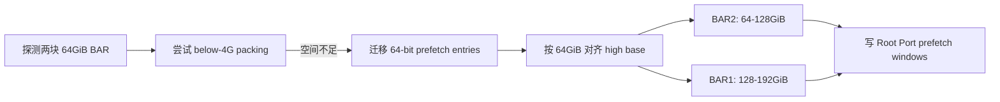
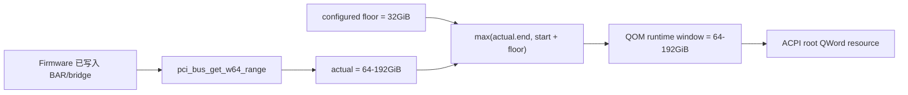

# Q35 双 64GiB BAR：SeaBIOS 自动扩窗与 OVMF 对照

## 1. 结论

QEMU Q35 的默认 `pci-hole64-size=32G` **不是 64-bit BAR 总容量上限**。在 QEMU 6.2 中，
它是运行时 root window 的最小跨度（floor）。若 firmware 已经把 BAR 放到更大的 64-bit
地址范围，QEMU 会让 `pci-hole64-end` 覆盖实际 BAR；实际范围可以大于 32GiB，甚至在
`pci-hole64-size=0` 时仍然存在。

这正是“Q35 + CBIOS/SeaBIOS + Windows 11 能直通两张各有 64GiB BAR 的卡”的机制解释：
SeaBIOS 先按真实 BAR demand 动态分配，再由 QEMU 根据已经写入的 BAR/bridge window 扩大
root window。32GiB 没有挡住 128GiB，因为它从来不是 hard cap。

必须把三个外观相似的参数分开：

| 控制项 | 本实验得到的语义 |
| --- | --- |
| VMware `pciPassthru.64bitMMIOSizeGB` | ESXi admission/mapping budget；此前 ESXi 实测中 32GiB 默认挡住了单个 64GiB BAR |
| OVMF `X-PciMmio64Mb` | OVMF firmware allocator 的 64-bit aperture 输入 |
| QEMU `pci-hole64-size` | QEMU root window 的最小跨度；不是 firmware allocator 的容量上限 |

因此，先前把 VMware/OVMF 的 32GiB 结果直接套到 QEMU Q35 + SeaBIOS，是错误的跨层类比。

## 2. 本地矩阵

环境为 QEMU 6.2.0、`pc-q35-jammy`、1GiB RAM、SeaBIOS 1.15.0 或 OVMF 2022.02。
每个 `pci-testdev` 提供一个无等量 backing 的 64GiB 64-bit prefetchable BAR，两个 endpoint
分别置于两个 PCIe Root Port 后。

| Firmware/参数 | QOM floor | 实际 root window | 已分配的 64GiB BAR | Guest heartbeat |
| --- | ---: | --- | --- | --- |
| SeaBIOS，Q35 默认 | 32GiB | `[64GiB, 192GiB)`，128GiB | 2/2 | 是 |
| SeaBIOS，显式 `32G` | 32GiB | `[64GiB, 192GiB)`，128GiB | 2/2 | 是 |
| SeaBIOS，显式 `0` | 0 | `[64GiB, 192GiB)`，128GiB | 2/2 | 是 |
| OVMF，两项默认 | 32GiB | `[4GiB, 36GiB)`，32GiB | 0/2 | 否 |
| OVMF，fw_cfg + floor 均为 128GiB | 128GiB | `[128GiB, 256GiB)`，128GiB | 2/2 | 是 |

SeaBIOS 的 `info pci` 实际地址为：

```text
rp2 prefetch window / largebar2 BAR2: [0x1000000000, 0x2000000000)
rp1 prefetch window / largebar1 BAR2: [0x2000000000, 0x3000000000)
qom pci-hole64-size:                   0x0000000800000000 (32GiB)
qom pci-hole64-start:                  0x0000001000000000 (64GiB)
qom pci-hole64-end:                    0x0000003000000000 (192GiB)
```

显式设 `pci-hole64-size=0` 后，两块 BAR 地址和 `[64GiB,192GiB)` runtime window 均不变。
这排除了“QEMU 先提供 32GiB 容量，SeaBIOS 只能在里面分配”的解释。

## 3. SeaBIOS 为什么能分配

与本机二进制对应的 SeaBIOS 1.15.0 `src/fw/pciinit.c` 行为是：

1. `pci_bios_get_bar()` 用标准写全 1/read-back 探测 size、type 和 64-bit 属性。
2. `pci_bios_init_root_regions_mem()` 先尝试 32-bit packing。
3. 32-bit 空间不足时，`pci_region_migrate_64bit_entries()` 把可迁移的 64-bit BAR/bridge
   prefetch window 移入高地址集合。
4. 高地址 base 至少高于 `reserved-memory-end` 与 `4GiB + above-4G RAM`，随后按集合中最大
   alignment 和 1GiB 对齐。
5. `pci_region_map_entries()` 逐级写 endpoint BAR 和 bridge base/limit。



这里的关键输入是 BAR demand 和对齐，而不是 Q35 的 32GiB floor。

## 4. QEMU 为什么会把窗口扩到 128GiB

QEMU 6.2 `hw/pci-host/q35.c` 的公开行为可写成（本地 QEMU 11.0.2 源码交叉核对仍是
同一公式与 32GiB 默认值）：

```python
actual = pci_bus_get_w64_range(root_bus)
if actual.nonempty:
    runtime_start = actual.start
    actual_end = actual.end
else:
    runtime_start = pc_pci_hole64_start()
    actual_end = runtime_start
floor_end = round_up(runtime_start + configured_pci_hole64_size, 1 * GiB)
runtime_end = max(actual_end, floor_end)
```

双 64GiB SeaBIOS 用例中：

```text
actual.start = 64GiB
actual.end   = 192GiB
floor_end    = 64GiB + 32GiB = 96GiB
runtime_end  = max(192GiB, 96GiB) = 192GiB
```

所以最终 span 是 128GiB。QEMU 的 ACPI builder 再读取动态的
`pci-hole64-start/end`，为 root bridge 生成 64-bit QWord memory resource。



公开源码索引：

- [QEMU 6.2 q35 host bridge](https://gitlab.com/qemu-project/qemu/-/blob/v6.2.0/hw/pci-host/q35.c)
- [QEMU 6.2 PCI W64 range collector](https://gitlab.com/qemu-project/qemu/-/blob/v6.2.0/hw/pci/pci.c)
- [QEMU 6.2 ACPI builder](https://gitlab.com/qemu-project/qemu/-/blob/v6.2.0/hw/i386/acpi-build.c)
- [SeaBIOS 1.15 PCI allocator](https://qemu.googlesource.com/seabios/+/refs/tags/rel-1.15.0/src/fw/pciinit.c)

## 5. OVMF 为什么不同

同一 Q35 和同一设备拓扑下，OVMF 默认值没有给两块 64GiB BAR 分配地址；HMP 中 BAR 和
Root Port window 都保持 `0xffffffffffffffff`/disabled 状态，QEMU 只能公开没有实际 BAR 时的
`[4GiB,36GiB)` 32GiB floor。显式同时传入：

```text
-fw_cfg name=opt/ovmf/X-PciMmio64Mb,string=131072
-global q35-pcihost.pci-hole64-size=128G
```

后，两块 BAR 被分配到 `[128GiB,192GiB)` 和 `[192GiB,256GiB)`，guest heartbeat 成功。
这证明 QEMU floor 不会替 OVMF 执行 BAR allocation；OVMF 与 SeaBIOS 必须是不同 profile。

## 6. 对 Qman 设计的修正

1. `pci-hole64-size` 在 schema 中命名为 `qemuPciHole64FloorBytes`，不得叫 capacity/limit。
2. planner 仍需计算完整 BAR + bridge + alignment 的 `requiredHighSpanBytes`。
3. OVMF profile 必须把计算结果编码到 fw_cfg，同时显式 pin QEMU floor；只配一侧不通过
   admission。
4. SeaBIOS 可以提供 `observed-auto-grow` 实验 profile，但生产 profile 仍显式 pin 已求解的
   floor，使升级、迁移和恢复不依赖 firmware 默认值。
5. 启动后必须分别核对 QOM floor、runtime start/end、每级 bridge window 和每个 mandatory
   BAR。不能只看 QEMU argv，也不能只看 root `_CRS`。
6. 自动扩窗不是无限能力：CPU guest-physical address width、machine reserved ranges、bridge
   是否支持 64-bit prefetch、firmware 版本策略及设备其他 BAR 都必须进入 admission。

## 7. 复现与证据

SeaBIOS floor/auto-grow 四组矩阵：

```bash
bash qemu-q35-seabios-hole64-floor-validate.sh
```

OVMF 默认负例与显式 128GiB 正例：

```bash
bash qemu-q35-ovmf-dual-64g-validate.sh
```

机器可读摘要为
[`evidence/qemu-q35-firmware-dual-64g-20260716-summary.json`](evidence/qemu-q35-firmware-dual-64g-20260716-summary.json)。
本次 raw evidence 保存在 WSL 的 `/root/pci-evidence/q35-seabios-floor-final-20260716-005149`
和 `/root/pci-evidence/q35-ovmf-dual-final-20260716-005825`，摘要中记录了结果与关键日志 SHA-256。

本地未重新启动用户的 Windows 11/真实 RTX 组合，因此 Windows driver/ReBAR 的最终行为仍以
用户现场观测为准；本次已经独立闭环了导致该现象成立的 Q35、SeaBIOS、bridge、BAR 和 ACPI
资源链。真实 GPU 还应补做 Windows 启动前/驱动后两次 HMP `info pci` 快照，以确认驱动是否
重写过 firmware 初始地址。本地把“CBIOS”按 QEMU 默认 legacy firmware SeaBIOS 复现；若现场
实际使用其他 CBIOS 镜像，还需对该镜像重复同一矩阵，不能只凭名称认定 allocator 相同。
