# QEMU 静态与动态 PCI 直通对标设计

状态：详细设计 2.7（ESXi 8.0.3/vHW20 外部行为基线冻结；产品边界按 ADR-002/003/005/007/010 收敛）
项目快照：G0 `DONE`；当前 G1 `IN_PROGRESS`；Acceptance `101/101` 已分类；
R01-R39 仍全部 `OPEN`；release `BLOCKED`。

目标基线：VMware ESXi 8.0.3 build 24280767、vSphere API 8.0.3.0、
virtual hardware 20

范围：公开接口、公开文档和本仓库黑盒结果所能观察的外部行为
非目标：推导 VMware 私有代码、复制未公开算法或把实验绕过描述成硬件安全能力

版本边界：本文不包含 vSphere 9.0/9.1 的 DirectPath Profile Manager、`directPathState`
或新增 binding 字段。其他 ESXi 版本只能作为旁证，不能改变本 profile 的状态、默认值或
完成标准。

面向实现者的模块接口、持久化表、事务补偿、crash reconcile、API 和端到端 worked example
见 [`qman-directpath-implementation-blueprint.md`](qman-directpath-implementation-blueprint.md)。
本文继续作为算法、风险和验收编号的规范正文。
当前 milestone、实现边界、已决 ADR 和机器发布门见
[`PROJECT-STATUS.md`](PROJECT-STATUS.md)。详细设计完成不等于产品实现或生产 qualification 完成。

产品范围以 [`ipd/README.md`](ipd/README.md) 为准：唯一目标是完成 F1-F8 的
`V3-FULL-DIRECTPATH`；本文 Phase 0-4 是技术实施分解，不是 V1/V2 部分产品发布。底层
attach/admission engine 以约束驱动方式追求通用安全 PCI 直通，生产 `SUPPORTED` 仅授予
compatibility catalog 中的精确 qualification profile。VMware 官方合同、可观察行为和待验证
假设统一见 [`ipd/VMWARE-BEHAVIOR-MODEL.md`](ipd/VMWARE-BEHAVIOR-MODEL.md)。
Qman/reference-side 的 E2/E3/E4 定义、WSL/QEMU 实测、hash 与关闭权限统一见
[`ipd/QMAN-TECHNICAL-EVIDENCE.md`](ipd/QMAN-TECHNICAL-EVIDENCE.md)；其中 reference subject
只能验证设计前提，不能把本设计标记为产品实现完成。
平台、Legacy-first、单一控制面、HCL 和双在线 cold relocation 边界见
[`product-decisions.json`](contracts/product-decisions.json) 与
[`compatibility-profile-policy.json`](contracts/compatibility-profile-policy.json)。

私有 Qman 源码不是本设计收敛的前置条件。target-independent 语义以
[`directpath-portable-control-contract.json`](contracts/directpath-portable-control-contract.json)
revision `2026-07-22.10` 为机器权威：35 个 operation、17 个可变 authority aggregate、4 个非
authority projection、FSM/CAS/reason/trust/qualification 都有 closed schema，并确定性导出 293 个
mapping item 与逐项 Case/test/八类 oracle requirement digest。35 个 operation 另有 70 个逐
operation/direction 的 closed request/result payload profile，Scenario fixture 必须绑定唯一 portable fragment、
profileId 和 canonical payload digest；每个执行 iteration 的 `operationExchanges` 再逐 Step 绑定实际 raw
envelope。qualification
还固定了可重放的 workload evaluator、独立 device taxonomy 以及实测
guest/runtime prerequisite。内网 AI 后续只把这些义务映射到 exact target commit 的 symbol/interface、
storage/transaction 和 test/fixture；私有代码无需离开内网，也不能根据现有代码反向缩小合同。
`PORTABLE_SPEC_READY=READY` 与
`TARGET_CODE_MAPPED=UNMAPPED`、`PRODUCT_IMPLEMENTED=NOT_PROVEN`、`QUALIFIED=NOT_PROVEN` 同时成立，
因此项目 release 仍诚实保持 `BLOCKED`。

## 0. 先理解问题，再看方案

### 0.1 我们实际在解决什么

先看一个符合当前部署约束的宿主机：

```text
Host
├─ NIC A/B：宿主 dataplane 的 DPDK 端口
│  └─ 即使平台没有启用 IOMMU，也必须能由 vfio-noiommu 或 UIO 接管
├─ GPU C/D：准备交给不受信任 VM 的直通设备
│  └─ 必须由真实 IOMMU translation domain 约束 DMA
├─ pcie_acs_override：因 DPDK 独占要求常开
└─ Qman VM：可能请求固定设备，也可能只请求“任意满足条件的两张 GPU”
```

这里没有一个全局的“直通开关”能够正确回答所有问题。DPDK 需要的
`enable_unsafe_noiommu_mode=1` 只表示 **Linux 允许创建不受 IOMMU 保护的 VFIO owner**；它
既不能证明某个 VM 设备正在走 no-IOMMU，也不能证明所有设备都不安全。反过来，一块设备
出现在 IOMMU group、带 FLR 或 class code 看起来像网卡，也不能独立证明它可安全交给 VM。

真正需要回答的是下面六个不同问题：

| 问题 | 失败后果 | 由谁回答 |
| --- | --- | --- |
| 这个 PCI function 在结构和平台策略上能否作为 VM payload？ | 把 host bridge、平台控制器或不受隔离的 DMA device 交给 guest | `capable/eligible` |
| 它当前归宿主、DPDK、其他 VM 还是空闲？ | 双重 owner、host 断网或数据面中断 | owner activation + lease |
| 切换 owner 能立即完成，必须重启，还是重启也无解？ | 把永久 host consumer 错报成“重启试试” | activation planner |
| 请求一个 BDF 时，实际必须一起占用和 reset 哪些 function？ | sibling/bridge/同组设备被另一 owner 使用或被连带 reset | dependency/domain builder |
| 设备全部 BAR 能否装进这台 VM 的完整 PCI 树？ | QEMU 启动后 BAR disabled、桥窗不覆盖或 guest 资源冲突 | MMIO allocator |
| attach/release 后 DMA、IRQ、reset 和 guest ABI 是否与计划一致？ | 纸面可用但运行态失控，下一台 VM 继承脏状态 | runtime verifier |

因此，本设计不是给 `qemu-system-*` 拼一串参数，而是建立从事实采集、资格判断、资源规划、
排他占有到运行后核验的一条控制链。

### 0.2 VMware 的可观察做法与 Qman 的对应设计

我们只对标 ESXi 8.0.3 的公开接口和黑盒现象，不推导其私有实现。对外可观察语义与 Qman
设计的关系如下：

| VMware 8.0.3 外部行为 | 它解决的问题 | Qman 对应能力 |
| --- | --- | --- |
| `passthruCapable` | 设备是否具备进入 DirectPath 管理面的基础资格 | 分层 `eligible`，输出 role/IOMMU/isolation/reset/policy reason |
| `passthruEnabled` | 管理员期望设备归 passthrough owner | durable `desiredOwner` |
| `passthruActive`、Configured/Current Owner | 期望 owner 是否已实际生效 | `effectiveOwner` 与 activation disposition |
| `dependentDevice` | 一个请求可能要求共同切换 bridge 或 sibling | 显式 `ownerActivationGroup`，不与 reset/lease 集合混用 |
| Static backing | VM 配置固定物理设备和 host affinity | 持久 `DeviceIdentity`，每次启动重验 |
| Dynamic `allowedDevice`/`assignedId` | VM 保存条件，开机时才选具体设备 | matcher + 全局求解 + 仅运行期 binding |
| `use64bitMMIO`、firmware/board 组合 | guest 地址空间必须覆盖全部 BAR 和桥窗 | demand-driven allocator + versioned machine profile |
| deferred/apply-now 与 reboot 后 Active | host owner 切换存在 desired/effective 分离 | `LIVE_APPLY`、`REBOOT_REQUIRED`、`DENIED`，并核验重启后状态 |

VMware 的 VM DirectPath 路径要求平台 DMA remapping；Qman 也保持这条 VM 安全边界。但
Qman 宿主另有可信 DPDK dataplane，这是我们的平台约束，不应错误映射成“整台 host 禁止
unsafe no-IOMMU 开关”。Qman 必须同时满足：

```text
allowUnsafeNoIommuForHostDataplane = true
requireIommuForGuestPassthrough    = true
hostDataplaneDevices               = explicit host reservation, never VM candidates
guestVfioBackend                   = exact-profile-pinned Legacy TYPE1 backend
futureGuestVfioBackend             = separately qualified IOMMUFD/VFIO cdev adapter
guestNoIommuBackend                = hard reject
backendSilentFallback              = false
```

这表示宿主机在 IOMMU 关闭时仍可运行 DPDK，但该 host 上没有设备能够通过 VM passthrough
admission；当 IOMMU 开启且 unsafe 全局开关仍为 DPDK 保持开启时，具有真实 IOMMU backing
的其他设备仍可交给 VM。

### 0.3 端到端解决路径

```mermaid
flowchart LR
    REQ["Static BDF 或 Dynamic 条件"] --> SNAP["不可变 host snapshot"]
    SNAP --> CAP["结构、DMA、隔离、reset 资格"]
    CAP --> DOM["owner/isolation/reset/attach 各域"]
    DOM --> MMIO["完整 guest PCI 树资源规划"]
    MMIO --> LEASE["durable lease + run generation"]
    LEASE --> ACT["必要时切换 host owner"]
    ACT --> VFIO["profile-selected Legacy VFIO backend"]
    VFIO --> QEMU["启动 QEMU/firmware"]
    QEMU --> VERIFY["QMP、guest BAR、DMA/IRQ 核验"]
    VERIFY --> RUN["提交 runtime binding"]
    RUN --> RELEASE["停止、reset、rebind、释放"]

    ACT -. "不可 live 但 boot claim 已证明" .-> REBOOT["维护重启并 reconcile"]
    VERIFY -. "不确定" .-> QUAR["quarantine"]
    RELEASE -. "清理不确定" .-> QUAR
```

宿主 DPDK 与 VM 路径在 inventory 前半段共享 PCI 事实，但在 owner policy 和 DMA backend
处分叉：

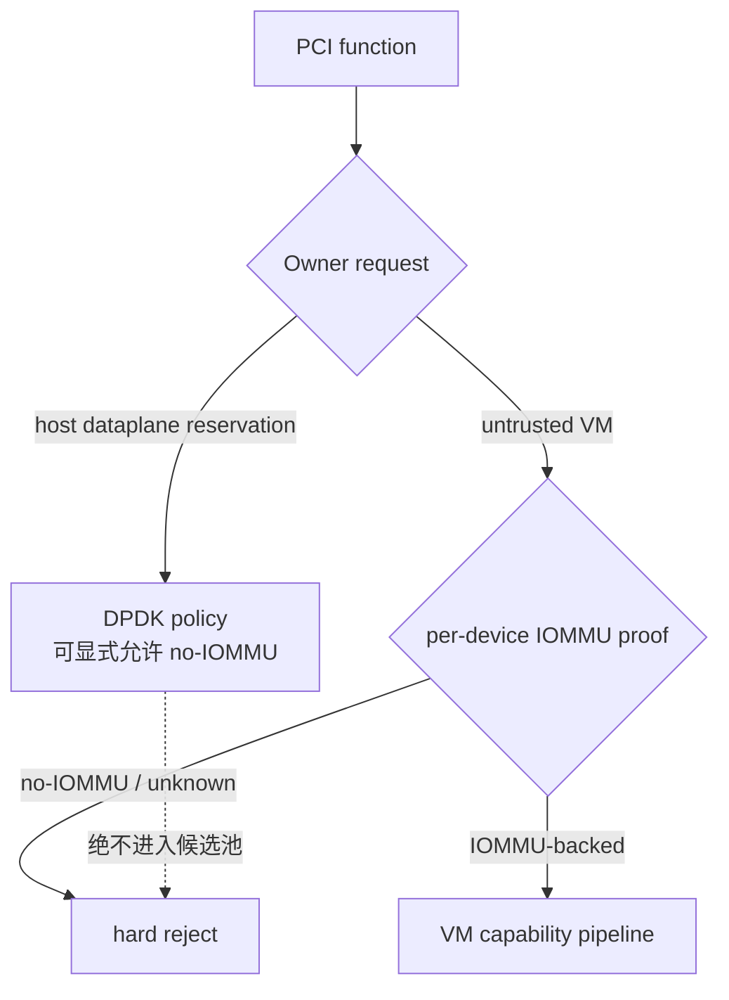

### 0.4 PCI/PCIe 与 VFIO 基础

本节只建立读懂后续设计所需的最小共同语言。

#### 0.4.1 PCI 是一棵 bus/device/function 树

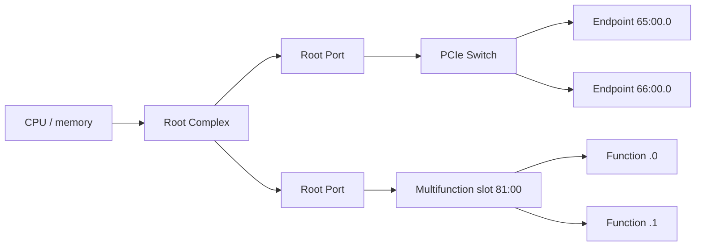

Linux 常用 `0000:65:00.1` 标识一个 function，四段分别是：

```text
0000 : 65 : 00 . 1
segment bus  device function
```

- **segment/domain** 允许系统存在多棵独立 PCI hierarchy。
- **bus** 由 bridge 划分；bridge 的 secondary/subordinate bus number 描述其下游范围。
- **device** 是一个 bus 上的槽位编号，取值 0-31。
- **function** 是同一 device 内的逻辑功能，取值 0-7；一个 BDF 指向一个 function，而不是整张卡。

QEMU 创建的是 guest 看到的另一棵虚拟 PCI 树。宿主 BDF 与 guest BDF 通常不同；平台必须
分别保存 host identity 和稳定的 guest slot/path，不能把两者混成一个字段。

#### 0.4.2 Config space、header Type 0/1 与 PCIe port type

每个 function 都有 PCI config space，里面至少包含 Vendor/Device ID、class code、command/
status、header type、BAR 和 capability 链。`Header Type` 的低 7 bit 决定基本布局：

| Header | 典型角色 | 关键资源字段 | 能否直接当普通 VM payload |
| --- | --- | --- | --- |
| Type 0 | endpoint、PF、VF | 最多 BAR0-BAR5 | 仍需通过其他 gate；Type 0 只是必要结构条件 |
| Type 1 | PCI/PCIe bridge | 最多 BAR0-BAR1、bus number、I/O/memory/prefetchable bridge window | 默认不能；它承载拓扑和下游资源 |

Header Type 的 bit 7 是 multifunction 标志；读取布局时要先屏蔽它。PCIe capability 中还有
`Device/Port Type`，用于区分 endpoint、root port、upstream/downstream switch port 等角色；
它和 PCI Header Type 不是同一个字段。class code 也只是功能分类：Type 0 function 即使填了
bridge class code，仍不能仅凭 class code 变成 fabric node；反之，实际生成 subordinate bus
的 function 即使 class code 异常，也不能按普通 endpoint 分配。

#### 0.4.3 Multifunction 不是“只选 .0 就够了”

同一 `bus:device` 下的 `.0`、`.1` 等 function 可能共享电源、内部交换路径、firmware、reset
或隐藏 requester identity。multifunction bit 只说明多个 function 可能存在，不证明它们一定
能独立 reset 或独立租用。因此平台同时采集 sibling 集合、IOMMU group、vendor dependency
和 reset affected set，再决定是否必须整卡交给同一 owner。

#### 0.4.4 BAR、桥窗口和 MMIO aperture

BAR 描述设备希望 guest 为寄存器、framebuffer 或 doorbell 保留多大的 I/O/MMIO 地址区间。
BAR size 必须按自身大小对齐；64-bit BAR 可被放到 4GiB 以上，但并不自动保证 firmware 会
这样放。一个 endpoint BAR 要能访问，至少要同时满足：

```text
BAR range
  contained by every upstream bridge window
  contained by root bridge aperture / ACPI _CRS
  not overlapping RAM, chipset ranges, reserved ranges or another BAR
```

所以 `pci-hole64-size=32G` 是 root aperture 的一个 floor/输入，不是“最多只能直通 32G BAR”
的简单上限；SeaBIOS、OVMF 和 QEMU host bridge 还会根据实际 BAR demand、对齐和 machine
profile 共同决定最终窗口。这正是双 64GiB GPU 不能靠把 BAR 相加后猜参数的原因。

#### 0.4.5 IOMMU、ACS 与 reset 分别解决什么

- **IOMMU** 把设备发出的 DMA 地址翻译到被授权的 host pages；没有它，恶意或故障 guest
  driver 可让设备 DMA 到任意 host memory。
- **IOMMU group** 是 Linux 认为不能安全拆给不同 DMA owner 的最小操作集合。ACS override
  可改变内核分组结果，但不会凭空改变 PCIe peer routing 硬件。
- **ACS** 位于 PCIe port，控制/重定向 peer-to-peer request。它影响物理隔离边界，不替代
  IOMMU page table。
- **reset** 清除设备运行状态。FLR 通常只针对一个 function；SBR/slot/bus reset 可能影响
  整个下游。能隔离 DMA 不代表能独立 reset，能 FLR 也不代表设备角色可分配。

因此后文会分别维护 kernel group、physical isolation domain、reset domain 和最终 lease，
而不是创建一个万能 `groupId`。

#### 0.4.6 VFIO 在直通链路中的位置

VFIO 把 PCI config、BAR region 和 interrupt eventfd 暴露给 QEMU，并通过 IOMMU backend
管理 DMA 映射。生产 VM 路径的简化流程是：

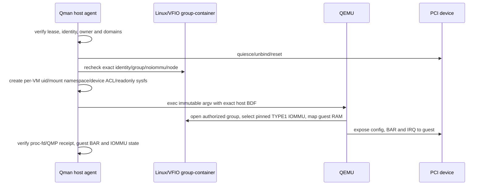

VFIO no-IOMMU 则省掉了真正的 DMA translation；它可满足可信 DPDK 的特定部署需求，但
不能满足 untrusted VM。当前产品使用 legacy group/container，并由精确 profile 固定
`VFIO_TYPE1v2_IOMMU` 或 `VFIO_TYPE1_IOMMU`；运行时必须拒绝 `VFIO_NOIOMMU_IOMMU` 和静默
backend fallback。仅检查全局 module parameter、driver 名称或存在一个 `iommu_group` symlink
都不够，因为 no-IOMMU 也可产生 synthetic group。IOMMUFD/cdev 的 fd passing 是未来独立
qualification profile，不能倒推 stock QEMU 5.0 的 legacy path 也支持 fd-only。

### 0.5 为什么 capable、allocator、重启和 reset 必须重点设计

| 机制 | 容易出现的错误理解 | 必须单独设计的原因 |
| --- | --- | --- |
| capable | “class code 是 GPU/网卡并且有 FLR 就行” | 它还取决于 Type 0/1、每设备 DMA backing、真实隔离、依赖、errata 和平台保留；错误会突破安全边界 |
| MMIO allocator | “把 BAR 相加，写成 hole64” | placement 受 32/64-bit、prefetch、对齐、桥层级、firmware、RAM 和保留区共同约束；错误往往到 guest 启动后才暴露 |
| owner activation/reboot | “不能立即解绑就重启” | 重启只对可在 early boot 抢先 claim 的暂态 owner 冲突有效；host-critical、持久 DPDK/storage consumer、身份不匹配和不可直通设备重启仍无解 |
| reset domain | “有 FLR 就只锁一个 BDF，没有 FLR 就全部拒绝” | FLR、PM reset、SBR、slot reset 的影响集合不同；还要合并 multifunction、RID alias 和 vendor dependency，并在释放时证明状态已清理 |

这四块之间也不能互相代替：BAR 放不下不会把静态硬件资格改成 incapable；设备 capable
但被 DPDK 保留时是不可用；host owner 已激活也不代表某台 VM 的 MMIO 可满足；reset 能力
更不能证明当前 native driver 可 live detach。

### 0.6 阅读地图与系统心智模型

本文按“事实、判断、占有、实现、验证”五层组织。第一次接触系统的读者先读完本节，再阅读
实现蓝图第 0-3 节和第 19 节完整例子；实现具体算法时，再回到本文第 7 节 capable、第 8 节
domain、第 12 节 allocator 和第 9/10 节事务。

| 想回答的问题 | 直接阅读 | 输出 |
| --- | --- | --- |
| 一块 PCI function 为什么 capable 或不 capable？ | 7.1-7.8 | 分层布尔值、稳定 reason、证据 provenance |
| 宿主允许 DPDK no-IOMMU 时，如何保证 VM 仍安全？ | 0.2、5.3、7.4 | host reservation、per-device DMA mode、provider proof |
| ACS override 后到底锁哪些设备？ | 5.2、8.1-8.5 | physical isolation domain 和 lease bundle |
| FLR/SBR 会影响谁，如何找 reset domain？ | 8.2 | `ResetContract`、authoritative affected set |
| BAR 怎么从设备需求变成 QEMU/OVMF 参数？ | 12.1、12.2.1-12.2.8 | guest PCI tree、逐桥窗口、root aperture、启动参数 |
| Static/Dynamic 如何避免抢卡和半成功？ | 9.2-9.6、10.2-10.7、11 | CAS lease、rollback、runtime binding |
| 哪些已经实现，哪些仍是设计？ | 22 | 代码映射和 fail-closed 状态 |
| 模块怎么接、数据怎么落盘、失败怎么补偿？ | 实现蓝图 3、8-18 | API、SQL、时序、补偿和实施计划 |

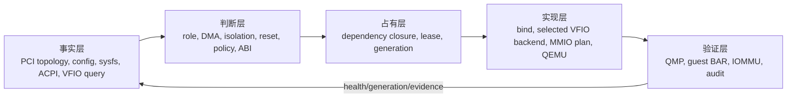

最重要的边界有四条：

1. `capable` 是相对稳定的硬件加策略资格，不包含“现在是否空闲”和“某台 VM 的 MMIO 是否装得下”。
2. 全局允许 VFIO no-IOMMU 不等于 VM 候选走 no-IOMMU；VM gate 必须检查每个 payload 的实际 DMA backend。
3. kernel IOMMU group、physical isolation domain、reset domain 和最终 lease bundle 是四种不同集合。
4. allocator 处理的是完整 guest PCI tree，不是把 passthrough BAR size 相加后写一个 hole。

## 1. 结论先行

QEMU 本体只能完成设备呈现、MMIO 映射、中断和 DMA 等运行时工作，不能单独提供
VMware Assignable Hardware 的候选发现、跨 VM 排他租约、跨主机选择、失联源主机保护和
审计状态。完整实现必须是一个 QEMU 平台：

```text
QEMU + OVMF/SeaBIOS + profile-selected VFIO backend
     + host inventory/capability agent
     + durable lease and placement service
     + lifecycle controller
     + versioned policy and qualification database
```

本设计采用以下核心原则：

1. 静态直通持久绑定一个明确 host device；动态直通持久保存匹配条件，只在 VM 启动事务中
   产生临时 `assignedId`。
2. Dynamic DirectPath 表示 power-on selection，不表示运行中 PCI hot-add/hot-remove。ESXi 8.0.3
   虽公开了 `fixedPassthruHotPlugEnabled`，Qman 的产品决策是所有 guest runtime PCI hotplug
   永久关闭；该字段只作为 VMware 能力边界记录，不进入实现路线。
3. `capable`、管理员启用、host 激活、当前可租用、对某个 VM 可启动和某项生命周期操作可用
   是六种不同状态。
4. 候选单位不是单个 BDF，而是 IOMMU、物理隔离、reset、RID alias、multifunction 和功能
   互连依赖的闭包。
5. ACS override 后的 kernel IOMMU group 只用于 VFIO 操作，不能缩小平台安全租约。
6. 多设备分配、bind、reset、QEMU 启动和释放必须是可回滚事务；清理失败进入 quarantine，
   不得直接回到 free pool。
7. VMware 对标 baseline 拒绝 snapshot、suspend、live migration 和 runtime hotplug；Qman 的
   API、scheduler、launcher 与 QMP ACL 必须共同拒绝。VFIO backend 即使报告 migration feature，
   也不能作为普通 profile flag 打开；未来支持必须新建 Feature 和 qualification。
8. Firmware、VM 创建路径和 resolved motherboard layout 是 guest ABI；缺省值必须在创建时
   解析并持久化。Stock QEMU 的 VMware chipset/topology 差异必须显式记录，但 Qman 只冻结
   自身 versioned guest ABI，不提供 strict VMware topology profile。

Firmware/layout 的已执行黑盒矩阵、原始产物索引和 QEMU 7-profile 结果见
[`vmware-firmware-layout-matrix.md`](vmware-firmware-layout-matrix.md)；机器可读摘要见
[`evidence/esxi8-firmware-layout-20260715-summary.json`](evidence/esxi8-firmware-layout-20260715-summary.json)。

## 2. 设计目标与边界

### 2.1 目标

- 对齐 VMware 静态 VMDirectPath 的 `Capable/Enabled/Active`、固定 backing 和 dependency 行为。
- 对齐 Dynamic DirectPath 的 allowed-device matcher、power-on selection、运行时 binding、关机
  清空、candidate exhaustion 和 powered-off relocate。
- 在 QEMU 启动前完成 BAR、MMIO、RMRR、IOMMU、ACS、reset、interrupt 和 lifecycle admission。
- 对所有拒绝给出稳定 reason code、具体依赖 BDF、证据 provenance 和恢复建议。
- source host 失联、QEMU crash、部分 bind 失败和 reset 失败后，不产生双重分配或未受控 DMA；
  source 失联时保留 lease、VM stopped 且不在 target 接管。
- 同一实现提供 ESXi 8.0.3 semantic-parity profile 和显式扩展的 QEMU-native profile；两者都
  使用稳定 Qman guest ABI，不宣称 VMware chipset/topology identity 等价。

### 2.2 非目标

- 不保证复刻 VMware 未公开的 candidate 排序；保证匹配集合、排他性和外部状态语义。
- 不把 VID:DID、class code、FLR bit 或 patched IOMMU group 单独当成 capable 结论。
- 不允许 VFIO no-IOMMU、unsafe interrupts 或未审计的 ACS override 进入 **VM passthrough**
  生产通过路径；宿主可信 DPDK 的独立 no-IOMMU profile 不属于 VM candidate pipeline。
- 不支持 live migration、FT、snapshot/suspend 或 guest runtime hotplug；不承诺任意 PCI 设备可
  安全复用，复用必须满足精确 reset/cleanup profile。
- 不提供 BMC/power fencing 或 host-failure 自动 HA restart；只支持 source/target 都在线的计划性
  cold relocation。
- 不在 guest 运行期间把一个 Dynamic backing 静默切换成另一个物理设备。

### 2.3 对标 profile

版本差异必须进入 profile，不能形成一个永久不变的“VMware 默认值”：

```text
vmware-esxi8u3-vhw20-create-efi-acpi        # CreateVM 缺省解析结果
vmware-esxi8u3-vhw20-create-bios-i440bx     # CreateVM 缺省解析结果
vmware-esxi8u3-vhw20-explicit-efi-i440bx    # 显式 legacy layout + EFI
vmware-esxi8u3-vhw20-register-efi-i440bx    # key-absent 直接注册 fallback
 qman-{platform}-{machine}-{firmware}-legacy # 当前产品 profile，精确钉住 TYPE1 subtype
 qman-{platform}-{machine}-{firmware}-iommufd # 未来独立 qualification profile
lab-unsafe                                  # 只用于实验，输出永远带 unsafe 标记
```

profile 至少固定 OS、architecture、QEMU、kernel、VFIO backend/subtype、firmware、machine type、guest firmware、vHW 对标版本、
配置创建路径、resolved motherboard layout、root topology、capability filter、MMIO policy、
migration-disabled policy 和 policy database hash。VMware `acpi+bios` rejection 只属于 VMware
reference profile；Qman 的 `q35+SeaBIOS` 是独立、可 qualification 的有效产品组合。

冻结的平台矩阵如下；每一行目标能力都是完整 V3：

| 交付线 | OS / arch | Kernel / QEMU | machine / firmware |
| --- | --- | --- | --- |
| 小规模测试 | Kylin V10 ARM | 4.19 / 5.0 | `virt+UEFI` |
| 小规模测试 | Kylin V10 C86 | 4.19 / 5.0 | `q35/i440fx × UEFI/SeaBIOS` |
| 小规模测试 | RH-family x86 | 4.18 / 5.0 | `q35/i440fx × UEFI/SeaBIOS` |
| 主线 | Kylin V11 ARM | 6.6 / 10.2 | `virt+UEFI` |
| 主线 | Kylin V11 C86 | 6.6 / 10.2 | `q35/i440fx × UEFI/SeaBIOS` |
| 主线 | openEuler x86 | 6.6 / 10.2 | `q35/i440fx × UEFI/SeaBIOS` |

本文的 **guest topology** 只指 VM 内看到的虚拟结构：PCI/ACPI root、root port/bridge、bus/slot/
function 路径、桥窗口、ACPI `_CRS` 和 BAR 地址。例如 Linux 的 `0000:03:00.0`、Windows 的
设备实例路径以及它们上游的虚拟 root port 都属于 guest topology；它不是宿主机物理 PCI
拓扑，也不是 ACS override 后的安全 domain。Qman 已冻结以下产品决策：

```text
strictVmwareGuestTopology = false
stableQmanGuestAbi        = true
guestPciRuntimeHotplug    = false
```

因此无需让 Q35/PXB 逐字节伪装成 VMware i440bx/acpi，但同一 Qman machine profile 的 guest
slot、root、ACPI namespace 和资源合同必须跨重启、升级稳定；发生不兼容变化时只能创建新
machine profile，不能静默改现有 VM。

## 3. VMware 公开状态到 QEMU 平台状态的映射

### 3.1 三个状态和一个事务结论

Broadcom API 将静态设备状态分成 `passthruCapable`、`passthruEnabled` 和
`passthruActive`。API 对 Active 的旧式描述是 “enabled + rebooted”，但 ESXi 8.0.3 的官方
ESXCLI 同时提供 `--apply-now`，本地实测也证明它可在不重启 host 的情况下令
`passthruActive=true`。因此 Qman 对标的是 **desired owner 与 effective owner 是否一致**，
而不是伪造“曾发生过物理重启”的历史。

| VMware 可观察状态 | QEMU 平台等价状态 | 说明 |
| --- | --- | --- |
| `passthruCapable` | `hardwareCapable && policyEligible` | 不受当前 owner 和 VM MMIO 布局影响 |
| `passthruEnabled` | `adminEnabled` | 管理员允许该设备进入直通池 |
| `passthruActive` / `Current Owner` | `hostActive` / `effectiveOwner` | 只由读回的实际 owner/provider 状态决定 |
| `dependentDevice` | `ownerActivationGroup + exclusiveAttachGroup` | 它是重要观测输入，但不能机械折叠成唯一 reset domain |
| static backing BDF | `StaticRequest.deviceUid` | BDF 和身份都必须匹配，禁止静默替换 |
| `allowedDevice` | `DynamicRequirement.matcher` | VID:DID，加可选 subsystem/revision |
| `customLabel` | `labels` exact matcher | 标签是调度条件，不是安全证明 |
| `assignedId` | `RuntimeBinding.hostBdf` | 只存在于当前 run；power-off 后清空 |
| AH binding | `LeaseRecord + RuntimeBinding` | durable lease 是权威 owner，QEMU manifest 是运行证据 |
| `fixedPassthruHotPlugEnabled` | `guestPciRuntimeHotplug=false` | VMware 有该独立接口；Qman 明确不实现并由 API/scheduler/launcher/QMP 四层拒绝 |
| owner 切换结果 | `activationDisposition` | `ALREADY_ACTIVE`、`LIVE_APPLY`、`REBOOT_REQUIRED` 或 `DENIED` |

Dynamic backing 仍保存 `allowedDevice`、可选 `customLabel` 和仅在 VM powered-on 时设置的
`assignedId`；它与 host owner activation 是正交概念。

2026-07-18 的共享 bridge dependency 实测进一步要求分开四个闭包：管理员显式提交的
`requestSet`、实际共同切换宿主 owner 的 `ownerActivationGroup`、VM admission 独占的
`exclusiveAttachGroup`，以及 FLR/SBR/PM 描述的 `resetDomain`。四者可以重叠，但数据模型和
锁键不得共用一个未经证明的 `bundleId`。

### 3.2 公开合同与本地实锤

| 证据 | 直接证明 |
| --- | --- |
| ESXCLI 8.0.3 `hardware pci pcipassthru set --apply-now` | 带 `-a` 会解绑 native driver 并绑定 `pciPassthru`；不带 `-a` 明确延迟到 host reboot |
| `HostPciPassthruInfo` | `passthruEnabled` 是配置，`passthruActive` 是生效状态，`dependentDevice` 是必须 unclaim 的设备且可能为 bridge |
| Broadcom KB 309986 | UI 绿色代表 enabled+active；橙色代表状态已改变但要重启后可用 |
| Broadcom KB 434815 | HBA 已建立 storage paths 时 native driver detach 返回 Busy；这是特定 consumer/driver 案例，不能泛化为所有 Busy |
| 本地 `20260713-capability-smoke-v5/root-virtio-flr-pm` | `-a` 返回 0 后立即得到 Configured/Current Owner 均为 `VM Passthru`、module=`pciPassthru`，中间没有 host reboot |
| 本地 `20260713-esxi8-flr-vm-power-v1` | 同一立即切换后 vSphere API 返回 enabled=true、active=true，进一步否定“Active 必须真的重启过” |
| 本地 `20260711-largebar2g/M00` | 已出现 Configured Owner=`VM Passthru`、Current Owner=`VMkernel`、module=`ne1000` 的 desired/effective 分离态 |
| 本地 `20260718-esxi8-owner-activation-v1` O03/O07 | 专用 endpoint deferred 后 desired/effective 分离；真实 host reboot、uptime 归零后同一 BDF 由 `pciPassthru` claim |
| 本地 v1 O04 A/B | 持久 vSwitch uplink 对 apply-now 和 direct deferred 都原子拒绝；移除 consumer 后同一 BDF 立即成功 |
| 本地 v1 O05 | 两个 sibling 的 `dependentDevice` 不同时，空闲 function 可单独激活，忙 sibling 保持 native |
| 本地 `20260718-esxi8-owner-activation-legacy-v2` L04/L11 | 共享 bridge dependency 时，请求空闲 member 自动扩展整组；显式请求 busy member 或整组则 ESXCLI/SOAP 均失败 |
| 本地 legacy-v2 L20/L22 | 同 dependency 两 VM 并发冲突；释放后可复用；同一 VM 同时加入两 member 也在第二项 AH admission 失败 |
| 本地 Workstation ESXi no-IOMMU v4 | vmkernel 明确记录 DMAR 缺失/IOMMU unavailable；45/45 API 条目 incapable，Function/Bridge reset 不能越过 host IOMMU gate |

脱敏命令/输出摘录见
[`evidence/esxi8-passthru-activation-20260718.md`](evidence/esxi8-passthru-activation-20260718.md)，机器可读索引见
[`evidence/esxi8-passthru-activation-20260718-summary.json`](evidence/esxi8-passthru-activation-20260718-summary.json)。
IOMMU 负控的全量 API/ESXCLI 结果与 hash 见
[`evidence/esxi8-workstation-noiommu-20260718.md`](evidence/esxi8-workstation-noiommu-20260718.md)。

### 3.3 VMware 何时要求重启

外部证据支持的判断不是 `if !FLR then reboot`，而是下面的所有权事务：

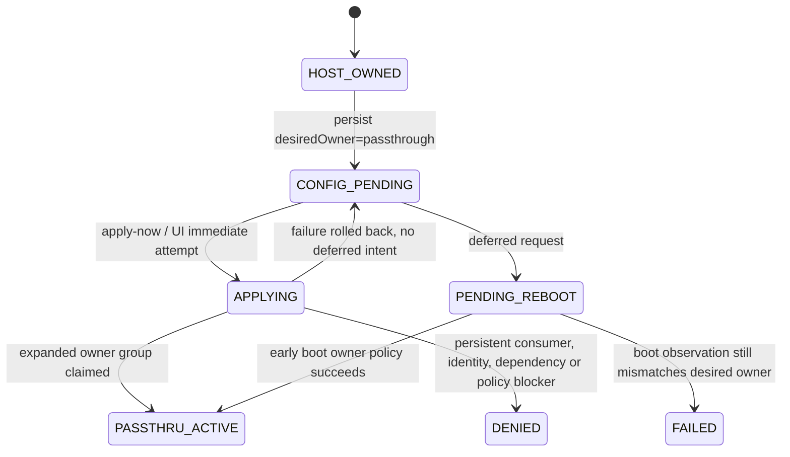

决定因素分三类：

1. **请求语义**：ESXCLI 不带 `-a` 就是显式延迟应用，设备再空闲也要等重启；这不是硬件判断。
2. **当前可解绑性**：带 `-a` 或 UI 尝试立即应用时，扩展后的 owner group 的 native driver、
   host service、storage path、网络用途或其他 consumer 必须能 quiesce/unclaim。本地 vSwitch A/B
   表明持久 host use 是 `DENIED`，并不会因为省略 `-a` 自动变成 pending reboot；只有被精确分类为
   transient、且具备 boot-claim proof 的阻塞才可能进入维护重启路径。
3. **重启是否真的能解决**：只有“启动早期可在 native driver/service claim 前交给 passthrough”
   的 ownership blocker 才是 `REBOOT_REQUIRED`。不可直通、identity/物理槽位记录不匹配、依赖
   不完整、host-critical 或策略拒绝都应是 `DENIED`，不能用“重启试试”掩盖。

FLR/SBR/reset contract 仍决定设备能否安全 attach、release 和复用，但它不能证明 native host
driver 当前可 detach，因此不能单独决定 reboot。BAR/MMIO 更是 VM admission，和 host owner
切换属于不同 gate。

### 3.4 Qman 激活规划算法

规划必须是无副作用纯函数，并先从显式请求扩展完整 `ownerActivationGroup`。它不能把
reset/isolation/VM admission closure 当成同一个集合：

```python
function planHostActivation(snapshot, requestedBdfs, desiredOwner, requestMode):
    requested = resolveExactIdentity(snapshot, requestedBdfs)
    ownerGroup = expandOwnerActivationGroups(snapshot, requested)
    require ownerGroup is complete and action-qualified

    if any ownerGroup member identity/path does not match persisted identity:
        return DENIED(ACTIVATION_IDENTITY_MISMATCH)
    if any ownerGroup member owner is UNKNOWN:
        return DENIED(CURRENT_OWNER_UNKNOWN)
    if any ownerGroup member quiesce fact is UNKNOWN:
        return DENIED(QUIESCE_STATE_UNKNOWN)
    if any ownerGroup member is host-critical, policy-denied, quarantined,
           or leased by another VM:
        return DENIED(exact blocker)
    if desiredOwner == PASSTHROUGH and
           any ownerGroup member has hostReservation:
        return DENIED(HOST_DEVICE_RESERVED)
    if any ownerGroup member has PERSISTENT_HOST_USE:
        return DENIED(PERSISTENT_HOST_USE)
    if every ownerGroup member effectiveOwner == desiredOwner:
        return ALREADY_ACTIVE

    changing = ownerGroup members where effectiveOwner != desiredOwner
    if requestMode != DEFER_TO_REBOOT and
           every changing member is IDLE and live-transition-supported:
        return LIVE_APPLY

    if requestMode explicitly permits reboot fallback and
           every changing member has a proven exact early-boot claim path:
        return REBOOT_REQUIRED
    return DENIED(BOOT_CLAIM_UNSUPPORTED)
```

`hostReservation=dataplane-dpdk` 是比 quiesce 探测更稳定的编排事实：目标 BDF 自身或扩组后任一
member 带有该 reservation，VM 激活立即返回 `DENIED(HOST_DEVICE_RESERVED)`。即使当前 DPDK
进程恰好退出、设备显示 idle，甚至存在 exact early-boot claim，planner 也不能把它降级为
`REBOOT_REQUIRED`；否则重启会把宿主 dataplane 的确定性保留误当成暂态驱动冲突。反向把设备
从 passthrough 归还给 host 不受该拒绝规则影响。

参考实现和覆盖四态、unknown/identity/lease/boot-claim 边界的单元测试见
[`activation.py`](pci-resource-model/pci_resource_model/activation.py) 与
[`test_activation.py`](pci-resource-model/tests/test_activation.py)。模型有意不把 reset bit 作为
重启判断；它验证 owner-group expansion、incomplete-group fail-closed、persistent host use 拒绝，
以及只有 request mode 显式允许 deferred、完整 owner group 具有 exact boot proof 时才返回
`REBOOT_REQUIRED`。主动 deferred 可用于 idle device；transient Busy 可在 `LIVE_OR_REBOOT` 下
fallback；persistent host use 始终拒绝。

Qman 只支持两种实现模式：

```text
activationMode = persistent-vfio | bind-on-lease
```

- `bind-on-lease` 是默认：查询阶段只返回 `LIVE_APPLY`，取得 durable lease 后才 quiesce、unbind、
  bind VFIO，并以实际 owner/driver/fd/DMA/IRQ 读回结果提交 `hostActive=true`。
- `persistent-vfio` 是维护模式：以 exact `deviceUid + physical path + identity hash + bundle hash`
  生成 early-boot claim manifest，在 native driver/service claim 前绑定；禁止只用全局 VID:DID，
  以免同型号 host 设备被误抢。
- `REBOOT_REQUIRED` 是规划结果，不是 activation mode。Qman 不自动重启 host；只有显式 maintenance
  事务才能持久化 `PENDING_REBOOT`。没有 early-boot claim 实现时应返回 `DENIED`，因为单纯 reboot
  不会让 Linux 自动改绑 VFIO。
- 命令成功、desired owner 已写入或进程退出码为 0 都不是提交点。必须读回 complete bundle 的
  effective owner/provider，并在不一致时 rollback 或 quarantine。

## 4. 总体架构

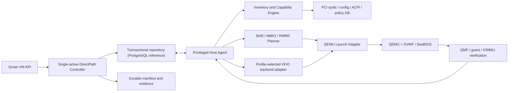

### 4.1 组件职责

| 组件 | 必须负责 | 禁止负责 |
| --- | --- | --- |
| Inventory agent | 全量 PCI 拓扑、资源、provenance、health 和 generation | 根据 VM 需要篡改硬件事实 |
| Capability engine | 静态 capable、dependency closure、reason code | 获取或释放实际 owner |
| DirectPath Controller + repository | 原子多 bundle 租约、assignedId、run generation、host epoch 与全局 CAS | 直接操作 PCI config space |
| Host agent | 本地 journal、bind/reset、backend prepare、受控 launch、receipt、rollback、quarantine | 用 SQLite 充当跨主机真相源；无 durable lease 自行选卡 |
| MMIO planner | selected BAR 布局、profile RMRR envelope、QEMU/firmware参数 | 把示例 hole 固定为生产默认 |
| QEMU adapter | 生成稳定 guest topology、启动和 QMP 验证 | 运行中重新选择 Dynamic backing |
| QEMU/VFIO | config/MMIO/IRQ/DMA 和可选 device migration | 分布式调度和跨进程租约 |
| Policy DB | HCL、errata、override、trust-domain 规则 | 用整个 class code 代替精确证据 |

### 4.2 控制面分层

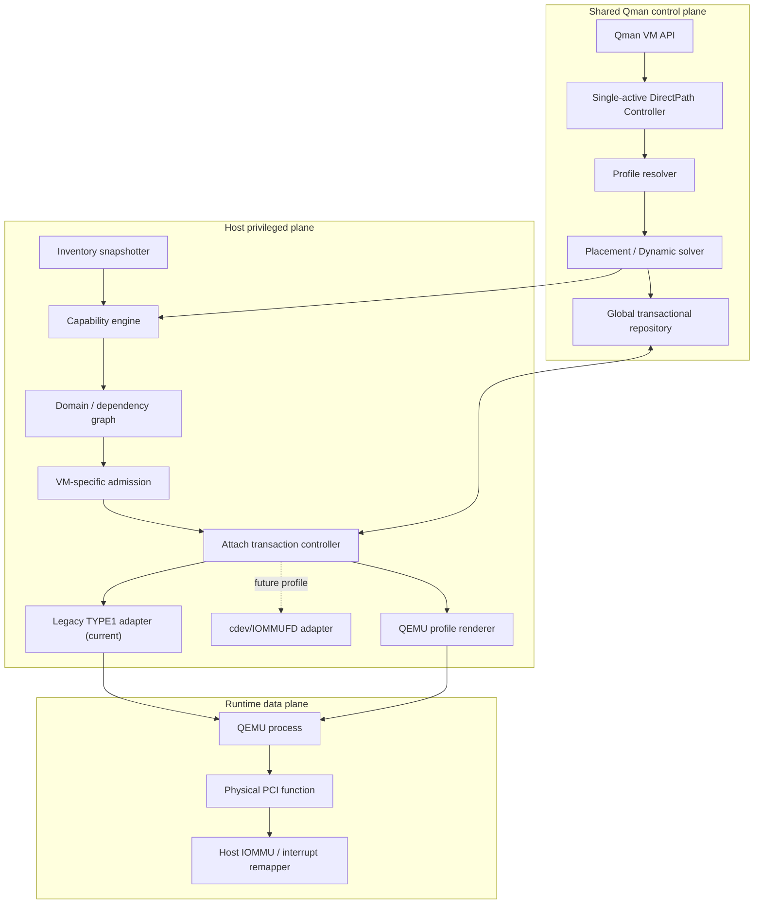

`Profile resolver` 先冻结 firmware/layout/machine ABI；`Capability engine` 只读取 snapshot，
不做 bind/reset；`Attach transaction controller` 只有拿到 durable lease 后才允许产生副作用。
QEMU 进程不是 owner 的权威记录，QMP success 也不是硬件清理完成的证明。
全局 repository 的参考实现是 PostgreSQL；Host Agent 本地 SQLite 只保存可重放 journal/cache。
Legacy 与 IOMMUFD 不得各自拥有 API、solver、FSM 或数据库 schema。

### 4.3 一次启动经过的七道门

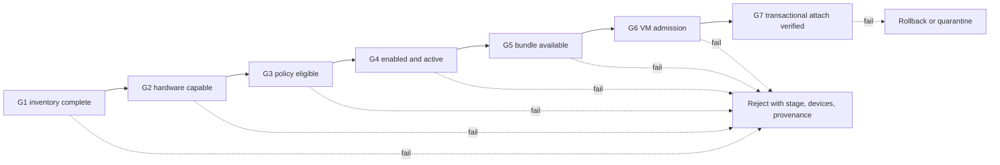

前六道门必须是无副作用计算。只有 G7 可以改 driver、打开 VFIO fd、执行 reset 或启动 QEMU。
任何 gate 都读取同一个 `snapshotEpoch/policyHash/profileHash`；版本不一致时整次计划作废。

## 5. 信任与安全模型

### 5.1 owner 和 trust domain

VM、DPDK 进程和其他 userspace driver 都是能够直接发起 DMA 的 owner。安全边界来自 IOMMU、
interrupt remapping、物理拓扑和租约，不来自进程名称。生产至少区分：

```text
untrusted-vm
trusted-vm
trusted-dpdk
host-kernel
qualification-lab
```

不同 trust domain 不能共享同一 `physicalIsolationDomain`、reset domain 或未证明安全的 P2P
互连。`uio_pci_generic`/`igb_uio` 不提供 VFIO/IOMMU 强制，不能用于 `untrusted-vm`。

### 5.2 ACS override 的强制约束

长期启用 `pcie_acs_override` 时必须同时保存：

```text
kernelIommuGroup          # 当前 kernel 的 VFIO 操作单位
physicalIsolationDomain  # 忽略 override 后保守重建的安全域
acsNativeIsolation
acsEffectiveIsolation
acsOverrideSource
```

租约闭包使用 physical domain，VFIO open/bind 使用 kernel group。缺少或矛盾 provenance 时
所有 override-dependent candidate fail-closed。本仓库的
[`kernel-patches/`](kernel-patches/README.md) 提供对应 Linux 6.6 接口和已构建验证。
对 physical domain 内每个 DMA-capable endpoint，必须二选一：与 payload 进入同一
owner/IOAS，或在整个 lease 期间解绑驱动、关闭 bus master 并证明 quiesced。只有不会
DMA 且不受 reset 影响的 fabric node 才可保留 host 所有权。任一 member 无法分类或
停机时拒绝整个 candidate；ACS override 本身永远不构成隔离证据。

### 5.3 DMA 和中断底线

Legacy TYPE1 与 IOMMUFD/cdev 的选择是 backend 资格问题，不是两套产品控制面，也不能仅凭
“接口更新”推导性能或安全结论：

| 维度 | Legacy VFIO group/container | IOMMUFD + VFIO cdev | Qman 结论 |
| --- | --- | --- | --- |
| 目标基线 | 覆盖本项目 4.18/4.19 与 6.6 kernel、QEMU 5.0/10.2 | 依赖较新 kernel、QEMU build 与独立资格验证 | 当前统一选 Legacy，避免为小规模旧基线分叉控制面 |
| QEMU 授权面 | stock QEMU 按 exact `host=BDF` 自行打开 group/device path | Host Agent 可预打开 cdev/IOMMUFD fd 并 typed 传递 | 两者都必须绑定 lease、generation、exact bundle 并产生 post-spawn receipt |
| 最小权限 | 需要 per-VM uid、mount namespace、device cgroup/LSM 和只读 sysfs 收窄 path | fd/cdev 更自然地表达 object-capability，减少 path 可见面 | cdev 的授权表达更清晰，但 Legacy 在完整 sandbox 下仍可满足当前边界 |
| DMA ownership | group/container；完整 IOMMU group 独占 | device-centric fd + IOAS，但 reset/P2P/隔离仍要求完整安全 ownership unit | IOMMUFD 不会消除 group/physical-isolation-domain 约束 |
| 功能演进 | 稳定、兼容旧平台；新 IOMMU userspace 能力有限 | 新内核 IOMMU userspace API、IOAS 和后续嵌套/脏页等能力的演进载体 | 只有出现明确 Feature 依赖时才建立 future profile |
| 性能 | 设备 DMA/IRQ 数据面可直达 | 同样可直达；API 新旧本身不证明吞吐或时延更好 | 不宣称 IOMMUFD 有普遍性能收益，必须按设备/workload 实测 |
| 迁移成本 | 当前实现量最小，且适配全部发货基线 | 新 adapter、renderer、receipt、kernel/QEMU 矩阵和 E4 qualification | 禁止运行时 fallback；后续按需求并行加入独立 profile |

- 对每个交给 VM 的 payload，Host IOMMU 必须存在，且该 function 必须有可验证的 translation
  domain；`NO_IOMMU` 和 `UNKNOWN` 都硬拒绝。
- 宿主可为可信 DPDK 保持 `enable_unsafe_noiommu_mode=1`。这个 module parameter 是能力开关，
  只产生审计 warning，不再作为整台 host 的 VM hard reject。
- DPDK BDF 必须以 `hostReservation=dataplane-dpdk` 显式保留。inventory scanner 记录该事实，
  availability gate、Dynamic matcher 和 lease solver 三层均不得把它放进 VM candidate pool；
  该运行归属事实不改写设备稳定的硬件 `passthruCapable` 结论。
- Interrupt remapping 对 untrusted VM 必须为 true；禁止 unsafe interrupts。
- Legacy VFIO group/container 是当前 VM 产品路径。每个 qualification profile 必须精确固定
  TYPE1v2 或 TYPE1，provider 和 QEMU 启动后 receipt 双重核验；禁止 `VFIO_NOIOMMU_IOMMU`、
  `/dev/vfio/noiommu-*` 和任意静默 fallback。
- Stock QEMU 5.0 legacy `vfio-pci` 没有 passed group/device fd property，只接受 `host`/`sysfsdev`；
  QEMU 10.2 的 `fd` property 只在 `CONFIG_IOMMUFD` 下注册。因此 Legacy launch grant 是
  `AUTHORIZED_DEVICE_PATH`，不是虚构的 fd-only：每 VM 独立 uid、mount namespace、device
  cgroup/LSM allowlist 与只读 sysfs 只暴露已租用 group/BDF，启动后再核对 `/proc/<pid>/fd`、
  QMP/QOM、argv hash、PID starttime、lease 和 run generation。版本证据见
  [`qemu-legacy-launch-surface-20260722.md`](evidence/qemu-legacy-launch-surface-20260722.md)。
- IOMMUFD/cdev 是未来独立 profile，可使用 pre-opened fd passing；它只替换 backend adapter、
  renderer 和 attach receipt，不复制 API、selector、lease、FSM、reason 或 manifest。
- IOMMUFD 的 device-centric fd 不改变 IOMMU group 单一 DMA owner 约束。
- ATS、PRI、PASID 默认不暴露；启用前必须证明 bind、invalidate、teardown 和 reset 语义。

inventory 必须区分三个事实，不能复用一个 `noIommuMode` 布尔值：

```text
host.unsafeNoIommuModeEnabled    # 全局内核允许位，可为 DPDK 开启
device.dmaIsolationMode          # IOMMU | NO_IOMMU | UNKNOWN
device.hostReservation           # dataplane-dpdk | 其他 host owner | null
```

仅看到 `iommu_group` symlink 不是最终证明：VFIO no-IOMMU 可创建 synthetic group。scanner 可
用 `/dev/vfio/noiommu-$GROUP` 识别明确反例；当前产品 C21 必须以 Legacy backend 成功选择精确
profile 所钉住的 TYPE1v2/TYPE1，并形成 QEMU 实际打开授权 group/device 的 receipt 为准。已有
cdev/IOMMUFD component proof 只证明未来 backend adapter 的前提，不能关闭当前产品路径。
QEMU/Linux 双场景的实际 bind、group 和 devnode 证据见
[`evidence/qemu-vfio-noiommu-split-20260718.md`](evidence/qemu-vfio-noiommu-split-20260718.md)。

当前 `pci_resource_model/vfio_provider.py` 已实现的 cdev 实验顺序为：捕获 exact BDF identity 与完整
IOMMU group，核对 caller 提供的 canonical identity/group hash，拒绝 `noiommu-N`，打开
IOMMUFD 并分配 IOAS，按 sysfs devt 与 `lstat -> O_NOFOLLOW open -> fstat` 打开 cdev，执行
`VFIO_DEVICE_BIND_IOMMUFD` 与 `VFIO_DEVICE_ATTACH_IOMMUFD_PT`，然后再次采集并核对 identity、
group、owner 和 node。关闭顺序为 detach、destroy IOAS、关闭 device/IOMMUFD；即使 cleanup
ioctl 失败也继续尝试关闭所有 fd。

Legacy provider 顺序固定为：相同的 preflight/no-IOMMU gate，打开 normal group，确认 viable，
打开 container 并核对 API version，要求**配置的** TYPE1v2 或 TYPE1 extension，`SET_CONTAINER`、
`SET_IOMMU`，再按 BDF `GET_DEVICE_FD` 并二次复核；关闭时先 device fd，再 `UNSET_CONTAINER`，
最后 group/container。reference provider 目前为了探测兼容面会按 TYPE1v2、TYPE1 尝试，产品实现
必须改成 exact profile pin；cdev 或另一 TYPE1 subtype 都不能成为失败后的 fallback。

provider proof 中的 `snapshotEpoch/topologyHash` 明确是 `CALLER_CORRELATION_ONLY`，不是 kernel
boot ID、ACS provenance 或整机 topology 的权威重算。组件真正复核的 claims 只有 PCI identity、
IOMMU group 和本次 VFIO DMA provider；standalone CLI 在输出前已清理 session，生命周期为
`ACQUIRED_AND_CLOSED`，proof 中的 IOAS/HWPT/device ID 不再可用。
当前手写 `_IO` UAPI 编码仅在 `x86_64/amd64/aarch64/arm64` 开放；其他架构在 sysfs/open 前
fail-closed，必须先用目标 Linux headers 生成并验收 ioctl ABI。
- P2P 必须显式声明 peer set。当前 QEMU IOMMUFD 文档仍列出 PCI BAR P2P mapping caveat，
  未通过 backend-specific 验收时直接拒绝。

## 6. 规范化 inventory

inventory 是事实快照，不是调度结果。每次 PCI add/remove、driver bind、link change、reset
失败、kernel reboot 或 policy 更新都递增 `snapshotEpoch`。

### 6.1 DeviceRecord

`DeviceRecord` 的跨进程、持久化和 hash projection 只有一个，严格等于
[`directpath-portable-entities.schema.json#/$defs/ENTITY-DEVICE-RECORD`](contracts/directpath-portable-entities.schema.json)：

```python
record DeviceRecord:                         # closed wire projection
    subjectType: const("DEVICE_RECORD")
    schemaVersion: const(1)
    hostId: Id
    deviceUid: IdentityV1DeviceUid
    immutableIdentity: IdentityV1
    identityFingerprint: SHA256
    currentBdf: CanonicalBdf
    physicalPathProvider: PhysicalPathProvider
    physicalPath: ProviderBoundPhysicalPath
    role: DeviceRole
    iommuProvider: IommuProvider
    physicalIsolationDomain: PhysicalIsolationDomainFact
    dependencyActions: CanonicalSet[DependencyAction]
    resetContract: ResetContractProjection
    owner: OwnerState
    bars: CanonicalSet[BarFact]
    interrupts: InterruptFacts
    health: DeviceHealth
    generations: DeviceGenerations
    provenance: DeviceProvenance
    deviceRecordHash: SHA256
```

`deviceUid` 按 [`contracts/directpath-identity-v1.schema.json`](contracts/directpath-identity-v1.schema.json)
的 `IDENTITY-V1` 与 `CANONICAL-JSON-V1` 生成；BDF 永不作为
identity input。没有 qualified serial/VPD 时必须使用 `SLOT_BOUND` 的稳定 physical location，
且 Static 是否允许由 profile 显式决定。所有 PCI ID 在 wire/hash 对象中使用固定宽度小写
十六进制字符串；采集器可在内部用整数，但跨进程前必须先规范化。

`structure/resources/domains/isolation/activation/policy` 等便于算法阅读的旧分组不是 wire 字段。
实现可以从 `immutableIdentity`、`role`、`iommuProvider`、`dependencyActions`、`resetContract`、
`owner`、`bars`、`interrupts` 和 `provenance.providerFacts` 物化只读 `DeviceEvaluationView`，但该 view
不得持久化、签名或独立计算 hash；它必须能无歧义投影回上面这一个 closed `DeviceRecord`，额外字段
进入 wire 一律拒绝。

### 6.2 必收集字段

| 类别 | 字段 |
| --- | --- |
| 身份 | VID:DID、subsystem、revision、class、VPD/serial hash（可用时） |
| 结构 | Header Type、PCIe type、parent、subordinate bus、physical slot、NUMA |
| BAR | index、size、I/O 或 memory、32/64-bit、prefetch、当前地址、ROM、VF BAR、ReBAR effective size |
| 隔离 | IOMMU group、physical domain、ACS native/effective/source、RID alias |
| Reset | sysfs methods、VFIO hot-reset affected set、method provenance |
| 功能依赖 | multifunction、PF/VF、NVLink/NVSwitch、vendor-declared group、platform dependency |
| DMA/IRQ | address width、MSI/MSI-X/INTx、vector count、ATS/PRI/PASID、interrupt remap |
| Reserved | RMRR/IVMD、reserved memory、ROM hash |
| 生命周期 | desired/effective owner、driver、quiesce/busy、boot-claim proof、admin state、health、generation、quarantine reason |
| 策略 | HCL/errata rule、override approval、profile compatibility、evidence level |

### 6.3 BAR 探测

正常 inventory 优先读取 kernel 已探测的 sysfs resource。write-all-ones sizing 只能在设备已经
解绑、quiesced、bus master/decode 已关闭且持有外部独占租约时执行；所有成功和异常路径恢复
BAR 与 `PCI_COMMAND`。本仓库 [`pci-resource-model/`](pci-resource-model/README.md) 已实现该
事务模型，但真实硬件写探测仍需单独资格验收。

### 6.4 Snapshot、provenance 与一致性

所有 evaluator 接受不可变 snapshot，不允许在算法中途再次零散读取 sysfs：

```python
record HostSnapshotWire:                    # exact portable hash subject
    subjectType: const("HOST_SNAPSHOT")
    schemaVersion: const(1)
    hostId: UUID
    kernelBootId: UUID
    hostEpoch: uint64
    agentGeneration: uint64
    hostAuthorityResourceVersion: uint64
    snapshotEpoch: uint64
    previousSnapshotContentHashOrNull: SHA256 | null
    capturedAt: Timestamp
    topologyDigest: SHA256
    deviceRecordDigests: CanonicalSet[SHA256]
    providerFactsDigest: SHA256
    policyHash: SHA256
    keyRingVersion: uint64
    signerKeyId: Id
    signature: Ed25519Signature | null
    contentHash: SHA256 | null

record SnapshotEvaluationView:              # internal, never a second wire object
    wire: HostSnapshotWire
    hostFacts: HostFacts
    devices: Map[BDF, DeviceEvaluationView]

record Fact[T]:
    value: T
    source: enum(kernel_uapi, patched_sysfs, acpi, config_space,
                 vendor_rule, qualification_snapshot, manual_audited)
    sourceVersion: string
    observedAt: Timestamp
    evidenceHash: SHA256
```

`HostSnapshotWire` 的唯一 schema 是
[`directpath-portable-hash-subjects.schema.json#/$defs/hostSnapshot`](contracts/directpath-portable-hash-subjects.schema.json)；
它不内嵌 device map。repository 读取 `deviceRecordDigests` 指向的 exact `DeviceRecord`，验证集合、
`providerFactsDigest/topologyDigest/contentHash/signature` 后才可构造 `SnapshotEvaluationView`。下文伪代码的
`snapshot.devices`、`snapshot.hostFacts` 是该只读 view 的快捷访问，不是 `HostSnapshotWire` 的额外字段；
`snapshot.hostId/snapshotEpoch/topologyDigest/policyHash` 都代理到 `snapshot.wire`。

扫描器先收集全 host，再做 domain closure，最后原子发布新 epoch。只扫描请求 BDF 会漏掉
IOMMU peer、reset peer 和 bridge child，因此不能产生 production snapshot。任一关键事实为
unknown 时，不使用“最常见情况”补值，而是在对应 gate 返回 fail-closed reason。

发布 snapshot 前至少检查：

```python
function publishSnapshot(raw):
    assert every device.parent either null or exists in raw.devices
    assert every domain member exists in raw.devices
    assert every device is a member of its own operational domains
    assert no parent cycle and no BDF identity collision
    assert ACS native/effective/source tuple is internally consistent
    assert topology did not change between first and final uevent sequence read
    return immutableHostSnapshot(
        snapshotEpoch=previous.snapshotEpoch + 1,
        previousSnapshotContentHashOrNull=previous.contentHash)
```

当前 [`authoritative_snapshot.py`](pci-resource-model/pci_resource_model/authoritative_snapshot.py)
已实现一个与该目标同方向、但信任范围受限的 component publisher/authorization：

- `capture_linux_full_snapshot()` 只接受 `FULL_HOST` capture，并要求
  `scannedDeviceCount == returnedDeviceCount == len(devices)`；连续两次完整扫描的 host、boot 和
  topology hash 必须相同，调用方不能自选 epoch。
- canonical signed envelope 覆盖 store instance、authority/key、host/boot/snapshot epoch、完整安全拓扑，
  以及每个 BDF 的 VID:DID/subsystem/revision、IOMMU group/member、identity/group hash 和 device
  generation；读取侧以 exact schema、duplicate-key、signature/content/topology/row cross-check 拒绝
  任何漂移。
- Linux native filesystem 上的 SQLite WAL/FULL store 使用 current-hash CAS 发布；resolved path、
  filesystem device/inode、store UUID、schema object/table 和无 TEMP user object 都是每次操作的 gate。
  insert 后硬退出不会暴露部分 epoch，并发同 CAS 只有一个 winner。
- publish 成功后把执行双扫描的同一个 capture provider 封存为
  `COMPONENT_CAPTURE_PROVIDER` capability；`authorize_launch()` 只为 current snapshot、current boot
  和 minimum epoch 签发 sealed context。VFIO 打开前后及 QEMU spawn 前只能复用该 capability 完成
  全量采集，launch caller 不能注入替代 provider。授权对象不可复制/pickle，退出 context 即失效。

该实现的 `trustBoundary` 固定为 `COMPONENT_AUTHENTICITY_ONLY`，算法是 HMAC-SHA256。共享组件 key
只能证明组件内 authenticity，不是 production trust root；没有 external monotonic rollback anchor
时，任何 earlier-valid SQLite 状态回放（包括同 key 下原位/块级恢复或删除最新行）都可能被接受，
inode/store UUID 不能提供 anti-rollback 证明。production key rotation/revocation、compatibility
catalog approval、kernel atomic topology/device-generation source 和 reset provider 也尚不存在。因此
`QMAN-E3-AUTHORITATIVE-SNAPSHOT-FAULT-001` 不关闭 C10/C15/C16/C18/F10 或 R04，也不完成 G1。

## 7. Capability 分层

### 7.1 输出模型

```text
hardwareCapable = assignable function role
               && host IOMMU/interrupt prerequisites
               && accepted reset path
               && trustworthy isolation
               && no structural/platform exclusion

technicallyAttachable = hardwareCapable
                     && given guest profile/VM resource context has a complete safe plan
                     # owner/lease/catalog state is deliberately excluded

qualified = exact platform/device/software/guest/workload record has valid E4 evidence

supported = qualified && current signed compatibility catalog contains exact record

policyEligible = hardwareCapable
              && HCL/errata/trust-domain policy permits
              && (supported in PRODUCTION || explicit UNQUALIFIED_LAB policy)

adminEnabled = policyEligible && administrator admitted device to pool

hostActive = adminEnabled
          && every bundle member effectiveOwner matches desiredOwner
          && effective provider state was read back

activationDisposition = plan(ALREADY_ACTIVE | LIVE_APPLY |
                             REBOOT_REQUIRED | DENIED)

available = adminEnabled
         && activationDisposition in {ALREADY_ACTIVE, LIVE_APPLY}
         && complete dependency bundle is healthy and free

attachable = available
          && technicallyAttachable
          && selected VM BAR/MMIO/RMRR/NUMA/IRQ admission passes

eligible = attachable              # IPD current-request state; not qualification/support

operationSupported(op) = attachable
                      && every selected device supports op
                      && target profile permits op
```

这些状态都必须返回，不能再压缩成一个 `passthroughCapable` 布尔值。

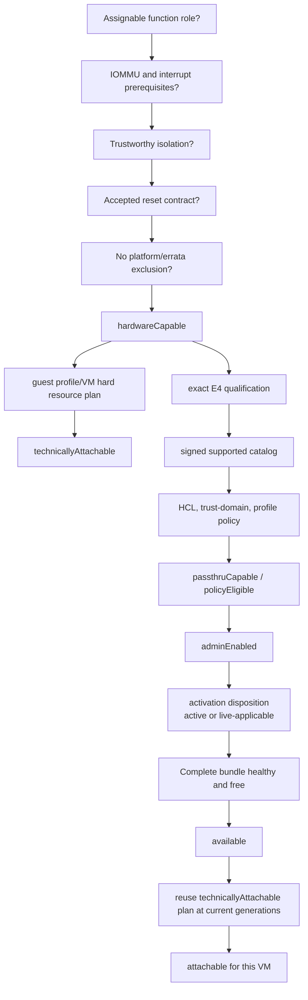

VMware API 的 `passthruCapable` 对标 `policyEligible`，而不是 `available` 或 `attachable`。
设备被另一台 VM 占用时，capable 不应抖成 false；只是 `available=false`。
`hostActive=false` 也不必自动令 candidate 消失：若 disposition 是 `LIVE_APPLY`，设备可在取得
lease 后进入启动事务；`REBOOT_REQUIRED` 和 `DENIED` 才阻断本次 VM 启动。

这与 IPD 四态一一对应：`TECHNICALLY_ATTACHABLE=technicallyAttachable`；
`ELIGIBLE=eligible`；`QUALIFIED=qualified`；`SUPPORTED=supported`。内部
`hardwareCapable/policyEligible/adminEnabled/hostActive/available/attachable` 是解释 VMware-like
capable 与运行时 gate 的分解字段，不得拿其中任意一个单独宣告产品 support。

### 7.2 设备 role

- Type-0 endpoint 和经过证明的 VF 可以作为 payload。
- Type-1 bridge、root port、switch port、host bridge 和实际承载 subordinate bus 的 function
  是 fabric node，只能作为 lease dependency，不能作为普通 payload。
- class code 是 metadata，不做 CPU/memory/bridge class blanket blacklist。
- 精确 denylist 只用于已知 errata，必须带 source、affected IDs/revisions、kernel/profile range、
  reason 和审计 override。

Role 判断使用结构证据，class code 只用于交叉检查：

```python
function classifyFunctionRole(d: DeviceEvaluationView) -> RoleDecision:
    if d.structure.headerType == TYPE1:
        return FABRIC("TYPE1_HEADER")

    if d.structure.hasSubordinateBus:
        return FABRIC("OWNS_SUBORDINATE_BUS")

    if d.structure.pcieType in {
        ROOT_PORT, UPSTREAM_PORT, DOWNSTREAM_PORT,
        PCIE_TO_PCI_BRIDGE, PCI_TO_PCIE_BRIDGE
    }:
        return FABRIC("PCIE_FABRIC_TYPE")

    if d.platform.hostBridge or d.platform.firmwareReserved:
        return PLATFORM("PLATFORM_OWNED")

    if d.sriov.isVirtualFunction:
        return VIRTUAL_FUNCTION("SRIOV_VF")

    if d.structure.headerType == TYPE0:
        return ENDPOINT("TYPE0_ENDPOINT")

    return UNKNOWN("INSUFFICIENT_STRUCTURE")
```

例如 CPU、内存控制器通常因 `platformOwned/firmwareReserved` 被拒绝；真实 Type-1 bridge 因
结构角色被拒绝。把 class 改成 display/network 不能绕过这两个 gate，反过来也不需要维护一个
“所有 CPU/memory class”黑名单。

### 7.3 reason code

所有 reason 至少带 `code`、`stage`、`devices`、`details`、`provenance`。权威 closed enum、retryability、
operator action 与 operation/CAS 引用位于
[`contracts/directpath-portable-control-contract.json`](contracts/directpath-portable-control-contract.json)
的 `errorContract.reasonCodes`；未登记 code 禁止出现在 wire/audit。下面只保留常见分组的阅读索引，
不是另一份枚举：

```text
HARDWARE_ROLE_NOT_ASSIGNABLE
HOST_IOMMU_MISSING
HOST_UNSAFE_NOIOMMU_MODE_ENABLED       # warning only
DEVICE_NO_IOMMU_DMA_ISOLATION
DEVICE_IOMMU_BACKING_UNKNOWN
HOST_DEVICE_RESERVED
INTERRUPT_REMAP_MISSING
IOMMU_GROUP_NOT_VIABLE
PHYSICAL_ISOLATION_DOMAIN_UNKNOWN
ACS_OVERRIDE_REQUIRES_WHOLE_PHYSICAL_DOMAIN
RESET_NOT_SUPPORTED
RESET_DOMAIN_UNVERIFIED
PLATFORM_RESERVED
DEVICE_ERRATA_DENY
ADMIN_DISABLED
HOST_ACTIVATION_REQUIRED
HOST_REBOOT_REQUIRED
HOST_DRIVER_BUSY
HOST_CRITICAL_DEPENDENCY
CURRENT_OWNER_UNKNOWN
QUIESCE_STATE_UNKNOWN
ACTIVATION_IDENTITY_MISMATCH
BOOT_CLAIM_UNSUPPORTED
ACTIVATION_OBSERVED_STATE_MISMATCH
DEVICE_QUARANTINED
DEPENDENCY_BUSY
DEPENDENCY_PROVENANCE_UNKNOWN
DEPENDENCY_ACTION_UNKNOWN
DEPENDENCY_ACTION_CONFLICT
DEPENDENCY_CLOSURE_LIMIT
PROFILE_NO_MATCH
PROFILE_ABI_MISMATCH
RMRR_PROFILE_CONFLICT
MMIO_APERTURE_EXHAUSTED
NUMA_POLICY_UNSATISFIED
LIVE_MIGRATION_UNSUPPORTED
HOTPLUG_UNSUPPORTED
INVENTORY_EPOCH_CHANGED
```

历史 `HOST_FENCE_PENDING` 不再是 wire code：控制面 generation 冲突使用
`STALE_HOST_EPOCH/STALE_RUN_GENERATION`，物理 source 不可达使用 `HOST_UNREACHABLE`。逻辑 epoch
从不声称完成 BMC/power fence。

### 7.4 输出对象与 reason 排序

```python
record CapabilityDecisionWire:              # the only persisted/signed projection
    subjectType: const("CAPABILITY_DECISION")
    schemaVersion: const(1)
    evaluationContext: enum(HOST_ONLY, VM_REQUEST)
    admissionMode: enum(PRODUCTION, ISOLATED_UNQUALIFIED_LAB)
    requestHash: SHA256
    snapshotEpoch: uint64
    policyHash: SHA256
    profileHash: SHA256
    bundleHashOrNull: SHA256 | null
    resourcePlanHashOrNull: SHA256 | null
    hardwareCapable: bool
    technicallyAttachable: bool | null
    qualified: bool
    supported: bool
    policyEligible: bool
    adminEnabled: bool
    hostActive: bool
    available: bool
    attachable: bool            # HOST_ONLY is always false
    eligible: bool
    reasons: List[Reason]
    warnings: List[Reason]
    decisionHash: SHA256 | null

record Reason:
    code: StableEnum
    stage: StableReasonStage
    devices: CanonicalSet[DeviceUid]
    details: CanonicalSet[ReasonDetail]
    provenance: CanonicalSet[ReasonProvenance]

record CapabilityEvaluationInternal:        # mutable algorithm view; never wire/hash
    wireDraft: CapabilityDecisionWireDraft
    wire: CapabilityDecisionWire | null
    target: BDF
    payload: SortedSet[BDF]
    passthruCapable: bool                    # compatibility view = policyEligible
    activationDisposition: enum(ALREADY_ACTIVE, LIVE_APPLY,
                                REBOOT_REQUIRED, DENIED) | null
    activationPlan: HostActivationPlan | null
    operationSupported: Map[Operation, bool]
    selectedReset: Map[BDF, ResetContract]
    leaseBundle: DependencyBundle | null
    resourcePlan: VmResourcePlan | null
```

`CapabilityDecisionWire` 严格等于
[`directpath-portable-hash-subjects.schema.json#/$defs/capabilityDecision`](contracts/directpath-portable-hash-subjects.schema.json)，
`Reason` 严格等于 operation envelope 的 closed `reason`；二者均拒绝额外字段。target/payload、activation
plan、operation matrix、selected reset、完整 bundle/resource plan 是内部计算输入或独立 hash artifact，
只能通过 `bundleHashOrNull/resourcePlanHashOrNull` 绑定，不能偷偷塞进 decision wire。
`finalizeDecision` 是唯一 projection：它把 HOST_ONLY 的内部 `attachable=null` 规范化为 wire
`attachable=false/eligible=false`，填充固定 context/hash，再按 canonical `[stage,code,devices]` 排序
reason。API 本地化 message 位于 signed decision 之外；code、devices、details、provenance 和 decision hash
保持稳定。下文变量 `out/decision` 是不越过进程边界的 `CapabilityEvaluationInternal`；访问同名布尔字段
表示访问其 `wireDraft`，最终只有 `finalizeDecision(out).wire` 可以落库、签名、缓存或返回 API。

### 7.5 capable 主算法

这是无副作用算法。它不 bind driver、不 reset、不抢租约：

```python
function evaluatePassthrough(snapshot, target, requestContext?, policy):
    ctx = requestContext or CapabilityContext.empty()
    profile = ctx.profile or policy.defaultCapabilityProfile
    out = CapabilityEvaluationInternal(
        snapshotEpoch=snapshot.snapshotEpoch,
        target=target,
        attachable=(false if ctx.vmSpec exists else null))

    # Gate 1: inventory completeness
    if target not in snapshot.devices:
        add(out, INVENTORY, DEVICE_NOT_IN_INVENTORY, {target})
        return finalizeDecision(out)
    if snapshot.hostFacts.unsafeNoIommuModeEnabled:
        warn(out, HARDWARE, HOST_UNSAFE_NOIOMMU_MODE_ENABLED, {})
    if not snapshot.hostFacts.iommuPresent:
        add(out, HARDWARE, HOST_IOMMU_MISSING, {target})
    if policy.requireInterruptRemapping:
        requireKnownTrue(out, snapshot.hostFacts.interruptRemapping,
                         INTERRUPT_REMAP_UNKNOWN, INTERRUPT_REMAP_MISSING)

    payload = normalizePayload(target, ctx.explicitPayload)
    out.payload = payload

    # Gate 2: resolve the stable dependency/action/reset closure before reading
    # admin, owner, health or VM resources. A target cannot be capable when a
    # mandatory guest/reset dependency has no safe action or reset contract.
    closure = resolveCapabilityClosure(snapshot, payload, profile, policy)
    merge(out, closure.reasons)
    if closure.success:
        out.payload = closure.bundle.payload
        out.leaseBundle = closure.bundle
        out.selectedReset = closure.selectedReset

        for bdf in closure.bundle.payload:
            d = snapshot.devices[bdf]
            role = classifyFunctionRole(d)
            if role.kind not in {ENDPOINT, VIRTUAL_FUNCTION}:
                add(out, HARDWARE, HARDWARE_ROLE_NOT_ASSIGNABLE, {bdf}, role)
            if d.platform.firmwareReserved or d.platform.hostCritical:
                add(out, HARDWARE, PLATFORM_RESERVED, {bdf})
            if d.dmaIsolationMode == NO_IOMMU:
                add(out, HARDWARE, DEVICE_NO_IOMMU_DMA_ISOLATION, {bdf},
                    source=d.dmaIsolationProvenance)
            if d.dmaIsolationMode == UNKNOWN:
                add(out, HARDWARE, DEVICE_IOMMU_BACKING_UNKNOWN, {bdf},
                    source=d.dmaIsolationProvenance)
            merge(out, evaluateIsolation(snapshot, d, policy))
            if bdf not in closure.selectedReset:
                add(out, HARDWARE, RESET_NOT_SUPPORTED, {bdf})

    out.hardwareCapable = closure.success and \
                         noBlockingReason(out, through=HARDWARE)

    # Gate 3: exact policy for every member/action, never a broad class shortcut.
    # A LOCK_ONLY fabric node may use a signed platform-action rule; it does not
    # need a guest-driver rule, but an implicit/missing action rule still rejects.
    if out.hardwareCapable:
        for bdf, action in out.leaseBundle.actions.sortedItems():
            d = snapshot.devices[bdf]
            rule = policy.qualificationDb.matchMemberAction(
                host=snapshot.hostFacts.identity,
                device=d.identity,
                action=action,
                kernel=snapshot.hostFacts.kernel,
                qemu=policy.qemuVersion,
                profile=profile)
            if rule is null:
                add(out, POLICY, QUALIFICATION_MISSING, {bdf},
                    details={"requiredAction": action},
                    source=policy.qualificationDb.provenance)
                continue
            if rule.denied:
                add(out, POLICY, DEVICE_ERRATA_DENY, {bdf}, rule.provenance)
            if not rule.supports(policy.trustDomain, ctx.operations, action):
                add(out, POLICY, QUALIFICATION_MISSING, {bdf}, rule.provenance)

    out.qualified = out.hardwareCapable and \
                    policy.qualificationDb.everyMatchedRuleHasValidE4(out.leaseBundle)
    out.supported = out.qualified and \
                    policy.supportedCatalog.containsExactQualificationSet(
                        out.leaseBundle, policy.qualificationDb.matchedRuleHashes)
    if policy.evaluationMode == PRODUCTION and not out.supported:
        add(out, POLICY, PROFILE_NO_MATCH, out.payload,
            details={"classification": "SUPPORTED_CATALOG_NO_MATCH"})
    if policy.evaluationMode == UNQUALIFIED_LAB and \
            not policy.explicitLabAdmission:
        add(out, POLICY, PROFILE_NO_MATCH, out.payload,
            details={"classification": "UNQUALIFIED_LAB_NOT_ENABLED"})
    out.policyEligible = out.hardwareCapable and noBlockingReason(out, through=POLICY)
    out.passthruCapable = out.policyEligible

    # Owner-independent technical plan: calculated even when the bundle is busy.
    # It maps directly to IPD TECHNICALLY_ATTACHABLE and is not support status.
    if ctx.vmSpec exists and out.hardwareCapable:
        technicalPlan = planVmResources(snapshot, out.leaseBundle,
                                        ctx.vmSpec, profile)
        out.resourcePlan = technicalPlan
        out.technicallyAttachable = technicalPlan.success and \
                                    hardOperationConstraintAllows(ctx.operations)

    # Gate 4: activation is planned without changing owner/driver.
    out.adminEnabled = out.policyEligible and allAdminEnabled(out.payload)
    if out.policyEligible and not out.adminEnabled:
        add(out, ACTIVATION, ADMIN_DISABLED, out.payload)
    if out.adminEnabled:
        out.activationPlan = planHostActivation(
            snapshot, out.leaseBundle, desiredOwner=PASSTHROUGH,
            requestMode=ctx.activationRequestMode or LIVE_ONLY)
        out.activationDisposition = out.activationPlan.disposition
        out.hostActive = out.activationDisposition == ALREADY_ACTIVE
        if out.activationDisposition == LIVE_APPLY:
            warn(out, ACTIVATION, HOST_ACTIVATION_REQUIRED,
                 out.activationPlan.transitionMembers)
        if out.activationDisposition == REBOOT_REQUIRED:
            add(out, ACTIVATION, HOST_REBOOT_REQUIRED,
                out.activationPlan.transitionMembers,
                details=out.activationPlan.reasons)
        if out.activationDisposition == DENIED:
            merge(out, out.activationPlan.reasons)

    # Gate 5: host reservations, current health and owners change availability;
    # the bundle above is already part of the stable capable decision.
    if out.adminEnabled:
        evaluateAvailability(snapshot, out.leaseBundle, ctx.owner, out)

    # Gate 6: optional VM-specific admission
    if ctx.vmSpec exists and out.available:
        evaluateVmAdmission(out.resourcePlan, ctx, out)
        out.attachable = out.technicallyAttachable and \
                         noBlockingReason(out, through=VM_ADMISSION)
    out.eligible = (out.attachable == true)

    evaluateOperationMatrix(out, ctx, policy)
    return finalizeDecision(out)

function finalizeDecision(out):
    wire = projectClosedCapabilityDecision(out.wireDraft,
        bundleHashOrNull=hashOrNull(out.leaseBundle),
        resourcePlanHashOrNull=hashOrNull(out.resourcePlan),
        attachable=(out.attachable == true),
        eligible=(out.attachable == true),
        reasons=stableSort(out.reasons),
        warnings=stableSort(out.warnings),
        decisionHash=null)
    validateClosed(wire, CAPABILITY_DECISION_SCHEMA)
    wire.decisionHash = hashCanonical(wire with decisionHash=null)
    out.wire = wire
    return out

function selectPublishedResetContract(snapshot, bdf, resetPolicy):
    candidates = []
    for c in snapshot.resetContracts.get(bdf, []):
        if c.snapshotEpoch != snapshot.snapshotEpoch:
            continue
        if c.topologyHash != resetTopologyHash(
                snapshot, bdf, c.affectedDevices):
            continue
        if c.source not in resetPolicy.trustedSources:
            continue
        if not resetPolicy.allows(c.method, c.scope):
            continue
        if not resetPolicy.qualificationDb.rule(c.qualificationRule).isCurrent:
            continue
        candidates.append(c)

    if candidates is empty:
        return reject(NO_ACCEPTED_RESET, {bdf})
    return min(candidates, key=resetPolicy.stablePreferenceOrder)
```

`selectPublishedResetContract` 只读 snapshot。真正调用 VFIO/ACPI/vendor provider 的
`discoverResetContract` 属于第 8.2 节的 inventory/qualification 流程；attach 事务再在租约内
重查一次。三处不得合并成一个“方便”的 helper，否则 capable 查询会产生解绑/reset 类副作用。

### 7.6 isolation evaluator

```python
function evaluateIsolation(snapshot, d, policy):
    if d.domains.kernelIommuGroup is empty:
        return reject(HARDWARE, IOMMU_GROUP_NOT_VIABLE, {d.bdf})

    if not snapshot.hostFacts.acsOverrideActive:
        if d.isolation.provenance in {NATIVE_ACS, NATURAL_TOPOLOGY,
                                      STOCK_KERNEL_IOMMU_GROUP}:
            return accept()
        return reject(HARDWARE, ACS_OR_TOPOLOGY_ISOLATION_MISSING, {d.bdf})

    # Override 开启后，patched kernel group 只能做 VFIO 操作单位。
    if not policy.allowAcsOverride:
        return reject(POLICY, ACS_OVERRIDE_NOT_ALLOWED, {d.bdf})
    if not d.isolation.componentProvenanceComplete:
        return reject(HARDWARE, PHYSICAL_ISOLATION_DOMAIN_UNKNOWN, {d.bdf})
    if d.domains.physicalIsolationDomain is empty:
        return reject(HARDWARE, PHYSICAL_ISOLATION_DOMAIN_UNKNOWN, {d.bdf})
    if d.bdf not in d.domains.physicalIsolationDomain:
        return reject(HARDWARE, PHYSICAL_ISOLATION_DOMAIN_INVALID, {d.bdf})
    if d.domains.physicalDomainSource not in {
            KERNEL_NATIVE_SHADOW_DOMAIN_V1,
            QUALIFIED_PLATFORM_NATIVE_DOMAIN}:
        return reject(HARDWARE, PHYSICAL_ISOLATION_DOMAIN_UNTRUSTED, {d.bdf})

    return acceptWithWarning(
        ACS_OVERRIDE_REQUIRES_WHOLE_PHYSICAL_DOMAIN,
        devices=d.domains.physicalIsolationDomain)
```

`allowAcsOverride=true` 只允许进入“整租 physical domain”的条件路径，不会把 override 变成
native ACS。unknown、来源冲突或 domain 不含自身均直接拒绝。

### 7.7 availability 与 VM admission

```python
function evaluateAvailability(snapshot, bundle, owner, out):
    if bundle.incompleteMembers not empty:
        add(out, AVAILABILITY, DEPENDENCY_NOT_IN_INVENTORY,
            bundle.incompleteMembers)
        return

    for member in bundle.members:
        d = snapshot.devices[member]
        if d.hostReservation is not null:
            add(out, AVAILABILITY, HOST_DEVICE_RESERVED, {member},
                details={"reservation": d.hostReservation})
        if d.health.state != HEALTHY:
            add(out, AVAILABILITY, DEVICE_QUARANTINED, {member}, d.health)
        if leaseOwner(member) not in {FREE, owner}:
            add(out, AVAILABILITY, DEPENDENCY_BUSY,
                {member}, owner=leaseOwner(member))
        if bundle.action[member] == QUIESCE_HOST and not canQuiesce(d):
            add(out, AVAILABILITY, DEPENDENCY_CANNOT_QUIESCE, {member})

    out.available = out.adminEnabled and \
                    out.activationDisposition in {ALREADY_ACTIVE, LIVE_APPLY} and \
                    noBlockingReason(out, through=AVAILABILITY)

function evaluateVmAdmission(plan, ctx, out):
    require(plan.success, VM_ADMISSION, MMIO_APERTURE_EXHAUSTED, plan.failure)
    require(plan.allMandatoryBarsAssigned,
            VM_ADMISSION, MANDATORY_BAR_UNASSIGNED, plan.unassigned)
    require(plan.rmrrCompatible,
            VM_ADMISSION, RMRR_PROFILE_CONFLICT, plan.rmrrConflict)
    require(plan.guestAbiSignature in ctx.allowedAbiSignatures,
            VM_ADMISSION, PROFILE_ABI_MISMATCH, plan.guestAbiSignature)
    require(plan.deviceCount <= ctx.profile.maxDevices,
            VM_ADMISSION, PROFILE_DEVICE_LIMIT, plan.deviceCount)
    require(plan.numaPolicySatisfied,
            VM_ADMISSION, NUMA_POLICY_UNSATISFIED, plan.numaDecision)
    require(plan.interruptBudgetSatisfied,
            VM_ADMISSION, INTERRUPT_BUDGET_EXHAUSTED, plan.interruptDecision)
```

### 7.8 不变量、缓存与重新计算

- `passthruCapable` 只能因 inventory/policy/profile 事实变化而变化，不能因当前 lease owner 变化。
- `available` 可以频繁变化，但不得写回 qualification DB。
- `attachable` 必须带 VM spec 和 profile hash；脱离该上下文的 true 没有意义。
- 任何 decision cache key 至少包含 `hostId + snapshotEpoch + policyHash + profileHash + requestHash`。
- driver rebind、reset、AER fatal、link flap、SR-IOV VF create/remove 都使相关 cache 失效。
- API 只允许从同一 decision object 派生各布尔值，禁止不同 endpoint 各自复制一套判断。

## 8. Dependency bundle

### 8.1 闭包规则

先区分六种集合：

| 集合 | 回答的问题 | 权威来源 | 是否直接决定 guest payload |
| --- | --- | --- | --- |
| `kernelIommuGroup` | kernel 允许哪些 function 共享一个 DMA owner？ | IOMMU core/VFIO | 否，决定 operational open/bind 单位 |
| `physicalIsolationDomain` | 忽略 ACS override 后，哪些 function 可能互相绕过 IOMMU？ | native/effective ACS provenance + topology | 否，决定安全租约边界 |
| `resetAffectedSet` | 执行选定 reset 会同时复位谁？ | VFIO hot-reset info 或已审核 function reset provider | 否，但必须全部被同 owner 控制 |
| `requesterAliasSet` | 哪些 requester 在 IOMMU 看来不可区分？ | IOMMU/PCI alias API、legacy bridge topology | 通常要求同 IOAS/owner |
| `functionalGroup` | 哪些 function 共享不可见硬件/firmware 状态？ | vendor rule/qualification | 由规则决定是否共同 payload |
| `leaseBundle` | 为安全完成一次 assignment 最终锁谁？ | 上述集合的传递闭包 | 只有 action=`ASSIGN` 的成员进 guest |

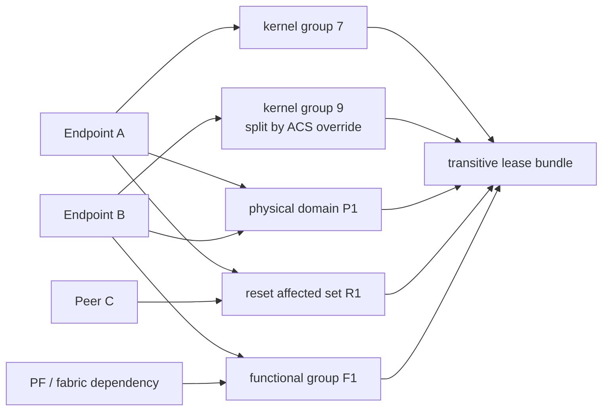

图中的 A、B 即使被 ACS override 分到不同 kernel group，仍因 P1 不能分给不同 trust domain；
A 的 bus reset 又把 C 拉入同一 lease。最终 bundle 是 hypergraph closure，不是选择一个“最大 group”。

对每个 payload seed 迭代求固定点：

```text
leaseDomain = closure(
    payload
  U kernelIommuGroup
  U physicalIsolationDomain
  U resetAffectedSet
  U requesterAliasSet
  U multifunctionSet
  U PF/VFDependencies
  U functionalGroup
  U platformDependencies
)
```

一个 bundle 可以包含不可直通的 fabric function。它们不进入 guest，但其 owner 必须被平台
锁定，必要时保持 host driver 状态不变。两个候选的 lease domain 有任意交集，就不是两个
可独立分配的资源。

### 8.2 reset domain

优先级为 device-specific、ACPI、FLR、AF FLR、PM function reset，再到已验证的 bus/link/slot
reset。bus-level reset 必须通过 `VFIO_DEVICE_GET_PCI_HOT_RESET_INFO` 或资格快照取得 affected
set；仅按 sysfs parent 猜测的集合默认拒绝。reset 日志不是内部状态已清除的证明。

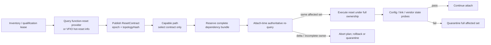

这条链故意把“知道 reset 会影响谁”和“此刻拥有 reset 所需全部设备”分开。前者形成可缓存
资格事实，后者只能在本次 lease 和同一个 VFIO ownership context 内证明。

#### 8.2.1 ResetContract

```python
record ResetContract:
    target: BDF
    operation: enum(VFIO_DEVICE_RESET, VFIO_PCI_HOT_RESET,
                    ACPI_RESET, VENDOR_RESET)
    method: enum(DEVICE_SPECIFIC, ACPI, FLR, AF_FLR, PM,
                 BUS, SLOT, LINK, HOT)
    scope: enum(FUNCTION, AFFECTED_SET)
    affectedDevices: SortedSet[BDF]
    affectedKernelGroups: SortedSet[GroupId]
    providerApi: string
    providerFlags: uint64
    source: Provenance
    snapshotEpoch: uint64
    topologyHash: SHA256         # target path + affected set, not whole-host hash
    qualificationRule: RuleId
    stateVerification: List[Probe]
```

`resetMethods` 表示候选能力，不等于 kernel 本次真的执行了某一种方法。只有 provider 能固定
或报告方法时才填精确 method；否则记录 `VFIO_DEVICE_RESET` 加候选集合，并由 qualification
证明其 scope。无法证明 function scope 时不能把 affected set 写成 `{target}`。

#### 8.2.2 Discovery 是 inventory 生产流程，不是 capable 副作用

bus-reset-only 设备通常需要先由 vfio-pci 打开才能查询 authoritative affected set。因此：

1. `persistent-vfio` 设备可在正常 inventory 时查询。
2. `bind-on-lease` 设备在管理员启用/qualification 阶段持有 host maintenance lease，临时
   quiesce、bind、query、restore，并把结果写入带 epoch 的 snapshot。
3. 普通 capable API 只消费已发布的 `ResetContract`，绝不为回答一个 GET 请求临时解绑设备。
4. attach 前在实际 lease 下重新查询；结果变化则废弃计划。

#### 8.2.3 查找 reset affected set 的伪代码

```python
function discoverResetContract(snapshot, bdf, provider, resetPolicy):
    d = snapshot.devices[bdf]

    # 优先选择已证明为 function-scoped 的路径。
    for method in resetPolicy.functionMethodOrder:
        capability = provider.queryFunctionReset(bdf, method)
        if not capability.supported:
            continue
        if capability.scope != FUNCTION:
            continue
        rule = resetPolicy.qualificationDb.matchReset(
            device=d.identity,
            platform=snapshot.hostFacts.platform,
            method=method,
            scope=FUNCTION,
            provider=capability.provenance)
        if rule is null or not rule.allowed:
            continue
        return ResetContract(
            target=bdf,
            operation=capability.operation,
            method=method,
            scope=FUNCTION,
            affectedDevices={bdf},
            affectedKernelGroups=groupsOf({bdf}),
            providerApi=capability.providerApi,
            providerFlags=capability.flags,
            source=capability.provenance,
            snapshotEpoch=snapshot.snapshotEpoch,
            topologyHash=resetTopologyHash(snapshot, bdf, {bdf}),
            qualificationRule=rule.id,
            stateVerification=rule.stateVerification)

    if not resetPolicy.allowBusReset:
        return reject(BUS_RESET_NOT_ALLOWED, {bdf})

    # UAPI 使用 argsz/count 的可变长返回；先查询 count，再填充数组。
    info = provider.getPciHotResetInfo(bdf)
    if info.error == ENODEV:
        return reject(NO_ACCEPTED_RESET, {bdf})
    if info.failed or info.devices is empty:
        return reject(RESET_DOMAIN_UNKNOWN, {bdf})

    affected = {decodeBdf(x.segment, x.bus, x.devfn) for x in info.devices}
    if bdf not in affected:
        return reject(RESET_DOMAIN_INVALID, affected union {bdf})
    if any(x not in snapshot.devices for x in affected):
        return reject(RESET_DEPENDENCY_NOT_IN_INVENTORY, affected)

    if provider.mode == CDEV:
        # DEV_ID 只声明 union 字段类型；此时允许看到 NOT_OWNED。
        if info.flags does not contain VFIO_PCI_HOT_RESET_FLAG_DEV_ID:
            return reject(RESET_PROVIDER_MODE_MISMATCH, affected)
        groups = groupsOf(affected)
    else if provider.mode == LEGACY_GROUP:
        if info.flags contains VFIO_PCI_HOT_RESET_FLAG_DEV_ID:
            return reject(RESET_PROVIDER_MODE_MISMATCH, affected)
        if any(x.groupId is unknown for x in info.devices):
            return reject(RESET_DOMAIN_UNVERIFIED, affected)
        groups = {x.groupId for x in info.devices}
    else:
        return reject(RESET_PROVIDER_MODE_UNSUPPORTED, {bdf})

    method = provider.reportedHotResetMethod()
    rule = resetPolicy.qualificationDb.matchReset(
        device=d.identity,
        platform=snapshot.hostFacts.platform,
        method=method,
        scope=AFFECTED_SET,
        provider=KERNEL_VFIO_HOT_RESET_INFO)
    if rule is null or not rule.allowed:
        return reject(QUALIFICATION_MISSING, affected)

    return ResetContract(
        target=bdf,
        operation=VFIO_PCI_HOT_RESET,
        method=method,
        scope=AFFECTED_SET,
        affectedDevices=affected,
        affectedKernelGroups=groups,
        providerApi=provider.uapiVersion,
        providerFlags=info.flags,
        source=KERNEL_VFIO_HOT_RESET_INFO,
        snapshotEpoch=snapshot.snapshotEpoch,
        topologyHash=resetTopologyHash(snapshot, bdf, affected),
        qualificationRule=rule.id,
        stateVerification=rule.stateVerification)
```

Linux VFIO UAPI 对两种 ownership proof 的约束不同：legacy group 调用 reset 时提交完整
`group_fds[]`；cdev 模式依靠同一 `iommufd_ctx` 中的 valid `devid`/owned flag，reset 传空 fd
数组。一个 affected set 内混用 legacy group 与 cdev 不支持，设计直接拒绝。

#### 8.2.4 执行 reset 的伪代码

```python
function executeReset(contract, lease, openedDevices, provider, qualificationDb):
    require lease.state == PREPARING or lease.state == RELEASING
    require lease.members containsAll contract.affectedDevices
    require leaseStore.currentOwner(contract.affectedDevices) == lease.owner
    require leaseStore.currentControllerGeneration() == lease.controllerGeneration
    require leaseStore.currentHostEpochForLease(lease.leaseId) == lease.hostEpoch
    require leaseStore.currentRunGenerationForLease(lease.leaseId) == lease.runGeneration
    require qualificationDb.rule(contract.qualificationRule).isCurrent
    require currentResetTopologyHash(
        contract.target, contract.affectedDevices) == contract.topologyHash

    if contract.scope == FUNCTION:
        freshFunction = provider.revalidateFunctionReset(
            contract.target, contract.operation, contract.method)
        require freshFunction.supported
        require freshFunction.scope == FUNCTION
        require freshFunction.provenance == contract.source
    else:
        fresh = provider.getPciHotResetInfo(contract.target)
        require not fresh.failed
        freshAffected = {
            decodeBdf(x.segment, x.bus, x.devfn) for x in fresh.devices
        }
        require freshAffected == contract.affectedDevices

    stopNewDma(contract.affectedDevices)
    maskInterrupts(contract.affectedDevices)
    clearBusMaster(contract.affectedDevices)
    drainPendingTransactions(contract.affectedDevices)

    if contract.scope == FUNCTION:
        require openedDevices.owns(contract.target)
        provider.executeFunctionReset(
            contract.target, contract.operation, contract.method)
    else if provider.mode == CDEV:
        require openedDevices.allUseMode(CDEV, contract.affectedDevices)
        require fresh.flags contains VFIO_PCI_HOT_RESET_FLAG_DEV_ID
        require fresh.flags contains VFIO_PCI_HOT_RESET_FLAG_DEV_ID_OWNED
        require no x.devid == VFIO_PCI_DEVID_NOT_OWNED for x in fresh.devices
        require openedDevices.sameIommufdCtx(contract.affectedDevices)
        provider.pciHotReset(contract.target, groupFds=[])
    else if provider.mode == LEGACY_GROUP:
        require openedDevices.allUseMode(LEGACY_GROUP, contract.affectedDevices)
        freshGroups = {x.groupId for x in fresh.devices}
        require freshGroups == contract.affectedKernelGroups
        fds = openedDevices.groupFds(contract.affectedKernelGroups)
        require count(fds) == count(contract.affectedKernelGroups)
        provider.pciHotReset(contract.target, groupFds=fds)
    else:
        reject(RESET_PROVIDER_MODE_UNSUPPORTED, contract.affectedDevices)

    restoreRequiredConfig(contract.affectedDevices)
    for probe in contract.stateVerification:
        require probe.verify() == PASS
```

任何 query delta、ownership 不完整、ioctl 失败或 state probe 失败，都 quarantine 整个
`affectedDevices`，不能只隔离 target。

### 8.3 functional group

functional group 覆盖 IOMMU 无法表达的设备关系，例如：

- vendor 声明必须共同分配的 multifunction functions；
- PF/VF 管理依赖；
- NVLink/NVSwitch 或其他 fabric-connected accelerators；
- 共享 firmware、doorbell、sideband management 或安全状态的 function；
- 允许 P2P 时的完整 peer set。

来源优先级为 vendor/HCL signed rule、host firmware/topology、qualification snapshot、人工审核。
不能从相同 VID:DID 自动推断功能依赖。

### 8.4 ACS override 下重建 physical isolation domain

本部署必须启用 override。不能只读 ACS capability bit，也不能把 override 后变小的 IOMMU
group 当物理事实。事实来源按以下优先级使用：

1. `KERNEL_NATIVE_SHADOW_DOMAIN_V1`：production authoritative source；
2. override 关闭时的 stock kernel IOMMU group；
3. `SOFTWARE_TOPOLOGY_ESTIMATE`：现有三项 ACS provenance 的保守估算，只用于开发和差分；
4. 缺任何事实时为 unknown。

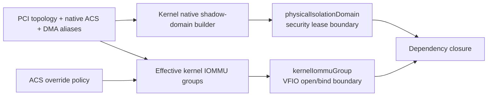

#### 8.4.1 Kernel authoritative shadow domain

现有 patch 已导出 `acs_native_isolation`、`acs_effective_isolation` 和
`acs_override_source`，但还没有导出 architecture requester alias 和 override 前的完整 group。
production 版本需增加 versioned shadow-domain ABI：

```python
record KernelPhysicalDomainFact:
    abiVersion: "native-shadow-domain-v1"
    topologyGeneration: uint64
    domainId: SHA256
    members: SortedSet[BDF]
    nativeAcsRequiredFlags: uint16
    aliasCoverageComplete: bool
    architectureConstraintsComplete: bool
    source: KERNEL_NATIVE_SHADOW_DOMAIN_V1
```

内核实现不是创建第二个 DMA domain，而是计算只读安全等价类；effective `iommu_group` 仍由
override 后的正常路径创建。伪代码中的 `forEachArchitectureGroupingEdge` 是待重构的内核内部
hook，必须复用实际 IOMMU/PCI group formation 的 alias/quirk 事实，不能在 sysfs 侧伪造：

```c
function rebuild_native_shadow_domains(pci_topology_generation):
    uf = union_find(all_present_pci_requester_functions)
    complete = true for each topology_component

    /* 实际 effective group 永远是安全租约的下界。 */
    for each effective_iommu_group:
        uf.union_all(pci_members(effective_iommu_group))

    /* 复用 kernel 已知 DMA requester aliases；无法映射的 RID 使 component unknown。 */
    for each pci_dev dev:
        for each alias_rid in pci_for_each_dma_alias(dev):
            alias_dev = resolve_present_requester(alias_rid)
            if alias_dev is missing:
                complete[component(dev)] = false
            else:
                uf.union(dev, alias_dev)

    /* 使用不含 pcie_acs_override 的 native verdict。 */
    for each fabric_node bridge in postorder:
        descendants = present_requesters_below(bridge)
        if not pci_acs_native_enabled(bridge, SV | RR | CR | UF):
            uf.union_all(descendants)

    for each multifunction_slot slot:
        if not native_multifunction_peer_isolation(slot, SV | RR | CR | UF):
            uf.union_all(present_functions(slot))

    /* 覆盖 iommu_ops/device_group、firmware alias 和非 PCI 层约束。 */
    for each edge in forEachArchitectureGroupingEdge():
        if edge cannot be represented by present lockable devices:
            complete[edge.component] = false
        else:
            uf.union(edge.left, edge.right)

    under topology_seqcount_write_lock:
        for each uf component:
            if not complete[component]:
                publish_unknown(component, topology_generation)
            else:
                members = canonical_sort(component.members)
                publish_same_fact_to_every_member(
                    domain_id=sha256(abi_version, generation, members),
                    members=members,
                    alias_coverage_complete=true,
                    architecture_constraints_complete=true)
```

ABI 可以是 sysfs 二进制/文本属性或 generic netlink dump，但必须支持一次 generation 的原子
全量读取。userspace 接受前验证：member list 对称且含自身、每个 effective group 是某个 shadow
domain 的子集、generation 一致、unknown component 不可租用。hotplug、AER remove、SR-IOV
create/remove 和 topology reset 都递增 generation。

验收需要同一硬件 A/B 启动：override 关闭时记录 stock groups，override 开启时要求 shadow
domain 是对应 stock group/alias constraint 的相等或保守超集；再做受控 peer-DMA 正负对照。
若架构 hook 尚未覆盖，`architectureConstraintsComplete=false` 直接拒绝，不用人工 allowlist
覆盖安全事实。

#### 8.4.2 Userspace estimate 仅作 fallback

下面算法保留用于当前 reference model 和 kernel shadow-domain differential test。即使 provenance
完整，其 source 仍是 `SOFTWARE_TOPOLOGY_ESTIMATE`；production policy 默认不把它放入
`TRUSTED_SOURCES`，因为 userspace 未必看得到所有 architecture requester alias：

```python
function reconstructPhysicalDomains(snapshot):
    if not snapshot.hostFacts.acsOverrideActive:
        return mirrorStockIommuGroups(source=STOCK_KERNEL_IOMMU_GROUP)

    uf = UnionFind(allBdfs(snapshot))

    for component in topologyComponents(snapshot):
        factsComplete = true
        anchors = Map[Anchor, List[BDF]]()

        for bdf in component.devices:
            chain = ancestorChain(bdf)
            if chain.hasCycle or any(not hasAcsProvenance(x) for x in chain):
                factsComplete = false
                continue

            for x in chain:
                f = snapshot.devices[x].isolation
                if f.overrideSource != NONE:
                    require f.nativeIsolation == false
                    require f.effectiveIsolation == true
                else:
                    require f.nativeIsolation == f.effectiveIsolation

            # 最高的 native non-isolating node 定义 conservative anchor。
            nonIsolating = [x for x in chain
                            if snapshot.devices[x].isolation.nativeIsolation == false]
            anchor = highest(nonIsolating) if nonIsolating else uniqueNativeAnchor(bdf)
            anchors[anchor].append(bdf)

        if not factsComplete:
            markPhysicalDomainUnknown(component)
            continue

        for members in anchors.values:
            uf.unionAll(members)
        for d in component.devices:
            uf.unionAll(d.domains.kernelIommuGroup)
            uf.unionAll(d.domains.multifunctionSet)
            uf.unionAll(d.domains.requesterAliasSet)

    for component in uf.components:
        source = (SOFTWARE_TOPOLOGY_ESTIMATE
                  if component.crossesOverridePath
                  else KERNEL_NO_OVERRIDE_IOMMU_GROUP)
        publishPhysicalDomain(component.members, source)
```

缺失 provenance 只使相应 topology component unknown，不应用手工猜测补齐。每个 domain
必须包含自身并对所有成员给出相同 canonical member list；不满足对称性即 inventory invalid。
若部署选择在单一 trust domain 的实验环境临时接受 estimate，manifest 必须标记 unsafe，且不能
把该结果提升为 production qualification。

### 8.5 构造 CapabilityClosure 与最终 DependencyBundle

Domain 是 hyperedge。member action 可能把新 function 提升为 guest payload，而每个新增 payload
又需要自己的 reset contract；reset affected set 反过来继续扩大 ownership members。因此不能
对初始 BDF 选完 reset 后做一次 union，也不能对新 member 调用不存在的 `resetContracts[bdf]`。
使用以下 owner-independent 单调固定点：

```python
function resolveCapabilityClosure(snapshot, initialPayload, profile, policy):
    payload = Set(initialPayload)
    members = Set(initialPayload)
    actions = Map(default=NONE)
    resetContracts = Map[BDF, ResetContract]()
    edges = Set[DependencyEdge]()

    for bdf in payload:
        actions[bdf] = ASSIGN_TO_GUEST

    repeat:
        previous = hashCanonical(payload, members, actions,
                                 resetContracts, edges)

        # Expand stable topology/security/functional domains first.
        for bdf in sorted(members):
            d = requireDevice(snapshot, bdf)
            domains = {
                IOMMU: d.domains.kernelIommuGroup,
                PHYSICAL: d.domains.physicalIsolationDomain,
                REQUESTER_ALIAS: d.domains.requesterAliasSet,
                MULTIFUNCTION: d.domains.multifunctionSet,
                PF_VF: d.domains.pfVfDependencies,
                FUNCTIONAL: d.domains.functionalGroup,
                PLATFORM: d.domains.platformDependencies,
            }
            for kind, peers in domains:
                if not trustedAndComplete(kind, d):
                    return reject(DEPENDENCY_PROVENANCE_UNKNOWN, {bdf})
                for peer in peers:
                    requireDevice(snapshot, peer)
                    edge = DependencyEdge(
                        bdf, peer, kind, provenanceOf(kind, d))
                    edges.add(edge)
                    members.add(peer)
                    action = conservativeRequiredMemberAction(
                        edge, snapshot.dependencyFacts,
                        payload, profile.dependencyPolicy,
                        currentActions=actions)
                    actions[peer] = mergeMemberActionOrReject(
                        actions[peer], action)

        # Only independently assigned/reset targets select a reset method.
        # A peer held solely because SBR affects it does not recursively select
        # an unrelated reset method unless an action rule promotes it.
        resetTargets = sorted(bdf for bdf in members
                              if actionRequiresTargetReset(actions[bdf]))
        for bdf in resetTargets:
            contract = selectPublishedResetContract(
                snapshot, bdf, policy.resetPolicy)
            if contract.rejected:
                return rejectWith(contract.reasons)
            resetContracts[bdf] = contract

            for peer in contract.affectedDevices:
                requireDevice(snapshot, peer)
                edges.add(DependencyEdge(
                    bdf, peer, RESET, contract.provenance))
                members.add(peer)
                hold = resetOwnershipAction(contract, target=bdf, peer=peer)
                actions[peer] = mergeMemberActionOrReject(
                    actions[peer], hold)

        promoted = {bdf for bdf in members
                    if actions[bdf] == ASSIGN_TO_GUEST}
        payload = payload union promoted

        if members.size > policy.maxDependencyMembers or \
                edges.size > policy.maxDependencyEdges:
            return reject(DEPENDENCY_CLOSURE_LIMIT, members)
    until hashCanonical(payload, members, actions,
                        resetContracts, edges) == previous

    if any action in {NONE, UNKNOWN}:
        return reject(DEPENDENCY_ACTION_UNKNOWN,
                      membersWithUnknownAction(actions))
    if not actionCompatibilityIsSafe(actions, resetContracts):
        return reject(DEPENDENCY_ACTION_CONFLICT,
                      conflictingMembers(actions))

    bundle = DependencyBundle(
        id=hashCanonical(members, payload, edges, actions,
                         snapshot.snapshotEpoch, policy.hash),
        members=sorted(members),
        payload=sorted(payload),
        actions=canonicalMap(actions),
        edges=stableSort(edges),
        snapshotEpoch=snapshot.snapshotEpoch,
        policyHash=policy.hash)
    return CapabilityClosure(
        success=true,
        bundle=bundle,
        selectedReset=resetContracts)
```

`mergeMemberActionOrReject` 使用显式 action lattice，不是随意取 enum 最大值。默认可提升路径是
`LOCK_ONLY -> VFIO_HOLD_IN_SAME_DMA_DOMAIN -> ASSIGN_TO_GUEST`；`QUIESCE_HOST` 与 guest assignment
冲突时必须有精确 signed rule，否则拒绝。算法以 set 去重、stable sort 和 member/edge 上限保证
cycle-safe、确定性终止；超限不能返回截断 bundle。

action resolver 只使用内置保守映射和 snapshot 中带可信 provenance 的 dependency fact；它不读
owner/admin，也不接受普通 allowlist 缩小 physical/reset closure。qualification gate 随后验证每个
member/action 的精确支持。未来若要缩小闭包，必须创建新 profile、改变 policy hash 并以 E4 证据
证明，而不是在运行时覆写 capable。

Bundle 的相交关系以 `members` 判断，而不是 payload。任何两 bundle 的 member intersection
非空，就不能同时租给不同 owner。每条 edge 保存 kind 和 provenance，管理员可解释“为什么
一张 NIC 把旁边 function/bridge 也锁住”。

`VFIO_HOLD_IN_SAME_DMA_DOMAIN` 表示 function 不出现在 guest PCI tree，但 host agent 必须打开并
置于同一 DMA owner，满足 IOMMU group 或 cdev hot-reset ownership。它与只关闭 bus master 的
`QUIESCE_HOST` 不同，manifest 必须记录实际 action。当前 Legacy adapter 对应同一个 TYPE1
container；未来 cdev adapter 对应同一个 IOMMUFD/IOAS。历史材料中的
`VFIO_HOLD_IN_SAME_IOAS` 只作为读取别名；持久对象、API、manifest 和新实现一律写 canonical
enum `VFIO_HOLD_IN_SAME_DMA_DOMAIN`，避免把 future cdev 名词泄漏到 Legacy 合同。

## 9. 静态直通设计

### 9.1 持久配置

持久对象使用唯一 closed `ENTITY-VM-DIRECTPATH-REQUEST` projection；外层索引字段必须与
`canonicalRequest` 对应字段 byte-equal，不是第二套输入：

```python
record VmDirectPathRequestWire:
    subjectType: const("VM_DIRECTPATH_REQUEST")
    schemaVersion: const(1)
    vmId: Id
    requestVersion: uint64
    requestType: enum(STATIC, DYNAMIC)
    canonicalRequest: StaticCanonicalRequest | DynamicCanonicalRequest
    requestHash: SHA256                 # hash(CANONICAL-JSON-V1(canonicalRequest))
    requiredGuestAbiClass: Id
    lifecyclePolicy: StaticLifecyclePolicy | DynamicLifecyclePolicy
    requestedBy: Id
    createdAt: Timestamp                # equals canonicalRequest.issuedAt
    resourceVersion: uint64

record StaticCanonicalRequest:
    schemaVersion: const(1)
    vmId: Id
    requestVersion: uint64
    requestType: const(STATIC)
    selector: {
        selectorType: const(STATIC_FIXED_IDENTITY_SET),
        members: CanonicalSet[{
            requirementId, deviceUid, identityFingerprint, enrolledHostId,
            expectedPhysicalPathProvider, expectedPhysicalPath,
            expectedCurrentBdf, guestSlot
        }]
    }
    hostAffinity: {mode: const(EXACT_HOST), hostId: Id}
    requiredGuestAbiClass: Id
    lifecyclePolicy: StaticLifecyclePolicy
    profileBinding: ProfileBinding
    snapshotConstraint: ResolveCurrentAtOperation | PinnedCurrentSnapshot
    policyBinding: PolicyBinding
    mutationPrecondition: MutationPrecondition
    idempotency: IdempotencyBinding
    requestedBy: Id
    issuedAt: Timestamp
```

完整字段、const、nullability、canonical order 和 selector union 严格以
[`directpath-portable-entities.schema.json#/$defs/ENTITY-VM-DIRECTPATH-REQUEST`](contracts/directpath-portable-entities.schema.json)
为准。`deviceUid` 和 `identityFingerprint` 的 canonical 算法由 portable contract 的 `IDENTITY-V1`
冻结；`expectedCurrentBdf` 只是 revalidation 位置事实。BDF/location 改变、板卡被替换或 fingerprint 不符时必须拒绝并要求
管理员显式 re-enroll，不能像 Dynamic 模式一样自动换卡。这里的 `qman-*` 是产品 guest profile，
不是把 VMware 实验 profile 当成 Qman 支持项。

`RESOLVE_CURRENT_AT_OPERATION` 由 repository 读取当时唯一 HostAuthority current pointer，再检查
`maximumAgeMicros` 并签发 sealed binding；`PINNED_CURRENT_SNAPSHOT` 则要求 request 中的完整
`hostId/kernelBootId/hostEpoch/agentGeneration/hostAuthorityResourceVersion/snapshotEpoch/snapshotContentHash`
binding 与 current pointer byte-equal 且未超龄。不存在“minimum epoch + 可独立组合的 boot/hash/BDF”
兼容入口；两种模式在任何 side effect 前都会变成同一种 exact current binding。

### 9.2 状态机

Owner activation 与 VM assignment 是两台正交状态机，不允许再混成一张图：

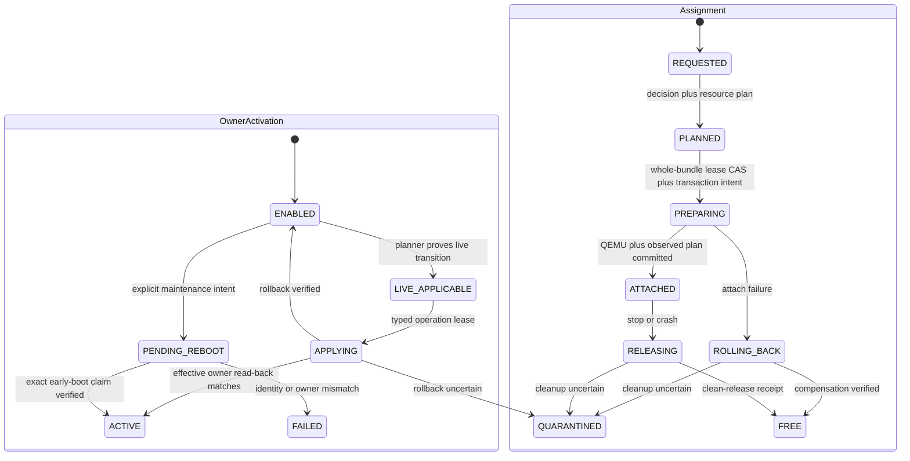

`ACTIVE` 只表示 host effective owner，`ATTACHED` 才表示某次 VM run 已提交；二者不能互换。
quarantine 也分别保存 owner recovery 与 assignment recovery 事实，通过同一个 bundle conflict key
阻断新事务，但不把两台 FSM 的 state 写进同一列。

### 9.3 启动事务

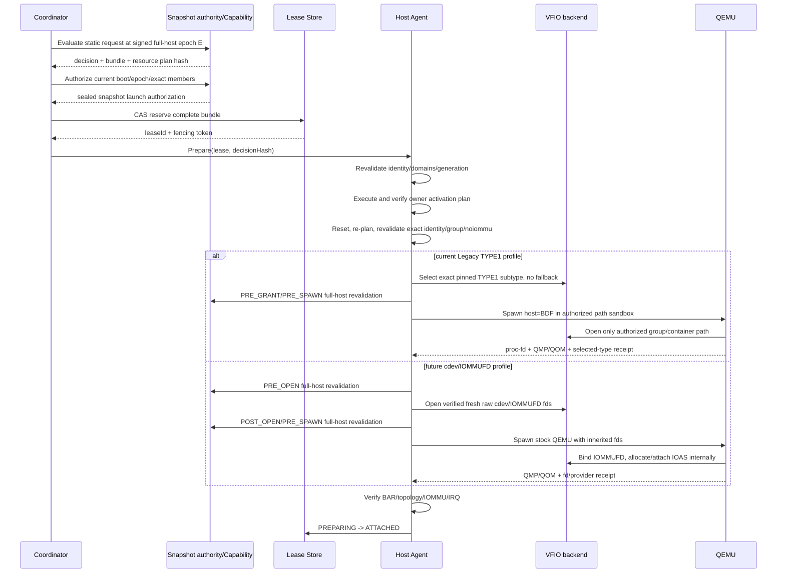

1. 读取 inventory 和 policy epoch，确认 exact device identity。
2. 计算 dependency bundle，执行 durable compare-and-swap lease。
3. 再次读取 udev generation、BDF identity 和 group membership，防止 TOCTOU。
4. 按 activation plan quiesce 完整 bundle，设置 `driver_override`，解绑 host driver、bind
   `vfio-pci`，再读回 effective owner；任何成员不匹配都不继续。
5. 执行选定 reset，重新读取 config/link/health，失败则 rollback 或 quarantine。
6. 根据最终 bundle 计算 BAR/MMIO/RMRR、NUMA、IRQ 和 guest ABI plan。
7. launcher 只能从 sealed snapshot authorization 派生完整 group/member request，并按已冻结
   backend profile 生成 typed grant。当前 Legacy profile 必须精确选定 TYPE1v2 或 TYPE1，
   不可用时直接 fail closed，不得切换 subtype 或 cdev。
8. Legacy 分支派生 `AUTHORIZED_DEVICE_PATH`：QEMU 使用 typed `vfio-pci,host=<BDF>`，
   但运行于 per-VM transient uid、mount namespace、device cgroup/LSM 和 read-only sysfs 中，
   只能看到已授权 BDF/group。启动后以 `/proc/<pid>/fd`、QMP/QOM 和 selected TYPE1
   receipt 证明没有越权打开。
9. 未来 cdev/IOMMUFD 分支才在 `PRE_OPEN/POST_OPEN` 之间打开 fresh raw fd，并由
   stock QEMU 执行 `VFIO_DEVICE_BIND_IOMMUFD`、IOAS 分配和 attach。它与 Legacy 只在
   backend adapter、renderer、grant 和 receipt 分叉，不复制 API、solver、FSM 或 store。
10. 两个分支都在 render 和 `Popen` 前做 `PRE_SPAWN` full-host revalidation，并要求
    snapshot/lease authorization 在 spawn 时仍 active。只有 QMP/QOM、backend ownership、Guest
    和独立 IOMMU/DMA/IRQ 观察全部通过，才能将 lease 从 `PREPARING` 提交为 `ATTACHED`。

#### 9.3.1 当前可执行 component envelope 与产品提交边界

仓库中的 schema-v4 `StaticLaunchEnvelopeStore` 把 9.3 中未来 cdev 分支的关键顺序
实现为独立 component；它不实现当前 Legacy path grant/sandbox/receipt：

```text
lease:    RESERVED -> PREPARING --------------------------------> QUARANTINED
envelope: INTENT -> LEASE_PREPARED -> HANDLES_OPEN -> QEMU_RUNNING
          -> QMP_RECEIPT_VERIFIED -> CLEANING ------------------> QUARANTINED

完整提交分支（本轮未到达）：
QMP_RECEIPT_VERIFIED -> DMA_RECEIPT_VERIFIED -> COMMIT_INTENT_DURABLE
-> lease ATTACHED -> envelope ATTACHED_CONFIRMED
```

envelope 数据库与权威 lease 数据库分别绑定 resolved path、filesystem device/inode、store UUID、
host、authority 和 schema；QEMU pid/start token、fd binding hash、launch plan hash、QMP/DMA observer
identity 与 nonce 都进入持久状态。QMP 与 DMA observer 必须是不同 identity 和 key。任何 schema/
metadata/store/lease/process/receipt 漂移都在 commit 前回滚当前 envelope mutation。

`open_vfio_launch_bundle()` 对每个涉及的 IOMMU group 要求精确完整成员，用一个共享 IOMMUFD
打开全部 cdev，打开后再复核全部 identity/group/node；任一失败按逆序关闭整个 ownership unit。
typed QEMU renderer 对同一 IOMMUFD 只创建一个 `-object iommufd`，每个 `vfio-pci` 只引用继承 fd。

`QMAN-E3-STATIC-LAUNCH-ENVELOPE-001` 的 v5 nested-QEMU run 已把
`AUTHORITATIVE_COMPONENT_SNAPSHOT_V1`、sealed capture provider、lease authorization、完整 IOMMU
group raw handles 与 QEMU adapter 绑定为同一条链，并强制 QEMU plan 的 BDF 集合等于
`authorized_bdfs`、覆盖每个 group member。2 次 publish scan 与 `PRE_OPEN`、`POST_OPEN`、两次
`PRE_SPAWN` 共 6 次 full-host capture 均得到相同 12-device topology；snapshot/lease authorization
在 `Popen` 时仍 active。
随后 stock QEMU 的 bind、IOAS allocate、attach ioctl 均成功，QMP/QOM realized endpoint 也通过。

实验仍没有 independent DMA/IRQ receipt，所以严格走 `CLEANING -> QUARANTINED`，`ATTACHED` 未提交，
bundle/member claims 保留且 raw handles 已关闭。HMAC snapshot/QMP authenticators 都只是 component
authenticity；没有 external rollback anchor、production key/catalog/generation/reset provider。该结果
只推进 TS-F1-01、TS-F3-02/03/05、TS-F5-04 与 TS-F8-02 的 component premise，不推进任何产品
milestone，不关闭 C21/S05/R04/R05/R26/R27。

### 9.4 释放事务

这里的强不变量是**独占权连续**，不是“QEMU 的原 fd 必须跨进程保留”。Stock QEMU 持有的
VFIO fd 会随进程退出关闭，Host Agent 不能把它们事后据为己有；因此产品使用一个在 QEMU 停止
前持久化的 `ReleaseOwnershipGuard`，把 durable lease、host/run generation、全入口 deny、
完整 affected set 和 OS device ACL 绑定在一起。在 guard 撤销前，除本次 Host Agent 外没有主体
能重新打开或重新分配 bundle。

1. `ATTACHED -> RELEASING` 做 CAS，并在任何 stop 副作用前签发
   `ReleaseOwnershipGuard`；撤销本次 launch grant，阻断新的 QEMU/raw-QMP/VFIO opener。
2. 要求 guest/设备停止提交 DMA，收集 QMP teardown 状态，再按 deadline 停止并 fence QEMU；
   以 pidfd/starttime 和 `/proc/<pid>/fd` 证明原进程及其 VFIO fd 已消失。进程未能消失时保持
   lease 并 quarantine，绝不继续 reset 或 restore driver。
3. 在 guard 和完整 bundle lease 仍有效时，由 backend adapter 获取新的、仅用于 release 的
   reset ownership context：Legacy 重新打开 exact group/container/device，固定原 TYPE1 subtype；
   future cdev 重新打开 exact cdev/reset handles，但不复用已销毁的 guest IOAS。
4. 核对 owner 仍为 `vfio-pci`、identity/group/physical/reset affected set 未漂移；证明旧 guest
   DMA/IRQ context 已 teardown，再关闭 bus master/interrupt 并执行 qualified release reset。
5. reset 和 post-reset probe 通过后关闭 release handles；按 activation mode 恢复原 host driver
   或验证 persistent VFIO owner，并验证无 stale DMA/IRQ、identity/link/health。
6. 递增 device generation。仅在所有 receipt 成功时清除 runtime binding、释放 lease 和 guard；
   否则保留 recovery binding、lease 与 guard 的 deny 效果，并 quarantine 整个 affected set。

这个次序同时适用于 Legacy 与 future cdev；差异仅在 `acquireReleaseContext`、backend teardown
receipt 和 handle close adapter。任何实现若“先把 lease/ACL 变为 FREE，再尝试 reset”，或把
QEMU 退出等同于 clean release，均违反本合同。

### 9.5 启动事务伪代码

```python
function attachStatic(vm, request):
    validateClosedEntity(request, ENTITY_VM_DIRECTPATH_REQUEST)
    require request.requestType == STATIC
    canonical = request.canonicalRequest
    require canonical.requestType == STATIC
    require indexedProjectionByteEqualsCanonical(request)
    require hashCanonical(canonical) == request.requestHash
    require canonical.hostAffinity.mode == EXACT_HOST
    require canonical.selector.selectorType == STATIC_FIXED_IDENTITY_SET
    profile = resolveExactProfileBinding(canonical.profileBinding)
    snapshotAuthorization = snapshotStore.authorizeLaunch(
        hostId=canonical.hostAffinity.hostId,
        snapshotConstraint=canonical.snapshotConstraint,
        requestedDeviceUids=sorted(m.deviceUid for m in canonical.selector.members))
    # 两个 authorization 都必须一直存活到 Popen。
    snapshot = snapshotAuthorization.snapshot
    selected = resolveStaticMembersExact(
        snapshot, canonical.selector.members,
        requireIdentityFingerprint=true,
        requireEnrolledHostAndPhysicalPath=true,
        requireExpectedCurrentBdf=true)
    decision = evaluatePassthroughSet(snapshot, selected.currentBdfs,
                                      context(vm, profile, request.requestHash), policy)
    require decision.attachable == true
    require decision.activationDisposition in {ALREADY_ACTIVE, LIVE_APPLY}

    lease = leaseStore.reserveAllCAS(
        bundleId=decision.leaseBundle.bundleHash,
        memberDeviceUids=decision.leaseBundle.memberDeviceUids,
        expectedSnapshotEpoch=snapshot.snapshotEpoch,
        expectedMemberGenerations=generations(
            snapshot, decision.leaseBundle.memberDeviceUids),
        ownerVmId=vm.id,
        runId=vm.runId,
        expectedRunGeneration=currentRunGeneration(vm.runId),
        expectedHostEpoch=currentHostEpoch(snapshot.hostId),
        expectedControllerGeneration=currentControllerGeneration(),
        decisionHash=decision.wire.decisionHash)
    leaseStore.transitionCAS(lease, RESERVED, PREPARING)
    leaseAuthorization = leaseStore.authorizeLaunch(lease)

    rollback = CompensationStack()
    rollback.push(() => leaseStore.releaseIfGenerationMatches(lease))

    try:
        current = inventory.readImmutable()
        requireSameIdentityAndDomains(snapshot, current,
                                      decision.leaseBundle.members)
        require lease.controllerGeneration == leaseStore.currentControllerGeneration()
        require lease.hostEpoch == leaseStore.currentHostEpoch(vm.hostId)
        require lease.runGeneration == leaseStore.currentRunGeneration(vm.runId)

        # 只有 durable lease 后才执行 LIVE_APPLY。helper 按 action manifest 处理
        # 完整 bundle，并以 owner/driver 读回结果作为提交条件。
        activation = hostActivation.executeForLease(
            decision.activationPlan, decision.leaseBundle, lease,
            expectedSnapshot=snapshot)
        require activation.everyEffectiveOwnerMatches
        rollback.push(() => hostActivation.restoreOrQuarantine(
            activation, lease))
        # reset ownership 与 QEMU launch raw handles 是两个有序阶段；不能把 pre-attached
        # component session 当成 stock QEMU 的输入。
        with resetProvider.openScopedHandles(
                activation, decision.leaseBundle, lease) as resetBindings:
            prepared = inventory.refreshMembers(decision.leaseBundle.members)
            requireOnlyExpectedPreparationChanges(snapshot, prepared,
                                                   decision.leaseBundle)
            requireObservedActivationMatches(activation, prepared)
            freshContracts = []
            for planned in deduplicateResetContracts(decision.selectedReset):
                fresh = discoverResetContract(prepared, planned.target,
                                              resetProvider, policy.resetPolicy)
                require resetSafetyEnvelope(fresh) == resetSafetyEnvelope(planned)
                freshContracts.append(fresh)

            # 同一 affected set 只 reset 一次，顺序由 dependency DAG 决定。
            for contract in dependencyResetOrder(freshContracts):
                executeReset(contract, lease, resetBindings,
                             resetProvider, policy.qualificationDb)
                rollback.push(() => resetProvider.reopenAndExecuteRollbackOrQuarantine(
                    contract, lease, policy.qualificationDb))

        postReset = inventory.refreshMembers(decision.leaseBundle.members)
        requireBarSizesAndIdentityUnchanged(snapshot, postReset)
        finalPlan = planVmResources(postReset, decision.leaseBundle,
                                    vm.spec, profile)
        require finalPlan.success
        require finalPlan.guestAbiSignature == decision.resourcePlan.guestAbiSignature

        # 唯一的 backend 分叉点。当前产品不会无条件打开 cdev/IOMMUFD fd。
        launchGrant = backendAdapter.createLaunchGrant(
            profile=profile,
            snapshotAuthorization=snapshotAuthorization,
            leaseAuthorization=leaseAuthorization,
            requestedBdfs=decision.payload)
        rollback.push(() => backendAdapter.revokeLaunchGrant(launchGrant))
        require launchGrant.members == completeAuthorizedIommuGroups(
            snapshotAuthorization, decision.payload)

        match launchGrant.kind:
            case AUTHORIZED_DEVICE_PATH:
                require profile.backendFamily == LEGACY_VFIO_TYPE1
                require launchGrant.preopenedDeviceFdPassing == false
                sandbox = launcher.createLegacySandbox(
                    transientUid=newPerVmUid(),
                    exactBdfs=launchGrant.authorizedBdfs,
                    exactGroupNodes=launchGrant.groupNodes,
                    configuredIommuType=profile.configuredIommuType,
                    noAlternateLaunchOrQmpEntry=true)
                rollback.push(() => launcher.destroySandbox(sandbox))
                qemuSpec = renderQemuAuthorizedDevicePath(
                    profile, finalPlan, launchGrant, sandbox)
            case AUTHORIZED_FD_BUNDLE:
                require profile.backendFamily == VFIO_CDEV_IOMMUFD
                require profile.isIndependentlyQualifiedFutureProfile
                # PRE_OPEN/POST_OPEN 只使用 authorization 中封存的 capture provider；
                # fresh raw fd 由 grant 持有，QEMU 内部完成 bind/IOAS attach。
                require launchGrant.hasFreshRawCdevAndIommufdFds
                qemuSpec = renderQemuAuthorizedFdBundle(
                    profile, finalPlan, launchGrant)

        qemuSpec.validateBeforeSpawn()       # PRE_SPAWN capture
        process = Popen(**qemuSpec.popen_kwargs())  # PRE_SPAWN again
        rollback.push(() => qemu.stopAndFence(process))

        qmp = qemu.waitQmpReady(process, profile.startTimeout)
        verifyRealizedTopology(qmp, finalPlan)
        attachReceipt = backendAdapter.collectAndVerifyAttachReceipt(
            process=process,
            grant=launchGrant,
            lease=lease,
            required=[QEMU_PID_STARTTIME, QEMU_ARGV_HASH,
                      AUTHORIZED_BDF_AND_GROUP, PROC_FD_DEVICE_IDENTITY,
                      QMP_QOM_DEVICE_IDENTITY, LEASE_AND_RUN_GENERATION,
                      HOST_EPOCH])
        require attachReceipt.hasNoUnauthorizedVfioFdOrBdf
        if launchGrant.kind == AUTHORIZED_DEVICE_PATH:
            require attachReceipt.selectedLegacyIommuType == \
                    profile.configuredIommuType
        else:
            require attachReceipt.qemuPerformedIommufdBindAndIoasAttachForEveryPayload
        guestEvidence = verifyGuestResources(vm, finalPlan)
        require guestEvidence.allMandatoryBarsMatch
        observedPlan = verifyObservedPlan(finalPlan, qmp, guestEvidence)

        binding = persistRuntimeBindingCAS(
            vm=vm, lease=lease, process=process,
            manifest=buildAssignmentManifest(
                decision, freshContracts, finalPlan, observedPlan,
                launchGrant.kind, attachReceipt))
        rollback.push(() => clearRuntimeBindingCAS(binding))

        leaseStore.transitionCAS(lease, PREPARING, ATTACHED)
        rollback.commit()
        return binding

    catch error:
        failures = rollback.runReverse()
        if failures affect DMA, reset, ownership, or identity:
            quarantine(decision.leaseBundle.members, error, failures)
            leaseStore.transitionToQuarantined(lease)
        else:
            leaseStore.releaseIfGenerationMatches(lease)
        raise structuredAttachFailure(error, failures)
    finally:
        leaseAuthorization.close()
        snapshotAuthorization.close()
```

renderer 只能使用 plan 中的 guest slot、machine、firmware hash、BAR aperture 和 typed
`launchGrant`；Legacy 只能使用 grant 中 exact BDF/path sandbox，future cdev 只能使用 grant 中
继承 fd。禁止再扫描设备、扩展 group、切换 TYPE1 subtype 或重新选择 Dynamic candidate。

### 9.6 释放事务伪代码

```python
function releaseAssignment(assignmentId, reason):
    manifest = store.requireAssignmentManifestV2(assignmentId)
    bindings = canonicalOrderedBindings(manifest.bindings)
    leaseSet = store.requireCanonicalLeaseSet(bindings, state=ATTACHED)
    scope = canonicalReleaseScope(leaseSet, bindings,
                                  manifest.resetAffectedSets)

    # 同一 global transaction 取得 RELEASE operation lease/full-scope guard，
    # 并推进 Assignment ATTACHED -> RELEASING；不能逐 binding/逐 bundle 释放。
    capability, guard = store.beginReleaseTransition(
        assignmentId, leaseSet, scope,
        expectedControllerGeneration=currentControllerGeneration(),
        expectedRunGeneration=manifest.runGeneration,
        expectedHostEpoch=manifest.hostEpoch)
    require guard.leaseSetHash == canonicalHash(leaseSet)
    require guard.coversEvery(scope.bundleIds, scope.memberDeviceUids)

    failures = qemu.stopGuestDmaAndFenceByDeadline(manifest.process)
    if not qemu.provePidAndAllVfioFdsGone(manifest.process):
        failures += failure(QEMU_EXIT_UNVERIFIED)

    releaseContexts = []
    if failures is empty:
        # Stock QEMU fd 不跨进程保留；guard 存活期间按每个 backend binding
        # 重新取得最小 release context，但 guard/receipt/CAS 始终覆盖整个 lease set。
        for binding in bindings:
            ctx = backendAdapter(binding.backendKind).acquireReleaseContext(
                capability=capability, guard=guard, binding=binding,
                exactConfiguredIommuType=binding.configuredIommuType)
            releaseContexts += ctx
            failures += backendAdapter(binding.backendKind).verifyGuestDmaIrqContextDestroyed(
                binding, ctx)

    if failures is empty:
        failures += disableBusMasterAndInterrupts(scope.memberDeviceUids,
                                                  releaseContexts)
        for contract in reverseResetOrder(scope.resetContracts):
            failures += tryExecuteReleaseReset(
                contract, leaseSet, releaseContexts,
                resetProvider, policy.resetPolicy, policy.qualificationDb)

    failures += closeEveryReleaseContext(releaseContexts)
    if failures is empty:
        failures += restoreHostDriversByManifest(manifest.memberActions)
        failures += verifyNoStaleDmaIrq(manifest)
        failures += verifyIdentityAndHealth(scope.memberDeviceUids)

    if failures is empty:
        receipt = signFullAssignmentCleanReleaseReceipt(
            guard, leaseSet, bindings, scope, evidence())
        store.atomicAcceptReceiptRevokeLeaseSetAndFreeAssignment(
            receipt, leaseSet, expectedControllerGeneration=currentControllerGeneration())
        backendAdapter.releaseOwnershipGuard(guard)
    else:
        markRuntimeBindingRecoveryRequired(manifest, failures)
        store.atomicQuarantineScopeAndRetainEveryClaim(
            scope, leaseSet, reason, failures)
        backendAdapter.retainDenyGuardForQuarantine(guard)

function tryExecuteReleaseReset(planned, leaseSet, releaseContexts,
                                provider, resetPolicy, qualificationDb):
    current = inventory.refreshMembers(planned.affectedDevices)
    fresh = discoverResetContract(current, planned.target,
                                  provider, resetPolicy)
    if fresh.rejected:
        return failure(RESET_NOT_SUPPORTED, fresh.reasons)
    if resetSafetyEnvelope(fresh) != resetSafetyEnvelope(planned):
        return failure(RESET_DOMAIN_CHANGED,
                       planned=planned.affectedDevices,
                       current=fresh.affectedDevices)
    return captureFailure(() => executeReset(
        fresh, leaseSet, releaseContexts, provider, qualificationDb))
```

QEMU 退出只满足释放流程的第一个条件。Stock QEMU 的旧 guest DMA context 以进程/fd teardown
销毁，Host Agent 随后在仍有效的 durable guard 下取得 fresh release context；两者之间没有授权
窗口。backend teardown receipt、IRQ teardown、release reset 和 health verification 任一缺失，
都不能把 lease 或 OS deny guard 变成 FREE。

## 10. Dynamic DirectPath 设计

### 10.1 持久请求

每个 virtual passthrough slot 是一个 requirement。持久配置保存 predicate，不保存 BDF：

```python
record DynamicCanonicalRequest:
    schemaVersion: const(1)
    vmId: Id
    requestVersion: uint64
    requestType: const(DYNAMIC)
    selector: {
        selectorType: const(DYNAMIC_ALLOWED_DEVICE_REQUIREMENTS),
        requirements: CanonicalSet[{
            requirementId,
            allowedDevices: CanonicalSet[{
                vendorId, deviceId,
                subsystemVendorId?, subsystemDeviceId?, revisionId?
            }],
            customLabelOrNull,
            requiredGuestAbiClass,
            count,
            guestSlots,                 # ordered sequence; length == count
            equivalencePolicyHash
        }]
    }
    hostAffinity: AnyOnlineCooperativeHost | AllowedOnlineCooperativeHostSet
    requiredGuestAbiClass: Id
    lifecyclePolicy: DynamicLifecyclePolicy
    profileBinding: ProfileBinding
    snapshotConstraint: ResolveCurrentAtOperation | PinnedCurrentSnapshot
    policyBinding: PolicyBinding
    mutationPrecondition: MutationPrecondition
    idempotency: IdempotencyBinding
    requestedBy: Id
    issuedAt: Timestamp
```

`vendorId/deviceId` 必须匹配；subsystem/revision 只有在 request 中存在时才参与 exact match。
所有 PCI ID 使用固定宽度小写十六进制字符串；`customLabelOrNull` 非 null 时也必须 exact match。
class code、display name 和驱动名不能替代这些字段。`guestSlots` 是有序数组且长度必须等于
`count`；solver 把它展开为 `(requirementId, ordinal, guestSlot)`，不自行发明额外 slot。
外层仍是上一节的 `VmDirectPathRequestWire`，且 `requestType=DYNAMIC`；BDF、physicalPath、
`deviceUid/bundleId/leaseId/assignedId` 在该 closed selector 中结构上不可表达。

### 10.2 candidate 构造

对每个匹配 function：

1. 运行静态 `policyEligible` evaluator。
2. 展开完整 dependency bundle。
3. 计算 `resourceSignature`、`guestAbiClass`、NUMA 和 health。
4. 去重相同 lease domain；同一物理 bundle 不能伪装成多个 candidate。
5. 排除与 request 的 trust domain、firmware 或 operation policy 不兼容者。

```python
record Candidate:
    id: SHA256
    primaryDevice: BDF
    assignPayload: SortedSet[BDF]
    bundle: DependencyBundle
    resourceSignature: ResourceSignature
    guestAbiClass: string
    guestAbiSignature: SHA256
    numaNode: int | UNKNOWN
    scoreInputs: Map
    decisionHash: SHA256

function buildCandidates(snapshot, requirement, vmContext, policy):
    byEquivalence = Map[CandidateEquivalenceKey, Candidate]()

    for bdf in sorted(snapshot.devices):
        d = snapshot.devices[bdf]
        if not exactMatcher(requirement.allowedDevices, d.identity):
            continue
        if requirement.customLabelOrNull is not null and \
                requirement.customLabelOrNull not in d.policy.labels:
            continue

        decision = evaluatePassthrough(snapshot, bdf, vmContext.withoutMmio(), policy)
        if not decision.policyEligible or decision.activationDisposition not in {
                ALREADY_ACTIVE, LIVE_APPLY}:
            continue
        if decision.leaseBundle has blocking availability reason:
            continue

        candidate = Candidate(
            primaryDevice=bdf,
            assignPayload=decision.leaseBundle.payload,
            bundle=decision.leaseBundle,
            resourceSignature=signatureOfBarsRmrrIrq(decision.leaseBundle),
            guestAbiClass=computeGuestAbiClass(d, vmContext.profile),
            guestAbiSignature=computeGuestAbiSignature(d, vmContext.profile),
            numaNode=effectiveNumaNode(decision.leaseBundle),
            decisionHash=decision.wire.decisionHash)

        if candidate.guestAbiClass != requirement.requiredGuestAbiClass:
            continue

        # 只有 payload、member action、ABI 和 resource signature 全部相同时才能去重。
        # 仅以 bundleId 去重会丢掉同一 multifunction bundle 的另一种合法 guest payload。
        key = CandidateEquivalenceKey(
            bundleId=candidate.bundle.id,
            assignPayloadHash=hashCanonical(candidate.assignPayload),
            memberActionHash=hashCanonical(candidate.bundle.memberActions),
            guestAbiClass=candidate.guestAbiClass,
            guestAbiSignature=candidate.guestAbiSignature,
            resourceSignatureHash=hashCanonical(candidate.resourceSignature))
        byEquivalence[key] = chooseStableRepresentative(
            byEquivalence.get(key), candidate,
            key=(snapshot.devices[candidate.primaryDevice].deviceUid,
                 candidate.decisionHash))

    return stableSort(byEquivalence.values, candidatePreferenceKey)
```

若一个 functional group 必须整体进 guest，candidate 的 `assignPayload` 包含完整组；若该组需要
同时满足多个 virtual slot，则在 solver 前折叠成一个 compound requirement/candidate，不能让
两个 requirement 各自“选中”同一 bundle。

### 10.3 多设备原子求解

输入是 requirement 到 candidate bundle 的二部图。求解结果必须满足：

```text
每个 requirement 达到 count
每个 selected bundle 满足 matcher 和 ABI class
任意 selected leaseDomain 两两不相交
同一 functional group 的 collective assignment 规则满足
host MMIO/RMRR/NUMA/IRQ/VM device-count 限制满足
```

实现使用确定性 backtracking/constraint solver，不使用逐 requirement 贪心。排序只影响可重复性：

1. candidate 数量最少的 requirement 优先；
2. exact subsystem/revision/label 匹配维度较多者优先；
3. NUMA rank 按 `LOCAL=0, UNKNOWN=1, REMOTE=2`（若 policy 要求 strict local，则后两者直接不可行）；
4. resource waste 按 `(below4GBytes, highMmioBytes, bridgeWindowBytes, virtualSlotCost)` 字典序较小者优先；
5. 最后按排序后的 `deviceUid`、`bundleId`、`guestAbiSignature` 和 `decisionHash` 排序。

这不是声称 VMware 使用同一排序，而是提供稳定、可审计且满足相同外部约束的选择。
`candidatePreferenceKey` 就是上述完整 tuple；不得依赖 hash-map 插入顺序、瞬时 BDF 枚举顺序或
数据库默认排序。`scoreAndCanonicalize` 在完整解上使用所有 selected candidate 的 tuple 拼接，
再加精确 resource plan 的 waste tuple；两个 tuple 全等才视为同一个 canonical 解。

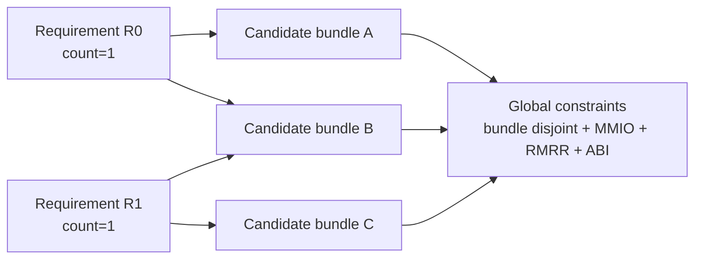

上图不能先贪心给 R0 选 B，否则 R1 无解；backtracking 应选 A+C。

```python
function solveDynamic(snapshot, requirements, vmSpec, profile, policy):
    slots = expandCountsAndCompoundRequirements(requirements)
    candidates = {slot.id: buildCandidates(snapshot, slot, context(vmSpec, profile),
                                             policy)
                  for slot in slots}
    if any(candidates[slot.id] is empty for slot in slots):
        return reject(PROFILE_NO_MATCH, emptySlotIds(candidates))

    best = null
    memo = Set()

    function search(unassigned, selected, occupiedMembers, partialResources):
        nonlocal best
        if unassigned is empty:
            plan = planVmResources(snapshot, bundles(selected), vmSpec, profile)
            if not plan.success:
                return
            solution = scoreAndCanonicalize(selected, plan)
            if best is null or solution.score < best.score:
                best = solution
            return

        stateKey = hashCanonical(unassigned, selected.bundleIds,
                                 occupiedMembers, partialResources.lowerBounds)
        if stateKey in memo:
            return
        memo.add(stateKey)

        # MRV: 每轮选择当前可行 candidate 最少的 requirement。
        slot = min(unassigned,
                   key=lambda r: count(feasibleCandidates(r, occupiedMembers,
                                                          partialResources)))
        for c in stableSort(feasibleCandidates(slot, occupiedMembers,
                                                partialResources),
                            candidatePreferenceKey):
            if intersects(c.bundle.members, occupiedMembers):
                continue
            if violatesFunctionalCollectiveRule(c, selected):
                continue
            nextResources = addResourceLowerBound(partialResources,
                                                  c.resourceSignature)
            if exceedsHardLimits(nextResources, vmSpec, profile):
                continue
            if best exists and lowerBoundScore(selected + c) >= best.score:
                continue
            search(unassigned - {slot},
                   selected + {(slot, c)},
                   occupiedMembers union c.bundle.members,
                   nextResources)

    search(slots, {}, {}, emptyResourceBounds())
    if best is null:
        return reject(PROFILE_NO_GLOBAL_SOLUTION,
                      explainUnsatisfiedConstraints(candidates))
    return best.with(snapshotEpoch=snapshot.snapshotEpoch,
                     policyHash=policy.hash,
                     profileHash=profile.hash)
```

`partialResources` 只做安全 lower-bound pruning；最终必须调用精确 allocator。某组选择因 2GiB
alignment 失败时，solver 会继续尝试 BAR 更小的 candidate，而不是把 Dynamic 请求直接判死。

### 10.4 事务和 `assignedId`

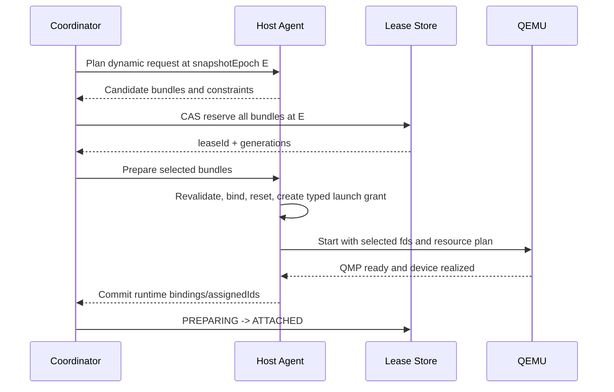

任何 requirement 无候选或任何准备步骤失败，整组回滚，不允许少配后启动。运行时 binding
包含 `leaseId`、`runId`、selected BDF、device generation 和 guest slot；VM powered-off 后清空。

### 10.5 Dynamic 不是 runtime hotplug

baseline profile 在 QEMU 启动前就选定并 realize `vfio-pci`。QMP `device_add/device_del` 是独立
扩展。ESXi 8.0.3 的 `fixedPassthruHotPlugEnabled` 证明 VMware 另有 fixed-device hotplug
接口，但 Qman 不支持任何 guest runtime PCI add/remove。Qman 分别暴露
`dynamicDirectPath=true|conditional`、`dynamicRuntimeHotplug=false` 和
`fixedPassthruHotplug=false`；launcher 不生成可热拔 slot，QMP ACL 无条件拒绝
`device_add/device_del`。宿主机 owner 的 live activation 发生在 VM power-on 前，不能被误叫成
guest hotplug。

### 10.6 原子 reservation 与重试

```python
function reserveDynamicSolution(vm, solution):
    members = union(c.bundle.members for c in solution.candidates)
    return leaseStore.transaction:
        require currentSnapshotEpoch(solution.hostId) == solution.snapshotEpoch
        require all lease(member) in {FREE, vm.runId} for member in members
        require generations(members) == solution.expectedGenerations
        create one BundleLeaseRecord per canonical bundleId,
                               each(bundleId=bundle.bundleHash,
                                    leaseId=newLeaseId(),
                                    leaseVersion=1,
                                    memberDeviceUids=sorted(bundle.memberDeviceUids),
                                    scopeHash=hashCanonicalScope(...),
                                    runId=vm.runId,
                                    ownerVmId=vm.id,
                                    state=RESERVED,
                                    runGeneration=solution.runGeneration,
                                    hostEpoch=solution.hostEpoch,
                                    controllerGeneration=currentControllerGeneration(),
                                    expectedMemberGenerations=solution.expectedMemberGenerations,
                                    resourceVersion=nextResourceVersion()))
        create canonical leaseSetHash over every bundleId/leaseId/leaseVersion
        require all BundleLeaseRecord rows and the Assignment PREPARING transition
                commit in this one transaction or none commit
```

不允许逐 candidate 写 lease，因为第二个失败时，第一个已经可被外部观察，容易形成部分 reservation。
CAS conflict 返回 retryable `INVENTORY_EPOCH_CHANGED` 或 `DEPENDENCY_BUSY`，coordinator 重新读取
snapshot 并从 candidate 构造开始重算。

### 10.7 Dynamic attach 复用同一事务核心

```python
function attachDynamic(vm, request):
    snapshot = inventory.readImmutable()
    solution = solveDynamic(snapshot, request.requirements,
                            vm.spec, resolveProfile(vm), policy)
    require solution.success
    lease = reserveDynamicSolution(vm, solution)

    # 与 static 的差别仅在 selection；之后使用同一个 prepare/rollback core。
    binding = attachSelectedBundles(vm, solution.candidates,
                                    solution.resourcePlan, lease)
    runtime.bindings = [
        RuntimeAssignedBinding(
            requirementId=slot.requirementId,
            ordinal=slot.ordinal,
            guestSlot=slot.guestSlot,
            assignedId=mintOpaqueAssignedId(vm.runId,
                                            slot.requirementId,
                                            slot.ordinal),
            deviceUid=snapshot.devices[candidate.primaryDevice].deviceUid,
            hostBdf=candidate.primaryDevice,
            bundleId=candidate.bundle.id)
        for slot, candidate in canonicalSelectionOrder(solution.selection)
    ]
    persistRuntimeBindingCAS(runtime, onlyIfLeaseState=ATTACHED)
    return runtime
```

`assignedId` 是当前 `runId` 内的 opaque runtime key，不是 BDF、`deviceUid` 或下一次启动的选择
约束；实际物理映射只存在于同一 `RuntimeAssignedBinding`/manifest 中。它只能在 QEMU 和 guest
resource verification 完成后发布；停止 VM 时在 clean release transaction 中清 runtime binding，
再释放 lease。持久 VM definition 始终只保存 matcher/profile/guest slots。

## 11. Durable lease 与并发控制

### 11.1 BundleLeaseRecord 与 assignment lease set

```json
{
  "bundleId": "sha256:...",
  "leaseId": "lease-uuid",
  "leaseVersion": 19,
  "memberDeviceUids": [
    "urn:qman:directpath:device:v1:host-a:sha256:identity"
  ],
  "scopeHash": "sha256:...",
  "runId": "run-77",
  "ownerVmId": "vm-42",
  "state": "ATTACHED",
  "runGeneration": 901,
  "hostEpoch": 37,
  "controllerGeneration": 204,
  "expectedMemberGenerations": {
    "urn:qman:directpath:device:v1:host-a:sha256:identity": 12
  },
  "resourceVersion": 77
}
```

每个完整 exclusive dependency bundle 对应一条权威 `BundleLeaseRecord`；一次 assignment 可以原子
持有多条 lease。assignment 以 canonical `leaseSetHash` 和逐 binding 的
`bundleId/leaseId/leaseVersion` 引用该集合。reserve、release、rollback、reconcile 都必须比较和更新
完整集合，禁止把多 bundle assignment 折叠成一条可被部分释放的 lease。
字段集合、枚举和 lifecycle invariant 严格以
[`directpath-authority-entities.schema.json#/$defs/ENTITY-BUNDLE-LEASE`](contracts/directpath-authority-entities.schema.json)
为准；旧 host/快照别名、BDF member 列表、TTL 或单一 fencing token 都不是该 authority row
的兼容别名。host 归属由 run/assignment 关联解析，快照与 policy 由 request/decision/manifest hash 绑定，
过期只触发 reconcile，绝不能凭 TTL 释放物理 claim。

### 11.2 状态

```text
[no lease row] -> RESERVED -> PREPARING -> ATTACHED -> RELEASING -> REVOKED
                      |          |             |             |
                      +----------+-------------+-------------+-> QUARANTINED
RESERVED --------------------------------------------------------> REVOKED
                       only atomic unstarted-cancel
```

`FREE` 是 Assignment/设备可分配语义，不是 `BundleLeaseRecord.state`。只有完整 canonical lease set
在 unstarted-cancel 或 clean-release transaction 中一起进入终态 `REVOKED` 后，Assignment 才可进入
`FREE`；`REVOKED` row 保留作审计且永不再次授权副作用。

- 所有产品 profile（包括单 host 部署）都使用同一 PostgreSQL global repository 和相同 CAS/epoch
  语义；Host Agent SQLite WAL 仅保存本机补偿 journal/cache，不能仲裁 owner、把 lease 置为
  `REVOKED` 或把 Assignment 置为 `FREE`。
- 多 host 仍使用同一 durable store；QEMU pidfile、VM config、SQLite cache 和进程列表都不是权威租约。
- 使用 pidfd/systemd scope 或等价进程身份，禁止仅按 PID 判断 owner，避免 PID reuse。
- TTL 只触发调查/回收流程，不能直接 revoke lease 或把 DMA-capable device 置为 FREE。
- 每次 bind/reset/release 增加 generation；旧 generation 的回调不能释放新 lease。

### 11.3 TOCTOU 防护

租约提交前后都核对：

```text
snapshotEpoch
device generation
BDF -> deviceUid mapping
VID:DID/subsystem/revision
IOMMU group and physical domain
driver owner
PCI link presence
```

发生变化返回 `INVENTORY_EPOCH_CHANGED` 并从头求解，不在旧计划上局部修补。

严格 epoch 比较适用于 `RESERVED -> PREPARING` 之前。进入 `PREPARING` 后，driver bind、VFIO open
和 reset 本来就会改变 operational facts；host agent 必须为每个预期变化记录 mutation receipt，
刷新 lease members，并逐字段证明差异只来自本事务。任何未列入 action manifest 的 topology、
identity、domain、BAR size 或 owner 变化仍然中止事务。reset 使用租约内 fresh `ResetContract`，
所以不会拿初始 epoch 的 provider 结果直接执行；全局无关设备的变化也不能绕过 member generation、
fencing token 和 affected-topology hash 的检查。

## 12. BAR、MMIO、RMRR 与 firmware

### 12.1 两阶段 admission

本地实测显示 Dynamic BAR 布局在选定具体 candidate 后生成；Broadcom KB 对 RMRR 则要求
Dynamic VM 的 memory map 尝试兼容 allowable devices。因此设计分开处理：

```text
BAR/MMIO plan       = selected bundles 的实际 BAR
RMRR profile plan   = 当前 host 上所有匹配且可允许 candidate 的 RMRR union
```

如果 selector-wide RMRR union 无法避开 guest RAM，拒绝整个 profile 或要求管理员缩小
allowed set，不能只因为当前选中的一张卡暂时可用就接受。
“不与 guest RAM 重叠”只是必要条件，不是充分条件。真实 RMRR/IVMD device 还必须证明
host reserved pages 可被安全保留为精确 identity mapping，且 device reset 后的 platform DMA
协议仍然正确；否则即使 memory-map planner 成功也必须拒绝。

### 12.2 MMIO planner

1. 固定不可替代的 32-bit/below-1M BAR。
2. 按 size/alignment 进行 below-4G packing。
3. 不能低置的 64-bit BAR 进入 high aperture。
4. 以实际 bridge tree 自底向上聚合 window，不只计算 root-level 总和。
5. OVMF profile 同时设置 `X-PciMmio64Mb` 与 QEMU host bridge
   `pci-hole64-size`；SeaBIOS 虽可按实际 BAR 自动扩窗，生产 profile 仍显式 pin 已求解的
   QEMU floor，不把 firmware 默认值当 admission 证明。
6. 记录 guest RAM、firmware reserved ranges、其他 virtual device BAR 和 RMRR。
7. plan 是事务结果；任何 BAR 失败时不返回部分布局。

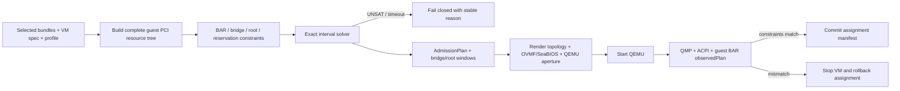

关键分层是：solver 证明“存在可行布局”，renderer 证明“backend 能表达该布局约束”，
post-boot verifier 再证明“firmware/guest 实际实现了允许的布局”。三者任一失败都不能提交 VM。

#### 12.2.1 Planner 不是 firmware allocator

Stock QEMU 中，host agent 只能设置 machine/topology/aperture，BAR 最终地址仍由 OVMF、
SeaBIOS 或 guest kernel allocator 决定。因此系统保存两个对象：

```text
admissionPlan   # 启动前证明完整资源树存在可行解，并生成 aperture/topology 参数
observedPlan    # 启动后从 QMP、ACPI、guest sysfs 读回的实际 BAR/window
```

`admissionPlan` 通过不代表地址已经被强制实现。普通功能 profile 要求实际结果满足 plan 的
约束；严格地址 parity profile 要求逐地址相等。Stock backend 无法强制严格结果时返回
`BACKEND_RESOURCE_PLACEMENT_GAP`，不能把预测地址写成既成事实。

##### 12.2.1.1 `pci-hole64-size` 是 floor，不是 cap

QEMU Q35 的 `pci-hole64-size` 必须在 schema 和日志中命名为
`qemuPciHole64FloorBytes`。QEMU 6.2 的公开实现先从 `pci_bus_get_w64_range()` 读取 firmware
已经写入的实际 64-bit BAR/bridge 范围，再按配置值扩展最小跨度；本地 QEMU 11.0.2
源码交叉核对仍保持相同公式与 32GiB 默认值：

```python
function projectQemuHole64(configuredFloor, actualW64, fallbackStart):
    if actualW64 is nonempty:
        runtimeStart = actualW64.start
        actualEnd = actualW64.end
    else:
        runtimeStart = fallbackStart
        actualEnd = runtimeStart

    floorEnd = alignUp(runtimeStart + configuredFloor, 1GiB)
    runtimeEnd = max(actualEnd, floorEnd)
    return [runtimeStart, runtimeEnd)
```

因此 `configuredFloor=32GiB` 不会拒绝 firmware 已分配的 128GiB span；即使 floor 为 0，
runtime window 仍须覆盖实际 BAR。2026-07-16 本地正例是 Q35 + SeaBIOS + 两个 64GiB
BAR：默认 32GiB 和显式 0 均得到 `[64GiB,192GiB)`。同拓扑 OVMF 默认负例没有分配 BAR，
只得到 `[4GiB,36GiB)`；同时设置 OVMF 与 QEMU 128GiB 后得到 `[128GiB,256GiB)`。
完整证据见 `qemu-q35-firmware-dual-64g-results.md`。

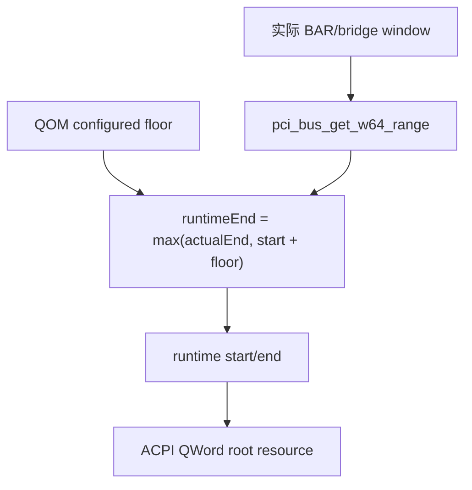

这不意味着管理面可以省掉 planner。自动扩窗只能证明某个 firmware/build 在启动后做出了
可用布局，不能提前证明 OVMF、不同 SeaBIOS 版本、不同 bridge tree 或受限 physical-address
width 一定成功。生产 renderer 显式 pin floor 是为了稳定 ABI 和可预检性，不是因为该属性
本身是 hard capacity。

#### 12.2.2 输入模型

```python
record ResourceDemand:
    key: string                 # guestDeviceId/BARn or ROM
    ownerNode: GuestPciNodeId
    size: uint64
    alignment: uint64
    kind: enum(IO, MEMORY)
    prefetchable: bool
    addressBits: enum(BELOW_1M, BITS_32, BITS_64)
    mandatory: bool
    fixedAddress: uint64 | null
    source: enum(PASSTHROUGH_BAR, VIRTUAL_DEVICE_BAR,
                 BRIDGE_INTERNAL, OPTION_ROM, PLATFORM_RESERVED)

record BridgeWindowCapability:
    kind: enum(IO, NON_PREFETCH_MEMORY, PREFETCH_MEMORY)
    addressBits: 32 | 64
    baseGranularity: uint64
    limitGranularity: uint64

record GuestPciNode:
    id: string
    type: enum(ROOT, BRIDGE, FUNCTION)
    parent: NodeId | null
    guestSlot: string
    demands: List[ResourceDemand]
    windowCapabilities: List[BridgeWindowCapability]
    children: List[NodeId]

record VmResourcePlan:
    success: bool
    failure: PlanFailure | null
    profileId: string
    profileHash: SHA256
    firmwareHash: SHA256
    snapshotEpoch: uint64
    tree: GuestPciTree
    barPlacements: Map[DemandKey, AddressRange]
    bridgeWindows: Map[NodeId, List[WindowPlan]]
    rootHighWindows: Map[RootId, AddressRange | empty]
    firmwareApertureBytes: uint64
    requiredHighSpanBytes: uint64
    qemuPciHole64FloorBytes: uint64
    qemuArguments: List[string]
    expectedRootTopology: RootTopologyConstraint
    expectedHighWindows: Map[RootId, WindowConstraint]
    verificationPolicy: PostBootVerificationPolicy
    expectedConstraints: List[PostBootConstraint]
    allMandatoryBarsAssigned: bool
    unassigned: SortedSet[DemandKey]
    rmrrCompatible: bool
    rmrrConflict: List[AddressRange]
    guestAbiSignature: SHA256
    deviceCount: uint32
    numaPolicySatisfied: bool
    numaDecision: NumaDecision
    interruptBudgetSatisfied: bool
    interruptDecision: InterruptDecision
    planHash: SHA256
```

普通 BAR 的 alignment 等于 effective size；ReBAR 使用 host 当前生效 size，不允许 guest 在
parity profile 中改 size。BAR 当前 host address 不参与 guest placement。MSI-X table 已包含在
其 BAR 内，不重复计数；ROM 只有 `rombar=1` 时进入 demand。

Planner 的输入必须包含：

- 所有 `ASSIGN_TO_GUEST` function 的全部 BAR，而不只是目标大 BAR；
- machine 自带和命令行添加的磁盘、网卡、显示、USB、桥、PXB/root-port 等虚拟设备资源；
- 每一级 bridge 的 decode capability 和 window granularity；
- guest RAM、ECAM、APIC、firmware、ACPI、RMRR/IVMD identity range 与其他 fixed reservation；
- profile 的 firmware/layout、root 数、bus range、device count 和 below/high-MMIO policy。

#### 12.2.3 完整树上的约束

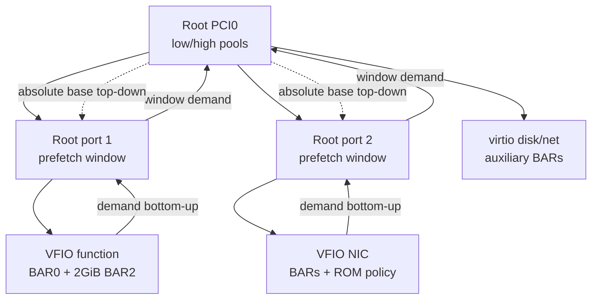

每个 BAR 必须被其路径上每一级 bridge window 覆盖。对每对 sibling bridge，其同类窗口不得
重叠；parent bus 上的 direct BAR 也不得与 child window 重叠。能否高置由整条路径决定：
64-bit prefetch BAR 只有在每一级 prefetch window 都能编码 64-bit base/limit 时才可放 high；
路径中任何一级只能 32-bit，就必须低置或拒绝。

核心约束可写成：

```text
bar.base % bar.alignment == 0
bar.base >= selected_pool.start
bar.end  <= selected_pool.end
no_overlap(sibling BARs and sibling bridge windows on the same bus/channel)
bridge.window contains every child BAR/window routed through that channel
bridge.base/limit obey backend capability granularity
all fixed/reserved intervals are excluded
every mandatory demand has exactly one placement
```

#### 12.2.4 Demand 收集与路径校验伪代码

```python
function buildGuestResourceTree(snapshot, selectedBundles, vmSpec, profile):
    tree = profile.instantiateStableGuestTopology(vmSpec.virtualDevices)

    for assignment in selectedBundles.assignedPayload:
        slot = profile.requireGuestSlot(assignment.requestKey)
        node = tree.attachFunction(slot, assignment.hostBdf)
        d = snapshot.devices[assignment.hostBdf]
        for bar in d.resources.bars:
            demand = ResourceDemand(
                key=node.id + "/BAR" + bar.index,
                ownerNode=node.id,
                size=bar.effectiveSize,
                alignment=bar.effectiveSize,
                kind=bar.kind,
                prefetchable=bar.prefetchable,
                addressBits=bar.addressBits,
                mandatory=qualificationDb.isMandatory(d.identity, bar.index),
                fixedAddress=null,
                source=PASSTHROUGH_BAR)
            validateDemand(demand)
            tree.addDemand(node, demand)

    tree.addDemands(profile.virtualDeviceResourceCatalog(vmSpec))
    tree.addFixedReservations(profile.platformMemoryMap(vmSpec))

    for demand in tree.demands:
        channel = routeChannel(demand)
        for bridge in tree.ancestors(demand.ownerNode):
            cap = bridge.findWindowCapability(channel)
            if cap is null:
                return reject(BRIDGE_WINDOW_TYPE_UNSUPPORTED,
                              demand.key, bridge.id, channel)
            if demandMayBeHigh(demand) and cap.addressBits < 64:
                markLowOnly(demand, reason=bridge.id)

    return tree
```

`validateDemand` 检查 size/alignment 为 2 的幂、32-bit BAR 不超过 4GiB、sub-page BAR 的 host
page isolation、duplicate BAR、ReBAR effective size、ROM policy 和 backend 最大地址位宽。

#### 12.2.5 精确 placement solver

生产实现不能只做 first-fit greedy。使用受限 interval/CP-SAT solver；参考 backtracking 必须与
同一约束模型做 differential test。变量包括每个 BAR base/pool、每个 bridge window base/limit
和每个 root aperture。

```python
function planVmResources(snapshot, bundles, vmSpec, profile):
    tree = buildGuestResourceTree(snapshot, bundles, vmSpec, profile)
    if tree.rejected:
        return failure(tree.reason)

    model = ConstraintModel()
    lowPools, highPools = profile.rootAddressPools(vmSpec)
    subtractReservations(lowPools, highPools, tree.fixedReservations)

    for demand in stableSort(tree.demands,
                             key=(-alignment, -size, key)):
        base = model.intVar(demand.key + ".base")
        pool = model.choiceVar(allowedPools(demand, tree, profile))
        model.add(base % demand.alignment == 0)
        model.add(rangeContains(pool, base, demand.size))
        if demand.fixedAddress exists:
            model.add(base == demand.fixedAddress)

    for bridge in tree.bridgesPostOrder:
        for channel in bridge.requiredChannels:
            win = model.windowVars(bridge.id, channel)
            cap = bridge.windowCapability(channel)
            model.add(win.base % cap.baseGranularity == 0)
            model.add((win.limit + 1) % cap.limitGranularity == 0)
            for childResource in routedChildren(bridge, channel):
                model.add(win.base <= childResource.base)
                model.add(win.limit >= childResource.end - 1)

    for bus, channel in tree.busChannels:
        model.addNoOverlap(resourcesDecodedOn(bus, channel))
    model.addNoOverlap(allLeafMemoryBarsInCpuAddressSpace())
    model.exclude(tree.fixedReservations)

    # Profile 定义语义目标，不把一个通用最小化策略冒充 VMware。
    model.lexicographicObjective(
        profile.preferLowForFlexible64Bit,
        minimizeTotalHighAperture,
        minimizeBridgePadding,
        stableAddressTieBreakByDemandKey)

    result = exactSolver.solve(model, timeout=profile.solverTimeout)
    if result == UNSAT:
        return failure(MMIO_APERTURE_EXHAUSTED,
                       unsatCore=explainConstraintCore(model))
    if result == TIMEOUT:
        return failure(MMIO_PLANNER_TIMEOUT, retryable=false)

    plan = materializePlan(tree, result, profile)
    plan.success = true
    plan.profileId = profile.id
    plan.profileHash = profile.hash
    plan.firmwareHash = profile.firmwareHash
    plan.snapshotEpoch = snapshot.snapshotEpoch
    populateRmrAbiNumaAndInterruptAdmission(plan, snapshot, bundles,
                                            vmSpec, profile)
    require plan.allMandatoryBarsAssigned
    if not backendCanEncode(profile, plan):
        return failure(BACKEND_APERTURE_ENCODING_GAP,
                       diagnostics=explainEncodingGap(profile, plan))
    plan.qemuArguments = renderApertureArguments(profile, plan)
    plan.expectedConstraints = buildPostBootConstraints(profile, plan)
    plan.expectedRootTopology = profile.expectedRootTopology(plan.tree)
    plan.expectedHighWindows = buildHighWindowConstraints(profile, plan)
    plan.verificationPolicy = profile.postBootVerificationPolicy
    plan.planHash = hashCanonical(plan without diagnostics)
    return plan
```

Solver timeout 是拒绝，不得退回 greedy。为避免求解规模失控，先做确定性的 constraint
propagation、地址位宽剪枝和 aggregate lower bound；这些只能排除必然无解分支，不能替代最终解。

#### 12.2.6 逐桥 window 与 root aperture 计算

```python
function materializePlan(tree, solution, profile):
    plan = VmResourcePlan.empty(tree=tree)
    for demand in tree.demands:
        if solution.hasBase(demand):
            plan.barPlacements[demand.key] = [
                solution.base(demand), solution.end(demand))
        else:
            plan.unassigned.add(demand.key)
    plan.allMandatoryBarsAssigned = no mandatory demand is unassigned

    for bridge in tree.bridgesPostOrder:
        for channel in bridge.requiredChannels:
            children = routedChildren(bridge, channel)
            rawStart = min(solution.base(x) for x in children)
            rawEnd = max(solution.end(x) for x in children)
            cap = bridge.windowCapability(channel)
            base = alignDown(rawStart, cap.baseGranularity)
            end = alignUp(rawEnd, cap.limitGranularity)
            require every child is contained in [base, end)
            plan.bridgeWindows[bridge.id].append([base, end))

    for root in tree.roots:
        leaves = highMemoryLeaves(root)
        if leaves is empty:
            plan.rootHighWindows[root.id] = empty
        else:
            start = min(solution.base(x) for x in leaves)
            end = max(solution.end(x) for x in leaves)
            require [start, end) is contiguous and excludes reservations
            plan.rootHighWindows[root.id] = [start, end)

    plan.requiredHighSpanBytes = profile.requiredEncodedHighSpan(
        plan.rootHighWindows, plan.bridgeWindows)
    plan.firmwareApertureBytes = profile.encodeFirmwareAperture(
        plan.rootHighWindows, plan.bridgeWindows)
    plan.qemuPciHole64FloorBytes = profile.encodeQemuHole64Floor(
        requiredSpan=plan.requiredHighSpanBytes,
        bridgeWindows=plan.bridgeWindows)
    return plan
```

多 root profile 必须保存每个 root 的窗口。若 stock QEMU/OVMF 只有一个全局 knob，renderer
必须证明该 knob 能覆盖所有 root 且不会违反 profile；否则返回 `BACKEND_APERTURE_ENCODING_GAP`。
单 root 时 `requiredEncodedHighSpan` 就是该 root 的 covering span；多 root 时由 backend profile
按实际编码关系计算，既不能简单求和，也不能取一个未经证明的最大值。

2GiB exact-hole 反例说明为什么不能只求和：

```text
available high window: [4GiB, 6GiB), size 2GiB
auxiliary/bridge demand: 16KiB
target BAR: size=2GiB, alignment=2GiB

16KiB 放在开头后，下一个 2GiB-aligned base 是 6GiB，已经越界；
2GiB BAR 先放又占满整个 window，16KiB 无处可放。因此总需求略大于 2GiB，必然 UNSAT。
扩大到 4GiB 后才有解。
```

#### 12.2.7 QEMU/firmware 参数渲染

```python
function renderApertureArguments(profile, plan):
    required = plan.requiredHighSpanBytes
    floor = plan.qemuPciHole64FloorBytes
    args = []
    if profile.firmware == OVMF:
        require plan.firmwareApertureBytes >= required
        args += ["-fw_cfg",
                 "name=opt/ovmf/X-PciMmio64Mb,string=" + ceilMiB(
                     plan.firmwareApertureBytes)]
    else if profile.firmware == SEABIOS:
        require profile.seabiosLargeBarPolicy allows plan
    else:
        return reject(FIRMWARE_BACKEND_UNSUPPORTED)

    if profile.releaseClass == PRODUCTION:
        require floor >= required
    else:
        require profile.releaseClass == QUALIFICATION_AUTO_GROW

    args += ["-global", profile.hostBridgeProperty +
             ".pci-hole64-size=" + formatSize(floor)]
    args += profile.renderMachineAndBridgeTree(plan.tree)
    return args
```

OVMF 和 host bridge 两侧必须同时设置；SeaBIOS 不消费 OVMF fw_cfg。`pci-hole64-size` 是
above-4G root window 的**最小跨度**，不是 below-4G `pci-hole-size`，也不是已分配 BAR 的
硬上限。`QUALIFICATION_AUTO_GROW` 只用于复现 floor 语义，不得被调度器宣传为 production
capability。参数值、machine type、firmware hash 和 plan hash 一起进入 manifest。

#### 12.2.8 启动后闭环

```python
function verifyObservedPlan(plan, qmp, guestEvidence):
    observed = collectObservedPlan(
        qmpInfoPci=qmp.queryPci(),
        qemuMemoryTree=qmp.queryMemoryTreeOrHmp(),
        qemuHole64Floor=qmp.qomGet("pci-hole64-size"),
        qemuHole64Start=qmp.qomGet("pci-hole64-start"),
        qemuHole64End=qmp.qomGet("pci-hole64-end"),
        acpiRoots=guestEvidence.acpiRootResources,
        pciTree=guestEvidence.lspciTree,
        sysfsResources=guestEvidence.sysfsPciResources)

    require observed.firmwareHash == plan.firmwareHash
    require observed.rootTopology satisfies plan.expectedRootTopology
    require every mandatory BAR is nonzero and has expected size/type
    require every BAR is contained by every bridge/root window on its path
    require no observed BAR overlaps RAM/reserved/another BAR
    require observed.qemuHole64Floor == plan.qemuPciHole64FloorBytes
    require observed.qemuHole64Runtime covers every observed high BAR/window
    require observed.highWindows satisfies plan.expectedHighWindows
    if plan.verificationPolicy.requiresExactAddresses:
        require observed.addresses == plan.barPlacements
    return observed
```

验证失败时停止 VM 并回滚 assignment。若只是 backend placement 与 profile 不符，quarantine
profile/build；只有伴随 reset、DMA、identity 或 device health 失败时才 quarantine 物理 bundle。

### 12.3 firmware profile

- EFI 基线使用 OVMF，并固定 CODE/VARS hash；Legacy BIOS 使用 SeaBIOS 并固定镜像 hash。
- SeaBIOS 是 QEMU legacy firmware，不是 VMware `firmware=bios` 的行为等价物。本地实测中
  SeaBIOS 可将 2GiB BAR 高置，而 VMware `i440bx+bios` 将同一 BAR 留为未分配；Q35 +
  SeaBIOS 1.15 还可在 QEMU floor 为 32GiB 或 0 时，按两块 64GiB BAR 的实际需求生成
  128GiB high window。该行为是独立的 QEMU profile，不能冒充 VMware BIOS 语义。
- Qman 创建 VM 时必须把 requested firmware/layout 解析成持久化 `resolvedLayout`，不能在
  QEMU 升级、导入或恢复时重新套用“当前默认”。x86/C86 产品矩阵明确包含
  `q35/i440fx × UEFI/SeaBIOS`；ARM 为 `virt+UEFI`。VMware `acpi+bios` 的拒绝只描述冻结的
  VMware reference profile，不得用于禁止独立 qualification 的 Qman `q35+SeaBIOS`。
- VMware CreateVM vHW20 缺省实测为 EFI/acpi、BIOS/i440bx；直接注册 layout key-absent
  VMX 的实测 fallback 为 i440bx-like。两条路径必须是不同 profile provenance。
- 默认 `rombar=0` 对齐当前 VMware 默认隐藏样本。
- 显式 Option ROM 必须固定 hash、来源和执行 policy；未知 ROM 不进入 guest firmware。
- VMware parity profile 固定 effective BAR size，并将 ReBAR control 隐藏或只读；未通过
  guest config-write 负例时，不允许带可写 ReBAR capability 的设备进入该 profile。

Stock QEMU 的 profile 边界如下：

| VMware 目标 | Stock QEMU 功能近似 | 已知不可消除差异 |
| --- | --- | --- |
| `i440bx+efi` | i440fx + OVMF；PCIe surface 另用 q35 + root-port 交叉验证 | i440fx 是 440FX/PIIX3 且无 VMware root-port surface；q35 是 Q35/ICH9 |
| `acpi+efi` | i440fx + OVMF + PXB multi-root | PXB/内部 bridge identity、bus 编排和 VMware 440BX/PIIX4 identity 不同 |
| `i440bx+bios` | i440fx + SeaBIOS 边界测试 | 大 BAR placement 已实测不等价 |

Qman 另有不追求 VMware chipset identity 的原生 profile：`q35+OVMF`、`q35+SeaBIOS`、
`i440fx+OVMF`、`i440fx+SeaBIOS` 和 ARM `virt+UEFI`。每个 profile 独立冻结 machine version、
firmware hash、ACPI/DT、PCI root、BAR/MMIO、IRQ 与 lifecycle 证据；其中任一通过都不能转授给
另一 profile。

因此 stock QEMU profile 只能声明 `functional-approximation`。若产品合同要求同时稳定
VMware chipset identity、PCIe root-port surface、ACPI 多根桥命名/bus range 和 BAR placement，
必须实现版本化 custom QEMU machine/host bridge，并重新执行完整 guest ABI 与迁移兼容性矩阵；
在该实现完成前返回 `BACKEND_TOPOLOGY_GAP`，不能悄悄选择 q35。

### 12.4 启动参数模板

下面是当前 Legacy-first 的 QEMU-native q35/OVMF PCIe profile 模板，不代表 VMware ACPI
layout 的精确 machine ABI。Host Agent 已在 durable lease 后创建每 VM device/sysfs namespace、
cgroup/LSM allowlist 和 transient identity；QEMU 5.0 通过 exact BDF 打开唯一可见的 normal VFIO
group，启动后由 Host Agent 形成 proc-fd/QMP receipt：

```bash
qemu-system-x86_64 \
  -machine q35,accel=kvm \
  -drive if=pflash,format=raw,readonly=on,file=OVMF_CODE.fd \
  -drive if=pflash,format=raw,file=OVMF_VARS.fd \
  -fw_cfg name=opt/ovmf/X-PciMmio64Mb,string=2048 \
  -global q35-pcihost.pci-hole64-size=2G \
  -device pcie-root-port,id=rp-dp0,chassis=1,slot=1,hotplug=off,x-do-not-expose-native-hotplug-cap=on \
  -device vfio-pci,id=dp0,host=0000:65:00.0,bus=rp-dp0,addr=00.0,rombar=0
```

`host=` 不是让用户绕过 Qman 的 raw CLI：只有受控 launcher 能进入该 mount/user/cgroup/LSM
边界，未获 lease 的进程看不到对应 `/dev/vfio/$GROUP`，alternate monitor/raw launcher 负例仍由
S15/F09 验证。未来 IOMMUFD/cdev profile 才使用 `-object iommufd,...,fd=N` 和
`-device vfio-pci,...,fd=M,iommufd=...`。

精确参数由启动时探测的 QEMU build capability决定。`hotplug=off` 与
`x-do-not-expose-native-hotplug-cap=on` 都是 DirectPath root-port 的强制 renderer 输出，不能由
raw argv 覆盖。当前 Legacy profile 精确钉住 TYPE1v2 或 TYPE1；不存在 subtype 或 cdev 的自动
fallback。宿主 DPDK 的独立 provider 不受此 VM 产品路径约束，但其设备不能进入 Qman VM namespace。

VMware `i440bx+efi` 和 `acpi+efi` 功能近似的命令由
`qemu-firmware-layout-matrix-validate.sh` 生成。MMIO planner 必须把 endpoint、root/secondary
bridge、PXB 和所有辅助设备 BAR 一起按 alignment 自底向上装箱；本地 2GiB exact-hole
用例已经证明，普通 `pci-bridge` 自身消耗少量 high resource 后，可使一个 2GiB-aligned
BAR 无法装入名义 2GiB aperture。

## 13. Guest ABI 与 QEMU surface policy

### 13.1 稳定和可变字段

Dynamic 冷启动允许在显式 allowed set 内更换物理 identity，但必须满足 guest contract：

| 必须稳定 | 可在显式 allowed set 内变化 |
| --- | --- |
| virtual slot/function、boot order、profile operation policy | VID:DID/subsystem/revision |
| firmware 类型和 ACPI ownership | BAR size/address（关机重启后） |
| 是否存在 guest vIOMMU | link speed/width 的 profile 化呈现 |
| capability filter 规则 | MSI-X vector 上限（ABI class 允许时） |

每个 candidate 生成 `guestAbiSignature`。request 的 `guestAbiClass` 声明允许的 signature 集合；
未在集合内时返回 `PROFILE_ABI_MISMATCH`，不能寄希望于 guest driver 恰好兼容。

### 13.2 VMware parity surface

基于当前实测，QEMU/VFIO 至少需要以下 policy：

| Surface | 基线行为 |
| --- | --- |
| PCIe topology/LinkCap | 按 profile 重建，不把 host link 原样当合同 |
| AER | host ownership；不向 guest 投递 AER notification；config surface 按实测 profile 过滤 |
| PME | ACPI `_OSC` 按 profile；默认不向 guest 提交 native PME IRQ |
| Option ROM | 默认隐藏；显式路径固定 ROM hash |
| MSI/MSI-X | 保留并要求 interrupt remapping；记录 vector budget |
| INTx | 仅在物理验收通过的 profile 中允许 |
| ATS/PRI/PASID | 默认过滤；启用需 IOMMUFD/vendor qualification |
| guest vIOMMU | VMware target 未暴露时不添加 |
| P2P | 默认拒绝；显式 peer-set profile 才允许 |
| ReBAR | parity profile 不允许运行时 resize |

不能由标准参数表达的 AER/config capability 过滤，应在 `vfio-pci` config-space policy 或
等价 proxy 中实现，并绑定 profile/version。实验补丁见
[`vmware-esxi8-lab/qemu-patches/`](vmware-esxi8-lab/qemu-patches/)，生产实现需要重写成通用、
有测试的 property/object，而不是保留 lab-only 开关。
当前黑盒样本中 guest 仍可见部分 raw status body，但这不等于 PCI error 被投递给
guest；产品合同以“host 处理、guest 无 notification”为硬语义，再用 versioned profile
对齐 config-space 可见性。

## 14. Lifecycle capability

### 14.1 baseline 矩阵

| Operation | 静态 parity | 动态 parity | 条件 |
| --- | --- | --- | --- |
| guest reboot | 允许 | 允许 | 同一 assigned device；reset/driver 功能验证 |
| VM power cycle | 允许 | 允许 | Dynamic 每次重新求解并产生新 binding |
| forced VM off | 允许但强制 cleanup | 同左 | cleanup 失败 quarantine |
| snapshot | 拒绝 | 拒绝 | 当前 ESXi 对标合同 |
| suspend/resume | 拒绝 | 拒绝 | 当前 ESXi 对标合同 |
| live migration | 拒绝 | 拒绝 | 当前实测 `assignHwNotAvailable` |
| powered-off relocate | 固定设备通常 host-bound | 允许 | 目标 host 重新求解 Dynamic request |
| source host unreachable / failed | 拒绝接管 | 拒绝接管 | 保留 lease、VM stopped，等待 source 返回 reconcile |
| runtime hot-add/remove（baseline） | 拒绝 | 拒绝 | Dynamic 不等于 hotplug |
| fixed passthru hotplug | 拒绝 | 拒绝 | VMware 有独立 API；Qman 产品范围永久关闭 |
| online host maintenance evacuation | source clean release 后按 host affinity 处理 | 双在线主机 cold relocate | 不能伪装成 live migration |

### 14.2 QEMU-native migration 不在 V3

即使未来 kernel/QEMU/vendor VFIO driver 报告 migration feature，V3 仍在 API、scheduler、launcher
和 QMP 返回 `FEATURE_DISABLED/LIVE_MIGRATION_UNSUPPORTED`。该能力不会作为普通 profile flag
打开；若未来要支持，必须新建 Feature、ADR、风险和物理 qualification，不修改本 V3 合同。

### 14.3 Guest runtime hotplug 明确排除

ESXi 8.0.3 的 `fixedPassthruHotPlugEnabled` 只作为对标差异记录。Qman 的固定合同是：

```text
fixedPassthruHotplug    = false
dynamicRuntimeHotplug  = false
qemuNativeRuntimeHotplug = false
```

API 配置该字段返回 `FEATURE_DISABLED/HOTPLUG_UNSUPPORTED`；scheduler 不创建 hotplug capacity；
launcher 不提供可热拔 PCI slot；QMP proxy 和 QEMU sandbox 拒绝 raw `device_add/device_del`。拒绝
前后 assignment、lease、VFIO fd、guest PCI tree 和 BAR window 必须逐项相同。宿主机在 VM 启动
前执行 `LIVE_APPLY` owner transition 不改变 guest PCI tree，仍属于 host activation，不违反本条。

这里的“launcher 不提供可热拔 slot”是可执行 argv 合同，不只是 API 语义：每个 DirectPath
`pcie-root-port` 必须显式包含 `hotplug=off,x-do-not-expose-native-hotplug-cap=on`。缺任一属性、
出现第二 monitor、未经 launch grant 精确授权的 `host=`/`sysfsdev=` 或额外 raw QEMU 参数时，
typed renderer 必须在 spawn 前拒绝；Legacy profile 只允许 renderer 生成与 lease/bundle 完全相等的
`host=<BDF>`。QMP allowlist 是其后的第二道边界。

## 15. Crash、rollback 与 quarantine

### 15.1 rollback 栈

每个 side effect 入栈对应补偿动作：

```text
lease reserved          -> release lease
host driver unbound     -> rebind original driver
vfio bound              -> unbind vfio
device fd opened        -> close fd
IOMMUFD attached        -> detach IOAS
DMA mapped              -> unmap DMA
QEMU spawned            -> stop/fence QEMU
device reset            -> verify or quarantine
runtime binding stored  -> clear binding with generation check
```

补偿按逆序执行。任何 reset、IOMMU detach、driver restore 或 identity revalidation 失败都禁止
释放成 FREE。

### 15.2 QEMU crash

- host agent 使用 pidfd/systemd scope 收到确定退出事件；
- 先撤销 DMA/IRQ，再 reset；
- config/link/health probe 通过后释放；
- QEMU process 消失但 fd ownership 不清楚时，确认 kernel owner 后再继续；
- lease record 保存 crash reason 和 cleanup evidence。

### 15.3 source host 失联

cluster 看到 agent heartbeat 丢失时只标记 `HOST_UNREACHABLE`，保留其 lease 和 assignedId，VM
保持 stopped，禁止任何目标主机接管。原 host 返回后以新的 host epoch 启动 agent，先拒绝旧
operation generation 的回调，再完成 inventory、DMA/IRQ/reset/owner reconcile；只有形成明确
clean-release receipt 后，设备才可回 pool。逻辑 epoch 不能被描述成物理 DMA fence。

### 15.4 quarantine

进入 quarantine 的条件包括：

```text
RESET_FAILED
RESET_STATE_VERIFY_FAILED
DMA_TEARDOWN_UNVERIFIED
IOMMU_DETACH_FAILED
LINK_OR_DEVICE_DISAPPEARED
AER_FATAL_OR_DPC_TRIGGERED
HOST_DRIVER_REBIND_FAILED
IDENTITY_CHANGED
VENDOR_HEALTH_CHECK_FAILED
```

退出 quarantine 必须是显式、审计的 recovery workflow，可要求 slot power cycle 或 host reboot。

## 16. 在线多主机 placement 与计划性 cold relocation

### 16.1 两阶段 placement

1. Coordinator 向每个 host 请求基于 snapshot 的 `CanSatisfy`，用于筛选和评分。
2. 选中 host 后必须重新执行原子 lease；`CanSatisfy=true` 不是 reservation。
3. 若 current snapshot epoch 或 owner 变化，返回可重试 conflict，而不是继续使用旧 plan。
4. 所有 requirements 成功后才启动 VM。

### 16.2 cold relocate

- source 与 target Host Agent 都必须在线；source 先停止 VM，并在同一 relocation transaction 中
  生成 DMA/IRQ teardown、reset、owner restore、assignedId clear 和 lease release receipt。
- receipt 未提交、source 失联或 cleanup 不确定时，target power-on 必须拒绝。
- 持久 VM config 只移动 matcher/profile，不移动 BDF。
- 目标 host 重新匹配、租约和 MMIO/RMRR plan。
- static request 默认 host-affine；只有管理员将其转换为 Dynamic request 才可自动换卡。

### 16.3 source 不可达与目标耗尽

- source 不可达时保持原 lease、状态 `HOST_UNREACHABLE` 和 VM stopped；不启动 BMC/power fence，
  不在其他 host 重分配。
- source clean release 后若 target 的 profile、RMRR、guest ABI class 不满足或 candidate exhaustion，
  VM 仍保持 stopped 并给出结构化 reason，不能降级为少配设备启动。
- global CAS、run generation 和 host epoch 只保证控制面 mutation 顺序；source clean-release receipt
  才是目标 attach 的前置条件。

## 17. API 与审计 manifest

### 17.1 建议 API

```text
GET  /hosts/{host}/directpath/devices
POST /hosts/{host}/directpath/activation-plan
PUT  /hosts/{host}/directpath/bundles/{bundle}/desired-owner
POST /hosts/{host}/directpath/bundles/{bundle}/apply-activation
POST /hosts/{host}/directpath/evaluate-static
POST /hosts/{host}/directpath/plan-dynamic
POST /hosts/{host}/directpath/reservations
POST /reservations/{id}/prepare
POST /reservations/{id}/attach
POST /reservations/{id}/release
POST /devices/{uid}/recover
GET  /vms/{vm}/directpath/runtime-bindings
```

所有变更 API 接受 idempotency key 和 expected epoch；所有响应带 policy/profile hash。
`activation-plan` 无副作用；`desired-owner` 只有显式 maintenance 请求才可持久化
`PENDING_REBOOT`；`apply-activation` 必须携带完整 bundle lease。不存在 runtime PCI hotplug API，
兼容层收到 VMware-like fixed-hotplug 字段时返回 `FEATURE_DISABLED`。

这些 URL 是语义示意，不要求私有 Qman 新建第二套 REST。reservation/prepare/attach/release 是
Controller 内部 operation，普通 caller 只能通过既有 VM lifecycle 发起并用 `operationId` 查询；
不得人工调用 attach/commit 跳过 receipt。canonical port、operation、request hash、async/cancel、
RBAC、reason 和 FSM 以
[`contracts/directpath-portable-control-contract.json`](contracts/directpath-portable-control-contract.json)
为权威，目标 REST/gRPC/event/symbol 由内网 integration map 绑定。

### 17.2 AssignmentManifest

```json
{
  "schemaVersion": 2,
  "assignmentId": "assignment-uuid",
  "vmId": "vm-42",
  "runId": "run-77",
  "requestType": "DYNAMIC",
  "hostId": "host-a",
  "profileId": "qman-x86-q35-uefi-v1",
  "snapshotEpoch": 1042,
  "topologyHash": "sha256:...",
  "policyHash": "sha256:...",
  "profileHash": "sha256:...",
  "riskRegisterHash": "sha256:...",
  "qualificationBundleHash": "sha256:...",
  "authority": {
    "leaseSetHash": "sha256:...",
    "leaseBindings": [
      {"bindingId": "binding-uuid", "bundleId": "sha256:...", "leaseId": "lease-uuid", "leaseVersion": 19}
    ],
    "fencingToken": 981,
    "controllerGeneration": 204,
    "hostEpoch": 37,
    "runGeneration": 901
  },
  "backend": {
    "kind": "LEGACY_VFIO_TYPE1",
    "configuredIommuType": "VFIO_TYPE1V2_IOMMU",
    "launchGrantKind": "AUTHORIZED_DEVICE_PATH",
    "attachReceiptHash": "sha256:..."
  },
  "activation": {
    "plannedDisposition": "LIVE_APPLY",
    "mode": "BIND_ON_LEASE",
    "desiredOwner": "PASSTHROUGH",
    "effectiveOwnerBefore": "HOST",
    "effectiveOwnerAfter": "VFIO",
    "activationPlanHash": "sha256:...",
    "observedStateHash": "sha256:..."
  },
  "bindings": [
    {
      "bindingId": "binding-uuid",
      "requirementId": "gpu0",
      "ordinal": 0,
      "assignedId": "dp-assigned/run-77/gpu0/0",
      "deviceUid": "urn:qman:directpath:device:v1:host-a:sha256:identity",
      "hostBdf": "0000:65:00.0",
      "deviceGeneration": 12,
      "bundleId": "sha256:...",
      "bundleMembers": ["0000:64:00.0", "0000:65:00.0"],
      "payloadMembers": ["0000:65:00.0"],
      "memberActionsHash": "sha256:...",
      "guestSlot": "rp-dp0/00.0",
      "guestAbiClass": "cuda-gpu-v1",
      "guestAbiSignature": "sha256:...",
      "backendKind": "LEGACY_VFIO_TYPE1",
      "launchGrantKind": "AUTHORIZED_DEVICE_PATH",
      "attachReceiptHash": "sha256:...",
      "resourcePlanSliceHash": "sha256:..."
    }
  ],
  "decisionHash": "sha256:...",
  "planHash": "sha256:...",
  "observedPlanHash": "sha256:...",
  "resetContractsHash": "sha256:...",
  "artifacts": {
    "qemuBinaryHash": "sha256:...",
    "firmwareCodeHash": "sha256:...",
    "firmwareVarsBaseHashOrNull": "sha256:...",
    "argvHash": "sha256:...",
    "observedEvidenceHash": "sha256:..."
  },
  "verification": {
    "qmpRealized": true,
    "guestEnumerated": true,
    "iommuMapped": true,
    "interruptRemapped": true
  },
  "manifestDigest": "sha256:..."
}
```

Static 也使用同一结构，固定 `requirementId=static-0, ordinal=0`。Dynamic 的一个 manifest 可包含
多个 requirement、多个 bundle 和多个 guest slot；禁止退化为单 `bundleId`/flat `assignedIds`。
manifest 可以记录本次 Dynamic BDF，但 `assignedId` 是 run-scoped opaque key，二者都不能回写成
下一次启动的持久 backing。完整 closed JSON Schema 和 required hash 字段以
[`contracts/directpath-assignment-manifest-v2.schema.json`](contracts/directpath-assignment-manifest-v2.schema.json)
及 portable contract 的 `ENTITY-ASSIGNMENT-MANIFEST` 为权威。

## 18. 关键风险与控制

| ID | 风险 | 后果 | 强制控制 | 验收证据 |
| --- | --- | --- | --- | --- |
| R01 | ACS override 缩小 group | P2P 绕过 IOMMU | 双域模型，整租 physical domain | provenance + peer-DMA negative/positive control |
| R02 | reset 影响旁路 function | 破坏 host/其他 VM | VFIO affected set 闭包和原子 lease | hot-reset info + callback/真实硬件 |
| R03 | reset 未清敏感状态 | 跨租户泄漏 | 双端 reset、state probe、失败 quarantine | generation register/vendor test |
| R04 | 双重分配/TOCTOU | 两个 owner 同时 DMA | durable CAS、epoch、backend-specific typed launch grant | 并发 race 测试 |
| R05 | 多设备部分成功 | guest 少配或依赖拆分 | constraint solver、all-or-nothing rollback | 中途 bind/reset fault injection |
| R06 | stale DMA/IOTLB/IRQ | power-off 后写 guest/host | unmap/invalidate/IRQ teardown 后才释放 | IOMMU trace 和 sentinel |
| R07 | RMRR 与 guest RAM 重叠 | identity DMA 错址 | selector-wide RMRR envelope | synthetic DMAR overlap A/B |
| R08 | 异构 candidate ABI 不兼容 | guest driver/firmware 失败 | guestAbiClass 和 per-candidate validation | cold restart across candidates |
| R09 | MMIO 只配 firmware 一侧 | BAR 未分配或隐式高置 | OVMF/QEMU 联动 planner | guest `_CRS`、BAR、HMP |
| R10 | source host 失联后错误释放或目标接管 | 旧设备仍可能 DMA，形成双 owner | 保留 lease/assignedId、VM stopped、禁止重分配；返回后 reconcile + clean-release receipt；logical epoch 拒绝 stale mutation | F03/F04 失联不接管与 old-generation 负例 |
| R11 | QEMU crash 清理失败 | device 带旧状态回池 | pidfd cleanup + quarantine | SIGKILL fault injection |
| R12 | Option ROM 不可信 | firmware supply-chain 风险 | 默认隐藏，显式 hash allowlist | ROM marker 和 hash |
| R13 | AER/DPC fatal | host/设备失稳 | host ownership、health/quarantine | host/guest paired logs |
| R14 | ATS/PRI/PASID 残留 | translation/cache 跨 owner | 默认过滤，vendor/IOMMUFD qualification | invalidate/reset/teardown trace |
| R15 | P2P backend 不支持 | mapping fail 或越界 DMA | 默认拒绝，backend/profile gate | peer DMA + IOMMU trace |
| R16 | live migration 能力误判 | 丢设备状态或脏页 | baseline blocker，VFIO feature 全量检查 | migration FSM/failure rollback |
| R17 | runtime eject 路径被意外暴露 | 设备仍在 guest 使用时被释放或重分配 | hotplug 永久 `FEATURE_DISABLED`，API/scheduler/launcher/QMP 四层拒绝 | S13-S16/F09 bypass negative |
| R18 | NUMA 远端放置 | 性能与中断抖动 | hard/soft NUMA policy 分离 | locality 和性能 counter |
| R19 | HCL/errata 变化 | 已知硬件缺陷进入生产 | signed versioned policy DB | policy hash 和 qualification report |
| R20 | guest/driver/OEM 不支持 | 功能或服务保证失效 | 版本化外部支持矩阵 | vendor statement + guest workload test |
| R21 | sub-page BAR 共享 4KB host page | 无关资源被映射或修改 | host resource page-isolation admission | sysfs/resource + config probe |
| R22 | ReBAR 写能力逃逸 | guest 改变 BAR size 破坏 plan | 固定 effective size 并过滤/只读 ReBAR capability | config write negative test |
| R23 | SR-IOV PF/VF lifecycle 依赖不完整 | VF 跨 owner、PF reset 破坏 VM | PF/VF 闭包、VF reset 和 capability filter | supported PF/VF hardware matrix |
| R24 | PME 所有权不匹配 | guest 低功耗后无法唤醒设备 | `_OSC` 与 config/message 联合 policy | controlled PME injection |
| R25 | 设备数/topology/resource ceiling | 第 N 个设备启动失败或 ABI 漂移 | 按 ESXi build、virtual hardware version 和 Qman verified limit 计算显式 profile limit，并做全量资源试算 | 1/legacy-limit/verified-limit/vendor-contract-limit/limit+1 matrix |
| R26 | raw CLI/QMP 绕过管理门 | 未租约或未验证设备被挂载 | backend-specific launch grant：Legacy per-VM device/sysfs namespace+cgroup/LSM+receipt，cdev fd passing；唯一 QMP、sandbox 和 privilege split | bypass negative test |
| R27 | IOMMU/interrupt-remap errata | DMA 或 IRQ 隔离失效 | platform qualification 和 denylist | bare-metal fault/interrupt trace |
| R28 | requester-ID alias 未被发现 | 多设备共用一 translation domain | alias/legacy subtree 整租 | peer DMA + requester trace |
| R29 | 隐藏 functional dependency | 只 reset/分配部分 function 导致故障 | 保守 multifunction/PF-VF 闭包加 vendor rule | cross-function state test |
| R30 | 创建/导入/注册路径重新解析 layout | 升级或恢复后 guest PCI ABI 漂移 | 持久化 requested/resolved layout 与 provenance，导入时显式确认 | CreateVM/register/import golden matrix |
| R31 | 混淆 VMware `acpi+bios` rejection 与 Qman machine/firmware profile，或接受未定义组合 | 启动晚期失败、错误拒绝有效 `q35+SeaBIOS`，或 backend 行为漂移 | requested/resolved profile 精确匹配；未定义组合三层拒绝；VMware 与 Qman profile 分 namespace | LF03 reference 与 Qman 四格 profile/raw-launch matrix |
| R32 | 把 stock q35/PXB 当精确 VMware topology | guest driver、slot、ACPI 路径和管理 ABI 漂移 | approximation 标记；严格 profile 要求 custom machine，否则拒绝 | chipset/root/bus/ACPI golden diff |
| R33 | MMIO 只累计 endpoint BAR | bridge/辅助 BAR 与 alignment 使 mandatory BAR 未分配 | 全树自底向上 packing、padding 与 mandatory-BAR assertion | exact-hole bridge 2G/4G A/B |
| R34 | Legacy BIOS mandatory large BAR 静默未分配 | guest 枚举但设备功能不完整 | admission 预拒绝或仅 lab degraded profile；启动后核对所有 mandatory BAR | VMware LF00 与 SeaBIOS 对照 |
| R35 | userspace ACS shadow domain 漏掉 architecture requester alias | override 后把可 P2P/同 RID 的设备拆给不同 owner | kernel native shadow-domain ABI；software estimate 不进 production trusted sources | override off/on group A/B、alias trace、peer-DMA 正负对照 |
| R36 | 把 QEMU `pci-hole64-size` floor 当 hard cap，或把 SeaBIOS auto-grow 当通用保证 | 前者错误拒绝可行 VM；后者让 OVMF/升级后 VM 启动失败或 BAR 未分配 | schema 分离 required span、firmware aperture、QEMU floor 与 observed runtime window；production 显式 pin 并启动后核对 | M22/M23、QOM/HMP/firmware paired logs |
| R37 | VMware fixed hotplug 字段或 raw QMP 被误当成 Qman 支持范围 | 在线改变 guest topology，绕过 power-on admission/lease | capability 永久 false；不创建 profile/slot/capacity；API、scheduler、launcher、QMP 全链路 fail-closed | S13-S16、F09 bypass negative |
| R38 | 先对请求 BDF 判 capable，等激活/attach 才扩 dependency；或只给初始 payload 选 reset | mandatory function 无 reset/qualification 仍显示 capable，之后晚失败或被错误拆分 | owner-independent action/reset 固定点 closure 前置到 hardware/policy gate；每个 member/action exact qualification；超限/unknown/conflict fail-closed | C20、C04/C13/C17/C18/D14，busy A/B 稳定性 |
| R39 | 把 desired owner、effective owner、capable 和 reboot-required 压成一个布尔值，或按 FLR/class 静态猜 reboot | 显示 Active 但 native driver 仍持有设备；错误重启；busy dependency 被部分解绑 | 独立 admin/effective/disposition；完整 bundle 纯函数规划；lease 后 live apply；owner/driver 读回提交；显式 maintenance reboot intent | O00-O09、`test_activation.py`、ESXi owner/API paired evidence |

### 18.1 风险清零发布门

“消除所有技术风险”在本设计中的可执行定义是：**支持范围内零已知未缓解风险**。
不宣称无法证明的“绝对零风险”；无法闭环的风险必须通过禁用设备、关闭功能、
缩小 profile 或拒绝启动来消除暴露，不能以“已接受”代替控制。

每一条 risk record 必须包含 risk ID、影响范围、owner、预防控制、检测、隔离/恢复、
测试 ID、证据等级、artifact hash 和以下唯一状态之一：

```text
OPEN                 # 已识别，未实现完整控制；阻断发布
CONTROL_IMPLEMENTED   # 控制已实现但证据未闭环；阻断发布
VERIFIED              # 控制与正/负/故障注入证据都通过；可在限定 profile 中暴露
FEATURE_DISABLED      # 对应功能在 API、调度和 QEMU 三层都 fail-closed；不属于支持范围
INVALIDATED           # 依赖变更使旧证据失效；立即撤销能力并阻断发布
```

发布和运行时强制规则：

1. 只有 `VERIFIED` 能进入 supported capability；`FEATURE_DISABLED` 必须在三层负例中证明无法绕过。
2. isolation、DMA/IOTLB/IRQ teardown、reset/state leakage、lease/fencing、identity 和 firmware
   integrity 不接受 waiver；只能 `VERIFIED` 或 `FEATURE_DISABLED`。
3. 硬件相关风险不能用 synthetic/QEMU 证据提升为物理硬件 `VERIFIED`；未验收的
   VID:DID/revision/topology 自动落入 deny-by-default。
4. 每个风险都必须同时拥有 prevention、detection、containment 和 recovery；只有日志或只有
   rollback 不算闭环。
5. QEMU、kernel、firmware、policy DB、host platform class 或 device revision 变更时，按依赖图
   自动将相关 `VERIFIED` 置为 `INVALIDATED`，重新验收前不可用。
6. CI/release controller 要求 risk register 无 `OPEN`、`CONTROL_IMPLEMENTED`、`INVALIDATED` 和
   `accepted-risk` 类状态；manifest 固定 risk/qualification hash，运行时 hash 不符立即拒绝。
7. 新发现严重风险时先撤销 capability 并 quarantine 已影响设备，再进行根因分析；
   不等待下一个常规版本。

### 18.2 当前 Qman 技术证据与设计反馈（2026-07-21）

本节只记录已由机器索引和 hash 固定的事实。权威记录是
[`contracts/qman-evidence-index.json`](contracts/qman-evidence-index.json)，结果合同是
[`contracts/qman-technical-evidence.schema.json`](contracts/qman-technical-evidence.schema.json)。

| Evidence | 等级/subject | 已验证的设计前提 | 对实现的强制反馈 | 仍未关闭 |
| --- | --- | --- | --- | --- |
| `QMAN-E2-REFERENCE-MODEL-001` | E2 / reference model | 历史基线 87/87 纯函数与 schema 单测通过 | 保持 capability、owner、allocator 查询无副作用且 hash 可复现 | 后续 C20 不由该旧记录追认；产品 controller、任何 Risk |
| `QMAN-E2-CLOSURE-001` | E2 / reference model | C20 22/22、全量 112/112；四格固定点、fact authenticity boundary、snapshot stale、closure limit、immutable inventory、golden/decision hash 与零副作用通过 | schema-v2 fact 全绑定 epoch/topology/subject/evidence；无 verifier 默认拒绝；member/edge 加入前增量限流；capability 与 executable decision hash 分离 | 产品 inventory/evidence provider、C20 产品 Case、R38、真实硬件 |
| `QMAN-QEMU-CONTROL-001` | E3 / QEMU control reference | raw QMP 可在冷启动规划后、machine 暂停态添加 PCI endpoint；相同 guest BDF 可承载不同 VID:DID；`device_del` reply 不是 teardown 完成；未验证 Guest 在线热插 | Static 身份必须是 `deviceUid + fingerprint`；生产 QMP 必须 allowlist；release 必须等待 Guest/backend/IOMMU/reset 完成证据 | S15/F09 产品 gate、lease/reconcile |
| `QMAN-E3-QMP-GATE-001` | E3 / Qman component | 27 个请求精确审计；独立 recorder 只见 3 次内部 capability 与 7 次只读 query，17 类拒绝未进入 backend；PCI tree、QEMU/gate fd 基线不变 | QMP 默认拒绝必须解析后重建、使用私有 backend ID、两阶段审计、拒绝 SCM_RIGHTS，并以外部 recorder 验证 | production launcher/controller/lease/generation/VFIO 与 API/CLI/storage/alternate-monitor 全入口；S15/F09、R17/R26/R37 |
| `QMAN-E3-DMA-PROVIDER-001` | E3 / QEMU+Guest+VFIO reference | unsafe=`Y` 时 `noiommu-*` 与 IOMMU-backed group/cdev 仍可逐设备区分 | VM attach provider 必须逐设备证明 DMA provider；不能按全局 unsafe switch 整机放行或整机拒绝 | C21 产品场景、物理 IOMMU/IR/errata、IOMMUFD attach |
| `QMAN-E3-VFIO-PROVIDER-GATE-001` | E3 / Qman component | 双 guest 中 no-IOMMU 稳定拒绝；IOMMU-backed cdev 真实完成 IOMMUFD bind、IOAS attach、identity/group hash 二次复核和 cleanup；snapshot/topology 为 caller correlation | 不能复用已关闭/已 pre-attach session；该结果只要求未来 cdev launcher 传 fresh raw fd 并由 stock QEMU 内部 bind/attach，不能倒推当前 Legacy path | authoritative snapshot、durable lease/launcher/generation、当前 Legacy path grant/sandbox/receipt、物理 IOMMU/IR/errata E4；C21/R27 |
| `QMAN-E3-STATIC-LEASE-FAULT-001` | E3 / Qman component | WSL 原生 ext4 上 7/7 subprocess/SQLite 场景通过：begin/release commit 前硬退出原子回滚、重叠 bundle 单 winner、SIGKILL/unknown cleanup 保留 whole-bundle quarantine | host/authority namespace、bundle/member/VM/device generation CAS、journal 与 claim 必须在副作用前同事务持久化；进程消失永不等于 cleanup 证据 | bind/reset/QEMU/pidfd/DMA/IRQ/driver clean-state 和产品接线；S03/S04/S05/F00、R04/R05/R11 均未关闭 |
| `QMAN-E3-AUTHORITATIVE-SNAPSHOT-FAULT-001` | E3 / Qman component | Linux-native SQLite publisher 在 insert 后硬退出不暴露部分 epoch；相同 current-hash CAS 两个 publisher 只有一个 winner；signature/payload/stale/minimum-epoch/boot replay 均 fail-closed；删除最新 row 后 earlier-valid epoch 会被 `current()` 接受为当前 authority state，但重开后无 sealed capture provider，不能签发 launch authorization | snapshot 必须 full-host double-scan、canonical signed、CAS/boot/current/min-epoch gated；launch 只能持有 sealed authorization；真正防回滚需要外部单调锚 | HMAC 不是 production trust root；无 external rollback anchor、production key rotation/revocation/catalog、kernel atomic generation/reset provider；无 Case/Risk closure，R04 仍 OPEN |
| `QMAN-E3-STATIC-LAUNCH-ENVELOPE-001` | E3 / Qman component | v5 在 sealed capture provider、signed full-host snapshot 与 lease authorization 同时 active 时，从 sealed facts 打开完整 group raw cdev/IOMMUFD，且 authorization/QEMU plan 范围一致；2 次 publish + `PRE_OPEN/POST_OPEN` + 两次 `PRE_SPAWN` 共 6 次 topology 一致；QMP/QOM realized，bind/IOAS allocate/attach ioctl 成功；无 independent DMA receipt 时 `ATTACHED=false`、claims 保留并 `QUARANTINED` | 这只固定未来 cdev adapter 将 snapshot/lease authorization 保持到 `Popen`、使用 typed fd render、双 observer receipt 与 durable commit-intent 的顺序；当前 Legacy 必须另行实现 path grant/sandbox/receipt；QMP 或同进程 trace 不得冒充 DMA clean-state | production snapshot trust/key/catalog/rollback anchor、kernel generation/reset、driver restore、pidfd、独立 DMA/IRQ observer、产品 controller 和物理 E4；C21/S05、R04/R05/R26/R27 均未关闭 |
| `QMAN-E3-MMIO-OBSERVED-001` | E3 / QEMU+firmware reference | QEMU 11/OVMF 双 64 GiB BAR：默认 0/2 分配；128 GiB firmware aperture 与 QEMU floor 配对后 2/2 且 heartbeat | 分开持久化 required span、firmware aperture、QEMU floor、observed runtime window；不把 floor 当 hard cap | M23 产品 post-start commit/rollback、物理 BAR qualification |

`QMAN-E3-VFIO-PROVIDER-GATE-001` 行保留的是当次 standalone evidence 的历史边界；后续 snapshot
与 v5 launch result 不会反向改写其 source state、caller-correlation 语义或 closure 权限。

十条结果中 5 条是 reference、5 条是 component，`closureEffect` 全部为空；Risk 状态继续保持
R01-R39 全 `OPEN`，G0 `DONE`、G1 `IN_PROGRESS`、G2-G6 `NOT_STARTED`，release 继续 `BLOCKED`；产品声明仍为
`REFERENCE_AND_QUALIFICATION_MODEL_ONLY`。该边界很重要：QMP/VFIO/Static lease/snapshot components
分别只证明受控 monitor 端点、独立 provider probe、host-local persistence/CAS/FSM、bounded HMAC
snapshot authority 和 stock-QEMU launch envelope。仓库中尚无完整 Qman controller、production
snapshot trust root/rollback/key/catalog、真实 reset/cleanup provider、独立 DMA observer 与全入口隔离，
不能据此宣告
产品 QMP/CLI/storage 绕过已封堵、C21 或 S03/S04/S05/F00 已关闭、VFIO
Static attach 已安全或设备已进入兼容性列表。

## 19. 验收矩阵

当前机器 acceptance inventory 为 101/101：O09 是 1 个 `EXECUTABLE` reference Case；
94 个是 `IMPLEMENTATION_BLOCKED`，其中 C20 的 E2 reference runner 不能替代产品闭环；
C12、M08、M12、M13、S06、S08 是 6 个
`HARDWARE_BLOCKED`；未分类数为 0。分类表示每个 Case 的当前执行边界，不表示已通过；
产品 Case closure 仍为 0。

### 19.1 Inventory 与 capable

| ID | 用例 | 通过条件 | 当前状态 |
| --- | --- | --- | --- |
| C00 | Type-0 FLR endpoint | capable=true，完整 domain | 已有 QEMU/ESXi |
| C01 | Type-1 bridge + FLR | role gate 拒绝 payload | 已有 ESXi |
| C02 | class code A/B | class 不改变 Type-0 结论 | 已有 ESXi |
| C03 | RC endpoint 无 FLR/D3 | reset gate 拒绝 | 已有 ESXi |
| C04 | bridge reset dependency | affected set 整租 | 已有 ESXi；VFIO ioctl 待接入 |
| C05 | no-ACS strict/bypass | strict reject；bypass 仅 conditional | 已有 ESXi |
| C06 | mandatory ACS override | patched group 与 physical domain 分离 | 已有单元/内核构建；运行态待启动新 kernel |
| C07 | RID alias/legacy bridge | alias domain 集体分配 | 已有 ESXi legacy；物理待验收 |
| C08 | narrow errata deny | 精确 ID/revision 和 reason | 待实现 |
| C09 | health/quarantine | 不健康设备不进入 candidate pool | 待实现 |
| C10 | qualification hash/version 变更 | 相关 capability 立即 invalidated | Case 已定义为 `IMPLEMENTATION_BLOCKED`；snapshot component 已有 signature/current/min-epoch/boot 负门，但 qualification/catalog 版本依赖失效仍未实现 |
| C11 | sub-4KB BAR 独占/共享 host page | 独占可评估；共享必须拒绝 | 待实现/物理验收 |
| C12 | RCiEP regular function/VF A/B | regular 按 reset gate；RCiEP VF 拒绝 | regular 负例已有；VF 待验收 |
| C13 | SR-IOV VF 与 PF reset dependency | PF/VF bundle 完整，VF 隔离可证明 | partial endpoint；支持型硬件待验收 |
| C14 | PF guest 写 VF Enable/NumVFs | capability 不可写或整个 PF 被拒绝 | 待 QEMU filter |
| C15 | 重复 capable 查询 | driver、lease、reset counter、generation 全部不变，decision hash 稳定 | Case 已定义为 `IMPLEMENTATION_BLOCKED`；evaluator 纯函数与 snapshot full-scan stability premise 已有，host/controller 零副作用负例仍缺 |
| C16 | 一个 topology component 缺 ACS provenance | 仅该 component 为 unknown；无关 component 结论不变 | Case 已定义为 `IMPLEMENTATION_BLOCKED`，当前只有 reference-model premise；kernel authoritative per-component provenance 仍缺 |
| C17 | VFIO cdev/legacy/mixed hot reset | cdev 要求 `DEV_ID_OWNED`；legacy 要求完整 group fds；mixed 拒绝 | UAPI 设计已定，provider 待实现 |
| C18 | stale `ResetContract` | epoch/topology/rule 任一变化即不可选择 | Case 已定义为 `IMPLEMENTATION_BLOCKED`；snapshot stale gate 与 reference evaluator 已有，但不能替代 authoritative reset provider/执行前 re-query |
| C19 | kernel native shadow domain | override-on shadow domain 是 override-off stock/alias constraint 的相等或保守超集；unknown component 拒绝 | phase-1 provenance patch 已构建；shadow ABI 待实现 |
| C20 | capability closure 前置与 reset/action 固定点 | mandatory dependency 无 reset/action/qualification 时 target capable=false；同 bundle free/busy A/B 只改变 available，不改变 capable/bundle hash | `QMAN-E2-CLOSURE-001` / 22 个 reference runner 场景已通过，但 C20 本身是 `PRODUCT/IMPLEMENTATION_BLOCKED`；产品 publisher/verifier/controller、E3 CaseCompletionRecord 与 R38 仍未关闭 |
| C21 | global unsafe switch 与逐设备 DMA provider A/B | 相同 device 在 unsafe=`Y` 时：`noiommu-*` 稳定拒绝；当前 Legacy profile 必须在 normal group 上选择精确 TYPE1 subtype并产生 QEMU proc-fd/QMP receipt；future cdev profile 必须绑定 IOMMUFD；全局开关本身不改变 device capable | v5 只有 future cdev bounded snapshot→lease→fresh raw fd→stock-QEMU component integration；Legacy product launch isolation/receipt、production authority/controller、独立 DMA/IRQ receipt 和物理 E4 均缺，Case 保持 `IMPLEMENTATION_BLOCKED` |

### 19.2 Host owner activation

| ID | 用例 | 通过条件 | 当前状态 |
| --- | --- | --- | --- |
| O00 | configured owner 与 current owner 分离 | desired/effective 分字段；不得仅凭 Enabled 宣告 Active | ESXi 本地证据已有 |
| O01 | idle complete bundle + apply-now | 不重启即切到 passthrough provider；完整成员读回一致 | ESXi 8.0.3 本地 pass |
| O02 | O01 后读取 vSphere API | `passthruEnabled=true`、`passthruActive=true`，证明 Active 不要求真实 reboot history | ESXi 8.0.3 本地 pass |
| O03 | 相同 idle device 不带 apply-now | desired 改变、effective 保持，结论为 `REBOOT_REQUIRED` | ESXi 8.0.3 本地 pass；真实重启前后成对证据 |
| O04 | 持久 vSwitch consumer busy | apply-now 与 direct deferred 均原子拒绝；移除 consumer 后同 BDF live apply 成功 | ESXi 8.0.3 本地 pass；不能泛化为 reboot-required |
| O05a | sibling 的 dependentDevice 不同 | 空闲 member 可单独 live apply；忙 sibling owner 不变 | ESXi 8.0.3 PCIe 本地 pass |
| O05b | sibling 共享 bridge dependentDevice | 请求空闲 member 自动扩组；显式请求 busy member/整组失败 | ESXi 8.0.3 ESXCLI + SOAP 本地 pass；Qman 采用先扩组再预检的保守分歧 |
| O06 | BDF/physical path identity stale | `DENIED(ACTIVATION_IDENTITY_MISMATCH)`，重启不能作为修复建议 | Broadcom GPU ConfigStore KB；Qman model pass |
| O07 | scheduled reboot / early-boot claim | boot 后 desired/effective/driver/owner group 全一致才提交 Active；不一致为 FAILED | ESXi 真实 host reboot 本地 pass；Qman boot agent 待实现 |
| O08 | disable active bundle | 无 lease且可 quiesce时 live rebind host；leased/busy时拒绝或 maintenance，不部分释放 | reference model pass；controller 待实现 |
| O09 | planner 无副作用和状态 A/B | idle live-only=`LIVE_APPLY`；idle defer=`REBOOT_REQUIRED`；persistent use=`DENIED`；transient+live-or-reboot+proof=`REBOOT_REQUIRED` | `test_activation.py` 已实现 |
| O10 | shared dependent VM admission | A 占用 function 0 时 B/function 1 失败；A 释放后 B 成功；同 VM 双 function 默认也拒绝 | ESXi 8.0.3 本地 pass；reference evaluator 已加 collision gate |

### 19.3 静态 lifecycle

| ID | 用例 | 通过条件 | 当前状态 |
| --- | --- | --- | --- |
| S00 | exact identity start/stop | 固定 backing、完整 lease、clean release | 部分已有 |
| S01 | BDF 相同但 identity 变化 | fail-closed | 待实现 |
| S02 | dependency busy | available=false，不改变 capable | 已有 evaluator |
| S03 | bind 中途失败 | 原 driver/lease 全回滚 | standalone lease 原子性前提已通过；真实 bind/owner restore/clean-state 产品集成待实现 |
| S04 | reset 失败 | quarantine，不回 free | simulated failure label 的 whole-bundle quarantine 前提已通过；真实 reset executor/验证待实现 |
| S05 | QEMU 启动失败 | fd/IOMMU/driver/lease 逆序清理 | missing-cleanup quarantine 前提已通过；真实 QEMU/fd/IOMMU/driver cleanup 待实现 |
| S06 | guest reboot traffic | 同设备继续工作 | 已有 ESXi |
| S07 | forced VM off | DMA/IRQ 清理后可复用 | 已有嵌套；controller 待实现 |
| S08 | 十次复用 | 无 stale DMA/interrupt/state | 已有嵌套；物理待验收 |
| S09 | snapshot/suspend | 明确拒绝且设备保持可用 | 已有 ESXi；QEMU gate 待实现 |
| S10 | Fault Tolerance 请求 | 对 DirectPath VM 明确拒绝 | Qman gate 待实现 |
| S11 | attach 前 reset affected set 改变 | 放弃旧 plan，不执行 reset，不启动 QEMU | 待 VFIO provider/fault injection |
| S12 | reset 后 state probe 失败 | affected set 整体 quarantine，lease 不回 FREE | 待 controller/fault injection |
| S13 | Qman API 设置 fixed-hotplug flag | `FEATURE_DISABLED/HOTPLUG_UNSUPPORTED`；VM definition 不变 | 产品决策冻结；API gate 待实现 |
| S14 | Dynamic VM 运行中请求换 backing | 稳定拒绝；`assignedId`、lease、guest function 不变 | 产品决策冻结；controller gate 待实现 |
| S15 | raw QMP `device_add`/`device_del` | QMP proxy/ACL 拒绝；QEMU device tree 和 VFIO fd 数不变 | QMP 与 standalone lease components 已通过；必须先完成 C21 + integrated Legacy path-authorized Static，再验证 production launcher/lease/generation/VFIO 与唯一 monitor |
| S16 | 并发/重复 hotplug 绕过请求 | 所有入口均失败，assignment generation、BAR window、DMA/IRQ owner 不变 | fault/bypass matrix 待实现 |

### 19.4 Dynamic matcher 与 solver

| ID | 用例 | 通过条件 | 当前状态 |
| --- | --- | --- | --- |
| D00 | VID:DID match | 开机选卡、关机清空 binding | 已有 ESXi |
| D01 | subsystem/revision A/B | 可选字段 exact match | 待实现 |
| D02 | customLabel A/B | label exact；非法 label 有 reason | ESXi API 已见；QEMU 待实现 |
| D03 | 同 BDF domain 的多个 candidate | 去重为一个 bundle | 已有 ESXi 负例 |
| D04 | heterogeneous BAR | selected candidate 后生成 BAR plan | 已有 ESXi |
| D05 | heterogeneous RMRR | allowed-set envelope 或明确冲突 | synthetic 单设备已有；动态集合待实现 |
| D06 | candidate exhaustion | all-or-nothing `PROFILE_NO_MATCH` | 已有 ESXi |
| D07 | 两 requirement 多解 | 确定性无交集 matching | 待实现 |
| D08 | 贪心失败但全局有解 | backtracking 找到合法解 | 待实现 |
| D09 | 两 VM 同时争抢 | 只一个 CAS 成功 | 待实现 |
| D10 | prepare 后 inventory 改变 | epoch conflict，完整重算 | 待实现 |
| D11 | 部分 bind/reset fault | 全组 rollback 或 quarantine | 待实现 |
| D12 | powered-off relocate | 目标 host 新 assignedId | 已有 ESXi |
| D13 | guest ABI class mismatch | candidate 被排除 | 待实现 |
| D14 | functional device group | 全组共同分配 | 待实现；真实 GPU 待验收 |

### 19.5 资源与 guest surface

| ID | 用例 | 通过条件 | 当前状态 |
| --- | --- | --- | --- |
| M00 | 1/2/4/8/32/64GB BAR | placement/failure 与 profile 一致 | 已有 |
| M01 | aggregate/alignment | bridge/root windows 正确 | root-level 已有；多级 planner 待实现 |
| M02 | OVMF-only/host-hole-only | 两种不完整配置均为负例 | 已有 |
| M03 | SeaBIOS profile | below-4G、ROM、device count 和 large-BAR placement 独立结论 | large-BAR 边界已有；ROM/device count 继续沿用独立矩阵 |
| M04 | RMRR compatible/overlap | 自动 hole 或精确拒绝 | 已有 synthetic ESXi |
| M05 | ROM default/explicit | 默认隐藏；显式 hash/marker | 已有默认与 QEMU 正控 |
| M06 | AER correctable/nonfatal | host/guest surface 符合 profile | 已有 |
| M07 | PME `_OSC` | ownership 和 IRQ 行为符合 profile | 已有 |
| M08 | MSI-X/MSI/INTx | remap 和功能证据 | MSI-X/MSI 已有；物理 INTx 待验收 |
| M09 | ATS/PRI/PASID | 默认隐藏；显式 profile 完整清理 | 待真实支持设备 |
| M10 | P2P | 默认拒绝；允许 profile 才成功 | ESXi synthetic 已有；QEMU backend gate 待实现 |
| M11 | ReBAR capability 写入 | guest 无法改变 effective BAR size/address plan | 待 QEMU filter |
| M12 | 1/legacy-limit/verified-limit/vendor-contract-limit/limit+1 devices | 已验收 effective limit 内稳定；limit+1 预检查拒绝；不得把 host release ceiling 与 vHW ceiling 混为一值 | 待实现 |
| M13 | 真实 RMRR identity mapping | reserved page、guest hole、reset 后 DMA 都正确 | synthetic 已有；物理待验收 |
| M14 | VMware firmware/layout 四格 | 三个有效组合完成 endpoint/IOMMU/BAR/topology；`acpi+bios` 精确拒绝 | 已有，LF00-LF03 |
| M15 | CreateVM 与直接注册缺省路径 | resolved layout 和 provenance 跨 power cycle 稳定 | 已有，LF04-LF06 |
| M16 | QEMU firmware/topology 七 profile | 每个 profile 对 root、target BAR 和预期正负结果自动断言 | 已有，7/7 pass |
| M17 | 严格 VMware guest machine ABI | custom machine 同时匹配 chipset/root topology/ACPI/BAR golden | 未实现；stock QEMU 标记 `BACKEND_TOPOLOGY_GAP` |
| M18 | 2GiB exact-hole + 16KiB auxiliary demand | 2GiB 为 UNSAT；扩大到 4GiB 后成功，逐桥 containment 正确 | root 反例已有；多级 solver 待实现 |
| M19 | first-fit/greedy 失败但精确布局有解 | exact solver 找到解，结果稳定 | 待实现 |
| M20 | exact solver timeout | 返回不可重试 `MMIO_PLANNER_TIMEOUT`，不降级 greedy | 待实现 |
| M21 | observed BAR/window 偏离 admission plan | VM 不提交，assignment 回滚，backend profile invalidated | 待 post-boot controller |
| M22 | Q35 + SeaBIOS，双 64GiB BAR，floor=default/32GiB/0 | 两个 BAR 均分配；runtime window 覆盖 128GiB；QOM floor 保持请求值 | 已有，4/4 pass |
| M23 | Q35 + OVMF，双 64GiB BAR默认/显式 128GiB | 默认 0/2 BAR；fw_cfg 与 floor 均为 128GiB 后 2/2 BAR 且 heartbeat | 已有，2/2 pass |

### 19.6 故障与多主机

snapshot fault runner 的内部场景名 `F01/C01/N01` 是该 runner 的局部编号，不等于本验收矩阵的
F01/C01。它只映射 TS-F1-01、TS-F8-02 与 R04，`caseIds` 为空，不能借名关闭 host-agent SIGKILL
或 Type-1 bridge Case。

| ID | 用例 | 通过条件 | 当前状态 |
| --- | --- | --- | --- |
| F00 | QEMU SIGKILL | cleanup 后复用或 quarantine | Python owner SIGKILL + durable quarantine 组件前提已通过；真实 QEMU/pidfd/cleanup controller 待实现 |
| F01 | host agent SIGKILL | lease 保留，重启 reconcile | 待实现 |
| F02 | lease store 短时不可用 | 不产生无租约 attach | 待实现 |
| F03 | source host/agent 失联 | lease 与 assignedId 保留，VM stopped，任何 target 接管均拒绝 | 产品负向门待实现；不需要 BMC 实验 |
| F04 | stale host epoch / operation generation | 旧 agent 无法提交、释放或改写 relocation | 待实现 |
| F05 | 双在线 cold relocate | source clean-release receipt 提交后，Dynamic 在 target 重选；static 保持 host-affine | Case 已定义为 `IMPLEMENTATION_BLOCKED`；target re-solve 已有 VMware 观察，原子 clean-release 正负 `EXECUTED_PASS` 产品场景与证据待实现 |
| F06 | target candidate exhaustion | source 已 clean release 但 target 无完整候选时 VM 保持 stopped，reason 完整 | 待实现 |
| F07 | live migration request | parity profile 明确拒绝 | 已有 ESXi；QEMU gate 待实现 |
| F08 | VFIO migration backend 即使可用 | V3 仍稳定返回 `FEATURE_DISABLED`，状态与 lease 不变 | 产品四层负向门待实现；正向 migration 不在范围 |
| F09 | raw CLI/QMP/storage API bypass | 无 lease/未验证设备无法附加，限制操作无法绕过 | 依赖 S15 的真实 Static run；QMP component 只覆盖一个端点，raw CLI/storage/API/alternate monitor/fd injection 与 end-to-end lease gate 待实现 |
| F10 | QEMU/kernel/firmware/policy 升级 | 依赖风险自动 invalidated，重验收前关闭 | Case 已定义为 `IMPLEMENTATION_BLOCKED`；component key/content/current-epoch gate 不等于 production key rotation/catalog/dependency invalidation |

## 20. 实施路线

### Phase 0：规范冻结

- 固定本文 schema、reason code、profile 和 evidence contract。
- 将 K01-K31、R01-R39 和 qualification dependency graph 做成可机器验证的 release input。
- 将现有 `pci-resource-model` 输出升级为 versioned inventory/plan。
- 验收：现有测试迁移，JSON schema/golden files 稳定，C10/C15-C20/F10 证明查询无副作用、
  domain provenance、reset contract 和依赖失效语义。

当前只完成了 Phase 0 的 bounded component premise：authoritative snapshot schema、full-host
double-scan/CAS/HMAC publisher、launch authorization 与 fault runner 已存在，但 C10/C15/C16/C18/F10
仍是 `IMPLEMENTATION_BLOCKED`。production trust root、external rollback anchor、key
rotation/revocation、compatibility catalog 和 kernel atomic generation/reset source 是进入产品阶段前的
新增交付物，不能从 component HMAC 推导出来。

qualification 的 `platformProfileHash` 必须从 active policy 的唯一完整平台行、完整 backend policy 与
host-configuration policy 按固定 projection 重算，不能信任 record 自报。离线 root 与 key ring 的每个
key 还必须绑定 immutable `principalId`；quorum/Qualification Engineering/Product Release/
Target Architect/Security/Test 的职责分离同时按 principal、keyId 和 public-key material 检查，同一
主体换多把钥匙不得被算成多方批准。

### Phase 1：单 host 静态控制器

- 实现 host agent、activation state、global durable lease、当前 Legacy authorized-path
  grant/sandbox/receipt；future cdev fd passing 只进入独立 backend qualification。
- 复用已冻结的逐设备 DMA provider component，但由 authoritative snapshot publisher 产生 expected
  identity/group hash，并由产品 launcher 观察 stock QEMU 内部 bind/IOAS attach；以 C21 将
  `noiommu-*` 拒绝与 IOMMU-backed 正控接入产品 Case。
- 接入 hot-reset affected set、rollback stack、health/quarantine。
- 将 MMIO planner 从 root aperture 扩展到多级 bridge windows。
- renderer 对每个 DirectPath root-port 强制输出
  `hotplug=off,x-do-not-expose-native-hotplug-cap=on`，并禁止 raw argv/第二 monitor。
- 验收：先关闭 C21，再完成 durable lease/Legacy path-authorized Static 的 O00-O09、S00-S12、M00-M08、
  M12、M14-M21；随后依次关闭 S15 和 F09，不允许并行局部证据相互追认。

该阶段的严格依赖顺序是：

```text
C21 component/provider
  -> bounded snapshot + durable lease + cdev/IOMMUFD stock-QEMU component chain (future adapter premise)
  -> Legacy exact-profile provider + device-path namespace/ACL + proc-fd receipt
  -> production snapshot trust/key/catalog/rollback/generation + shared product controller
  -> S15 production QMP boundary
  -> F09 API/CLI/QMP/storage/alternate-monitor/fd-injection bypass matrix
```

C21 当前仍为 `IMPLEMENTATION_BLOCKED`。组件已经能区分 no-IOMMU，并完成未来 cdev adapter 的 bounded signed
snapshot→lease authorization→fresh cdev/IOMMUFD→stock-QEMU bind/attach→无 DMA receipt 时
`QUARANTINED` 的 v5 链；但尚无 production authority/controller、kernel atomic generation/reset、
当前 Legacy launcher namespace/ACL/proc-fd receipt、独立 DMA/IRQ observer 和物理 IOMMU/interrupt-remapping/errata E4。S15 必须先在产品 Static run 上
证明唯一 monitor 的 mutation 不改变 lease/VFIO/topology；F09 才扩展到所有未管理入口。

### Phase 2：单 host Dynamic

- 实现 matcher、bundle dedup、constraint solver、runtime binding。
- 实现 heterogeneous BAR 和 selector-wide RMRR admission。
- 实现 guest ABI class、两 VM race 和多 requirement all-or-nothing。
- 验收：D00-D14，且持久 VM 定义不包含 selected BDF。

### Phase 3：在线多 host cold relocation

- 实现 cluster placement、全局事务 CAS、run generation、host epoch 与 source clean-release receipt。
- 支持 source/target 都在线的 powered-off relocation；source 失联时保留 lease、VM stopped、无接管。
- 验收：F01-F07，重点为 F03/F04 不接管负例与 F05/F06 clean-release/target-exhaustion 原子矩阵。

### Phase 4：QEMU parity surface

- 把 AER/PME/ROM/LinkCap/ReBAR/SR-IOV/ATS capability policy 从 lab patch 产品化。
- 实现 versioned `directpath-profile` QOM object/property 和 QMP 状态查询。
- 验收：guest config、ACPI、BAR、IRQ 和 host logs 与目标 VMware profile 比较，C14/M11/F09 负例不可绕过。

### Phase 5：高级设备 profile（不含 migration/hotplug）

- 支持 SR-IOV PF/VF lifecycle、device groups 和 ATS/PRI/PASID advanced profile。
- S13-S16/F07-F09 作为永久负例持续回归；任何扩展都不得打开 live migration 或 guest runtime hotplug。
- 扩展能力不得改变 VMware parity profile 的默认拒绝结果。

## 21. 完成标准

实现完成必须同时满足：

1. 静态和 Dynamic 请求都经过同一个 capability、bundle、lease、resource 和 lifecycle 核心。
2. Dynamic 持久配置没有 BDF，运行时 `assignedId` 在 power-off 后清空。
3. 多设备和依赖 bundle 只有全成功或全回滚，不存在部分 guest 启动。
4. ACS override、bus reset、RID alias、functional group 都不能被拆给不同 trust domain。
5. attach 前后都有 IOMMU/IRQ/reset 证据；cleanup 未验证的设备进入 quarantine。
6. host/QEMU/agent/store 故障注入不产生双重 owner 或未授权 DMA。
7. BAR/MMIO、RMRR、firmware、guest ABI 和 operation capability 都进入 manifest。
8. 每个拒绝有稳定 reason code、具体 devices、provenance 和 policy/profile hash。
9. VMware parity 与 QEMU-native extension 分 profile，测试和 API 不混淆。
10. 所有纯软件用例自动执行；真实硬件缺口明确标记，不用 synthetic 结果冒充 E4。
11. risk register 中没有 `OPEN`、`CONTROL_IMPLEMENTED`、`INVALIDATED` 或风险接受项；
    所有暴露能力均为 `VERIFIED`，其余均为不可绕过的 `FEATURE_DISABLED`。
12. 第 24 节 K01-K31 每行都有实现、验收和风险处置；第 24.6 节的任一
    Qman capability 只能在所有 applicable K/R 条目闭环后宣告。

## 22. 当前实现与缺口

| 模块 | 当前状态 |
| --- | --- |
| K01-K31 全量对标合同 | 文档和 G0 governance evaluator 已完成；acceptance `101/101` 已分类（1 个 executable reference、94 个 implementation blocked、6 个 hardware blocked），未分类为 0；product release controller 和产品 Case closure 仍未完成 |
| qualification/risk DB | R01-R39 的 owner、containment/recovery、Case 和证据字段已补齐，但 39 条状态仍全部 `OPEN`；signed DB、依赖失效和 runtime capability gate 尚未实现 |
| capable evaluator | `capability.py` 已有 role、per-device DMA mode、host dataplane reservation、isolation/reset-policy/availability/VM-fit 基线；全局 unsafe switch 只告警，no-IOMMU/unknown payload 硬拒绝；尚缺第 7.5 节其余完整 gate、admin activation、精确 qualification 和 operation matrix |
| dependency closure | 已合并 kernel group、physical domain、reset estimate、multifunction 和 platform dependency；尚缺 requester alias、PF/VF、functional rule、member action 与 edge provenance |
| Linux sysfs inventory | 只读 scanner 能区分普通 group、`noiommu-*` 反例和 ambiguous group；`authoritative_snapshot.py` 已有 full-host double-scan、exact launch facts、CAS/HMAC signed SQLite publisher、current boot/epoch authorization 与 fault gates。它仍是 `COMPONENT_AUTHENTICITY_ONLY`，缺 production trust/rollback/key/catalog、kernel atomic health/generation 和 reset facts |
| VFIO DMA provider 分流 | `vfio_provider.py` 已有 caller-correlated Legacy TYPE1 probe和 future cdev/IOMMUFD component；`open_authorized_vfio_launch_bundle()` 的 sealed component 链只覆盖 cdev。当前产品仍缺 exact-profile Legacy provider、每 VM device/sysfs namespace/ACL、stock-QEMU `host=` 启动后的 proc-fd/QMP receipt、产品 controller、独立 DMA/IRQ observer 和物理 E4，因此 C21 未关闭 |
| mandatory ACS override provenance | phase-1 native/effective/source patch 已完整构建但未运行；authoritative native shadow-domain ABI 尚未实现；当前 userspace estimate 还会在单点 provenance 缺失时全局失效，不能进入 production trusted sources |
| reset affected set | 当前只按 sysfs parent 生成 `estimated` 集合，不能用于生产通过路径；`VFIO_DEVICE_GET_PCI_HOT_RESET_INFO` discovery/re-query/execute provider 尚未实现 |
| BAR sizing、root MMIO allocator | `allocator.py` 已实现 BAR 归一化、alignment、low/high root pool 和事务失败测试 |
| 多级 bridge resource planner | 第 12.2 节完整树/精确 solver/renderer/observed-plan verifier 尚未实现；当前 root result 不能冒充完整 admission proof |
| 静态 `eligible/available/attachable` | reference model、host-local lease/FSM、bounded authoritative snapshot 与 future cdev v5 launch-envelope component chain 已实现并测试；真实 stock-QEMU cdev bind/IOAS/attach 已观察，但没有 independent DMA receipt，最终 claims retained + `QUARANTINED`。当前 Legacy production launch isolation/receipt、production trust/controller、真实 reset/driver restore、pidfd、独立 DMA/IRQ clean-state 与 rollback executor尚未实现 |
| Dynamic matcher/solver | 第 10 节详细算法已定，尚未实现 |
| durable lease/host agent | schema-v4 host-local SQLite lease/CAS/FSM、snapshot authorization 与 future cdev launch-envelope components 已形成 v5 component 链；production PostgreSQL repository、controller/owner/pidfd/clean-state provider 和 Host Agent 接线尚未实现。Legacy 不能把 pre-opened group/device fd 交给 stock QEMU 5.0，必须实现受控 path namespace 与 post-spawn receipt |
| bind/reset rollback/quarantine | journal/claim/generation/quarantine 的 persistence 语义已有；真实 bind/reset/driver restore/DMA/IRQ cleanup 与补偿执行器尚未实现 |
| online cold-relocation coordinator | 尚未实现；目标是全局 CAS、source clean-release receipt、target re-solve 与失联不接管，不包含 BMC/host-failure HA |
| firmware/layout resolver | VMware LF00-LF06 与 QEMU 七 profile 已验证；产品化 resolver、持久 provenance 和稳定 Qman guest ABI profile 尚未实现；strict VMware topology 非产品目标 |
| AER/PME/ROM QEMU parity | lab patch/验证已有，尚未产品化 |
| host owner activation | ESXi desired/effective 与 apply-now 证据已固化；纯函数 planner 和 O09 单测已有；owner executor/boot agent 尚未实现 |
| fixed passthrough hotplug | VMware API 事实已确认；Qman 产品决策为永久 `FEATURE_DISABLED`；QMP component 已验证，S13-S16/F09 的产品四层负门仍待集成 |
| VFIO migration | 明确不在 V3；即使 backend 报告 migration feature 也必须由四层负向 gate 拒绝 |

在 Phase 1-4 和对应风险闭环完成前，本仓库的产品声明固定为
`REFERENCE_AND_QUALIFICATION_MODEL_ONLY`；bounded snapshot/Static v5 component chain 也不是可上
生产的 DirectPath 控制器。G0 已 `DONE`，G1 为 `IN_PROGRESS`，G2-G6 保持 `NOT_STARTED`，
R01-R39 全 `OPEN`。
未实现或仅 synthetic 验证的能力必须在对外
capability 中视为 `FEATURE_DISABLED`，不得从命令行、API 或手工 QMP 路径绕过。

当前可执行参考实现为 [`pci-resource-model/`](pci-resource-model/README.md)，现有 VMware
黑盒结论和 Case 索引分别见
[`vmware-esxi8-directpath-local-results.md`](vmware-esxi8-directpath-local-results.md) 和
[`vmware-directpath-acceptance-test-plan.md`](vmware-directpath-acceptance-test-plan.md)。

## 23. 仍需真实硬件完成的项目

- 真实 FLR/SBR/D3/link reset 对敏感状态、外部接口和 DMA 的清除。
- 物理 ACS、PCIe switch P2P、requester-ID alias 和 ACS override 风险边界。
- 支持 ATS/PRI/PASID 的真实设备在 claim/release/migration 时的 cache 和 request teardown。
- 真实 INTx shared-line、interrupt remapping 和压力行为。
- 目标平台真实 DPDK PMD 在 no-IOMMU 下的包转发/故障/性能，以及 DPDK reservation 与 VM
  provider 的权限隔离；QEMU e1000e 已证明 VFIO takeover 和 devnode 分流，不能替代该验收。
- ESXi HCL 支持的 SR-IOV PF/VF、VF reset、PF 管理依赖和 ARI。
- vendor Option ROM 正样本、firmware reinitialization 和安全审核。
- GPU/NVLink/NVSwitch 等 device group 的完整分配与故障恢复。
- vendor driver/HCL/errata policy 和裸机 NUMA/性能验收。

这些项目之外，matcher、solver、lease、rollback、quarantine、RMRR/MMIO、双 host 调度和
绝大多数 lifecycle failure 都应先用 QEMU/instrumented endpoint 完成，不应等待物理硬件。

## 24. KB 312208 到 QEMU/Qman 的全量能力对标合同

本节以 [Broadcom KB 312208](https://knowledge.broadcom.com/external/article/312208/vsphere-vmdirectpath-io-and-dynamic-dire.html)
的每一类公开要求为左侧合同，而不是只对齐 BAR 或启动参数。Qman 只能在对应
行的实现、验收和风险门全部通过后宣告该能力。

### 24.1 结论标记

| 标记 | 含义 |
| --- | --- |
| `SW-CLOSE` | 风险可通过 Qman/controller/QEMU/kernel 实现和软件故障注入闭环 |
| `HW-QUAL` | 还必须对精确 platform/device/revision/firmware 做真实硬件验收 |
| `EXT-QUAL` | 依赖 OEM、device/guest OS/driver/workload vendor 的外部支持，Qman 不能用代码消除 |
| `BACKEND-GAP` | 当前 stock QEMU/VFIO/IOMMUFD 缺少必要语义，完成补丁和验收前必须禁用 |

`HW-QUAL`、`EXT-QUAL` 和 `BACKEND-GAP` 不是“接受风险”。它们表示当前不能无条件
暴露能力：只有精确 allowlist 通过后才能开启，其余配置均为 `FEATURE_DISABLED`。

### 24.2 支持矩阵、平台与 BAR

| KB ID | VMware 公开合同 | QEMU/Qman 对应实现 | 结论 | 未闭环时的风险/处置 |
| --- | --- | --- | --- | --- |
| K01 | server、device、ESXi/guest OS、guest driver、solution 和 workload 均需支持 | 建立自有 qualification DB，key 至 host model/BIOS/IOMMU、device IDs/revision/firmware、kernel/QEMU/OVMF、guest/driver/workload | `EXT-QUAL` | Broadcom HCL 不能转授为 Qman 支持；缺少厂商声明时标为 unsupported，对应 R19/R20 |
| K02 | platform 必须用 IOMMU 将 guest physical DMA 重映射到 host physical | VM payload 当前使用 profile-pinned Legacy TYPE1，未来可用独立 qualification 的 cdev/IOMMUFD profile；两者都按设备拒绝 no-IOMMU/unknown，attach 前后核对 domain、mapping、fault 和 interrupt-remap；宿主 DPDK 的全局 unsafe 允许位与 VM gate 分离 | `HW-QUAL` | IOMMU/IR 硬件 errata 不能仅靠 API bit 排除；未验收 platform 禁用，R06/R27 |
| K03 | passthrough 路径上 root port/switch downstream port 需 ACS；multifunction P2P 也需 ACS | 解析 native ACS capability/control 和整条 path，用 physical isolation domain 分配 | `HW-QUAL` | 伪造 ACS bit 不能防止真实 peer routing；需 peer-DMA 正/负对照，R01 |
| K04 | VMware 要求真实 ACS；本部署又必须开 Linux ACS override | kernel group 只用于 VFIO 操作；kernel native shadow domain 作为安全 lease 边界，其中 DMA endpoint 必须同 IOAS 或被证明 quiesced | `HW-QUAL` | ACS override 无法生成物理隔离；shadow ABI/alias coverage/peer path 未闭环即拒绝，R01/R26/R35 |
| K05 | BAR 必须按 4KB 或更大对齐；sub-4KB BAR 所在 host page 不得有其他资源 | inventory 同时检查 host resource start/size/page sharing 和 guest allocator 对齐；冲突则拒绝 | `SW-CLOSE` + `HW-QUAL` | host firmware 若将无关资源放入同页，QEMU 不能安全补救，R21 |
| K06 | passthrough 不支持 Resizable BAR | 在 bind 前固定 effective BAR size，vfio-pci config policy 隐藏或只读 ReBAR control，guest 写入必须无效 | `BACKEND-GAP` | 只在 planner 记录 size 不够；stock vfio-pci 表面可见性需逐版验证，R22 |
| K07 | legacy BIOS 受 below-4G/3.75GB 合计 BAR 限制；UEFI + 64-bit MMIO 支持大 BAR，host firmware 也需 above-4G mapping | SeaBIOS/OVMF 分 profile；parity legacy 显式实施 3.75GB ceiling；host admission 核对 above-4G 和 IOMMU/address-width 边界；对 selected BAR 逐级 bridge packing；OVMF 同时设置 firmware aperture 与 QEMU floor，SeaBIOS production profile 显式 pin floor，再核对 QOM runtime window、`_CRS`/BAR | `SW-CLOSE` | `pci-hole64-size` 是 floor 而非 cap；单边配置、隐式 auto-grow、对齐和机型拓扑可导致窗口不等价，R09/R36 |
| K08 | Broadcom 明确列出的 passthrough maximum pair 为：7.x/vHW13-19=16、8.0/vHW20=32、8.0 U1/vHW20=64、8.0 U2/vHW21=128；另有兼容矩阵证明 U2/U3 可运行 vHW20/21。本文冻结的 U3/vHW20 不直接对应一条 maximum 表行，因此先保守以 64 为 vendor ceiling 候选，并要求 runtime option query 与实际矩阵确认 | profile 同时保存 `documentedPairLimit`、`runtimeOptionLimit` 与 `qmanVerifiedLimit`，只有三者一致或有更保守裁决时才生成 `effectiveLimit=min(...)`；预建稳定 root ports，并在租约前试算 BDF、bus number、MMIO、IRQ 和 fd 预算 | `SW-CLOSE` | host 是 U3 不代表 vHW20 VM 可宣告 128；64 也是待运行时确认的保守候选，不是本仓库已验证能力；未完成 legacy/verified/vendor/limit+1 真实启动矩阵前，对外 limit 必须降到实际通过值，R25 |

### 24.3 Reset、拓扑与功能依赖

| KB ID | VMware 公开合同 | QEMU/Qman 对应实现 | 结论 | 未闭环时的风险/处置 |
| --- | --- | --- | --- | --- |
| K09 | 可选 FLR、SBR、Link Disable/Enable、D0-D3hot-D0，用于 host/VM 隔离和干净启动 | 读取 `reset_method`，通过 VFIO reset/hot-reset ioctl 选法；claim/release/reboot 都记录 callback、config/link/health | `HW-QUAL` | capability bit 或 ioctl success 不能证明内部状态已清；每个 device revision 需真机，R02/R03 |
| K10 | reset 后不得看似已初始化、不得保留 secret、正常配置必须可再用 | vendor/instrumented generation/state/DMA/IRQ sentinel，双向 tenant A-to-B/B-to-A 清洁测试，不通过则 quarantine | `HW-QUAL` | 通用软件无法穷举设备内部/sideband state；无 vendor 证据不进 pool，R03 |
| K11 | SBR/link reset 为 bus-level，同一 bus 的所有 function 必须给同一 VM | `VFIO_DEVICE_GET_PCI_HOT_RESET_INFO` affected set 进 dependency closure，所有 member 原子租约 | `SW-CLOSE` + `HW-QUAL` | kernel reported set 外的 sideband/vendor dependency 仍需真机证明，R02/R29 |
| K12 | root-complex integrated endpoint 可直通，但直连 host bridge 的 function 必须 FLR 或可接受 D3Hot reset；RCiEP VF 不支持 | scanner 根据 PCIe type/parent/physfn 分类；普通 RC endpoint 只在精确 reset 路径验证后放行，RCiEP VF 拒绝 | `HW-QUAL` | Linux 报告 D3hot 不等于设备符合 VMware 的干净 reset 语义，R03/R23 |
| K13 | multifunction 若有功能依赖，所有依赖 function 必须给同一 VM | 默认整租 multifunction set，再叠加 reset/PF-VF/vendor functional group；不依赖需有明确 qualification rule 才可拆 | `HW-QUAL` | 隐藏 firmware/doorbell/sideband dependency 无法从 class/FLR 推出，R29 |
| K14 | legacy PCI/PCIe-to-PCI bridge 后 function 因 bridge requester ID 需整体分配 | 重建 requesterAliasSet/legacy subtree，整租 translation/reset domain，不把 endpoint BDF 当独立 owner | `HW-QUAL` | alias 遗漏会使不同 VM 共用 IOMMU translation；未观测 requester trace 前禁用，R28 |
| K15 | ESXi 7.0 U2+ 可用 `allowP2P` + `relaxACSforP2P` 开启 passthrough peer DMA | 整个 peer set 同 owner/IOAS、同 lease，独立 allow 和 ACS-relax policy，需 BAR mapping 与 peer DMA trace | `BACKEND-GAP` | 当前 QEMU IOMMUFD 公开文档仍说 PCI BAR P2P mapping 不支持；parity profile 必须关闭，R01/R15 |
| K16 | SR-IOV VF 在满足平台/设备要求时可直通 | host 管理 PF/VF create/remove，VF 作 payload，PF/VF/reset/ARI 进 bundle，一个 VF 一个安全 owner | `HW-QUAL` | PF reset、VF FLR、firmware 和跨 VF state 需支持型 NIC/GPU 验收，R23/R29 |
| K17 | PF 可为普通 function 直通，但不支持 guest 通过 PF SR-IOV capability 创建 VFs | vfio-pci profile 必须隐藏/只读 PF SR-IOV capability 和 VF Enable/NumVFs，或对带该 capability 的 PF 整体拒绝 | `BACKEND-GAP` | 未证明 config filter 前直通 PF 可让 guest 改变 host VF topology，R22/R23/R26 |

### 24.4 Reserved memory、interrupt、error、ROM 与 power management

| KB ID | VMware 公开合同 | QEMU/Qman 对应实现 | 结论 | 未闭环时的风险/处置 |
| --- | --- | --- | --- | --- |
| K18 | DMA 到 host reserved memory 必须由 RMRR 声明；VM RAM 不得重叠，ESXi 可自动调整 memory map | 解析 DMAR/IVMD 和 device scope；保留 guest GPA hole 并只在可安全建立精确 identity mapping 时启动 | `HW-QUAL` + `BACKEND-GAP` | 任意 host reserved page 不能盲目映射给 userspace/guest；当前默认拒绝真实 RMRR device，R07/R27 |
| K19 | Dynamic 需尽量容纳所有 allowable device 的 RMRR；不可能时缩小 allowed set 或拒绝 | plan 阶段对 selector-wide candidate RMRR 取 union，任一 candidate 不可安全容纳时不宣告该 selector 可迁移 | `SW-CLOSE` + K18 gate | 只按当次 selected BDF 规划会使下次 Dynamic 选卡失败，R07/R08 |
| K20 | MSI-X、MSI、INTx 都可用，但推荐 MSI/MSI-X | MSI/MSI-X 需 interrupt remapping 和 vector budget；INTx 需验证 shared-line mask/unmask/EOI、延迟和 DoS 界限 | `HW-QUAL` | 当前只对 MSI/MSI-X 有较强证据；INTx 在物理验收前默认禁用，R06/R27 |
| K21 | PCI error 始终由 ESXi 处理，不向 guest 虚拟化；uncorrectable error 可能使 host 无法恢复 | QEMU profile 截获/过滤 AER ownership/config/event path，host agent 记录并 quarantine，guest 不收到 AER notification | `BACKEND-GAP` + `HW-QUAL` | stock vfio-pci guest surface 不等价；真实 fatal/NMI 无法用软件保证恢复，只能用合格设备、故障域和 fencing 限制，R13 |
| K22 | Expansion ROM 可支持但默认不执行；开启后 power-on/restart 由 VM firmware 重执行 | 默认 `rombar=0`；显式 profile 固定 ROM hash/signature、`rombar`/`romfile`、OVMF/SeaBIOS marker 和 reboot re-exec | `SW-CLOSE` + `HW-QUAL` | ROM supply chain、reset 后可重执行性和 host-driver rebind 依赖需逐设备验收，R03/R12 |
| K23 | PME 不向 guest 通知；BIOS `_OSC` 默认可能又授予 guest native PME control | ACPI `_OSC`、vfio-pci PM config 和 PME message 作为一个 profile；parity 默认 host-owned、不注入 guest IRQ | `BACKEND-GAP` + `HW-QUAL` | 只改 `_OSC` 或只吞 message 都可能使 guest driver 将设备留在低功耗；需受控 PME 注入，R24 |

### 24.5 Static、Dynamic 与 lifecycle

| KB/API ID | VMware 公开合同 | QEMU/Qman 对应实现 | 结论 | 未闭环时的风险/处置 |
| --- | --- | --- | --- | --- |
| K24 | VMDirectPath 将精确 PCI function 直接分配给 VM | static request 固定 deviceUid/identity/guest slot 和完整 bundle 租约；Legacy 使用受控 device-path namespace，未来 cdev 可 fd passing | `SW-CLOSE` + device gates | controller/lease/launch isolation/rollback 产品代码未完成前不可上生产，R02-R06/R11/R26 |
| K25 | Dynamic 可保存多个 allowed vendor/device 组合，power-on 时选择可用设备 | matcher + dependency bundle + 多 requirement solver + durable CAS；只在 run manifest 保存 `assignedId` | `SW-CLOSE` + device gates | 候选异构、竞争、部分 bind 和 stale binding 需 all-or-nothing/fault injection，R04/R05/R08 |
| K26 | Dynamic 的 `assignedId` 是运行时 backing，powered-off 后可在另一在线 host 重新选择 | binding 与 runId/lease/generation 绑定，power-off 清空；cold relocate 必须先有 source clean-release receipt，再在 target 解算 | `SW-CLOSE` | source 未 clean release 或持久化 BDF 会造成双 owner/错卡，R04/R10 |
| K27 | power-on、guest restart 和功能负载必须正常；还要验证 forced VM shutdown/VM crash 与 source 失联 fail-closed | S00-S08/F00-F04；QEMU/agent/store 故障注入，DMA/IRQ teardown、reset、reconcile、quarantine 和 no-takeover | `SW-CLOSE` + `HW-QUAL` | virtual callback 只证明路径，不证明真实设备电气/内部状态，R03/R06/R10/R11 |
| K28 | VMDirectPath 使 Suspend/Resume、Snapshots、Fault Tolerance 和 vMotion 不可用 | Qman API 和 scheduler 显式拒绝；QEMU 设 migration blocker，QMP/storage 路径加 ACL，返回稳定 reason | `SW-CLOSE` | 只在 UI 隐藏会被 raw QMP/CLI 绕过；必须完成负例和权限分离，R16/R26 |
| K29 | Dynamic DirectPath 是 power-on selection，不是 runtime PCI hotplug | parity profile 启动前完成选择和 realize，运行中 `device_add/device_del` 拒绝 | `SW-CLOSE` | 把 QMP hotplug 当 Dynamic 会引入 guest eject/reset/release race，R17/R26 |
| K30 | vSphere API 8.0.1+ 存在 `fixedPassthruHotPlugEnabled`，用于运行中增删 fixed passthrough device | Qman 明确不实现：capability 永久 false，不创建 hotplug profile/capacity，API/scheduler/launcher/QMP 四层拒绝 | `FEATURE_DISABLED` | S13-S16/F09 必须证明不可绕过；这是产品范围差异，不伪称 VMware 不支持，R17/R26/R37 |
| K31 | ESXi 8.0.3 将 configured/enabled 与 current/active 分开；ESXCLI `--apply-now` 尝试 native-driver 与 `pciPassthru` 的立即重绑，不带该参数则重启后生效；busy native owner 可使立即 unbind 失败 | Qman 保存 admin/desired/effective/disposition 四层；完整 bundle 纯函数规划；lease 后 live apply；exact early-boot claim 才允许 maintenance reboot；读回 owner/provider 后提交 | `SW-CLOSE` + host qualification | owner executor/boot agent 未完成前仅 `bind-on-lease` 参考模型；不得按 FLR/class 猜 reboot 或把 desired 当 active，O00-O09/R39 |

### 24.6 Qman 对外可宣告的最终能力

下表是产品能力合同，也是实现完成时的最终验收索引。“条件支持”意味着只对
qualification DB 中的精确组合返回 true，绝不是风险豁免。

| Qman capability | VMware 对标语义 | 最终对外结果 | 当前仓库状态 | 解锁条件/风险 |
| --- | --- | --- | --- | --- |
| `staticDirectPath` | 固定 function 静态直通 | 条件支持 | capability/resource model 已有；controller 未实现 | Phase 1 + K01-K24 applicable gates |
| `dynamicDirectPath` | allowed set + power-on selection + runtime `assignedId` | 条件支持 | VMware 语义已验证；Qman solver/lease 未实现 | Phase 2 + K25/K26 |
| `dynamicColdRelocate` | source/target 在线、source clean release 后 target host 重新选卡 | 条件支持 | target re-solve 的 VMware 观察已验证；原子 source receipt/coordinator 未实现 | Phase 3 + clean-release/ABI/RMRR gates |
| `guestRebootWithDirectPath` | guest restart 后同一 assigned device 重新可用 | 条件支持 | VMware 已验证；Qman 真机矩阵未跑 | K09/K10/K27 |
| `powerCycleWithDirectPath` | power-off/on 后 static 重用原卡，Dynamic 重新选卡 | 条件支持 | VMware 已验证；controller 未实现 | lease/reset/cleanup 全链路 |
| `forcedOffRecovery` | VM crash/forced-off 后清理并安全复用设备 | 条件支持 | nested 证据已有；产品 cleanup 未实现 | K27，R03/R06/R11 |
| `sourceUnreachableNoTakeover` | source 失联时不自动 HA、不重分配 | 必须为 true | 尚未实现产品负向门 | F03/F04，R10；保留 lease、VM stopped，等待 source reconcile |
| `firmwareLayoutProfiles` | 创建路径、firmware 与 resolved motherboard layout 构成稳定 VM ABI | 条件支持 | VMware LF00-LF06 已验证；Qman resolver 未实现 | R30/R31；持久化 provenance 与三层 bypass 负例 |
| `acpiMultiRootLayout` | EFI 下多个 ACPI host bridge | 功能近似；严格 parity 暂不支持 | PXB/OVMF 功能正例已有 | custom machine 完成 M17 前保留 `BACKEND_TOPOLOGY_GAP`，R32 |
| `efiLargeBar` | UEFI + 64-bit MMIO 的大 BAR | 条件支持 | 1/2/4/8/32/64GB 参考证据已有 | 多级 planner、真实 BAR 和 K05-K07 |
| `legacyBiosPassthrough` | below-4G 限制下的 legacy BIOS | 条件支持；mandatory large BAR 默认拒绝 | VMware BIOS 与 SeaBIOS 边界已测且不等价 | 单独 profile、全 BAR assertion 和 R34 |
| `rebarGuestResize` | passthrough 不支持 Resizable BAR | false | config filter 未产品化 | K06/R22 |
| `dependencyBundleIsolation` | bus/multifunction/legacy alias 依赖不得拆分 | 条件支持 | evaluator 已有部分模型 | K11/K13/K14，R02/R28/R29 |
| `numaAwarePlacement` | 不改变直通语义，但避免远端 DMA/IRQ 性能风险 | 条件支持 | solver 未实现 | hard/soft locality policy，R18 |
| `msiMsiX` | MSI/MSI-X passthrough | 条件支持 | nested translation/remap 证据已有 | 真实 platform IR/device qualification |
| `intx` | legacy INTx passthrough | 默认关闭，精确硬件可条件开启 | nested functional fail | K20 物理 shared-line 验收 |
| `atsPriPasid` | KB 312208 未承诺的 advanced DMA capability | parity profile 中 false | 未做真实设备验收 | 只能在独立 native profile 中条件开启，R14 |
| `sriovVf` | 已由 host 创建的 VF 直通 | 默认关闭，支持型 PF/VF 可条件开启 | 只有 partial endpoint 证据 | K16 与 R23 |
| `sriovPfGuestVfEnable` | guest 通过 PF 创建 VF | 永久拒绝 | filter 待产品化 | K17 |
| `p2pDirectPath` | 显式允许 peer DMA | 当前拒绝 | ESXi synthetic 证据已有；IOMMUFD backend gap | K15，backend 支持和真机验收前不开启 |
| `rmrrDevice` | reserved-memory identity DMA | 默认拒绝，精确 platform 可条件开启 | synthetic memory-map 证据已有 | K18/K19，安全 identity mapping + E4 |
| `expansionRom` | 默认不执行，可显式开启 | 默认关闭，签名/hash profile 可条件开启 | 默认隐藏和 QEMU 正控已验证 | K22 |
| `guestAerVirtualization` | PCI errors 不向 guest 虚拟化 | false，host-owned | lab surface 已验证；通用 filter 未产品化 | K21，完成 QEMU config/event policy |
| `guestPmeNotification` | PME 被 host 忽略，不通知 guest | false，host-owned | lab injection 已验证；通用 profile 未产品化 | K23 |
| `snapshot` | DirectPath VM 不可 snapshot | false | VMware 已验证；Qman gate 未实现 | K28 + bypass negative test |
| `suspendResume` | DirectPath VM 不可 suspend/resume | false | 同上 | K28 |
| `faultTolerance` | DirectPath VM 不可 FT | false | Qman 无对等 FT 实现 | K28，API 不得宣告 |
| `liveMigration` | DirectPath VM 不可 vMotion | false in parity profile | VMware 已验证；Qman gate 未实现 | K28；VFIO migration 只属于另一 native profile |
| `dynamicRuntimeHotplug` | Dynamic 只在 power-on 选卡 | false | 尚未实现 gate | K29 |
| `fixedPassthruHotplug` | 8.0 U3 有 fixed-device runtime add/remove API | 永久 false | Qman 产品范围已冻结；负门待实现 | K30、R17/R26/R37 |
| `qemuNativeRuntimeHotplug` | 超出 VMware fixed-device 合同的 QEMU 扩展 | 永久 false | Qman 不支持设备热插拔 | S13-S16/F09 |
| `hostOwnerLiveActivation` | `--apply-now` owner transition | 条件支持 | planner/单测已有；executor 待实现 | K31、O00-O09、R39 |
| `hostOwnerMaintenanceActivation` | desired/current 分离后 reboot 生效 | 条件支持；无 early-boot claim 时 false | ESXi 合同/证据已有；Qman boot agent 待实现 | K31、O03-O08、R39 |
| `maxPassthroughDevices` | 由 `(ESXi build, virtual hardware version)` 与 runtime config option 共同裁决；本文 U3/vHW20 暂以 64 为保守候选，vHW21/128 不在冻结基线 | `min(documentedPairLimit, runtimeOptionLimit, qmanVerifiedLimit)`；任一未知即不宣告该上限 | 完整 64-device Qman 矩阵和 U3/vHW20 runtime option query 未跑；vHW21/128 profile 未纳入当前基线 | K08/R25 |

Qman 对外返回能力的唯一规则是：

```text
advertised(feature, host, device, vm, profile) =
    implementationPresent
 && everyApplicableKbRowVerified
 && everyReferencedRiskIsVerifiedOrExposureIsDisabled
 && qualificationHashesMatchRuntime
 && noManagementBypassExists
```

因此，本节中“尚未实现”或“待真机”的行就是当前对应的技术风险清单；
在它们闭环前，Qman 不得宣告对应能力已对标完成。

## 25. 详细算法实施追踪

本节给出推荐的代码所有权边界。路径是目标结构，不要求一次性重命名现有 reference model；
但依赖方向必须保持单向，特别是 decision 层不能调用产生 bind/reset 副作用的 provider。

### 25.1 目标模块分层

```mermaid
flowchart TB
    subgraph FACTS["pci/inventory"]
        SCAN["scanner.py"]
        SNAP["authoritative_snapshot.py"]
        ISO["isolation.py"]
        RESETFACT["reset_qualification.py"]
    end

    subgraph DECISION["pci/decision"]
        CAP["capability.py"]
        DEP["dependency.py"]
        ADMIT["admission.py"]
    end

    subgraph RES["pci/resources"]
        TREE["guest_tree.py"]
        ALLOC["planner.py"]
        RENDER["qemu_renderer.py"]
        OBS["observed_plan.py"]
    end

    subgraph OWN["pci/ownership"]
        LEASE["lease.py"]
        FENCE["fencing.py"]
    end

    subgraph RUNTIME["pci/runtime"]
        VFIOP["vfio_provider.py"]
        ATTACH["attach.py"]
        RELEASE["release.py"]
        RECOVER["recovery.py"]
    end

    SCAN --> SNAP
    ISO --> SNAP
    RESETFACT --> SNAP
    SNAP --> CAP --> DEP --> ADMIT
    ADMIT --> TREE --> ALLOC --> RENDER
    LEASE --> ATTACH
    ADMIT --> ATTACH
    VFIOP --> ATTACH --> OBS
    RENDER --> ATTACH
    ATTACH --> RELEASE --> RECOVER
    FENCE --> LEASE
```

允许的调用方向是 facts -> decision -> ownership/resources -> runtime -> evidence。runtime 可以触发
新一轮 inventory，但不能反向修改旧 snapshot；旧对象只能被标记 stale，不能原地“修好”。

### 25.2 算法合同

| 算法 | 前置条件 | 成功后置条件 | 允许副作用 | 失败策略 | 规模/复杂度 |
| --- | --- | --- | --- | --- | --- |
| `publishSnapshot`（6.4） | 一次扫描的拓扑、config、provider facts 同 epoch | snapshot canonical、对称 domain、hash 可复现 | 原子替换 published pointer | 整个新 snapshot 不发布 | `O(V+E)` |
| `evaluatePassthrough`（7.5） | immutable snapshot + policy/profile hash | 六层状态和 reason 自洽，decision hash 稳定 | 无 | fail-closed，不改设备 | `O(payload + closure edges)` |
| `reconstructPhysicalDomains`（8.4） | patched-kernel provenance 覆盖目标 component | 每个已知 domain 自包含、对称、来源可信 | 无 | 仅相应 component unknown | `O(V alpha(V)+E)` |
| `discoverResetContract`（8.2.3） | maintenance lease 或 persistent VFIO ownership | authoritative affected set 带 epoch/topology/rule | qualification 阶段临时 bind/open 可回滚 | 不发布 contract | `O(affected devices)` |
| `resolveCapabilityClosure`（8.5） | 所有引用 domain/reset/dependency fact 已发布 | owner-independent fixed-point bundle、member action、selected reset 和 edge provenance | 无 | missing/unknown/conflict/limit 时拒绝 | `O(V+E)`（有显式上限） |
| `planHostActivation`（3.4） | 完整 bundle、desired/effective owner、quiesce/boot-claim/identity facts | 四态 disposition 与精确 blockers | 无 | unknown/host-critical/stale identity/foreign lease 均拒绝 | `O(bundle members)` |
| `planVmResources`（12.2.5） | 完整 guest tree、fixed reservations、profile | 所有 mandatory demand、逐桥 window、root aperture 同一解 | 无 | UNSAT/timeout 均拒绝 | NP-hard；profile 设置硬规模和 timeout |
| `solveDynamic`（10.3） | 每个 requirement 已构造去重 candidate | 全 requirement、bundle disjoint、全局 resource plan 同时满足 | 无 | 无全局解即整体拒绝 | 最坏指数级；MRV/memo/lower-bound 剪枝 |
| `attachSelectedBundles`（9.5） | durable lease + fresh epoch + resource plan | VFIO ownership、reset、QEMU、observed plan、manifest 全提交 | 有，必须全部入 rollback 栈 | rollback；清理不确定则 quarantine | 线性步骤，外部调用有 deadline |
| `releaseAssignment`（9.6） | 当前 fencing token 和 run generation 匹配 | DMA/IRQ/fd/driver/reset 清理已验证后才 FREE | 有 | 保留 lease 并 quarantine | `O(bundle members)` |

表中的 `publishSnapshot` 是 production 目标合同。当前同名能力只实现了 bounded HMAC component：
它满足 full-host double-scan、canonical hash、CAS/atomic commit 和 sealed launch authorization，但
不满足 production trust root、external rollback anchor、key/catalog lifecycle、kernel atomic
generation/reset provenance，所以不能把该行视为产品后置条件已完成。

`planVmResources` 和 `solveDynamic` 的 worst case 不能靠文档消除；风险控制是限制 profile 规模、
确定性 timeout、保存 unsat/timeout 诊断，并在超时时拒绝。任何 heuristic 只能给 solver warm start，
不能产生 `success=true`。

### 25.3 当前代码到目标模块

| 设计章节 | 当前文件/证据 | 已有能力 | 下一实现单元 | 验收 |
| --- | --- | --- | --- | --- |
| 6.1-6.4 inventory | `linux_sysfs.py`、`authoritative_snapshot.py`、snapshot fault runner | sysfs/config/topology/BAR 只读采集；full-host double-scan、exact identity/group/generation、CAS/HMAC SQLite publish、current boot/epoch authorization、hard-exit/concurrent/tamper gates | production trust root、external rollback anchor、key rotation/revocation/catalog、kernel atomic health/generation/reset provenance | C10、C15、C16、C18、F10（均未关闭） |
| 7.2-7.8 capable / C21 provider | `capability.py`、`vfio_provider.py`、`vfio_launch_handles.py`、`qemu_launch_contract.py` | capability 基线；历史 standalone caller-correlated probe；authoritative component authorization 派生完整 group fresh raw cdev/IOMMUFD，`PRE_OPEN/POST_OPEN/PRE_SPAWN` live gates 与 stock-QEMU component observation | 产品 controller/authority、reset/clean-state provider、独立 DMA/IRQ observer、物理 E4；其余六 gate/operation matrix 保持纯函数 | C00-C15、C20、C21 |
| 8.4 physical domain | phase-1 kernel patch + `linux_sysfs.py::reconstruct_physical_isolation_domains` | ACS native/effective/source 与 userspace union-find estimate | 实现 kernel native shadow-domain ABI；estimate 改为 per-component 并仅作 differential evidence | C05、C06、C16、C19 |
| 8.2 reset domain | 当前只有 sysfs parent `estimated` set；DMA provider component 已独立实现 | estimate 可供 lab 展示，不是 production reset proof | 复用 scoped VFIO ownership，新增 hot-reset 两阶段 query/re-query/execute、UAPI mode 与 rollback 负例 | C03、C04、C17、C18、S11、S12 |
| 8.5 dependency bundle | `capability.py::_dependency_closure` | 五类集合的基础 closure | edge provenance、requester alias、PF/VF、functional rule、member action | C07、C13、D03、D14 |
| 3.4 host activation | `activation.py` + `test_activation.py` | desired/effective 分离、完整 bundle 四态 planner 与 fail-closed A/B 单测 | durable activation journal、live owner executor、exact early-boot claim/reconcile | O00-O09、R39 |
| 12.2 allocator | `pci_resource_model/allocator.py` | root low/high pool、BAR alignment、事务失败、QEMU floor/runtime projection | 完整 guest tree、逐桥 window、exact solver、backend renderer、observed verifier | M00-M03、M18-M23 |
| 9 static transaction | `authoritative_snapshot.py`、`static_lease.py`、`static_launch_envelope.py`、raw handles/QEMU contract + v5 nested runner | sealed capture provider、bounded snapshot 与 lease authorization 同时 active；future cdev adapter 的完整 group raw fd ownership、fd-only stock-QEMU、QMP/QOM 与 ioctl observation；无 independent DMA receipt 时保留 claims 并 `QUARANTINED` | 当前 Legacy exact-profile provider、per-VM path namespace/cgroup/LSM/proc-fd receipt；production controller/trust/key/catalog/rollback anchor、kernel generation/reset、真实 driver restore、pidfd 与独立 DMA/IRQ/clean-state observer、manifest commit | O00-O09、S00-S16、F00、F09（无产品关闭） |
| 10 Dynamic | VMware 黑盒证据和本节伪代码 | matcher/assignedId 外部语义已知 | candidate builder、global solver、atomic reservation、runtime binding | D00-D14 |
| 11/15 ownership/recovery | `static_lease.py` component | SQLite/CAS 单 host lease、generation、journal、typed reconcile 与 whole-bundle quarantine 前提 | product authority/owner/pidfd/clean-state provider 接线、真实 recovery workflow、global CAS 与 online cold-relocation receipt | D09-D11、F00-F06 |
| 12.3/13 profile surface | firmware 七 profile、AER/PME/ROM lab patch | 黑盒与 QEMU 分项证据 | versioned resolver/QOM policy/custom machine 或明确 backend gap | M05-M17、F09 |

### 25.4 建议的实现提交顺序

1. bounded authoritative snapshot schema、full-host publisher/authorization 与 v5 launch chain 已完成
   component 验证；下一提交必须增加 production trust root、external rollback anchor、key
   rotation/revocation/catalog 和 kernel atomic generation/reset provenance，不能直接把 HMAC key 升格。
2. 以一套 product authority/controller 接入 Legacy exact-profile provider，完成 per-VM uid/mount
   namespace/device cgroup/LSM/read-only sysfs 与 post-spawn proc-fd/QMP receipt；保留现有 cdev chain
   作为未来 adapter premise。物理平台补 IOMMU/IR/errata E4 和独立 DMA/IRQ receipt。
3. 实现 VFIO reset provider与 kernel native shadow-domain ABI，完成 C17/C18、per-component
   provenance 和 dependency edge/action manifest。
4. 实现完整 guest tree 和 exact allocator，以 M18-M23 阻止 root-only/floor-as-cap 结果被误用；
   renderer 强制 DirectPath root-port 的两个 hotplug-off 属性。
5. 把已有单 host durable lease/FSM component 接到 owner activation executor 与 stock-QEMU Legacy
   Static：renderer 只生成授权 `host=<BDF>`，QEMU 只能看到租用 group；所有真实副作用和 receipt
   接入统一 rollback 栈。未来 cdev adapter 才传 fresh raw fd。
6. 在 Static 正向/故障注入通过后先关闭 S15：唯一 monitor、QMP mutation 对 lease/VFIO/topology
   零变化；随后关闭 F09 的 API/CLI/QMP/storage/alternate-monitor/fd-injection 全入口矩阵。
7. 再复用事务 core 实现 Dynamic matcher/solver，最后接入在线 cold relocation coordinator 和 parity surface；
   每一步都由第 18 节 risk gate 控制暴露。

因此当前关键路径可简写为
`C21 component -> bounded snapshot/lease/Static premise -> production authority+controller+DMA/reset -> S15 -> F09`。
任何 component-only 或单入口负例都不能越级关闭后续产品 Case。

每个提交都必须保持尚未完成的 capability 为 `FEATURE_DISABLED`。不允许先开放 raw QEMU/VFIO
入口，再期待后续控制面补上安全边界。

### 25.5 无私有代码条件下的 Case、证据与信任闭环

本设计的完成不依赖访问 Qman 私有仓库。私有仓库只在 target mapping 阶段提供 exact commit、
service/path/symbol/interface/test，不能重新定义 VMware parity、安全不变量或 Case 退出条件。
该阶段的输出必须进一步落到 exact storage table/field/transaction/CAS/outbox/journal/migration 和 exact
test/fixture；不需要、也不允许为了本 portable 设计把私有源码带出内网。

35 个 backend-neutral operation 的 common envelope 与 operation-specific body 分离：
`directpath-operation-payload.schema.json` 为每个 operation 固定一个 `REQUEST` 和一个 `RESULT`，共 70 个
closed profile；envelope 的 request/result binding 必须选择唯一 fragment。Scenario Step 只能在 `TEMPLATE`
中保留尚未落盘的 fixture；进入 `BOUND/EXECUTED_PASS` 后，request 与 expected result 必须同时固定
operationId、direction、profileId、portable schema fragment/hash、repository path 和 raw fixture hash，并与实际
envelope/status/reason/retryable 精确一致。叙述性 intent、开放 object 或 target-local DTO 没有绑定权限。

`tools/generate_directpath_case_contracts.py` 从本设计第 19 节、`acceptance/cases/` 和 portable contract
确定性生成 101 个 `CaseContract`。每个合同固定：原始 pass condition、显式 assertion digest、依赖 Case、
Tech Story/Risk、test/parity obligation、要求覆盖的 port/operation/transition、fault class、artifact schema、
八类 oracle、minimum repeat/duration，以及 E3/E4 边界。单个 Scenario 可以覆盖其中一个合法子集；只有
`CaseCompletionRecord` 能在同一 target-code revision C、mapping core M 和 target commit 上聚合多个
`EXECUTED_PASS`，独立求 coverage union 与 repeat/duration sum 后宣告 Case 完成。记录同时签入
`platformProfileId/platformProfileDigest/backendProfileDigest/exactQualificationKey`；E3 的 exact key 为 null，
E4 必须从实测 Subject 的九字段资格输入重算。完成/依赖复用身份使用完整
`(platformProfileId, platformProfileDigest, backendProfileDigest, exactQualificationKey, caseId)` tuple，不能只按
Case ID 或 target commit 复用；外层 integration/release index 无权为解析后的记录换标签。

证据构造采用以下无环顺序：

```text
target commit C -> SourceTreeManifest -> build/output/log -> BuildAttestation
  -> RunnerManifest + WorkloadEvaluatorManifest + DeviceTaxonomyDefinition
signed RunRequest(fresh nonce + exact deviceUid/deviceRecordHash)
  -> DeviceTaxonomyDefinition + current signed HostSnapshot/exact DeviceRecord
  -> signed HostAuthority pointer receipt(at classifiedAt) + signed ClassificationContext
  -> deterministic classification projection -> authority fills signedAt/signs DeviceClassificationRecord
  -> taxonomy Measurement
WorkloadDefinition(pinned evaluator manifest) + the same signed RunRequest
  -> E4 scenario input + RunnerManifest + canonical raw artifact observations + signed EvaluationContext
  -> scenario execution core（含 run/request/nonce digests，不含 index、自身 final digest、QualificationSubject）
  -> replay pinned evaluator -> signed EvaluationReport -> signed WorkloadResult
  -> typed QualificationMeasurement -> dual-attested QualificationRunManifest -> measured QualificationSubjectManifest（仅 E4）
  -> ExecutionEvidenceIndex
  -> final signed ScenarioExecutionResult
  -> QualificationRecord + CaseCompletionRecord
  -> integration / qualification release index
```

`SourceTreeManifest` 从 target commit 的 Git object database 完整枚举 tracked path、mode、object、raw content
hash、symlink 与递归 submodule；dirty/untracked working-tree 输入或只写一个不可复算的 source hash 均无效。
`BuildAttestation` 固定 canonical argv/cwd/空环境 allowlist、builder/toolchain/dependency/environment、
完整外部输入闭包、output 与 build log；Hermetic 声明必须再有不同 principal 在独立 clean environment
产生 byte-identical output 的签名 replay receipt。`RunnerManifest` 双重绑定 source tree 与 build attestation
的 raw/internal digest，并固定 runner binary、predicate symbol/interface 和 schema decoder；产品 Scenario
runner 禁止 interpreted no-build。`ExecutionEvidenceIndex` 要求 SOURCE_TREE_MANIFEST、BUILD_ATTESTATION、
BUILD_LOG、TEST_LOG、TOOL_MANIFEST、RUNNER_BINARY 为六个不同 byte-verified artifact，并把
oracle/predicate evidence 限定到唯一 iteration 和唯一 evidence role。一个 blob/hash 不得跨 iteration、
oracle、assertion 或 control role 复用。

Case 求值器不属于 Scenario runner。它必须单独生成并签名 `CaseEvaluatorToolManifest`，绑定 evaluator 在
C 中的精确 blob/interface、完整 SourceTreeManifest、runtime binary、dependency lock、environment manifest
和 build log；四种 runtime artifact role 相互独立。借用 RunnerManifest、scenario 的 TOOL_MANIFEST hash、
ambient PATH interpreter 或 mutable image tag 均不能证明 completion evaluator 的来源与执行环境。

E4 不接受 `QualificationRecord` 自报 subject。PCI identity/traits、device archetype taxonomy、firmware/ROM、
kernel/QEMU/firmware、IOMMU/interrupt/reset provider、guest driver/workload 和每个 scenario core 必须先各自
形成可定位、raw hash-bound、typed、签名的 `QualificationMeasurement`；固定 collector/tool manifest 从
原始 observation 重建完整 `/measuredValue`。`DeviceTaxonomyDefinition` 先固定五类 archetype/profile、
classifier 的 exact path/symbol/blob/semantic/interface、完整 source/build/runtime closure 和 QE 签名；随后
RunRequest 在任何 collector 前冻结 exact `deviceUid/deviceRecordHash`。Host Inventory authority 在
`classifiedAt` 对完整 HostAuthority state、snapshot raw hash 与 classificationId 生成独立签名 pointer receipt；
`ClassificationContext` 再签入该 receipt 以及 classificationId/classifiedAt/signer 与 exact
taxonomy/snapshot/device。identity/traits Measurement 的 current HostSnapshot 和 DeviceRecord binding、
classification 内嵌的 DeviceRecord descriptor 必须三方完全一致；从 DeviceRecord.immutableIdentity
确定性反推的 PCI identity 也必须逐字段相等。`DeviceClassificationRecord` 的 classifier 只消费这些显式输入，
输出 trace、archetype/profile 和空的
`signedAt/digest/signature` 构造投影，再由 authority 完成签名。它不能读取隐藏时钟、QualificationRecord、
SupportedCatalog 或 HCL 结论。

所有 Measurement 还绑定同一 run/host/epoch/boot/deviceUid/deviceRecordHash。`QualificationWorkloadDefinition` 预先固定 binary/config、
无 shell invocation、duration、完整 `supportedQualificationTuples`（每行同时包含 guest+runtime，禁止两半
独立命中或笛卡尔扩展）、
mandatory assertion/oracle/evidence role、metric
projection 与 `WorkloadEvaluatorManifest`；signed `QualificationRunRequest` 在执行前原子消费 fresh nonce 并
固定定义、Case plan 和 host/profile/backend。Evaluator manifest 固定 exact C/M/portable、source tree、
BuildAttestation、runtime closure、path/symbol/blob/interface 和 decimal/rounding/percentile/rate 语义。replay
只能交给 verifier 外置、受信、按目标架构运行的 isolation runner，禁止 validator 裸执行 evidence binary；signed
`EvaluationContext` 在求值前固定 evaluationId/evaluatedAt/key-ring/signer。evaluator 只消费 Definition、
RunRequest、RFC8785 canonical artifact-observation descriptor array、descriptor 精确绑定的 read-only raw
observation closure 与 Context，生成可重放的 signed
`WorkloadEvaluationReport`。terminal `QualificationWorkloadResult` 必须逐字节复制报告的 observations、
assertionResults、metrics 和 outcome；进程退出码、日志摘要和事后可变脚本均不能替代报告。

guest ABI/architecture/OS/kernel/driver/vCPU/memory/capabilities 只与 signed guest/workload Measurement 比较；
runtime capabilities 及 platform/backend/IOMMU/machine/firmware/provider 只与 signed platform/provider
Measurement 比较；archetype/traits 只与上述 classification/trait Measurement 比较。required
capability/provider 必须逐项精确包含，资源必须达到 definition minimum；缺失、alias、自报或未支持的笛卡尔
组合一律 fail closed。E4 Scenario
target/input、execution core 和 EvidenceIndex 必须重复相同 runId、request digest 与 domain-separated nonce
digest，因此 RunManifest 不能事后收养无关 core。
`QualificationRunManifest` 固定 fresh orchestrator nonce、当前 inventory、wall/monotonic 起止、完整
measurement/core/workload 集合，并由 Host Inventory 与 Test 两个不同 principal 双签。
`QualificationSubjectManifest` 只接受该 COMPLETE/PASSED run，要求七个普通字段各恰好一条 measurement，
caseExecution 与 core digest 一一双射，再重算 `platformProfileHash`、case matrix、`exactQualificationKey`，
并证明实测时长不少于 profile 的 `minimumDurationSeconds`。旧 boot/run replay 或从 proposed Record/Subject
回抄值一律无效。

Host Agent 的 `CleanReleaseReceipt` 只证明“主机声称物理清理完成”。全局可复用还要求 repository 在同一
serializable transaction 内比较 receipt digest、完整旧 lease/version、assignment/run/generation、host epoch
和 authority resourceVersion，撤销全部 lease、推进 authority version、写 audit/outbox，并生成
`ENTITY-CLEAN-RELEASE-ACCEPTANCE`。该对象由独立 `CONTROL_REPOSITORY_EVIDENCE` key 签名。没有它，
`FREE`、relocation `TARGET_SOLVE` 和新 assignment 都必须拒绝。

信任门必须解析 `TrustKeyRingHistory` 的 genesis→current 每一环，禁止 sequence 跳号、principal/key
重绑定或撤销回滚。旁置 rollback-anchor 文件只证明历史内容；release evaluator 必须生成至少 128-bit
nonce，向独立 monotonic authority 实时取得最长 300 秒的 `AnchorFreshnessEnvelope`，并以离线 root quorum
验证。没有匹配 nonce 的 live response，只能报告 `freshness=NOT_PROVEN`，不能提升 `QUALIFIED`。

## 26. 公开依据

- [Broadcom KB 312208：VMDirectPath/Dynamic DirectPath 平台和设备要求](https://knowledge.broadcom.com/external/article/312208/vsphere-vmdirectpath-io-and-dynamic-dire.html)
- [Broadcom Compatibility Guide](https://compatibilityguide.broadcom.com/)
- [vSphere 8.0 U3 API：HostPciPassthruInfo](https://developer.broadcom.com/xapis/vsphere-web-services-api/8.0U3/vim.host.PciPassthruInfo.html)
- [vSphere 8.0 U3 API：HostPciPassthruSystem](https://developer.broadcom.com/xapis/vsphere-web-services-api/8.0U3/vim.host.PciPassthruSystem.html)
- [ESXCLI 8.0.3：`hardware pci pcipassthru set --apply-now`](https://developer.broadcom.com/xapis/esxcli-command-reference/8.0.3/namespace/esxcli_hardware.html)
- [Broadcom KB 309986：按 ESXi/vHW 列出的 passthrough device 上限，以及 Enabled/Active 与 reboot pending UI 状态](https://knowledge.broadcom.com/external/article/309986/configuring-vmdirectpath-io-passthrough.html)
- [Broadcom KB 312100：ESXi release 与 virtual hardware version 兼容矩阵](https://knowledge.broadcom.com/external/article/312100/esxi-hosts-and-compatible-virtual-machin.html)
- [Broadcom KB 434815：busy native HBA driver 使 immediate unbind 失败](https://knowledge.broadcom.com/external/article/434815/hba-adapter-hba355i-registers-as-storage.html)
- [vSphere 8.0 U3 API：HostAssignableHardwareManager](https://developer.broadcom.com/xapis/vsphere-web-services-api/8.0U3/vim.host.AssignableHardwareManager.html)
- [vSphere 8.0 U3 API：DynamicBackingInfo](https://developer.broadcom.com/xapis/vsphere-web-services-api/8.0U3/vim.vm.device.VirtualPCIPassthrough.DynamicBackingInfo.html)
- [vSphere 8.0 U3 API：AllowedDevice](https://developer.broadcom.com/xapis/vsphere-web-services-api/8.0U3/vim.vm.device.VirtualPCIPassthrough.AllowedDevice.html)
- [vSphere 8.0 U3 API：`VirtualMachineConfigSpec.fixedPassthruHotPlugEnabled`](https://developer.broadcom.com/xapis/vsphere-web-services-api/8.0U3/vim.vm.ConfigSpec.html#fixedPassthruHotPlugEnabled)
- [Linux kernel：VFIO](https://docs.kernel.org/driver-api/vfio.html)
- [DPDK：Linux drivers 与 VFIO no-IOMMU mode](https://doc.dpdk.org/guides-25.03/linux_gsg/linux_drivers.html)
- [Linux UAPI：`vfio.h` hot-reset affected set 与 cdev/legacy ownership 合同](https://github.com/torvalds/linux/blob/master/include/uapi/linux/vfio.h)
- [Linux kernel：IOMMUFD](https://docs.kernel.org/userspace-api/iommufd.html)
- [Linux kernel：x86 IOMMU 与 RMRR/IVRS](https://docs.kernel.org/next/x86/iommu.html)
- [QEMU：IOMMUFD backend with VFIO](https://www.qemu.org/docs/master/devel/vfio-iommufd.html)
- [QEMU：VFIO device migration](https://www.qemu.org/docs/master/devel/migration/vfio.html)
- [QEMU：QMP device_add/device_del](https://www.qemu.org/docs/master/interop/qemu-qmp-ref.html)
- [QEMU 6.2：Q35 `pci-hole64` floor 与实际 BAR range](https://gitlab.com/qemu-project/qemu/-/blob/v6.2.0/hw/pci-host/q35.c)
- [QEMU 6.2：`pci_bus_get_w64_range` 收集 decode-enabled 64-bit BAR/bridge window](https://gitlab.com/qemu-project/qemu/-/blob/v6.2.0/hw/pci/pci.c)
- [QEMU 6.2：ACPI root QWord resource 生成](https://gitlab.com/qemu-project/qemu/-/blob/v6.2.0/hw/i386/acpi-build.c)
- [SeaBIOS 1.15：PCI BAR/bridge allocator](https://qemu.googlesource.com/seabios/+/refs/tags/rel-1.15.0/src/fw/pciinit.c)
