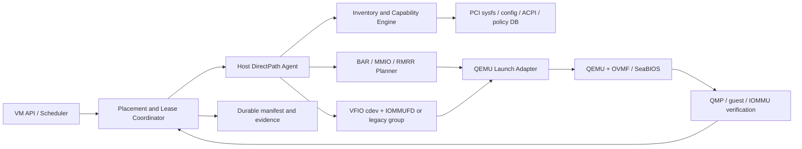
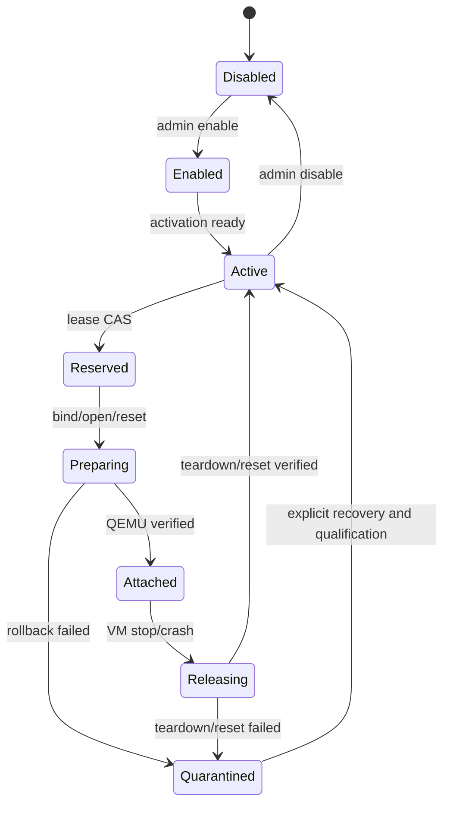
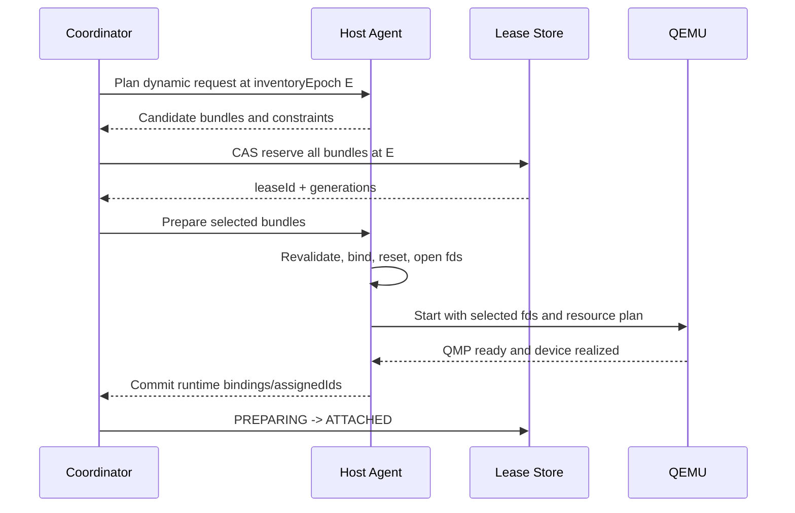

# QEMU 静态与动态 PCI 直通对标设计

状态：架构基线 1.0

目标基线：VMware ESXi 8.0 U3、virtual hardware 20、EFI guest

范围：公开接口、公开文档和本仓库黑盒结果所能观察的外部行为
非目标：推导 VMware 私有代码、复制未公开算法或把实验绕过描述成硬件安全能力

## 1. 结论先行

QEMU 本体只能完成设备呈现、MMIO 映射、中断和 DMA 等运行时工作，不能单独提供
VMware Assignable Hardware 的候选发现、跨 VM 排他租约、跨主机选择、故障 fencing 和
审计状态。完整实现必须是一个 QEMU 平台：

```text
QEMU + OVMF/SeaBIOS + VFIO/IOMMUFD
     + host inventory/capability agent
     + durable lease and placement service
     + lifecycle controller
     + versioned policy and qualification database
```

本设计采用以下核心原则：

1. 静态直通持久绑定一个明确 host device；动态直通持久保存匹配条件，只在 VM 启动事务中
   产生临时 `assignedId`。
2. Dynamic DirectPath 表示 power-on selection，不表示运行中 PCI hot-add/hot-remove。
3. `capable`、管理员启用、host 激活、当前可租用、对某个 VM 可启动和某项生命周期操作可用
   是六种不同状态。
4. 候选单位不是单个 BDF，而是 IOMMU、物理隔离、reset、RID alias、multifunction 和功能
   互连依赖的闭包。
5. ACS override 后的 kernel IOMMU group 只用于 VFIO 操作，不能缩小平台安全租约。
6. 多设备分配、bind、reset、QEMU 启动和释放必须是可回滚事务；清理失败进入 quarantine，
   不得直接回到 free pool。
7. VMware 对标 profile 默认拒绝 snapshot、suspend、live migration 和 runtime hotplug；QEMU
   原生 VFIO migration 或 hotplug 只能作为单独扩展 profile，经能力证明后启用。
8. Firmware、VM 创建路径和 resolved motherboard layout 是 guest ABI；缺省值必须在创建时
   解析并持久化。Stock QEMU 只能提供分项功能近似时，严格 profile 必须 fail-closed。

Firmware/layout 的已执行黑盒矩阵、原始产物索引和 QEMU 7-profile 结果见
[`vmware-firmware-layout-matrix.md`](vmware-firmware-layout-matrix.md)；机器可读摘要见
[`evidence/esxi8-firmware-layout-20260715-summary.json`](evidence/esxi8-firmware-layout-20260715-summary.json)。

## 2. 设计目标与边界

### 2.1 目标

- 对齐 VMware 静态 VMDirectPath 的 `Capable/Enabled/Active`、固定 backing 和 dependency 行为。
- 对齐 Dynamic DirectPath 的 allowed-device matcher、power-on selection、运行时 binding、关机
  清空、candidate exhaustion 和 powered-off relocate。
- 在 QEMU 启动前完成 BAR、MMIO、RMRR、IOMMU、ACS、reset、interrupt 和 lifecycle admission。
- 对所有拒绝给出稳定 reason code、具体依赖 BDF、证据 provenance 和恢复建议。
- host crash、QEMU crash、部分 bind 失败和 reset 失败后，不产生双重分配或未受控 DMA。
- 允许同一实现提供严格 VMware parity profile 和显式扩展的 QEMU-native profile。

### 2.2 非目标

- 不保证复刻 VMware 未公开的 candidate 排序；保证匹配集合、排他性和外部状态语义。
- 不把 VID:DID、class code、FLR bit 或 patched IOMMU group 单独当成 capable 结论。
- 不允许 VFIO no-IOMMU、unsafe interrupts 或未审计的 ACS override 进入生产通过路径。
- 不承诺任意 PCI 设备可迁移、可热拔或可安全复用；这些都是独立的设备能力。
- 不在 guest 运行期间把一个 Dynamic backing 静默切换成另一个物理设备。

### 2.3 对标 profile

版本差异必须进入 profile，不能形成一个永久不变的“VMware 默认值”：

```text
vmware-esxi8u3-vhw20-create-efi-acpi        # CreateVM 缺省解析结果
vmware-esxi8u3-vhw20-create-bios-i440bx     # CreateVM 缺省解析结果
vmware-esxi8u3-vhw20-explicit-efi-i440bx    # 显式 legacy layout + EFI
vmware-esxi8u3-vhw20-register-efi-i440bx    # key-absent 直接注册 fallback
qemu-vfio-native                            # 允许经过证明的 VFIO migration/hotplug 扩展
lab-unsafe                                  # 只用于实验，输出永远带 unsafe 标记
```

profile 至少固定 QEMU、kernel、firmware、machine type、guest firmware、vHW 对标版本、
配置创建路径、resolved motherboard layout、root topology、capability filter、MMIO policy、
migration policy 和 policy database hash。`acpi+bios` 是启动前拒绝的非法组合，不创建 profile。

## 3. VMware 公开状态到 QEMU 平台状态的映射

Broadcom API 将静态设备状态分成 `passthruCapable`、`passthruEnabled` 和
`passthruActive`；其中 Active 明确定义为 enabled 且 host 已重启。Dynamic backing 则保存
`allowedDevice`、可选 `customLabel` 和仅在 VM powered-on 时设置的 `assignedId`。

| VMware 可观察状态 | QEMU 平台等价状态 | 说明 |
| --- | --- | --- |
| `passthruCapable` | `hardwareCapable && policyEligible` | 不受当前 owner 和 VM MMIO 布局影响 |
| `passthruEnabled` | `adminEnabled` | 管理员允许该设备进入直通池 |
| `passthruActive` | `hostActive` | Linux 可按策略安全 bind/open；不伪造“必须重启”语义 |
| `dependentDevice` | `requiredLease` | 完整 dependency closure，不只返回一个 bridge |
| static backing BDF | `StaticRequest.deviceUid` | BDF 和身份都必须匹配，禁止静默替换 |
| `allowedDevice` | `DynamicRequirement.matcher` | VID:DID，加可选 subsystem/revision |
| `customLabel` | `labels` exact matcher | 标签是调度条件，不是安全证明 |
| `assignedId` | `RuntimeBinding.hostBdf` | 只存在于当前 run；power-off 后清空 |
| AH binding | `LeaseRecord + RuntimeBinding` | durable lease 是权威 owner，QEMU manifest 是运行证据 |

Linux 不需要为了外观对标而强制 host reboot。平台应输出实际激活模式：

```text
activationMode = persistent-vfio | bind-on-lease | reboot-required
```

`hostActive=true` 的含义是该模式已经满足，而不是谎称走过 ESXi 的实现路径。

## 4. 总体架构



### 4.1 组件职责

| 组件 | 必须负责 | 禁止负责 |
| --- | --- | --- |
| Inventory agent | 全量 PCI 拓扑、资源、provenance、health 和 generation | 根据 VM 需要篡改硬件事实 |
| Capability engine | 静态 capable、dependency closure、reason code | 获取或释放实际 owner |
| Lease coordinator | 原子多 bundle 租约、epoch/CAS、fencing | 直接操作 PCI config space |
| Host agent | bind/reset/open、fd passing、rollback、quarantine | 无 durable lease 自行选卡 |
| MMIO planner | selected BAR 布局、profile RMRR envelope、QEMU/firmware参数 | 把示例 hole 固定为生产默认 |
| QEMU adapter | 生成稳定 guest topology、启动和 QMP 验证 | 运行中重新选择 Dynamic backing |
| QEMU/VFIO | config/MMIO/IRQ/DMA 和可选 device migration | 分布式调度和跨进程租约 |
| Policy DB | HCL、errata、override、trust-domain 规则 | 用整个 class code 代替精确证据 |

## 5. 信任与安全模型

### 5.1 owner 和 trust domain

VM、DPDK 进程和其他 userspace driver 都是能够直接发起 DMA 的 owner。安全边界来自 IOMMU、
interrupt remapping、物理拓扑和租约，不来自进程名称。生产至少区分：

```text
untrusted-vm
trusted-vm
trusted-dpdk
host-kernel
qualification-lab
```

不同 trust domain 不能共享同一 `physicalIsolationDomain`、reset domain 或未证明安全的 P2P
互连。`uio_pci_generic`/`igb_uio` 不提供 VFIO/IOMMU 强制，不能用于 `untrusted-vm`。

### 5.2 ACS override 的强制约束

长期启用 `pcie_acs_override` 时必须同时保存：

```text
kernelIommuGroup          # 当前 kernel 的 VFIO 操作单位
physicalIsolationDomain  # 忽略 override 后保守重建的安全域
acsNativeIsolation
acsEffectiveIsolation
acsOverrideSource
```

租约闭包使用 physical domain，VFIO open/bind 使用 kernel group。缺少或矛盾 provenance 时
所有 override-dependent candidate fail-closed。本仓库的
[`kernel-patches/`](kernel-patches/README.md) 提供对应 Linux 6.6 接口和已构建验证。
对 physical domain 内每个 DMA-capable endpoint，必须二选一：与 payload 进入同一
owner/IOAS，或在整个 lease 期间解绑驱动、关闭 bus master 并证明 quiesced。只有不会
DMA 且不受 reset 影响的 fabric node 才可保留 host 所有权。任一 member 无法分类或
停机时拒绝整个 candidate；ACS override 本身永远不构成隔离证据。

### 5.3 DMA 和中断底线

- Host IOMMU 必须存在并启用 translation；禁止 no-IOMMU。
- Interrupt remapping 对 untrusted VM 必须为 true；禁止 unsafe interrupts。
- VFIO cdev/IOMMUFD 是优先后端，legacy group/container 是兼容后端。
- IOMMUFD 的 device-centric fd 不改变 IOMMU group 单一 DMA owner 约束。
- ATS、PRI、PASID 默认不暴露；启用前必须证明 bind、invalidate、teardown 和 reset 语义。
- P2P 必须显式声明 peer set。当前 QEMU IOMMUFD 文档仍列出 PCI BAR P2P mapping caveat，
  未通过 backend-specific 验收时直接拒绝。

## 6. 规范化 inventory

inventory 是事实快照，不是调度结果。每次 PCI add/remove、driver bind、link change、reset
失败、kernel reboot 或 policy 更新都递增 `inventoryEpoch`。

### 6.1 DeviceRecord

```json
{
  "deviceUid": "host-uuid/physical-slot-or-bdf/function",
  "hostBdf": "0000:65:00.0",
  "identity": {
    "vendorId": 4318,
    "deviceId": 9860,
    "subVendorId": 4318,
    "subDeviceId": 5192,
    "revisionId": 161,
    "classCode": 197120
  },
  "structure": {
    "headerType": 0,
    "pcieType": 0,
    "parent": "0000:64:00.0",
    "physicalSlot": "slot-3",
    "numaNode": 1
  },
  "resources": {
    "bars": [],
    "rom": null,
    "rmrr": [],
    "interruptModes": ["msix", "msi"],
    "maxVectors": 129,
    "dmaAddressBits": 48
  },
  "domains": {
    "kernelIommuGroup": ["0000:65:00.0"],
    "physicalIsolationDomain": ["0000:65:00.0"],
    "resetDomain": ["0000:65:00.0"],
    "requesterAliasSet": ["0000:65:00.0"],
    "multifunctionSet": ["0000:65:00.0"],
    "functionalGroup": []
  },
  "reset": {
    "methods": ["flr"],
    "selectedMethod": "flr",
    "domainSource": "vfio-hot-reset-info"
  },
  "isolation": {
    "provenance": "native-acs",
    "overrideSource": "none"
  },
  "activation": {
    "adminEnabled": true,
    "hostActive": true,
    "driver": "vfio-pci",
    "activationMode": "persistent-vfio"
  },
  "health": {
    "state": "healthy",
    "generation": 12,
    "lastResetResult": "pass"
  },
  "policy": {
    "eligible": true,
    "policyHash": "sha256:...",
    "qualificationLevel": "software-plus-vendor"
  }
}
```

### 6.2 必收集字段

| 类别 | 字段 |
| --- | --- |
| 身份 | VID:DID、subsystem、revision、class、VPD/serial hash（可用时） |
| 结构 | Header Type、PCIe type、parent、subordinate bus、physical slot、NUMA |
| BAR | index、size、I/O 或 memory、32/64-bit、prefetch、当前地址、ROM、VF BAR、ReBAR effective size |
| 隔离 | IOMMU group、physical domain、ACS native/effective/source、RID alias |
| Reset | sysfs methods、VFIO hot-reset affected set、method provenance |
| 功能依赖 | multifunction、PF/VF、NVLink/NVSwitch、vendor-declared group、platform dependency |
| DMA/IRQ | address width、MSI/MSI-X/INTx、vector count、ATS/PRI/PASID、interrupt remap |
| Reserved | RMRR/IVMD、reserved memory、ROM hash |
| 生命周期 | driver、admin state、health、generation、quarantine reason |
| 策略 | HCL/errata rule、override approval、profile compatibility、evidence level |

### 6.3 BAR 探测

正常 inventory 优先读取 kernel 已探测的 sysfs resource。write-all-ones sizing 只能在设备已经
解绑、quiesced、bus master/decode 已关闭且持有外部独占租约时执行；所有成功和异常路径恢复
BAR 与 `PCI_COMMAND`。本仓库 [`pci-resource-model/`](pci-resource-model/README.md) 已实现该
事务模型，但真实硬件写探测仍需单独资格验收。

## 7. Capability 分层

### 7.1 输出模型

```text
hardwareCapable = assignable function role
               && host IOMMU/interrupt prerequisites
               && accepted reset path
               && trustworthy isolation
               && no structural/platform exclusion

policyEligible = hardwareCapable
              && HCL/errata/trust-domain policy permits

adminEnabled = policyEligible && administrator admitted device to pool

hostActive = adminEnabled && activation mode is ready

available = hostActive
         && complete dependency bundle is healthy and free

attachable = available
          && selected VM BAR/MMIO/RMRR/NUMA/IRQ admission passes

operationSupported(op) = attachable
                      && every selected device supports op
                      && target profile permits op
```

这些状态都必须返回，不能再压缩成一个 `passthroughCapable` 布尔值。

### 7.2 设备 role

- Type-0 endpoint 和经过证明的 VF 可以作为 payload。
- Type-1 bridge、root port、switch port、host bridge 和实际承载 subordinate bus 的 function
  是 fabric node，只能作为 lease dependency，不能作为普通 payload。
- class code 是 metadata，不做 CPU/memory/bridge class blanket blacklist。
- 精确 denylist 只用于已知 errata，必须带 source、affected IDs/revisions、kernel/profile range、
  reason 和审计 override。

### 7.3 reason code

所有 reason 至少带 `stage`、`devices`、`details`、`source`：

```text
HARDWARE_ROLE_NOT_ASSIGNABLE
HOST_IOMMU_MISSING
INTERRUPT_REMAP_MISSING
IOMMU_GROUP_NOT_VIABLE
PHYSICAL_ISOLATION_DOMAIN_UNKNOWN
ACS_OVERRIDE_REQUIRES_WHOLE_PHYSICAL_DOMAIN
RESET_NOT_SUPPORTED
RESET_DOMAIN_UNVERIFIED
PLATFORM_RESERVED
DEVICE_ERRATA_DENY
ADMIN_DISABLED
HOST_ACTIVATION_REQUIRED
DEVICE_QUARANTINED
DEPENDENCY_BUSY
PROFILE_NO_MATCH
PROFILE_ABI_MISMATCH
RMRR_PROFILE_CONFLICT
MMIO_APERTURE_EXHAUSTED
NUMA_POLICY_UNSATISFIED
MIGRATION_UNSUPPORTED
HOTPLUG_UNSUPPORTED
HOST_FENCE_PENDING
INVENTORY_EPOCH_CHANGED
```

## 8. Dependency bundle

### 8.1 闭包规则

对每个 payload seed 迭代求固定点：

```text
leaseDomain = closure(
    payload
  U kernelIommuGroup
  U physicalIsolationDomain
  U resetAffectedSet
  U requesterAliasSet
  U multifunctionSet
  U PF/VFDependencies
  U functionalGroup
  U platformDependencies
)
```

一个 bundle 可以包含不可直通的 fabric function。它们不进入 guest，但其 owner 必须被平台
锁定，必要时保持 host driver 状态不变。两个候选的 lease domain 有任意交集，就不是两个
可独立分配的资源。

### 8.2 reset domain

优先级为 device-specific、ACPI、FLR、AF FLR、PM function reset，再到已验证的 bus/link/slot
reset。bus-level reset 必须通过 `VFIO_DEVICE_GET_PCI_HOT_RESET_INFO` 或资格快照取得 affected
set；仅按 sysfs parent 猜测的集合默认拒绝。reset 日志不是内部状态已清除的证明。

### 8.3 functional group

functional group 覆盖 IOMMU 无法表达的设备关系，例如：

- vendor 声明必须共同分配的 multifunction functions；
- PF/VF 管理依赖；
- NVLink/NVSwitch 或其他 fabric-connected accelerators；
- 共享 firmware、doorbell、sideband management 或安全状态的 function；
- 允许 P2P 时的完整 peer set。

来源优先级为 vendor/HCL signed rule、host firmware/topology、qualification snapshot、人工审核。
不能从相同 VID:DID 自动推断功能依赖。

## 9. 静态直通设计

### 9.1 持久配置

```json
{
  "mode": "static",
  "deviceUid": "host-a/slot-3/function-0",
  "expectedHostBdf": "0000:65:00.0",
  "expectedIdentity": {
    "vendorId": 4318,
    "deviceId": 9860,
    "subVendorId": 4318,
    "subDeviceId": 5192,
    "revisionId": 161
  },
  "guestSlot": "rp-dp0/00.0",
  "profile": "vmware-esxi8u3-vhw20-efi"
}
```

BDF 改变、板卡被替换或 subsystem/revision 不符时必须拒绝并要求管理员确认，不能像 Dynamic
模式一样自动换卡。

### 9.2 状态机



### 9.3 启动事务

1. 读取 inventory 和 policy epoch，确认 exact device identity。
2. 计算 dependency bundle，执行 durable compare-and-swap lease。
3. 再次读取 udev generation、BDF identity 和 group membership，防止 TOCTOU。
4. quiesce host workload，设置 `driver_override`，解绑 host driver 并 bind `vfio-pci`。
5. 打开全部 VFIO cdev/group fd，绑定 IOMMUFD/IOAS，确认单一 DMA owner。
6. 执行选定 reset，重新读取 config/link/health，失败则 rollback 或 quarantine。
7. 根据最终 bundle 计算 BAR/MMIO/RMRR、NUMA、IRQ 和 guest ABI plan。
8. 通过继承 fd 启动 QEMU，避免 QEMU 按字符串 BDF 重新解析到另一设备。
9. QMP、guest 和 IOMMU 三方验证通过后，将 lease 从 `PREPARING` 提交为 `ATTACHED`。

### 9.4 释放事务

1. 停止 guest DMA，等待 QEMU 退出或完成 device detach。
2. 撤销 IRQ eventfd、DMA map、IOAS attachment 和 device fd。
3. 关闭 bus master/interrupt，执行 release reset 并验证 link/config/health。
4. 按 policy 重新绑定 host driver，或保持 persistent-vfio active。
5. 清除 runtime binding，递增 device generation。
6. 仅在所有步骤成功后释放 lease；否则进入 quarantine。

## 10. Dynamic DirectPath 设计

### 10.1 持久请求

每个 virtual passthrough slot 是一个 requirement。持久配置保存 predicate，不保存 BDF：

```json
{
  "mode": "dynamic",
  "requirements": [
    {
      "requestKey": "pciPassthru0",
      "allowedDevices": [
        {
          "vendorId": 32902,
          "deviceId": 4110,
          "subVendorId": 6900,
          "subDeviceId": 1,
          "revisionId": 2
        }
      ],
      "customLabel": "storage-tier-a",
      "count": 1,
      "guestSlot": "rp-dp0/00.0",
      "guestAbiClass": "nvme-tier-a-v1"
    }
  ],
  "profile": "vmware-esxi8u3-vhw20-efi"
}
```

`vendorId/deviceId` 必须匹配；subsystem/revision 只有在 request 中存在时才参与 exact match。
`customLabel` 存在时也必须 exact match。class code、display name 和驱动名不能替代这些字段。

### 10.2 candidate 构造

对每个匹配 function：

1. 运行静态 `policyEligible` evaluator。
2. 展开完整 dependency bundle。
3. 计算 `resourceSignature`、`guestAbiClass`、NUMA 和 health。
4. 去重相同 lease domain；同一物理 bundle 不能伪装成多个 candidate。
5. 排除与 request 的 trust domain、firmware 或 operation policy 不兼容者。

### 10.3 多设备原子求解

输入是 requirement 到 candidate bundle 的二部图。求解结果必须满足：

```text
每个 requirement 达到 count
每个 selected bundle 满足 matcher 和 ABI class
任意 selected leaseDomain 两两不相交
同一 functional group 的 collective assignment 规则满足
host MMIO/RMRR/NUMA/IRQ/VM device-count 限制满足
```

实现使用确定性 backtracking/constraint solver，不使用逐 requirement 贪心。排序只影响可重复性：

1. candidate 数量最少的 requirement 优先；
2. exact subsystem/revision/label 优先；
3. 满足 VM NUMA locality 的 bundle 优先；
4. resource waste 较小者优先；
5. 最后按稳定 `deviceUid` 排序。

这不是声称 VMware 使用同一排序，而是提供稳定、可审计且满足相同外部约束的选择。

### 10.4 事务和 `assignedId`



任何 requirement 无候选或任何准备步骤失败，整组回滚，不允许少配后启动。运行时 binding
包含 `leaseId`、`runId`、selected BDF、device generation 和 guest slot；VM powered-off 后清空。

### 10.5 Dynamic 不是 runtime hotplug

baseline profile 在 QEMU 启动前就选定并 realize `vfio-pci`。QMP `device_add/device_del` 是独立
扩展，`device_del` 只发起 guest eject，必须等待 `DEVICE_DELETED` 才能继续 teardown。未证明
guest cooperation、reset 和 driver recovery 时，runtime hotplug capability 为 false。

## 11. Durable lease 与并发控制

### 11.1 LeaseRecord

```json
{
  "leaseId": "uuid",
  "hostId": "host-a",
  "ownerVmId": "vm-42",
  "runId": "run-77",
  "state": "ATTACHED",
  "bundleIds": ["bundle/0000:65:00.0"],
  "members": ["0000:64:00.0", "0000:65:00.0"],
  "inventoryEpoch": 1042,
  "deviceGenerations": {
    "0000:65:00.0": 12
  },
  "fencingToken": 981,
  "policyHash": "sha256:...",
  "expiresAt": null
}
```

### 11.2 状态

```text
FREE -> RESERVED -> PREPARING -> ATTACHED -> RELEASING -> FREE
                         |             |             |
                         +-------------+-------------+-> QUARANTINED
```

- 单 host 可用 SQLite WAL 加 host-local file lock，但 API 必须保留 CAS/epoch 语义。
- 多 host 使用有共识的 durable store；QEMU pidfile、VM config 和进程列表都不是权威租约。
- 使用 pidfd/systemd scope 或等价进程身份，禁止仅按 PID 判断 owner，避免 PID reuse。
- TTL 只触发调查/回收流程，不能直接把 DMA-capable device 置为 FREE。
- 每次 bind/reset/release 增加 generation；旧 generation 的回调不能释放新 lease。

### 11.3 TOCTOU 防护

租约提交前后都核对：

```text
inventoryEpoch
device generation
BDF -> deviceUid mapping
VID:DID/subsystem/revision
IOMMU group and physical domain
driver owner
PCI link presence
```

发生变化返回 `INVENTORY_EPOCH_CHANGED` 并从头求解，不在旧计划上局部修补。

## 12. BAR、MMIO、RMRR 与 firmware

### 12.1 两阶段 admission

本地实测显示 Dynamic BAR 布局在选定具体 candidate 后生成；Broadcom KB 对 RMRR 则要求
Dynamic VM 的 memory map 尝试兼容 allowable devices。因此设计分开处理：

```text
BAR/MMIO plan       = selected bundles 的实际 BAR
RMRR profile plan   = 当前 host 上所有匹配且可允许 candidate 的 RMRR union
```

如果 selector-wide RMRR union 无法避开 guest RAM，拒绝整个 profile 或要求管理员缩小
allowed set，不能只因为当前选中的一张卡暂时可用就接受。
“不与 guest RAM 重叠”只是必要条件，不是充分条件。真实 RMRR/IVMD device 还必须证明
host reserved pages 可被安全保留为精确 identity mapping，且 device reset 后的 platform DMA
协议仍然正确；否则即使 memory-map planner 成功也必须拒绝。

### 12.2 MMIO planner

1. 固定不可替代的 32-bit/below-1M BAR。
2. 按 size/alignment 进行 below-4G packing。
3. 不能低置的 64-bit BAR 进入 high aperture。
4. 以实际 bridge tree 自底向上聚合 window，不只计算 root-level 总和。
5. high aperture 同时设置 OVMF `X-PciMmio64Mb` 和 QEMU host bridge
   `pci-hole64-size`，不允许只设置一侧。
6. 记录 guest RAM、firmware reserved ranges、其他 virtual device BAR 和 RMRR。
7. plan 是事务结果；任何 BAR 失败时不返回部分布局。

### 12.3 firmware profile

- EFI 基线使用 OVMF，并固定 CODE/VARS hash；Legacy BIOS 使用 SeaBIOS 并固定镜像 hash。
- SeaBIOS 是 QEMU legacy firmware，不是 VMware `firmware=bios` 的行为等价物。本地实测中
  SeaBIOS 可将 2GiB BAR 高置，而 VMware `i440bx+bios` 将同一 BAR 留为未分配。
- Qman 创建 VM 时必须把 requested firmware/layout 解析成持久化 `resolvedLayout`，不能在
  QEMU 升级、导入或恢复时重新套用“当前默认”。`acpi+bios` 在资源规划前返回
  `PROFILE_FIRMWARE_LAYOUT_MISMATCH`。
- VMware CreateVM vHW20 缺省实测为 EFI/acpi、BIOS/i440bx；直接注册 layout key-absent
  VMX 的实测 fallback 为 i440bx-like。两条路径必须是不同 profile provenance。
- 默认 `rombar=0` 对齐当前 VMware 默认隐藏样本。
- 显式 Option ROM 必须固定 hash、来源和执行 policy；未知 ROM 不进入 guest firmware。
- VMware parity profile 固定 effective BAR size，并将 ReBAR control 隐藏或只读；未通过
  guest config-write 负例时，不允许带可写 ReBAR capability 的设备进入该 profile。

Stock QEMU 的 profile 边界如下：

| VMware 目标 | Stock QEMU 功能近似 | 已知不可消除差异 |
| --- | --- | --- |
| `i440bx+efi` | i440fx + OVMF；PCIe surface 另用 q35 + root-port 交叉验证 | i440fx 是 440FX/PIIX3 且无 VMware root-port surface；q35 是 Q35/ICH9 |
| `acpi+efi` | i440fx + OVMF + PXB multi-root | PXB/内部 bridge identity、bus 编排和 VMware 440BX/PIIX4 identity 不同 |
| `i440bx+bios` | i440fx + SeaBIOS 边界测试 | 大 BAR placement 已实测不等价 |

因此 stock QEMU profile 只能声明 `functional-approximation`。若产品合同要求同时稳定
VMware chipset identity、PCIe root-port surface、ACPI 多根桥命名/bus range 和 BAR placement，
必须实现版本化 custom QEMU machine/host bridge，并重新执行完整 guest ABI 与迁移兼容性矩阵；
在该实现完成前返回 `BACKEND_TOPOLOGY_GAP`，不能悄悄选择 q35。

### 12.4 启动参数模板

下面只是一份 QEMU-native q35/OVMF PCIe profile 模板，不代表 VMware ACPI layout 的精确
machine ABI。host agent 应先打开 IOMMUFD 和 VFIO cdev，再把 fd 传给 QEMU：

```bash
qemu-system-x86_64 \
  -machine q35,accel=kvm \
  -object iommufd,id=iommufd0,fd=22 \
  -drive if=pflash,format=raw,readonly=on,file=OVMF_CODE.fd \
  -drive if=pflash,format=raw,file=OVMF_VARS.fd \
  -fw_cfg name=opt/ovmf/X-PciMmio64Mb,string=2048 \
  -global q35-pcihost.pci-hole64-size=2G \
  -device pcie-root-port,id=rp-dp0,chassis=1,slot=1 \
  -device vfio-pci,id=dp0,fd=23,iommufd=iommufd0,bus=rp-dp0,addr=00.0,rombar=0
```

精确参数由启动时探测的 QEMU build capability 决定。旧 kernel/QEMU 可退回 legacy
group/container，但仍必须持有完整 platform lease；禁止退回 no-IOMMU。

VMware `i440bx+efi` 和 `acpi+efi` 功能近似的命令由
`qemu-firmware-layout-matrix-validate.sh` 生成。MMIO planner 必须把 endpoint、root/secondary
bridge、PXB 和所有辅助设备 BAR 一起按 alignment 自底向上装箱；本地 2GiB exact-hole
用例已经证明，普通 `pci-bridge` 自身消耗少量 high resource 后，可使一个 2GiB-aligned
BAR 无法装入名义 2GiB aperture。

## 13. Guest ABI 与 QEMU surface policy

### 13.1 稳定和可变字段

Dynamic 冷启动允许在显式 allowed set 内更换物理 identity，但必须满足 guest contract：

| 必须稳定 | 可在显式 allowed set 内变化 |
| --- | --- |
| virtual slot/function、boot order、profile operation policy | VID:DID/subsystem/revision |
| firmware 类型和 ACPI ownership | BAR size/address（关机重启后） |
| 是否存在 guest vIOMMU | link speed/width 的 profile 化呈现 |
| capability filter 规则 | MSI-X vector 上限（ABI class 允许时） |

每个 candidate 生成 `guestAbiSignature`。request 的 `guestAbiClass` 声明允许的 signature 集合；
未在集合内时返回 `PROFILE_ABI_MISMATCH`，不能寄希望于 guest driver 恰好兼容。

### 13.2 VMware parity surface

基于当前实测，QEMU/VFIO 至少需要以下 policy：

| Surface | 基线行为 |
| --- | --- |
| PCIe topology/LinkCap | 按 profile 重建，不把 host link 原样当合同 |
| AER | host ownership；不向 guest 投递 AER notification；config surface 按实测 profile 过滤 |
| PME | ACPI `_OSC` 按 profile；默认不向 guest 提交 native PME IRQ |
| Option ROM | 默认隐藏；显式路径固定 ROM hash |
| MSI/MSI-X | 保留并要求 interrupt remapping；记录 vector budget |
| INTx | 仅在物理验收通过的 profile 中允许 |
| ATS/PRI/PASID | 默认过滤；启用需 IOMMUFD/vendor qualification |
| guest vIOMMU | VMware target 未暴露时不添加 |
| P2P | 默认拒绝；显式 peer-set profile 才允许 |
| ReBAR | parity profile 不允许运行时 resize |

不能由标准参数表达的 AER/config capability 过滤，应在 `vfio-pci` config-space policy 或
等价 proxy 中实现，并绑定 profile/version。实验补丁见
[`vmware-esxi8-lab/qemu-patches/`](vmware-esxi8-lab/qemu-patches/)，生产实现需要重写成通用、
有测试的 property/object，而不是保留 lab-only 开关。
当前黑盒样本中 guest 仍可见部分 raw status body，但这不等于 PCI error 被投递给
guest；产品合同以“host 处理、guest 无 notification”为硬语义，再用 versioned profile
对齐 config-space 可见性。

## 14. Lifecycle capability

### 14.1 baseline 矩阵

| Operation | 静态 parity | 动态 parity | 条件 |
| --- | --- | --- | --- |
| guest reboot | 允许 | 允许 | 同一 assigned device；reset/driver 功能验证 |
| VM power cycle | 允许 | 允许 | Dynamic 每次重新求解并产生新 binding |
| forced VM off | 允许但强制 cleanup | 同左 | cleanup 失败 quarantine |
| snapshot | 拒绝 | 拒绝 | 当前 ESXi 对标合同 |
| suspend/resume | 拒绝 | 拒绝 | 当前 ESXi 对标合同 |
| live migration | 拒绝 | 拒绝 | 当前实测 `assignHwNotAvailable` |
| powered-off relocate | 固定设备通常 host-bound | 允许 | 目标 host 重新求解 Dynamic request |
| HA restart | 条件允许 | 条件允许 | 原 host fenced，目标有完整 candidate bundle |
| runtime hot-add/remove | 拒绝 | 拒绝 | Dynamic 不等于 hotplug |
| host maintenance evacuation | 关机/应用层处理 | 关机后 relocate | 不能伪装成 live migration |

### 14.2 QEMU-native migration 扩展

只有 device/vendor VFIO driver 报告 migration feature，destination ABI 匹配，DMA dirty
tracking 可用，且全部 P2P devices 支持 P2P migration/quiescent state 时，才可启用
`qemu-vfio-native` live migration。该能力必须显示为 VMware parity 之外的 extension。

迁移失败或取消必须把 device state 恢复为 RUNNING；源端 lease 在 destination commit 前不可
释放。多设备 migration 的 stop/start 不是天然原子操作，必须遵守 VFIO P2P quiescent 规则。

### 14.3 runtime hotplug 扩展

可选实现必须：

1. 预留稳定 PCIe root port 和 firmware hotplug aperture。
2. 在 `device_add` 前完成完整 lease、bind、reset 和 admission。
3. `device_del` 后等待 `DEVICE_DELETED`，不能把 QMP command success 当成已拔除。
4. 再执行 unmap/reset/rebind/release；guest 不合作时保持 lease 并进入 recovery。

## 15. Crash、rollback 与 quarantine

### 15.1 rollback 栈

每个 side effect 入栈对应补偿动作：

```text
lease reserved          -> release lease
host driver unbound     -> rebind original driver
vfio bound              -> unbind vfio
device fd opened        -> close fd
IOMMUFD attached        -> detach IOAS
DMA mapped              -> unmap DMA
QEMU spawned            -> stop/fence QEMU
device reset            -> verify or quarantine
runtime binding stored  -> clear binding with generation check
```

补偿按逆序执行。任何 reset、IOMMU detach、driver restore 或 identity revalidation 失败都禁止
释放成 FREE。

### 15.2 QEMU crash

- host agent 使用 pidfd/systemd scope 收到确定退出事件；
- 先撤销 DMA/IRQ，再 reset；
- config/link/health probe 通过后释放；
- QEMU process 消失但 fd ownership 不清楚时，确认 kernel owner 后再继续；
- lease record 保存 crash reason 和 cleanup evidence。

### 15.3 host crash 和 fencing

cluster 看到 agent heartbeat 丢失时只能标记 `HOST_UNREACHABLE`，不能释放其设备。HA 在其他
host 启动 VM 前必须完成原 host power fencing；原 host 恢复后以更高 fencing token 启动
agent，旧 token 的回调全部拒绝。host reboot 后重新 inventory、reset/health check，再把设备
加入 pool。

### 15.4 quarantine

进入 quarantine 的条件包括：

```text
RESET_FAILED
RESET_STATE_VERIFY_FAILED
DMA_TEARDOWN_UNVERIFIED
IOMMU_DETACH_FAILED
LINK_OR_DEVICE_DISAPPEARED
AER_FATAL_OR_DPC_TRIGGERED
HOST_DRIVER_REBIND_FAILED
IDENTITY_CHANGED
VENDOR_HEALTH_CHECK_FAILED
```

退出 quarantine 必须是显式、审计的 recovery workflow，可要求 slot power cycle 或 host reboot。

## 16. 多主机 placement、cold relocate 与 HA

### 16.1 两阶段 placement

1. Coordinator 向每个 host 请求基于 snapshot 的 `CanSatisfy`，用于筛选和评分。
2. 选中 host 后必须重新执行原子 lease；`CanSatisfy=true` 不是 reservation。
3. 若 inventory epoch 或 owner 变化，返回可重试 conflict，而不是继续使用旧 plan。
4. 所有 requirements 成功后才启动 VM。

### 16.2 cold relocate

- VM powered-off 且 runtime binding 为空才能迁移 Dynamic request。
- 持久 VM config 只移动 matcher/profile，不移动 BDF。
- 目标 host 重新匹配、租约和 MMIO/RMRR plan。
- static request 默认 host-affine；只有管理员将其转换为 Dynamic request 才可自动换卡。

### 16.3 HA restart

HA 成功条件是目标 host 存在完整、健康、互不重叠的 candidate bundles。原 host 未 fenced、
profile RMRR 不兼容、guest ABI class 不满足或 candidate exhaustion 时，保持 VM stopped 并给出
结构化 reason，不能降级为少配设备启动。

## 17. API 与审计 manifest

### 17.1 建议 API

```text
GET  /hosts/{host}/directpath/devices
POST /hosts/{host}/directpath/evaluate-static
POST /hosts/{host}/directpath/plan-dynamic
POST /hosts/{host}/directpath/reservations
POST /reservations/{id}/prepare
POST /reservations/{id}/attach
POST /reservations/{id}/release
POST /devices/{uid}/recover
GET  /vms/{vm}/directpath/runtime-bindings
```

所有变更 API 接受 idempotency key 和 expected epoch；所有响应带 policy/profile hash。

### 17.2 AssignmentManifest

```json
{
  "schemaVersion": 1,
  "vmId": "vm-42",
  "runId": "run-77",
  "mode": "dynamic",
  "profile": "vmware-esxi8u3-vhw20-efi",
  "inventoryEpoch": 1042,
  "policyHash": "sha256:...",
  "riskRegisterHash": "sha256:...",
  "qualificationBundleHash": "sha256:...",
  "leaseId": "uuid",
  "fencingToken": 981,
  "bindings": [
    {
      "requestKey": "pciPassthru0",
      "assignedId": "0000:65:00.0",
      "deviceUid": "host-a/slot-3/function-0",
      "deviceGeneration": 12,
      "leaseMembers": ["0000:64:00.0", "0000:65:00.0"],
      "guestSlot": "rp-dp0/00.0",
      "guestAbiSignature": "sha256:..."
    }
  ],
  "resourcePlan": {
    "mmio32": [],
    "mmio64": [],
    "rmrrEnvelope": [],
    "ovmfPciMmio64Mb": 2048,
    "qemuPciHole64Size": 2147483648
  },
  "artifacts": {
    "qemuHash": "sha256:...",
    "firmwareCodeHash": "sha256:...",
    "firmwareVarsBaseHash": "sha256:...",
    "argvHash": "sha256:..."
  },
  "verification": {
    "qmpRealized": true,
    "guestEnumerated": true,
    "iommuMapped": true,
    "interruptRemapped": true
  }
}
```

manifest 可以记录本次 Dynamic BDF，但不能回写成下一次启动的持久 backing。

## 18. 关键风险与控制

| ID | 风险 | 后果 | 强制控制 | 验收证据 |
| --- | --- | --- | --- | --- |
| R01 | ACS override 缩小 group | P2P 绕过 IOMMU | 双域模型，整租 physical domain | provenance + peer-DMA negative/positive control |
| R02 | reset 影响旁路 function | 破坏 host/其他 VM | VFIO affected set 闭包和原子 lease | hot-reset info + callback/真实硬件 |
| R03 | reset 未清敏感状态 | 跨租户泄漏 | 双端 reset、state probe、失败 quarantine | generation register/vendor test |
| R04 | 双重分配/TOCTOU | 两个 owner 同时 DMA | durable CAS、epoch、fd passing | 并发 race 测试 |
| R05 | 多设备部分成功 | guest 少配或依赖拆分 | constraint solver、all-or-nothing rollback | 中途 bind/reset fault injection |
| R06 | stale DMA/IOTLB/IRQ | power-off 后写 guest/host | unmap/invalidate/IRQ teardown 后才释放 | IOMMU trace 和 sentinel |
| R07 | RMRR 与 guest RAM 重叠 | identity DMA 错址 | selector-wide RMRR envelope | synthetic DMAR overlap A/B |
| R08 | 异构 candidate ABI 不兼容 | guest driver/firmware 失败 | guestAbiClass 和 per-candidate validation | cold restart across candidates |
| R09 | MMIO 只配 firmware 一侧 | BAR 未分配或隐式高置 | OVMF/QEMU 联动 planner | guest `_CRS`、BAR、HMP |
| R10 | host crash 后误释放 | split brain | power fencing 和 fencing token | kill/restart/old-token test |
| R11 | QEMU crash 清理失败 | device 带旧状态回池 | pidfd cleanup + quarantine | SIGKILL fault injection |
| R12 | Option ROM 不可信 | firmware supply-chain 风险 | 默认隐藏，显式 hash allowlist | ROM marker 和 hash |
| R13 | AER/DPC fatal | host/设备失稳 | host ownership、health/quarantine | host/guest paired logs |
| R14 | ATS/PRI/PASID 残留 | translation/cache 跨 owner | 默认过滤，vendor/IOMMUFD qualification | invalidate/reset/teardown trace |
| R15 | P2P backend 不支持 | mapping fail 或越界 DMA | 默认拒绝，backend/profile gate | peer DMA + IOMMU trace |
| R16 | live migration 能力误判 | 丢设备状态或脏页 | baseline blocker，VFIO feature 全量检查 | migration FSM/failure rollback |
| R17 | runtime eject 未完成 | 提前释放仍在用设备 | 等 `DEVICE_DELETED` 和 fd teardown | guest cooperation timeout test |
| R18 | NUMA 远端放置 | 性能与中断抖动 | hard/soft NUMA policy 分离 | locality 和性能 counter |
| R19 | HCL/errata 变化 | 已知硬件缺陷进入生产 | signed versioned policy DB | policy hash 和 qualification report |
| R20 | guest/driver/OEM 不支持 | 功能或服务保证失效 | 版本化外部支持矩阵 | vendor statement + guest workload test |
| R21 | sub-page BAR 共享 4KB host page | 无关资源被映射或修改 | host resource page-isolation admission | sysfs/resource + config probe |
| R22 | ReBAR 写能力逃逸 | guest 改变 BAR size 破坏 plan | 固定 effective size 并过滤/只读 ReBAR capability | config write negative test |
| R23 | SR-IOV PF/VF lifecycle 依赖不完整 | VF 跨 owner、PF reset 破坏 VM | PF/VF 闭包、VF reset 和 capability filter | supported PF/VF hardware matrix |
| R24 | PME 所有权不匹配 | guest 低功耗后无法唤醒设备 | `_OSC` 与 config/message 联合 policy | controlled PME injection |
| R25 | 设备数/topology/resource ceiling | 第 N 个设备启动失败或 ABI 漂移 | 显式 profile limit 和全量资源试算 | 1/16/32/64/limit+1 matrix |
| R26 | raw CLI/QMP 绕过管理门 | 未租约或未验证设备被挂载 | fd-only launch、QMP ACL、sandbox 和 privilege split | bypass negative test |
| R27 | IOMMU/interrupt-remap errata | DMA 或 IRQ 隔离失效 | platform qualification 和 denylist | bare-metal fault/interrupt trace |
| R28 | requester-ID alias 未被发现 | 多设备共用一 translation domain | alias/legacy subtree 整租 | peer DMA + requester trace |
| R29 | 隐藏 functional dependency | 只 reset/分配部分 function 导致故障 | 保守 multifunction/PF-VF 闭包加 vendor rule | cross-function state test |
| R30 | 创建/导入/注册路径重新解析 layout | 升级或恢复后 guest PCI ABI 漂移 | 持久化 requested/resolved layout 与 provenance，导入时显式确认 | CreateVM/register/import golden matrix |
| R31 | 接受 `acpi+bios` 非法组合 | 启动晚期失败或 backend 行为偏离 | API/schema/launcher 三层 fail-closed | LF03 和 raw-launch bypass 负例 |
| R32 | 把 stock q35/PXB 当精确 VMware topology | guest driver、slot、ACPI 路径和管理 ABI 漂移 | approximation 标记；严格 profile 要求 custom machine，否则拒绝 | chipset/root/bus/ACPI golden diff |
| R33 | MMIO 只累计 endpoint BAR | bridge/辅助 BAR 与 alignment 使 mandatory BAR 未分配 | 全树自底向上 packing、padding 与 mandatory-BAR assertion | exact-hole bridge 2G/4G A/B |
| R34 | Legacy BIOS mandatory large BAR 静默未分配 | guest 枚举但设备功能不完整 | admission 预拒绝或仅 lab degraded profile；启动后核对所有 mandatory BAR | VMware LF00 与 SeaBIOS 对照 |

### 18.1 风险清零发布门

“消除所有技术风险”在本设计中的可执行定义是：**支持范围内零已知未缓解风险**。
不宣称无法证明的“绝对零风险”；无法闭环的风险必须通过禁用设备、关闭功能、
缩小 profile 或拒绝启动来消除暴露，不能以“已接受”代替控制。

每一条 risk record 必须包含 risk ID、影响范围、owner、预防控制、检测、隔离/恢复、
测试 ID、证据等级、artifact hash 和以下唯一状态之一：

```text
OPEN                 # 已识别，未实现完整控制；阻断发布
CONTROL_IMPLEMENTED   # 控制已实现但证据未闭环；阻断发布
VERIFIED              # 控制与正/负/故障注入证据都通过；可在限定 profile 中暴露
FEATURE_DISABLED      # 对应功能在 API、调度和 QEMU 三层都 fail-closed；不属于支持范围
INVALIDATED           # 依赖变更使旧证据失效；立即撤销能力并阻断发布
```

发布和运行时强制规则：

1. 只有 `VERIFIED` 能进入 supported capability；`FEATURE_DISABLED` 必须在三层负例中证明无法绕过。
2. isolation、DMA/IOTLB/IRQ teardown、reset/state leakage、lease/fencing、identity 和 firmware
   integrity 不接受 waiver；只能 `VERIFIED` 或 `FEATURE_DISABLED`。
3. 硬件相关风险不能用 synthetic/QEMU 证据提升为物理硬件 `VERIFIED`；未验收的
   VID:DID/revision/topology 自动落入 deny-by-default。
4. 每个风险都必须同时拥有 prevention、detection、containment 和 recovery；只有日志或只有
   rollback 不算闭环。
5. QEMU、kernel、firmware、policy DB、host platform class 或 device revision 变更时，按依赖图
   自动将相关 `VERIFIED` 置为 `INVALIDATED`，重新验收前不可用。
6. CI/release controller 要求 risk register 无 `OPEN`、`CONTROL_IMPLEMENTED`、`INVALIDATED` 和
   `accepted-risk` 类状态；manifest 固定 risk/qualification hash，运行时 hash 不符立即拒绝。
7. 新发现严重风险时先撤销 capability 并 quarantine 已影响设备，再进行根因分析；
   不等待下一个常规版本。

## 19. 验收矩阵

### 19.1 Inventory 与 capable

| ID | 用例 | 通过条件 | 当前状态 |
| --- | --- | --- | --- |
| C00 | Type-0 FLR endpoint | capable=true，完整 domain | 已有 QEMU/ESXi |
| C01 | Type-1 bridge + FLR | role gate 拒绝 payload | 已有 ESXi |
| C02 | class code A/B | class 不改变 Type-0 结论 | 已有 ESXi |
| C03 | RC endpoint 无 FLR/D3 | reset gate 拒绝 | 已有 ESXi |
| C04 | bridge reset dependency | affected set 整租 | 已有 ESXi；VFIO ioctl 待接入 |
| C05 | no-ACS strict/bypass | strict reject；bypass 仅 conditional | 已有 ESXi |
| C06 | mandatory ACS override | patched group 与 physical domain 分离 | 已有单元/内核构建；运行态待启动新 kernel |
| C07 | RID alias/legacy bridge | alias domain 集体分配 | 已有 ESXi legacy；物理待验收 |
| C08 | narrow errata deny | 精确 ID/revision 和 reason | 待实现 |
| C09 | health/quarantine | 不健康设备不进入 candidate pool | 待实现 |
| C10 | qualification hash/version 变更 | 相关 capability 立即 invalidated | 待实现 |
| C11 | sub-4KB BAR 独占/共享 host page | 独占可评估；共享必须拒绝 | 待实现/物理验收 |
| C12 | RCiEP regular function/VF A/B | regular 按 reset gate；RCiEP VF 拒绝 | regular 负例已有；VF 待验收 |
| C13 | SR-IOV VF 与 PF reset dependency | PF/VF bundle 完整，VF 隔离可证明 | partial endpoint；支持型硬件待验收 |
| C14 | PF guest 写 VF Enable/NumVFs | capability 不可写或整个 PF 被拒绝 | 待 QEMU filter |

### 19.2 静态 lifecycle

| ID | 用例 | 通过条件 | 当前状态 |
| --- | --- | --- | --- |
| S00 | exact identity start/stop | 固定 backing、完整 lease、clean release | 部分已有 |
| S01 | BDF 相同但 identity 变化 | fail-closed | 待实现 |
| S02 | dependency busy | available=false，不改变 capable | 已有 evaluator |
| S03 | bind 中途失败 | 原 driver/lease 全回滚 | 待实现 |
| S04 | reset 失败 | quarantine，不回 free | 待实现 |
| S05 | QEMU 启动失败 | fd/IOMMU/driver/lease 逆序清理 | 待实现 |
| S06 | guest reboot traffic | 同设备继续工作 | 已有 ESXi |
| S07 | forced VM off | DMA/IRQ 清理后可复用 | 已有嵌套；controller 待实现 |
| S08 | 十次复用 | 无 stale DMA/interrupt/state | 已有嵌套；物理待验收 |
| S09 | snapshot/suspend | 明确拒绝且设备保持可用 | 已有 ESXi；QEMU gate 待实现 |
| S10 | Fault Tolerance 请求 | 对 DirectPath VM 明确拒绝 | Qman gate 待实现 |

### 19.3 Dynamic matcher 与 solver

| ID | 用例 | 通过条件 | 当前状态 |
| --- | --- | --- | --- |
| D00 | VID:DID match | 开机选卡、关机清空 binding | 已有 ESXi |
| D01 | subsystem/revision A/B | 可选字段 exact match | 待实现 |
| D02 | customLabel A/B | label exact；非法 label 有 reason | ESXi API 已见；QEMU 待实现 |
| D03 | 同 BDF domain 的多个 candidate | 去重为一个 bundle | 已有 ESXi 负例 |
| D04 | heterogeneous BAR | selected candidate 后生成 BAR plan | 已有 ESXi |
| D05 | heterogeneous RMRR | allowed-set envelope 或明确冲突 | synthetic 单设备已有；动态集合待实现 |
| D06 | candidate exhaustion | all-or-nothing `PROFILE_NO_MATCH` | 已有 ESXi |
| D07 | 两 requirement 多解 | 确定性无交集 matching | 待实现 |
| D08 | 贪心失败但全局有解 | backtracking 找到合法解 | 待实现 |
| D09 | 两 VM 同时争抢 | 只一个 CAS 成功 | 待实现 |
| D10 | prepare 后 inventory 改变 | epoch conflict，完整重算 | 待实现 |
| D11 | 部分 bind/reset fault | 全组 rollback 或 quarantine | 待实现 |
| D12 | powered-off relocate | 目标 host 新 assignedId | 已有 ESXi |
| D13 | guest ABI class mismatch | candidate 被排除 | 待实现 |
| D14 | functional device group | 全组共同分配 | 待实现；真实 GPU 待验收 |

### 19.4 资源与 guest surface

| ID | 用例 | 通过条件 | 当前状态 |
| --- | --- | --- | --- |
| M00 | 1/2/4/8/32/64GB BAR | placement/failure 与 profile 一致 | 已有 |
| M01 | aggregate/alignment | bridge/root windows 正确 | root-level 已有；多级 planner 待实现 |
| M02 | OVMF-only/host-hole-only | 两种不完整配置均为负例 | 已有 |
| M03 | SeaBIOS profile | below-4G、ROM、device count 和 large-BAR placement 独立结论 | large-BAR 边界已有；ROM/device count 继续沿用独立矩阵 |
| M04 | RMRR compatible/overlap | 自动 hole 或精确拒绝 | 已有 synthetic ESXi |
| M05 | ROM default/explicit | 默认隐藏；显式 hash/marker | 已有默认与 QEMU 正控 |
| M06 | AER correctable/nonfatal | host/guest surface 符合 profile | 已有 |
| M07 | PME `_OSC` | ownership 和 IRQ 行为符合 profile | 已有 |
| M08 | MSI-X/MSI/INTx | remap 和功能证据 | MSI-X/MSI 已有；物理 INTx 待验收 |
| M09 | ATS/PRI/PASID | 默认隐藏；显式 profile 完整清理 | 待真实支持设备 |
| M10 | P2P | 默认拒绝；允许 profile 才成功 | ESXi synthetic 已有；QEMU backend gate 待实现 |
| M11 | ReBAR capability 写入 | guest 无法改变 effective BAR size/address plan | 待 QEMU filter |
| M12 | 1/16/32/64/65 devices | 已验收 limit 内稳定；limit+1 预检查拒绝 | 待实现 |
| M13 | 真实 RMRR identity mapping | reserved page、guest hole、reset 后 DMA 都正确 | synthetic 已有；物理待验收 |
| M14 | VMware firmware/layout 四格 | 三个有效组合完成 endpoint/IOMMU/BAR/topology；`acpi+bios` 精确拒绝 | 已有，LF00-LF03 |
| M15 | CreateVM 与直接注册缺省路径 | resolved layout 和 provenance 跨 power cycle 稳定 | 已有，LF04-LF06 |
| M16 | QEMU firmware/topology 七 profile | 每个 profile 对 root、target BAR 和预期正负结果自动断言 | 已有，7/7 pass |
| M17 | 严格 VMware guest machine ABI | custom machine 同时匹配 chipset/root topology/ACPI/BAR golden | 未实现；stock QEMU 标记 `BACKEND_TOPOLOGY_GAP` |

### 19.5 故障与多主机

| ID | 用例 | 通过条件 | 当前状态 |
| --- | --- | --- | --- |
| F00 | QEMU SIGKILL | cleanup 后复用或 quarantine | 待 controller；嵌套 host crash 已有 |
| F01 | host agent SIGKILL | lease 保留，重启 reconcile | 待实现 |
| F02 | lease store 短时不可用 | 不产生无租约 attach | 待实现 |
| F03 | host power loss | 未 fence 不在其他 host 重启 | 待实现 |
| F04 | stale fencing token | 旧 agent 无法提交/释放 | 待实现 |
| F05 | cold relocate | Dynamic 重新选卡，static 保持 host-affine | Dynamic 已有 |
| F06 | HA candidate exhaustion | VM 保持 stopped，reason 完整 | 待实现 |
| F07 | live migration request | parity profile 明确拒绝 | 已有 ESXi；QEMU gate 待实现 |
| F08 | optional VFIO migration | feature/P2P/dirty tracking 全满足才通过 | 待支持硬件 |
| F09 | raw CLI/QMP/storage API bypass | 无 lease/未验证设备无法附加，限制操作无法绕过 | 待实现 |
| F10 | QEMU/kernel/firmware/policy 升级 | 依赖风险自动 invalidated，重验收前关闭 | 待实现 |

## 20. 实施路线

### Phase 0：规范冻结

- 固定本文 schema、reason code、profile 和 evidence contract。
- 将 K01-K29、R01-R34 和 qualification dependency graph 做成可机器验证的 release input。
- 将现有 `pci-resource-model` 输出升级为 versioned inventory/plan。
- 验收：旧 46 项测试迁移，JSON schema/golden files 稳定，C10/F10 证明依赖变更会撤销能力。

### Phase 1：单 host 静态控制器

- 实现 host agent、activation state、durable local lease、VFIO fd passing。
- 接入 hot-reset affected set、rollback stack、health/quarantine。
- 将 MMIO planner 从 root aperture 扩展到多级 bridge windows。
- 验收：S00-S10、M00-M08、M12、M14-M17 自动化，QEMU crash 和 F09 bypass fault injection 通过。

### Phase 2：单 host Dynamic

- 实现 matcher、bundle dedup、constraint solver、runtime binding。
- 实现 heterogeneous BAR 和 selector-wide RMRR admission。
- 实现 guest ABI class、两 VM race 和多 requirement all-or-nothing。
- 验收：D00-D14，且持久 VM 定义不包含 selected BDF。

### Phase 3：多 host 与 HA

- 实现 cluster placement、consensus lease、fencing token、host reconcile。
- 支持 powered-off relocate 和经 fencing 的 HA restart。
- 验收：F01-F07，两 host 并发/断网/崩溃矩阵无双重 owner。

### Phase 4：QEMU parity surface

- 把 AER/PME/ROM/LinkCap/ReBAR/SR-IOV/ATS capability policy 从 lab patch 产品化。
- 实现 versioned `directpath-profile` QOM object/property 和 QMP 状态查询。
- 验收：guest config、ACPI、BAR、IRQ 和 host logs 与目标 VMware profile 比较，C14/M11/F09 负例不可绕过。

### Phase 5：可选扩展

- 仅对明确支持的 vendor VFIO device 启用 migration。
- 仅对通过 guest cooperation 和 reset 验收的设备启用 runtime hotplug。
- 支持 SR-IOV PF/VF lifecycle、device groups 和 ATS/PRI/PASID advanced profile。
- 扩展能力不得改变 VMware parity profile 的默认拒绝结果。

## 21. 完成标准

实现完成必须同时满足：

1. 静态和 Dynamic 请求都经过同一个 capability、bundle、lease、resource 和 lifecycle 核心。
2. Dynamic 持久配置没有 BDF，运行时 `assignedId` 在 power-off 后清空。
3. 多设备和依赖 bundle 只有全成功或全回滚，不存在部分 guest 启动。
4. ACS override、bus reset、RID alias、functional group 都不能被拆给不同 trust domain。
5. attach 前后都有 IOMMU/IRQ/reset 证据；cleanup 未验证的设备进入 quarantine。
6. host/QEMU/agent/store 故障注入不产生双重 owner 或未授权 DMA。
7. BAR/MMIO、RMRR、firmware、guest ABI 和 operation capability 都进入 manifest。
8. 每个拒绝有稳定 reason code、具体 devices、provenance 和 policy/profile hash。
9. VMware parity 与 QEMU-native extension 分 profile，测试和 API 不混淆。
10. 所有纯软件用例自动执行；真实硬件缺口明确标记，不用 synthetic 结果冒充 E4。
11. risk register 中没有 `OPEN`、`CONTROL_IMPLEMENTED`、`INVALIDATED` 或风险接受项；
    所有暴露能力均为 `VERIFIED`，其余均为不可绕过的 `FEATURE_DISABLED`。
12. 第 24 节 K01-K29 每行都有实现、验收和风险处置；第 24.6 节的任一
    Qman capability 只能在所有 applicable K/R 条目闭环后宣告。

## 22. 当前实现与缺口

| 模块 | 当前状态 |
| --- | --- |
| K01-K29 全量对标合同 | 文档已完成；可机器执行的 release evaluator 尚未实现 |
| qualification/risk DB | schema 需求已定；signed DB、依赖失效和 capability gate 尚未实现 |
| BAR sizing、root MMIO allocator | 已实现并测试 |
| 静态 `eligible/available/attachable` | 已实现并测试 |
| Linux sysfs inventory | 已实现只读版本 |
| mandatory ACS override provenance | kernel patch 已完整构建；运行新 kernel 待验收 |
| reset affected set | 模型支持，真实 VFIO ioctl 尚未接入 scanner |
| Dynamic matcher/solver | 设计完成，尚未实现 |
| durable lease/host agent | 尚未实现 |
| bind/reset rollback/quarantine | 尚未实现 |
| 多级 bridge resource planner | 尚未实现 |
| multi-host coordinator/fencing | 尚未实现 |
| AER/PME/ROM QEMU parity | lab patch/验证已有，尚未产品化 |
| VFIO migration/hotplug extension | 尚未实现，baseline 明确拒绝 |

在 Phase 1-4 和对应风险闭环完成前，本仓库的产物是 reference/qualification model，
不是可上生产的 DirectPath 控制器。未实现或仅 synthetic 验证的能力必须在对外
capability 中视为 `FEATURE_DISABLED`，不得从命令行、API 或手工 QMP 路径绕过。

当前可执行参考实现为 [`pci-resource-model/`](pci-resource-model/README.md)，现有 VMware
黑盒结论和 Case 索引分别见
[`vmware-esxi8-directpath-local-results.md`](vmware-esxi8-directpath-local-results.md) 和
[`vmware-directpath-acceptance-test-plan.md`](vmware-directpath-acceptance-test-plan.md)。

## 23. 仍需真实硬件完成的项目

- 真实 FLR/SBR/D3/link reset 对敏感状态、外部接口和 DMA 的清除。
- 物理 ACS、PCIe switch P2P、requester-ID alias 和 ACS override 风险边界。
- 支持 ATS/PRI/PASID 的真实设备在 claim/release/migration 时的 cache 和 request teardown。
- 真实 INTx shared-line、interrupt remapping 和压力行为。
- ESXi HCL 支持的 SR-IOV PF/VF、VF reset、PF 管理依赖和 ARI。
- vendor Option ROM 正样本、firmware reinitialization 和安全审核。
- GPU/NVLink/NVSwitch 等 device group 的完整分配与故障恢复。
- vendor driver/HCL/errata policy 和裸机 NUMA/性能验收。

这些项目之外，matcher、solver、lease、rollback、quarantine、RMRR/MMIO、双 host 调度和
绝大多数 lifecycle failure 都应先用 QEMU/instrumented endpoint 完成，不应等待物理硬件。

## 24. KB 312208 到 QEMU/Qman 的全量能力对标合同

本节以 [Broadcom KB 312208](https://knowledge.broadcom.com/external/article/312208/vsphere-vmdirectpath-io-and-dynamic-dire.html)
的每一类公开要求为左侧合同，而不是只对齐 BAR 或启动参数。Qman 只能在对应
行的实现、验收和风险门全部通过后宣告该能力。

### 24.1 结论标记

| 标记 | 含义 |
| --- | --- |
| `SW-CLOSE` | 风险可通过 Qman/controller/QEMU/kernel 实现和软件故障注入闭环 |
| `HW-QUAL` | 还必须对精确 platform/device/revision/firmware 做真实硬件验收 |
| `EXT-QUAL` | 依赖 OEM、device/guest OS/driver/workload vendor 的外部支持，Qman 不能用代码消除 |
| `BACKEND-GAP` | 当前 stock QEMU/VFIO/IOMMUFD 缺少必要语义，完成补丁和验收前必须禁用 |

`HW-QUAL`、`EXT-QUAL` 和 `BACKEND-GAP` 不是“接受风险”。它们表示当前不能无条件
暴露能力：只有精确 allowlist 通过后才能开启，其余配置均为 `FEATURE_DISABLED`。

### 24.2 支持矩阵、平台与 BAR

| KB ID | VMware 公开合同 | QEMU/Qman 对应实现 | 结论 | 未闭环时的风险/处置 |
| --- | --- | --- | --- | --- |
| K01 | server、device、ESXi/guest OS、guest driver、solution 和 workload 均需支持 | 建立自有 qualification DB，key 至 host model/BIOS/IOMMU、device IDs/revision/firmware、kernel/QEMU/OVMF、guest/driver/workload | `EXT-QUAL` | Broadcom HCL 不能转授为 Qman 支持；缺少厂商声明时标为 unsupported，对应 R19/R20 |
| K02 | platform 必须用 IOMMU 将 guest physical DMA 重映射到 host physical | VFIO cdev + IOMMUFD/IOAS，禁止 no-IOMMU；attach 前后核对 domain、mapping、fault 和 interrupt-remap | `HW-QUAL` | IOMMU/IR 硬件 errata 不能仅靠 API bit 排除；未验收 platform 禁用，R06/R27 |
| K03 | passthrough 路径上 root port/switch downstream port 需 ACS；multifunction P2P 也需 ACS | 解析 native ACS capability/control 和整条 path，用 physical isolation domain 分配 | `HW-QUAL` | 伪造 ACS bit 不能防止真实 peer routing；需 peer-DMA 正/负对照，R01 |
| K04 | VMware 要求真实 ACS；本部署又必须开 Linux ACS override | kernel group 只用于 VFIO 操作；安全 lease 整租 override 前 physical domain，其中 DMA endpoint 必须同 IOAS 或被证明 quiesced | `HW-QUAL` | ACS override 无法生成物理隔离；未知 member/P2P path 直接拒绝，R01/R26 |
| K05 | BAR 必须按 4KB 或更大对齐；sub-4KB BAR 所在 host page 不得有其他资源 | inventory 同时检查 host resource start/size/page sharing 和 guest allocator 对齐；冲突则拒绝 | `SW-CLOSE` + `HW-QUAL` | host firmware 若将无关资源放入同页，QEMU 不能安全补救，R21 |
| K06 | passthrough 不支持 Resizable BAR | 在 bind 前固定 effective BAR size，vfio-pci config policy 隐藏或只读 ReBAR control，guest 写入必须无效 | `BACKEND-GAP` | 只在 planner 记录 size 不够；stock vfio-pci 表面可见性需逐版验证，R22 |
| K07 | legacy BIOS 受 below-4G/3.75GB 合计 BAR 限制；UEFI + 64-bit MMIO 支持大 BAR，host firmware 也需 above-4G mapping | SeaBIOS/OVMF 分 profile；parity legacy 显式实施 3.75GB ceiling；host admission 核对 above-4G 和 IOMMU/address-width 边界；UEFI 对 selected BAR 逐级 bridge packing，同时设置 OVMF aperture 与 QEMU `pci-hole64-size`，再核对 `_CRS`/BAR | `SW-CLOSE` | 单边配置、隐式对齐和机型拓扑可导致窗口不等价，R09 |
| K08 | passthrough device 上限随 ESXi 版本为 16/32/64；目标 8.0 U3 为 64 | Qman profile 硬限 64，预建稳定 root ports，在租约前试算 BDF、bus number、MMIO、IRQ 和 fd 预算 | `SW-CLOSE` | 未完成 1/16/32/64/65 真实启动矩阵前对外 limit 必须降到已验证值，R25 |

### 24.3 Reset、拓扑与功能依赖

| KB ID | VMware 公开合同 | QEMU/Qman 对应实现 | 结论 | 未闭环时的风险/处置 |
| --- | --- | --- | --- | --- |
| K09 | 可选 FLR、SBR、Link Disable/Enable、D0-D3hot-D0，用于 host/VM 隔离和干净启动 | 读取 `reset_method`，通过 VFIO reset/hot-reset ioctl 选法；claim/release/reboot 都记录 callback、config/link/health | `HW-QUAL` | capability bit 或 ioctl success 不能证明内部状态已清；每个 device revision 需真机，R02/R03 |
| K10 | reset 后不得看似已初始化、不得保留 secret、正常配置必须可再用 | vendor/instrumented generation/state/DMA/IRQ sentinel，双向 tenant A-to-B/B-to-A 清洁测试，不通过则 quarantine | `HW-QUAL` | 通用软件无法穷举设备内部/sideband state；无 vendor 证据不进 pool，R03 |
| K11 | SBR/link reset 为 bus-level，同一 bus 的所有 function 必须给同一 VM | `VFIO_DEVICE_GET_PCI_HOT_RESET_INFO` affected set 进 dependency closure，所有 member 原子租约 | `SW-CLOSE` + `HW-QUAL` | kernel reported set 外的 sideband/vendor dependency 仍需真机证明，R02/R29 |
| K12 | root-complex integrated endpoint 可直通，但直连 host bridge 的 function 必须 FLR 或可接受 D3Hot reset；RCiEP VF 不支持 | scanner 根据 PCIe type/parent/physfn 分类；普通 RC endpoint 只在精确 reset 路径验证后放行，RCiEP VF 拒绝 | `HW-QUAL` | Linux 报告 D3hot 不等于设备符合 VMware 的干净 reset 语义，R03/R23 |
| K13 | multifunction 若有功能依赖，所有依赖 function 必须给同一 VM | 默认整租 multifunction set，再叠加 reset/PF-VF/vendor functional group；不依赖需有明确 qualification rule 才可拆 | `HW-QUAL` | 隐藏 firmware/doorbell/sideband dependency 无法从 class/FLR 推出，R29 |
| K14 | legacy PCI/PCIe-to-PCI bridge 后 function 因 bridge requester ID 需整体分配 | 重建 requesterAliasSet/legacy subtree，整租 translation/reset domain，不把 endpoint BDF 当独立 owner | `HW-QUAL` | alias 遗漏会使不同 VM 共用 IOMMU translation；未观测 requester trace 前禁用，R28 |
| K15 | ESXi 7.0 U2+ 可用 `allowP2P` + `relaxACSforP2P` 开启 passthrough peer DMA | 整个 peer set 同 owner/IOAS、同 lease，独立 allow 和 ACS-relax policy，需 BAR mapping 与 peer DMA trace | `BACKEND-GAP` | 当前 QEMU IOMMUFD 公开文档仍说 PCI BAR P2P mapping 不支持；parity profile 必须关闭，R01/R15 |
| K16 | SR-IOV VF 在满足平台/设备要求时可直通 | host 管理 PF/VF create/remove，VF 作 payload，PF/VF/reset/ARI 进 bundle，一个 VF 一个安全 owner | `HW-QUAL` | PF reset、VF FLR、firmware 和跨 VF state 需支持型 NIC/GPU 验收，R23/R29 |
| K17 | PF 可为普通 function 直通，但不支持 guest 通过 PF SR-IOV capability 创建 VFs | vfio-pci profile 必须隐藏/只读 PF SR-IOV capability 和 VF Enable/NumVFs，或对带该 capability 的 PF 整体拒绝 | `BACKEND-GAP` | 未证明 config filter 前直通 PF 可让 guest 改变 host VF topology，R22/R23/R26 |

### 24.4 Reserved memory、interrupt、error、ROM 与 power management

| KB ID | VMware 公开合同 | QEMU/Qman 对应实现 | 结论 | 未闭环时的风险/处置 |
| --- | --- | --- | --- | --- |
| K18 | DMA 到 host reserved memory 必须由 RMRR 声明；VM RAM 不得重叠，ESXi 可自动调整 memory map | 解析 DMAR/IVMD 和 device scope；保留 guest GPA hole 并只在可安全建立精确 identity mapping 时启动 | `HW-QUAL` + `BACKEND-GAP` | 任意 host reserved page 不能盲目映射给 userspace/guest；当前默认拒绝真实 RMRR device，R07/R27 |
| K19 | Dynamic 需尽量容纳所有 allowable device 的 RMRR；不可能时缩小 allowed set 或拒绝 | plan 阶段对 selector-wide candidate RMRR 取 union，任一 candidate 不可安全容纳时不宣告该 selector 可迁移 | `SW-CLOSE` + K18 gate | 只按当次 selected BDF 规划会使下次 Dynamic 选卡失败，R07/R08 |
| K20 | MSI-X、MSI、INTx 都可用，但推荐 MSI/MSI-X | MSI/MSI-X 需 interrupt remapping 和 vector budget；INTx 需验证 shared-line mask/unmask/EOI、延迟和 DoS 界限 | `HW-QUAL` | 当前只对 MSI/MSI-X 有较强证据；INTx 在物理验收前默认禁用，R06/R27 |
| K21 | PCI error 始终由 ESXi 处理，不向 guest 虚拟化；uncorrectable error 可能使 host 无法恢复 | QEMU profile 截获/过滤 AER ownership/config/event path，host agent 记录并 quarantine，guest 不收到 AER notification | `BACKEND-GAP` + `HW-QUAL` | stock vfio-pci guest surface 不等价；真实 fatal/NMI 无法用软件保证恢复，只能用合格设备、故障域和 fencing 限制，R13 |
| K22 | Expansion ROM 可支持但默认不执行；开启后 power-on/restart 由 VM firmware 重执行 | 默认 `rombar=0`；显式 profile 固定 ROM hash/signature、`rombar`/`romfile`、OVMF/SeaBIOS marker 和 reboot re-exec | `SW-CLOSE` + `HW-QUAL` | ROM supply chain、reset 后可重执行性和 host-driver rebind 依赖需逐设备验收，R03/R12 |
| K23 | PME 不向 guest 通知；BIOS `_OSC` 默认可能又授予 guest native PME control | ACPI `_OSC`、vfio-pci PM config 和 PME message 作为一个 profile；parity 默认 host-owned、不注入 guest IRQ | `BACKEND-GAP` + `HW-QUAL` | 只改 `_OSC` 或只吞 message 都可能使 guest driver 将设备留在低功耗；需受控 PME 注入，R24 |

### 24.5 Static、Dynamic 与 lifecycle

| KB/API ID | VMware 公开合同 | QEMU/Qman 对应实现 | 结论 | 未闭环时的风险/处置 |
| --- | --- | --- | --- | --- |
| K24 | VMDirectPath 将精确 PCI function 直接分配给 VM | static request 固定 deviceUid/identity/guest slot，完整 bundle 租约，fd-only 传入 QEMU | `SW-CLOSE` + device gates | controller/lease/rollback 产品代码未完成前不可上生产，R02-R06/R11/R26 |
| K25 | Dynamic 可保存多个 allowed vendor/device 组合，power-on 时选择可用设备 | matcher + dependency bundle + 多 requirement solver + durable CAS；只在 run manifest 保存 `assignedId` | `SW-CLOSE` + device gates | 候选异构、竞争、部分 bind 和 stale binding 需 all-or-nothing/fault injection，R04/R05/R08 |
| K26 | Dynamic 的 `assignedId` 是运行时 backing，powered-off 后可在另一 host 重新选择 | binding 与 runId/lease/generation 绑定，power-off 清空；cold relocate/HA 在 target host 重新解算 | `SW-CLOSE` | 原 host 未 fence 或持久化 BDF 会造成双 owner/错卡，R04/R10 |
| K27 | power-on、guest restart 和功能负载必须正常；还要验证 forced VM shutdown/VM crash 和 host shutdown/crash | S00-S08/F00-F04；QEMU/agent/store/host 故障注入，DMA/IRQ teardown、reset、reconcile、quarantine 和 fencing | `SW-CLOSE` + `HW-QUAL` | virtual callback 只证明路径，不证明真实设备电气/内部状态，R03/R06/R10/R11 |
| K28 | VMDirectPath 使 Suspend/Resume、Snapshots、Fault Tolerance 和 vMotion 不可用 | Qman API 和 scheduler 显式拒绝；QEMU 设 migration blocker，QMP/storage 路径加 ACL，返回稳定 reason | `SW-CLOSE` | 只在 UI 隐藏会被 raw QMP/CLI 绕过；必须完成负例和权限分离，R16/R26 |
| K29 | Dynamic DirectPath 是 power-on selection，不是 runtime PCI hotplug | parity profile 启动前完成选择和 realize，运行中 `device_add/device_del` 拒绝 | `SW-CLOSE` | 把 QMP hotplug 当 Dynamic 会引入 guest eject/reset/release race，R17/R26 |

### 24.6 Qman 对外可宣告的最终能力

下表是产品能力合同，也是实现完成时的最终验收索引。“条件支持”意味着只对
qualification DB 中的精确组合返回 true，绝不是风险豁免。

| Qman capability | VMware 对标语义 | 最终对外结果 | 当前仓库状态 | 解锁条件/风险 |
| --- | --- | --- | --- | --- |
| `staticDirectPath` | 固定 function 静态直通 | 条件支持 | capability/resource model 已有；controller 未实现 | Phase 1 + K01-K24 applicable gates |
| `dynamicDirectPath` | allowed set + power-on selection + runtime `assignedId` | 条件支持 | VMware 语义已验证；Qman solver/lease 未实现 | Phase 2 + K25/K26 |
| `dynamicColdRelocate` | powered-off 后 target host 重新选卡 | 条件支持 | VMware 已验证；coordinator 未实现 | Phase 3 + fencing/ABI/RMRR gates |
| `haRestartWithDirectPath` | host 故障后在有候选卡的 host 冷启动 | 条件支持 | 尚未实现 | K26/K27，原 host 必须 fenced |
| `guestRebootWithDirectPath` | guest restart 后同一 assigned device 重新可用 | 条件支持 | VMware 已验证；Qman 真机矩阵未跑 | K09/K10/K27 |
| `powerCycleWithDirectPath` | power-off/on 后 static 重用原卡，Dynamic 重新选卡 | 条件支持 | VMware 已验证；controller 未实现 | lease/reset/cleanup 全链路 |
| `forcedOffRecovery` | VM crash/forced-off 后清理并安全复用设备 | 条件支持 | nested 证据已有；产品 cleanup 未实现 | K27，R03/R06/R11 |
| `hostCrashRecovery` | host crash 后 reconcile，未 fence 不重分配 | 条件支持 | 尚未实现 | K26/K27，R10 |
| `firmwareLayoutProfiles` | 创建路径、firmware 与 resolved motherboard layout 构成稳定 VM ABI | 条件支持 | VMware LF00-LF06 已验证；Qman resolver 未实现 | R30/R31；持久化 provenance 与三层 bypass 负例 |
| `acpiMultiRootLayout` | EFI 下多个 ACPI host bridge | 功能近似；严格 parity 暂不支持 | PXB/OVMF 功能正例已有 | custom machine 完成 M17 前保留 `BACKEND_TOPOLOGY_GAP`，R32 |
| `efiLargeBar` | UEFI + 64-bit MMIO 的大 BAR | 条件支持 | 1/2/4/8/32/64GB 参考证据已有 | 多级 planner、真实 BAR 和 K05-K07 |
| `legacyBiosPassthrough` | below-4G 限制下的 legacy BIOS | 条件支持；mandatory large BAR 默认拒绝 | VMware BIOS 与 SeaBIOS 边界已测且不等价 | 单独 profile、全 BAR assertion 和 R34 |
| `rebarGuestResize` | passthrough 不支持 Resizable BAR | false | config filter 未产品化 | K06/R22 |
| `dependencyBundleIsolation` | bus/multifunction/legacy alias 依赖不得拆分 | 条件支持 | evaluator 已有部分模型 | K11/K13/K14，R02/R28/R29 |
| `numaAwarePlacement` | 不改变直通语义，但避免远端 DMA/IRQ 性能风险 | 条件支持 | solver 未实现 | hard/soft locality policy，R18 |
| `msiMsiX` | MSI/MSI-X passthrough | 条件支持 | nested translation/remap 证据已有 | 真实 platform IR/device qualification |
| `intx` | legacy INTx passthrough | 默认关闭，精确硬件可条件开启 | nested functional fail | K20 物理 shared-line 验收 |
| `atsPriPasid` | KB 312208 未承诺的 advanced DMA capability | parity profile 中 false | 未做真实设备验收 | 只能在独立 native profile 中条件开启，R14 |
| `sriovVf` | 已由 host 创建的 VF 直通 | 默认关闭，支持型 PF/VF 可条件开启 | 只有 partial endpoint 证据 | K16 与 R23 |
| `sriovPfGuestVfEnable` | guest 通过 PF 创建 VF | 永久拒绝 | filter 待产品化 | K17 |
| `p2pDirectPath` | 显式允许 peer DMA | 当前拒绝 | ESXi synthetic 证据已有；IOMMUFD backend gap | K15，backend 支持和真机验收前不开启 |
| `rmrrDevice` | reserved-memory identity DMA | 默认拒绝，精确 platform 可条件开启 | synthetic memory-map 证据已有 | K18/K19，安全 identity mapping + E4 |
| `expansionRom` | 默认不执行，可显式开启 | 默认关闭，签名/hash profile 可条件开启 | 默认隐藏和 QEMU 正控已验证 | K22 |
| `guestAerVirtualization` | PCI errors 不向 guest 虚拟化 | false，host-owned | lab surface 已验证；通用 filter 未产品化 | K21，完成 QEMU config/event policy |
| `guestPmeNotification` | PME 被 host 忽略，不通知 guest | false，host-owned | lab injection 已验证；通用 profile 未产品化 | K23 |
| `snapshot` | DirectPath VM 不可 snapshot | false | VMware 已验证；Qman gate 未实现 | K28 + bypass negative test |
| `suspendResume` | DirectPath VM 不可 suspend/resume | false | 同上 | K28 |
| `faultTolerance` | DirectPath VM 不可 FT | false | Qman 无对等 FT 实现 | K28，API 不得宣告 |
| `liveMigration` | DirectPath VM 不可 vMotion | false in parity profile | VMware 已验证；Qman gate 未实现 | K28；VFIO migration 只属于另一 native profile |
| `runtimeHotplug` | Dynamic 不等于 runtime hotplug | false in parity profile | 尚未实现 gate | K29 |
| `maxPassthroughDevices` | ESXi 8.0 U1+ 上限 64 | 目标 64，运行时不超过已验证值 | 完整 64-device Qman 矩阵未跑 | K08/R25 |

Qman 对外返回能力的唯一规则是：

```text
advertised(feature, host, device, vm, profile) =
    implementationPresent
 && everyApplicableKbRowVerified
 && everyReferencedRiskIsVerifiedOrExposureIsDisabled
 && qualificationHashesMatchRuntime
 && noManagementBypassExists
```

因此，本节中“尚未实现”或“待真机”的行就是当前对应的技术风险清单；
在它们闭环前，Qman 不得宣告对应能力已对标完成。

## 25. 公开依据

- [Broadcom KB 312208：VMDirectPath/Dynamic DirectPath 平台和设备要求](https://knowledge.broadcom.com/external/article/312208/vsphere-vmdirectpath-io-and-dynamic-dire.html)
- [Broadcom Compatibility Guide](https://compatibilityguide.broadcom.com/)
- [vSphere API：HostPciPassthruInfo](https://developer.broadcom.com/xapis/vsphere-web-services-api/latest/vim.host.PciPassthruInfo.html)
- [vSphere API：HostAssignableHardwareManager](https://developer.broadcom.com/xapis/vsphere-web-services-api/latest/vim.host.AssignableHardwareManager.html)
- [vSphere API：DynamicBackingInfo](https://developer.broadcom.com/xapis/vsphere-web-services-api/latest/vim.vm.device.VirtualPCIPassthrough.DynamicBackingInfo.html)
- [vSphere API：AllowedDevice](https://developer.broadcom.com/xapis/vsphere-web-services-api/latest/vim.vm.device.VirtualPCIPassthrough.AllowedDevice.html)
- [Linux kernel：VFIO](https://docs.kernel.org/driver-api/vfio.html)
- [Linux kernel：IOMMUFD](https://docs.kernel.org/userspace-api/iommufd.html)
- [Linux kernel：x86 IOMMU 与 RMRR/IVRS](https://docs.kernel.org/next/x86/iommu.html)
- [QEMU：IOMMUFD backend with VFIO](https://www.qemu.org/docs/master/devel/vfio-iommufd.html)
- [QEMU：VFIO device migration](https://www.qemu.org/docs/master/devel/migration/vfio.html)
- [QEMU：QMP device_add/device_del](https://www.qemu.org/docs/master/interop/qemu-qmp-ref.html)
