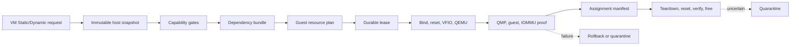
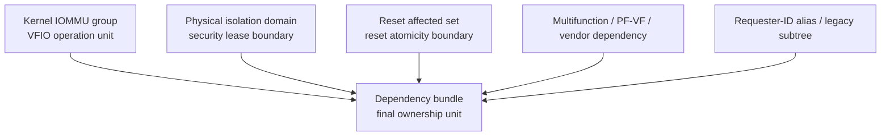
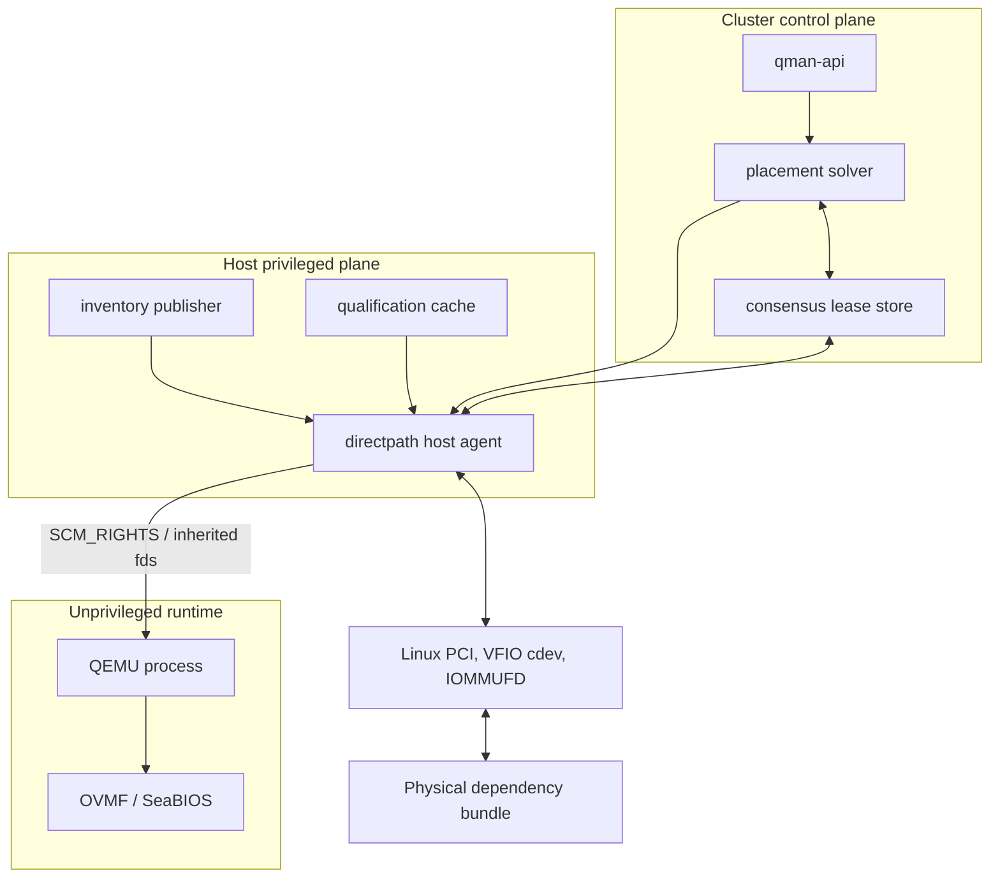
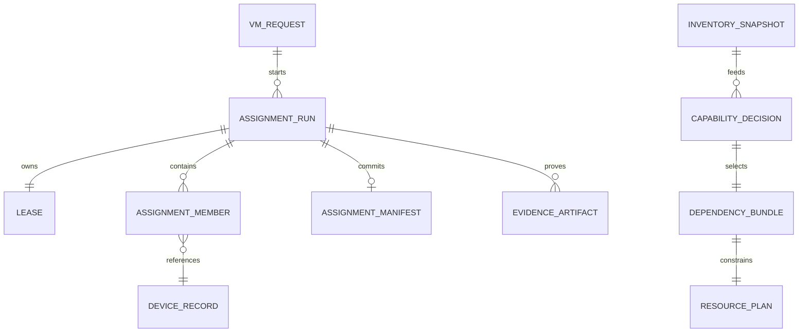
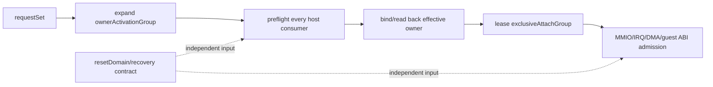
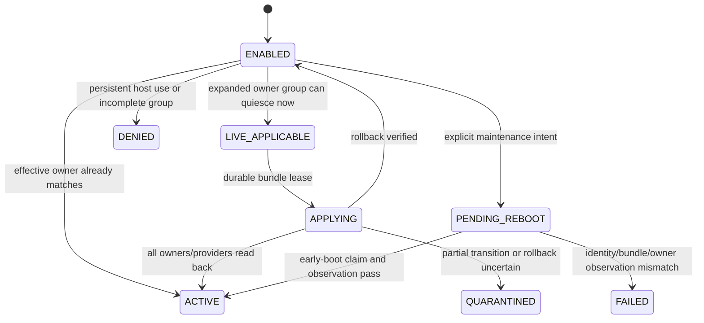
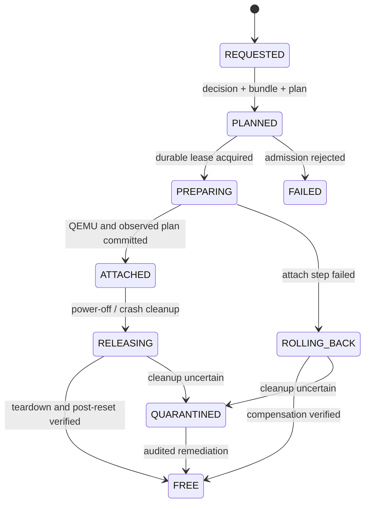
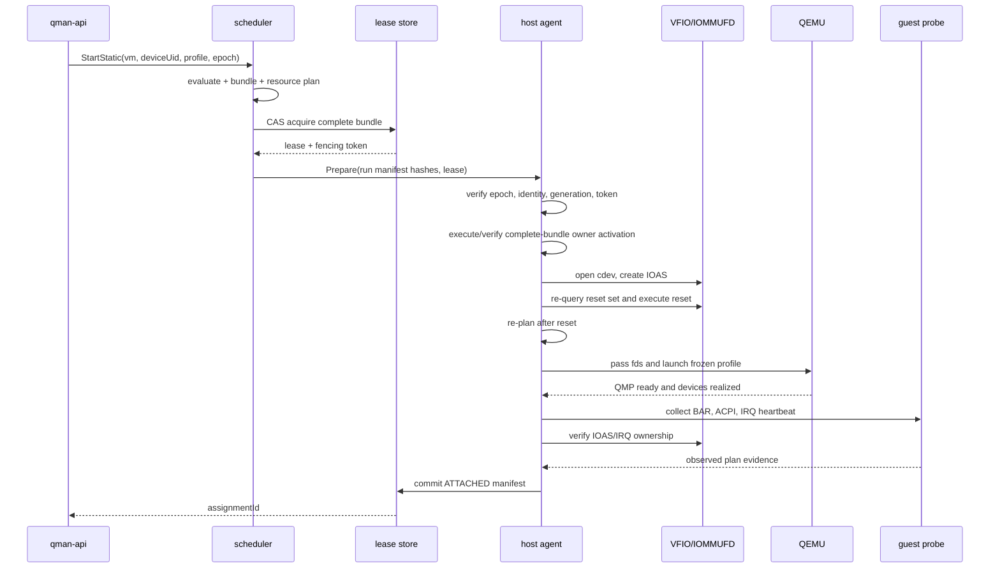
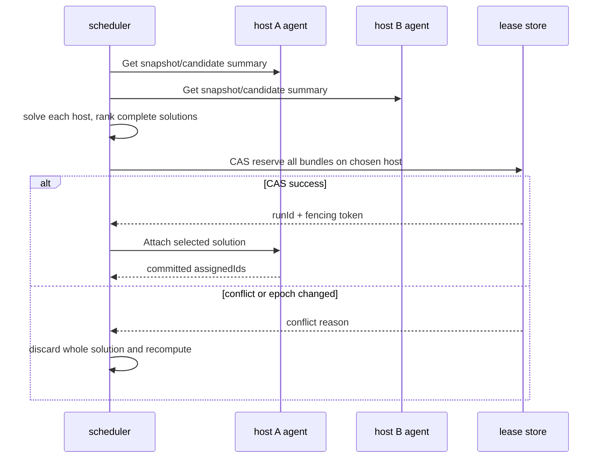

# Qman Static/Dynamic DirectPath 实现蓝图

状态：详细设计 1.3（ESXi 8.0.3/vHW20 外部行为基线冻结；产品 G0 收敛中）
目标读者：Qman 架构、host agent、QEMU/VFIO、调度、测试和安全评审人员
规范正文：[`qemu-static-dynamic-directpath-design.md`](qemu-static-dynamic-directpath-design.md)

本文回答“工程师拿到设计后具体怎么实现”。规范正文仍是 capability、domain、allocator、
风险和验收编号的权威来源；本文给出阅读路径、模块接口、持久化模型、事务补偿、端到端
样例和需要产品方确认的架构决策。二者冲突时，以规范正文的 fail-closed 规则为准。
当前 milestone、开放决策和发布阻断项见 [`PROJECT-STATUS.md`](PROJECT-STATUS.md)。

产品范围以 [`ipd/README.md`](ipd/README.md) 为准：唯一目标是 F1-F8 全部完成的
`V3-FULL-DIRECTPATH`。本文 Phase 1A-4 是 W1-W6 内部的工程子阶段，不是独立产品版本。
实现不得按 NIC/GPU/HBA 或具体 VID:DID 分叉主流程；通用技术准入由隔离、dependency、reset、
owner、MMIO 和 Guest 约束决定，生产支持则只对 compatibility catalog 中的精确 qualification
profile 生效。VMware 参考模型和实验缺口见
[`ipd/VMWARE-BEHAVIOR-MODEL.md`](ipd/VMWARE-BEHAVIOR-MODEL.md)。
当前 Qman/reference-side 的 WSL/QEMU 结果、runner/hash、E2/E3/E4 边界见
[`ipd/QMAN-TECHNICAL-EVIDENCE.md`](ipd/QMAN-TECHNICAL-EVIDENCE.md)。这些结果用于冻结实现约束，
最小 default-deny QMP、逐设备 VFIO provider 与 host-local Static lease/FSM components 已验证，
但不代表下述 production controller、launcher 集成、真实 VFIO attach/cleanup 或 recovery 已经存在。

## 0. 五分钟读懂系统

### 0.1 先看当前平台的矛盾

Qman 宿主同时承担两类直接设备访问：可信宿主 DPDK dataplane 必须在没有 IOMMU 时仍能
接管指定网卡；不受信任 VM 的 PCI passthrough 则必须保证设备 DMA 只能访问该 VM 的内存。
此外，宿主因 DPDK 独占约束常开 ACS override，VM 又可能一次直通多张大 BAR GPU。

如果把这些需求压成一个全局 `no-IOMMU=false` 或一个 `capable=true`，会出现两个相反错误：

| 错误模型 | 直接后果 |
| --- | --- |
| 看到全局 unsafe no-IOMMU 开关就拒绝整台 host | IOMMU-backed GPU 也无法给 VM，DPDK 与虚拟化不能共存 |
| 因宿主允许 DPDK no-IOMMU，就允许任意 VFIO device 进入 VM | guest 可驱动设备 DMA 到任意 host memory |
| 把 DPDK 网卡和空闲设备放进同一 Dynamic candidate pool | VM 启动可抢占 dataplane，造成宿主业务中断 |
| capable 时不计算 dependency/reset domain | sibling 或 bridge 被另一 owner 使用，attach/release 破坏其他设备 |
| 只按 BAR 总和设置 `pci-hole64-size` | 多级桥窗、对齐和 firmware placement 仍可能失败 |
| live detach 失败统一建议重启 | persistent host consumer 重启后仍会抢回设备，形成维护事故 |

所以 Qman 对标的不是一条 QEMU 命令，而是 ESXi 8.0.3 在设备资格、资源规划、排他占有、
host owner 激活、生命周期和失败恢复上的公开外部语义。PCI 基础术语和 VFIO 原理先读规范
正文第 0.4 节；本蓝图从工程模块和数据合同继续。

### 0.2 先给出解决办法

| 问题 | VMware 可观察语义 | Qman 设计落点 |
| --- | --- | --- |
| 设备是否可直通 | `passthruCapable` | role + per-device IOMMU + isolation + reset + qualification |
| 管理员是否启用 | `passthruEnabled` | durable desired owner，不与 capable 混合 |
| 何时重启生效 | `passthruActive`、Configured/Current Owner、apply-now | activation planner 输出 live/reboot/deny，并在 boot 后 reconcile |
| 共同切换谁 | `dependentDevice` | 显式 owner activation group；reset/isolation/attach 各自建模 |
| 大 BAR 如何放置 | `use64bitMMIO` 与 firmware/layout | 完整 guest PCI tree allocator，统一渲染 QEMU/firmware 参数 |
| Static/Dynamic | fixed backing 与 `allowedDevice/assignedId` | 固定 identity 或开机求解；都复用同一 capability/lease/attach core |

no-IOMMU 使用 **按 owner 和设备分流**，而不是全局二选一：

```text
host unsafe-noiommu capability = enabled for explicitly reserved DPDK devices
VM passthrough policy          = every payload must prove IOMMU-backed DMA
DPDK BDF                       = hostReservation=dataplane-dpdk, never a VM candidate
VM product provider            = VFIO cdev + IOMMUFD (no noiommu support)
VM legacy provider             = explicit lab-only TYPE1v2/TYPE1, never product fallback
```

这一分流已由 QEMU/Linux 双 guest 实测：两边全局 unsafe switch 都为 `Y`，无 vIOMMU 的设备
生成 `/dev/vfio/noiommu-0`，有 vIOMMU 的设备生成正常 `/dev/vfio/7` 和 cdev。证据与复现见
[`evidence/qemu-vfio-noiommu-split-20260718.md`](evidence/qemu-vfio-noiommu-split-20260718.md)。

### 0.3 端到端链路



一句话区分 Static 和 Dynamic：

| 模式 | VM 持久配置保存什么 | 每次开机做什么 | 关机后什么仍然存在 |
| --- | --- | --- | --- |
| Static DirectPath | 精确设备 identity 与 host affinity | 验证原设备仍是同一设备并占用完整 bundle | 固定设备请求仍在，运行 lease 释放 |
| Dynamic DirectPath | allowed-device 条件，不保存 BDF | 在目标 host 构造候选、全局求解并生成临时 `assignedId` | allowed-device 条件仍在，`assignedId` 清空 |

最容易混淆的四个集合必须始终分开：



`pcie_acs_override` 可以改变第一个集合，不能证明第二个集合变小。Qman 必须对最终
`DependencyBundle` 做租约和分配，不能对用户请求的单个 BDF 做租约。

## 1. 冻结的对标合同

### 1.1 唯一 VMware 基线

| 项目 | 冻结值 |
| --- | --- |
| ESXi | 8.0.3 / 8.0 U3 |
| 被测 build | 24280767 |
| vSphere API | 8.0.3.0 |
| virtual hardware | 20 |
| 外部依据 | Broadcom KB 312208、8.0 U3 API、仓库黑盒证据 |
| 对标方法 | 只比较公开接口、PCI/ACPI surface、日志和生命周期结果 |
| 明确排除 | vSphere 9.0/9.1 DirectPath Profile Manager、新 API 字段和未公开实现 |

版本不能被“latest”链接暗中升级。qualification manifest 必须保存上述版本、build、
证据 hash 和采集日期；将来支持其他 ESXi 版本时创建新 profile，不能改写本 profile。

### 1.2 对标层级

本设计默认追求 **外部行为与安全语义对齐**，不追求 VMware 私有实现或逐字节复制所有
虚拟芯片组细节。能力分三级：

| 层级 | 含义 | 本设计默认 |
| --- | --- | --- |
| Semantic parity | 状态、资格、资源、错误、生命周期和失败结果等价 | 必须 |
| Guest ABI parity | guest PCI 路径、ACPI root、slot、BAR 与 capability surface 稳定 | 必须稳定；允许明确记录的 topology approximation |
| Strict topology parity | chipset/root bridge/ACPI namespace 与 VMware golden 完全一致 | 不支持；不是产品目标 |

这里的 guest topology 只指 VM 内看到的虚拟 PCI/ACPI root、root port/bridge、BDF 路径、
桥窗口、`_CRS` 和 BAR，不是宿主机物理拓扑或 ACS 安全 domain。Qman 不伪装成 VMware
芯片组，但必须把自己的 machine profile、guest slot 和 ACPI/资源 ABI 做成跨重启与升级稳定
的合同。因此 stock Q35/PXB 可进入 semantic profile；manifest 记录其 profile identity，产品
不提供 `strict VMware topology` 开关。

### 1.3 Firmware/layout profile

VMware 8.0 U3 黑盒矩阵与 QEMU qualification profile 分开表达：

| VMware firmware/layout | VMware 结论 | QEMU qualification 对照 | 产品含义 |
| --- | --- | --- | --- |
| BIOS + i440bx | 有效 | i440fx + SeaBIOS | legacy/below-4G profile；mandatory large BAR 预拒绝 |
| EFI + i440bx | 有效 | i440fx + OVMF | legacy root topology + UEFI profile |
| EFI + acpi | 有效 | Q35/PXB + OVMF | 语义近似并冻结 Qman guest ABI；不宣称 VMware chipset identity 等价 |
| BIOS + acpi | ESXi 启动前拒绝 | Q35 + SeaBIOS 只作 QEMU qualification | parity API、schema 和 raw-launch 三层都拒绝 |

Q35 + SeaBIOS 的双 64GiB BAR 结果用于理解 QEMU allocator，不会把 VMware 明确拒绝的
`acpi+bios` 组合变成可用 parity profile。

### 1.4 支持范围默认值

在 qualification 完成前，以下默认值是设计合同，不是临时建议：

```text
host unsafe no-IOMMU switch      = enabled/allowed for trusted DPDK
host DPDK device reservation     = explicit, excluded from VM candidates
VM per-device IOMMU backing      = required, no-IOMMU/unknown hard reject
VM VFIO cdev + IOMMUFD           = required product backend
VM legacy VFIO backend           = explicit lab-only TYPE1v2/TYPE1, no product fallback
interrupt remapping             = required
ACS override                    = allowed only with whole physical-domain lease
ReBAR guest resize              = false
guest SR-IOV VF creation        = false
P2P                             = false
ATS/PRI/PASID                   = false
INTx                            = false unless exact hardware is qualified
real RMRR device                = false unless exact identity mapping is qualified
snapshot/suspend/FT/vMotion     = false
Dynamic runtime device switch   = false
fixed passthru hotplug          = false, permanently unsupported
maximum passthrough functions   = min(64, locally qualified limit)
```

未实现能力必须同时在 API、scheduler/host agent 和 QEMU/QMP 三层返回
`FEATURE_DISABLED`，不能只隐藏 UI。

## 2. 设计目标、非目标与完成定义

### 2.1 设计目标

1. Static 与 Dynamic 共用 inventory、capability、dependency、allocator、lease 和 attach core。
2. 所有决策使用同一个 immutable snapshot；决策阶段不 bind、不 reset、不打开独占 VFIO fd。
3. 所有副作用在 durable lease 后发生，并进入显式 rollback stack。
4. 多设备、多 dependency、多个 Dynamic requirement 只有全成功或全失败。
5. attach 和 release 都以可验证的硬件状态结束；不确定状态进入 quarantine。
6. 每个结论都可追到 policy/profile/snapshot/证据 hash 和验收编号。

### 2.2 非目标

- 不还原 VMware 私有 capable、candidate 排序或 MMIO allocator。
- 不保证任意 PCI endpoint 都能安全直通；默认 deny-by-default。
- 不把 QEMU synthetic callback 当成物理隔离、reset 清理或 vendor 支持证明。
- 不实现 guest runtime PCI hot-add/hot-remove；ESXi 8.0.3 的 fixed hotplug API 只作为产品差异
  记录，Qman 永久返回 `FEATURE_DISABLED`。host owner 的 live activation 不属于 guest hotplug。
- 不允许运维人员用 raw QEMU CLI 绕开 Qman 的 lease 和 admission。

### 2.3 Definition of Done

某个对外 capability 只有同时满足以下条件才可标记 supported：

```text
implementation present
AND all applicable K rows verified
AND all referenced R rows are VERIFIED
AND positive, negative and fault-injection tests pass
AND qualification hashes match runtime
AND management bypass tests fail as expected
AND cleanup/recovery evidence is complete
```

其余状态只能是 `FEATURE_DISABLED`。不存在“功能能跑但风险先接受”的生产状态。

## 3. 组件与权限边界

### 3.1 进程分层



### 3.2 组件责任

| 组件 | 必须负责 | 绝不能负责 |
| --- | --- | --- |
| `qman-api` | 验证请求、profile、idempotency key；返回稳定状态/reason | 直接操作 sysfs、VFIO 或 QMP |
| placement solver | Static host affinity；Dynamic candidate/global solve | bind/reset 或信任 stale inventory |
| lease store | CAS、fencing token、run generation、持久 owner | 推断硬件 capability |
| inventory publisher | 原子采集 host/device/provider facts | 为了让设备通过而补默认值 |
| host agent | lease 内 bind/reset/open/launch/verify/release | 在 lease 前产生设备副作用 |
| qualification DB | 精确 host/device/profile allow/deny 与证据依赖 | 用宽泛 class code 代替设备规则 |
| QEMU adapter | 渲染稳定 topology、接收 fd、限制 QMP、读回 observed plan | 选择 Dynamic backing 或成为 owner 权威 |
| QEMU | config/MMIO/IRQ/DMA runtime | durable ownership、跨 VM/host fencing |

### 3.3 最小权限

- API/scheduler 不以 root 运行，不拥有 `/dev/vfio/*`、PCI sysfs 写权限或 QMP unrestricted socket。
- host agent 是唯一允许 bind driver、执行 reset、创建 IOAS 和向 QEMU 传 fd 的进程。
- QEMU 不接收物理 BDF 字符串作为生产信任输入，只接收 host agent 已打开并与 manifest 对应的 fd。
- QMP 使用 allowlist；parity profile 拒绝 `device_add`、`device_del`、migration 和绕过 profile 的属性修改。
- policy、firmware、ROM 和 QEMU binary 都按 digest 固定；digest 改变使旧 qualification 失效。

## 4. 核心对象与版本规则

### 4.1 标识符

```text
hostId              stable host UUID
deviceUid           hostId + PCI segment:BDF + immutable identity fingerprint
snapshotEpoch       host-local monotonically increasing uint64
topologyHash        canonical PCI topology and domain hash
profileHash         resolved firmware/machine/surface policy hash
policyHash          qualification/risk database hash
bundleId            canonical hash of dependency members and edge provenance
planHash            canonical guest resource plan hash
leaseId             UUID for one ownership attempt
runId               UUID for one VM power-on generation
fencingToken        monotonic token issued by authoritative store
assignmentId        UUID for committed runtime assignment
```

`BDF` 不是设备身份。设备被更换但占用相同 BDF 时，`deviceUid` 必须变化，Static 请求必须
返回 `DEVICE_IDENTITY_CHANGED`，不能静默直通替代设备。

### 4.2 不可变快照

```python
record InventorySnapshot:
    schemaVersion: uint32
    hostId: UUID
    snapshotEpoch: uint64
    kernelBootId: UUID
    topologyHash: SHA256
    capturedAt: Timestamp
    hostFacts: HostFacts
    devices: Map[BDF, DeviceRecord]
    resetContracts: Map[BDF, List[ResetContract]]

record HostFacts:
    identity: HostIdentity
    iommuPresent: Fact[bool]
    interruptRemapping: Fact[bool | unknown]
    unsafeNoIommuModeEnabled: Fact[bool]
    acsOverrideActive: Fact[bool]

record DeviceRecord:
    identity: DeviceIdentity
    roleFacts: RoleFacts
    dmaIsolationMode: Fact[enum(IOMMU, NO_IOMMU, UNKNOWN)]
    dmaIsolationProvenance: ProviderProof
    hostReservation: Fact[string | null]
    kernelIommuGroup: Fact[Set[BDF]]
    physicalIsolationDomain: Fact[Set[BDF]]
    ownerActivationGroup: Fact[Set[BDF]]
    exclusiveAttachGroup: Fact[string]
    resetContracts: List[ResetContractRef]
    bars: List[BarRequirement]

record Fact[T]:
    value: T
    source: enum(kernel_uapi, patched_kernel_abi, acpi,
                 config_space, qualification_db, manual_audited)
    sourceVersion: string
    observedAt: Timestamp
    evidenceHash: SHA256
```

扫描流程必须读取一次 topology generation，在完整扫描后再次读取；发生变化则丢弃整轮，
不发布拼接快照。所有 evaluator 只接收已发布对象，不允许中途零散重读 sysfs。

`unsafeNoIommuModeEnabled` 是宿主 kernel capability，不是某个设备的运行 backend；它为 true
只产生审计 warning。`dmaIsolationMode` 才进入 VM hardware gate。仅由 sysfs 推断时，
`/dev/vfio/noiommu-$GROUP` 是明确的 `NO_IOMMU` 反证；最终 `IOMMU` proof 必须来自 cdev 成功
绑定 IOMMUFD/IOAS，或显式 lab-only legacy container 成功选择 TYPE1v2/TYPE1。后者只验证
component 分流，不构成产品 launcher backend。DPDK 编排配置必须在快照
发布前覆盖 `hostReservation`，无法关联到准确 BDF/identity 时拒绝发布候选快照。

### 4.3 运行对象关系



任何对象引用的 `snapshotEpoch/policyHash/profileHash` 不一致时，旧 plan/decision/lease
不能被“修补后继续”，必须作废并从无副作用阶段重新计算。

## 5. Capability 详细设计

### 5.1 状态分层

| 层 | 回答的问题 | 典型失败 |
| --- | --- | --- |
| `hardwareCapable` | 结构、IOMMU、物理隔离和 reset 是否可证明 | Type-1 payload、IOMMU missing、domain unknown |
| `policyEligible` | 精确平台/设备/profile 是否被 qualification 允许 | rule missing、errata deny |
| `adminEnabled` | 管理员是否把设备放入直通池 | disabled |
| `hostActive` | complete bundle 的 effective owner/provider 是否已读回为目标状态 | desired/current mismatch |
| `activationDisposition` | 本次 owner transition 是已生效、可 live apply、需维护重启还是拒绝 | driver busy、identity stale、host-critical |
| `available` | 完整 bundle 此刻是否健康且未被占用 | dependency busy、quarantine |
| `attachable` | 对这个 VM/profile 的资源和操作是否可行 | MMIO UNSAT、RMRR overlap、ABI mismatch |

对标 VMware 的 `passthruCapable` 是前两层，不是 `available`。设备被其他 VM 使用时
capable 不应抖动，只改变 availability。

### 5.2 Gate 顺序

```python
function evaluate(snapshot, target, vmContext, profile, policy):
    require snapshot is published and immutable

    if snapshot.hostFacts.unsafeNoIommuModeEnabled:
        warnings += HOST_UNSAFE_NOIOMMU_MODE_ENABLED
    if not snapshot.hostFacts.iommuPresent:
        reasons += HOST_IOMMU_MISSING

    closure = resolveCapabilityClosure(snapshot, {target}, profile, policy)
    hardwareCapable = closure.success
    for bdf in closure.payload:
        d = snapshot.devices[bdf]
        if d.dmaIsolationMode == NO_IOMMU:
            reasons += DEVICE_NO_IOMMU_DMA_ISOLATION(bdf)
        if d.dmaIsolationMode == UNKNOWN:
            reasons += DEVICE_IOMMU_BACKING_UNKNOWN(bdf)
        reasons += evaluateRoleIsolationResetAndPlatformGates(
            snapshot, d, closure.selectedReset[bdf], policy)
    hardwareCapable = hardwareCapable and noHardwareBlockingReason(reasons)

    qualification = QualificationResult.notEvaluated()
    if closure.success:
        qualification = matchExactQualificationForEveryMemberAction(
            host=snapshot.hostFacts.identity,
            members=closure.actions,
            kernel=snapshot.hostFacts.kernel,
            qemu=profile.qemu,
            firmware=profile.firmware,
            profileHash=profile.hash)
    policyEligible = hardwareCapable and qualification.allAllowed

    adminEnabled = policyEligible and activationDb.allEnabled(closure.payload)
    activationPlan = null
    hostActive = false
    if adminEnabled:
        activationPlan = planHostActivation(
            snapshot, closure.bundle, desiredOwner=PASSTHROUGH,
            requestMode=vmContext.activationRequestMode or LIVE_ONLY)
        hostActive = activationPlan.disposition == ALREADY_ACTIVE

    bundle = closure.bundle if closure.success else null
    available = false
    if bundle is not null:
        for bdf in bundle.members:
            if snapshot.devices[bdf].hostReservation is not null:
                reasons += HOST_DEVICE_RESERVED(
                    bdf, snapshot.devices[bdf].hostReservation,
                    stage=AVAILABILITY)
    if activationPlan exists and \
            activationPlan.disposition in {ALREADY_ACTIVE, LIVE_APPLY}:
        available = bundle.complete and healthyAndUnowned(bundle) and \
                    noHostReservations(bundle, snapshot)

    plan = null
    attachable = null
    if vmContext exists and available:
        plan = planVmResources(snapshot, {bundle}, vmContext, profile)
        attachable = plan.success and operationAllowed(vmContext.operation)

    return canonicalDecisionWithStableReasons(...)
```

closure、hardware 和 policy 三层不得读取 VM owner/admin/当前健康状态；availability/attachability
不得反向改写 capable。查询 API 重复执行时，
driver、reset generation、lease 和设备寄存器必须完全不变。

因此一张结构、IOMMU、隔离和 reset 均合格、但被宿主 DPDK 保留的网卡可以保持
`hardwareCapable=true`、`policyEligible=true`，同时必须是 `available=false`。这是刻意的分层：
前两个字段允许资格缓存稳定复用，后一个字段和 activation planner 才负责防止 VM 抢占宿主
dataplane；planner 还必须把该情况硬拒绝为 `HOST_DEVICE_RESERVED`，不能建议重启。

### 5.3 Role 不是 class whitelist

判断顺序是 Type-1/header/PCIe port/subordinate bus/platform ownership 等结构证据，class code
只作一致性检查。Type-0 endpoint 改成 bridge class 仍可 capable；真实 Type-1 bridge 即使改成
display class 仍应因结构角色拒绝。精确 VID:DID/revision denylist 只承载已知 errata，必须带来源、
影响版本和 evidence hash。

### 5.4 输出合同

```json
{
  "schemaVersion": 1,
  "snapshotEpoch": 1842,
  "target": "0000:65:00.0",
  "hardwareCapable": true,
  "policyEligible": true,
  "adminEnabled": true,
  "hostActive": false,
  "activationDisposition": "live-apply",
  "desiredOwner": "passthrough",
  "effectiveOwner": "host",
  "available": false,
  "attachable": null,
  "bundleId": "sha256:...",
  "reasons": [
    {
      "stage": "availability",
      "code": "DEPENDENCY_BUSY",
      "devices": ["0000:65:00.0", "0000:65:00.1"],
      "source": "lease-store",
      "details": {"ownerRunId": "..."}
    }
  ],
  "policyHash": "sha256:...",
  "profileHash": "sha256:...",
  "decisionHash": "sha256:..."
}
```

API 文案可以本地化；`code/devices/details/hash` 必须稳定并参与回归 golden。

## 6. Domain 与 DependencyBundle

### 6.1 边类型

| 边 | 权威来源 | 默认动作 |
| --- | --- | --- |
| kernel IOMMU group | kernel VFIO/IOMMU | 同一 ownership transaction |
| physical isolation domain | patched-kernel shadow ABI | 同 trust domain、通常同 IOAS/lease |
| reset affected set | VFIO hot-reset UAPI/qualified FLR | 原子租约与 reset |
| requester alias | kernel PCI/IOMMU alias facts | 同 IOAS/owner |
| multifunction | PCI identity/topology | 默认整租，精确 qualification 可放宽 |
| PF/VF | SR-IOV topology/provider | PF 管理依赖与 reset closure |
| functional group | signed vendor/platform rule | 按 rule 整租或同 VM |
| platform dependency | RMRR/firmware/platform rule | 特定 action 或拒绝 |

同一张 dependency graph 投影为不同用途的 key，不能输出一个万能 `bundleId`：

```python
function buildAssignmentGroups(snapshot):
    safetyEdges = IOMMU | PHYSICAL | RESET | REQUESTER_ALIAS |
                  MULTIFUNCTION | PF_VF | FUNCTIONAL | PLATFORM

    for connectedComponent in transitiveClosure(snapshot.devices, safetyEdges):
        conservativeId = canonicalId(connectedComponent.members)
        for device in connectedComponent.members:
            # 没有 VMware dependentDevice 等更精确、已 qualification 的事实时，
            # owner/attach 都使用同一保守超集，而不是猜 singleton。
            device.ownerActivationGroup = conservativeId
            device.exclusiveAttachGroup = conservativeId

    applySignedExactRulesThatMayOnlySplitQualifiedEdges()
    require every payload has complete owner/attach group provenance
```

reference scanner 已实现 IOMMU、physical isolation、reset、multifunction 和 platform dependency
的保守传递闭包。缺 `exclusiveAttachGroup` 的外部 inventory 只能到 `available`，不得成为
`attachable`；精确放宽只接受 exact group ID，不提供 host-wide boolean。

### 6.2 CapabilityClosure 固定点

closure 是 `hardwareCapable/policyEligible` 的输入，必须在读取 admin、owner、health 之前求出。
不能先把单 function 标成 capable，再在 attach 时才发现其依赖 function 不可 reset/qualification。
member action 和 reset affected set 相互依赖，因此两者在同一个单调固定点中求解：

```python
function resolveCapabilityClosure(snapshot, requestedPayload, profile, policy):
    members = Set(requestedPayload)
    actions = Map(default=NONE)
    selectedReset = Map[BDF, ResetContract]()
    edges = Set[DependencyEdge]()

    for bdf in requestedPayload:
        actions[bdf] = mergeAction(actions[bdf], ASSIGN_TO_GUEST)

    repeat:
        before = hashCanonical(members, actions, selectedReset, edges)

        # Domain edges may add ownership members. The signed rule maps each edge
        # to a conservative action; an unknown/conflicting mapping is a rejection.
        for bdf in sorted(members):
            d = requireDevice(snapshot, bdf)
            domains = [
                (IOMMU, d.kernelIommuGroup),
                (PHYSICAL, d.physicalIsolationDomain),
                (REQUESTER_ALIAS, d.requesterAliasSet),
                (MULTIFUNCTION, d.multifunctionSet),
                (PF_VF, d.pfVfDependencies),
                (FUNCTIONAL, d.functionalGroup),
                (PLATFORM, d.platformDependencies),
            ]
            for kind, peers in domains:
                require trustedProvenance(kind, d)
                for peer in peers:
                    require peer in snapshot.devices
                    edge = canonicalEdge(bdf, peer, kind, provenanceOf(kind, d))
                    edges.add(edge)
                    members.add(peer)
                    required = conservativeRequiredMemberAction(
                        edge, snapshot.dependencyFacts,
                        requestedPayload, profile.dependencyPolicy,
                        currentActions=actions)
                    actions[peer] = mergeActionOrReject(actions[peer], required)

        # Only members that must be independently presented/reset need their own
        # reset contract. A peer merely held because it is affected by SBR does
        # not recursively acquire an unrelated reset method.
        resetTargets = sorted(bdf for bdf in members
                              if actionRequiresTargetReset(actions[bdf]))
        for bdf in resetTargets:
            contract = selectPublishedResetContract(snapshot, bdf, policy.resetPolicy)
            require contract.accepted
            selectedReset[bdf] = contract
            for peer in contract.affectedDevices:
                require peer in snapshot.devices
                edges.add(canonicalResetEdge(bdf, peer, contract.provenance))
                members.add(peer)
                holdAction = resetOwnershipAction(contract, bdf, peer)
                actions[peer] = mergeActionOrReject(actions[peer], holdAction)

        # A dependency rule may promote a newly found member into guest payload;
        # promotion is monotonic and causes its reset/domain facts to be solved.
        requestedPayload = requestedPayload union {
            bdf for bdf in members if actions[bdf] == ASSIGN_TO_GUEST
        }
    until hashCanonical(members, actions, selectedReset, edges) == before

    require no action is NONE or UNKNOWN
    require every reset contract matches snapshot epoch/topology/rule hash
    require actionCompatibilityIsSafe(actions, selectedReset)

    bundle = canonicalBundle(
        members=members,
        payload={bdf where actions[bdf] == ASSIGN_TO_GUEST},
        edges=edges,
        actions=actions,
        snapshotEpoch=snapshot.snapshotEpoch,
        policyHash=policy.hash)
    return CapabilityClosure(bundle, selectedReset, success=true)
```

`mergeActionOrReject` 不是随意的 enum `max`：允许的提升关系由 policy schema 固定，例如
`LOCK_ONLY -> VFIO_HOLD_IN_SAME_IOAS -> ASSIGN_TO_GUEST`；`QUIESCE_HOST` 与
`ASSIGN_TO_GUEST` 等冲突若没有精确 rule 必须拒绝。固定点实现还要有 `|devices| + |edges|`
上界和 cycle-safe set，超界返回 `DEPENDENCY_CLOSURE_LIMIT`，不能截断后继续。

这里的 action resolver 只能使用内置保守映射和 snapshot 中带可信 provenance 的 dependency
fact，不能读取 owner/admin，也不能用 allowlist 把 bundle 缩小。签名 qualification 在下一 gate
确认“该精确 member/action 是否受支持”；任何允许缩小物理/reset closure 的未来规则都必须形成
新 profile 和 E4 证据，不能作为普通 policy override。

闭包必须确定性排序，`bundleId` 包含 member、edge type、provenance、action、snapshot epoch 和
policy hash。只记录 member 而不记录“为什么加入”会使审计和后续安全放宽不可行。

### 6.3 ACS override 的 kernel 合同

production 不能依赖 userspace 从被 override 后的 group 反推原始安全边界。内核需要发布：

```python
record KernelPhysicalDomainFact:
    abiVersion: "native-shadow-domain-v1"
    pciTopologyGeneration: uint64
    domainId: uint64
    members: SortedSet[BDF]
    constraints: List[enum(native_missing_acs, requester_alias,
                           legacy_subtree, platform_quirk)]
    memberProvenance: Map[BDF, BitSet]
```

构建器复用 stock IOMMU group formation 的 ACS、alias 和 architecture quirk 事实，但忽略
override 造成的“允许拆组”结果。任一 topology component provenance 不完整时，只把该
component 标成 unknown；不得让无关 component 一起失效，也不得把 unknown 当单设备 domain。

### 6.4 Reset provider 合同

reset discovery 是 qualification/inventory 操作，不是普通 capable 查询的副作用：

```python
function discoverResetContract(snapshot, bdf, provider):
    require maintenance lease or persistent provider ownership
    methods = provider.readResetMethods(bdf)

    for method in policyPreference(methods):
        if method == FLR:
            affected = {bdf}
        else:
            affected = provider.queryHotResetAffectedSetTwoPass(bdf)

        contract = ResetContract(
            method=method,
            affectedDevices=affected,
            inventoryEpoch=snapshot.snapshotEpoch,
            topologyHash=hashResetTopology(snapshot, affected),
            ownershipMode=provider.mode,
            qualificationRule=exactRuleId(bdf))
        if qualificationAccepts(contract):
            publish(contract)
```

执行前再次 query affected set；和 plan 不一致时返回 `RESET_DOMAIN_CHANGED`，不 reset、不启动
QEMU。ioctl 成功只证明命令执行，不证明敏感状态已清；后者由设备级 state probe 和真机
qualification 决定。

## 7. MMIO/firmware planner

### 7.1 输入与输出

planner 输入不是 BAR size 总和，而是完整 guest tree：

```text
selected dependency bundles
resolved machine/firmware profile
guest RAM and fixed reservations
every endpoint BAR: size, alignment, 32/64-bit, prefetchable, mandatory
root port and bridge window capability
ROM and emulated-device demand
RMRR/IVMD identity ranges
device/bus/IRQ/fd limits
```

输出 `VmResourcePlan` 至少包含每个 BAR 地址、每级 bridge window、root low/high aperture、
firmware aperture、QEMU `pci-hole64-size` floor、RMRR hole、guest topology、rendered profile 和
预期 observed assertions。

### 7.2 求解流程

```mermaid
flowchart LR
    INPUT["Snapshot + bundles + VM profile"] --> TREE["Build complete guest PCI tree"]
    TREE --> DEMAND["Normalize BAR and fixed demand"]
    DEMAND --> PACK["Bottom-up bridge packing"]
    PACK --> ROOT["Solve root low/high windows"]
    ROOT --> FW["Derive firmware aperture and QEMU floor"]
    FW --> RENDER["Render versioned QEMU profile"]
    RENDER --> ASSERT["Generate observed-plan assertions"]
```



每个 pool 使用 half-open interval `[start,end)`；size 和 alignment 使用 checked unsigned 64-bit
运算。求解 timeout 返回非重试 `MMIO_PLANNER_TIMEOUT`，不得退回可能给出错误成功的 greedy。

### 7.3 QEMU floor 与实际窗口

`pci-hole64-size` 是 floor，不是 hard cap：

```python
function projectQemuHole64(configuredFloor, actualW64, fallbackStart):
    if actualW64 exists:
        start = actualW64.start
        actualEnd = actualW64.end
    else:
        start = fallbackStart
        actualEnd = start

    floorEnd = alignUp(start + configuredFloor, 1GiB)
    return [start, max(actualEnd, floorEnd))
```

Schema 必须分开保存：

```text
requiredHighSpanBytes       selected tree 的真实需求
firmwareApertureBytes       OVMF/firmware 可分配范围
qemuPciHole64FloorBytes     QEMU host-bridge floor
observedRuntimeStart/End    QOM/HMP 实际 root window
```

### 7.4 双 64GiB BAR worked example

输入：Q35、两个独立 Root Port、每个 endpoint 一个 mandatory 64-bit prefetchable 64GiB BAR。

| Profile | 请求 | 预期 |
| --- | --- | --- |
| SeaBIOS qualification | QEMU floor 默认 32GiB | SeaBIOS 分配 `[64G,128G)`、`[128G,192G)`；runtime window `[64G,192G)` |
| OVMF negative | OVMF aperture 默认、floor 32GiB | 两个 mandatory BAR 均未分配；启动验证失败 |
| OVMF positive | `X-PciMmio64Mb=131072`、floor 128GiB | BAR `[128G,192G)`、`[192G,256G)`；runtime window `[128G,256G)` |

产品 renderer 不依赖 SeaBIOS auto-grow 兜底。它显式渲染 planner 解出的 aperture/floor，启动后
再读取 QOM `pci-hole64-start/end/size`、HMP `info pci/mtree`、guest BAR 和 `_CRS`。任何 mandatory
BAR 为 0 或 observed plan 偏离均在 assignment commit 前失败并回滚。

## 8. 持久化与并发模型

### 8.1 单 host 与多 host

- 单 host MVP 可使用 SQLite WAL，但所有更新仍使用 expected version/CAS，不能依赖“只有一个线程”。
- 多 host Dynamic/HA 使用具备线性一致 CAS 和 lease/fencing token 的外部 store。
- 两种实现共用 repository interface；业务层不得判断底层是 SQLite 还是 cluster store。

### 8.2 逻辑表

```sql
CREATE TABLE assignment_run (
    run_id              TEXT PRIMARY KEY,
    vm_id               TEXT NOT NULL,
    request_type        TEXT NOT NULL,
    operation           TEXT NOT NULL,
    state               TEXT NOT NULL,
    host_id             TEXT,
    snapshot_epoch      INTEGER NOT NULL,
    policy_hash         TEXT NOT NULL,
    profile_hash        TEXT NOT NULL,
    decision_hash       TEXT NOT NULL,
    plan_hash           TEXT NOT NULL,
    fencing_token       INTEGER NOT NULL,
    version             INTEGER NOT NULL,
    created_at          TEXT NOT NULL,
    updated_at          TEXT NOT NULL
);

CREATE TABLE bundle_lease (
    bundle_id           TEXT PRIMARY KEY,
    lease_id            TEXT NOT NULL UNIQUE,
    run_id               TEXT NOT NULL,
    owner_vm_id         TEXT NOT NULL,
    state               TEXT NOT NULL,
    fencing_token       INTEGER NOT NULL,
    expected_generations TEXT NOT NULL,
    expires_at          TEXT,
    version             INTEGER NOT NULL
);

CREATE TABLE assignment_member (
    run_id              TEXT NOT NULL,
    device_uid          TEXT NOT NULL,
    bdf                 TEXT NOT NULL,
    action              TEXT NOT NULL,
    owner_group_id      TEXT NOT NULL,
    attach_group_id     TEXT NOT NULL,
    original_driver     TEXT,
    reset_contract_hash TEXT,
    vfio_device_id      TEXT,
    PRIMARY KEY (run_id, device_uid)
);

CREATE TABLE host_activation_intent (
    intent_id               TEXT PRIMARY KEY,
    desired_owner           TEXT NOT NULL,
    request_mode            TEXT NOT NULL,
    state                   TEXT NOT NULL,
    identity_manifest_hash  TEXT NOT NULL,
    requested_set_hash      TEXT NOT NULL,
    owner_group_hash        TEXT NOT NULL,
    expected_snapshot_epoch INTEGER NOT NULL,
    applied_boot_id         TEXT,
    observed_state_hash     TEXT,
    reason_code             TEXT,
    version                 INTEGER NOT NULL,
    updated_at              TEXT NOT NULL
);

CREATE TABLE quarantine_record (
    device_uid          TEXT PRIMARY KEY,
    bundle_id           TEXT NOT NULL,
    reason_code         TEXT NOT NULL,
    evidence_hash       TEXT NOT NULL,
    generation          INTEGER NOT NULL,
    cleared_by          TEXT,
    cleared_at          TEXT,
    version             INTEGER NOT NULL
);

CREATE TABLE idempotency_record (
    scope               TEXT NOT NULL,
    idempotency_key     TEXT NOT NULL,
    request_hash        TEXT NOT NULL,
    response_json       TEXT,
    state               TEXT NOT NULL,
    expires_at          TEXT NOT NULL,
    PRIMARY KEY (scope, idempotency_key)
);
```

JSON 字段在实现中使用 versioned canonical schema；上表只描述事务关系，不允许把无法查询的
任意 JSON 当成所有权权威。

`host_activation_intent` 只保存显式 maintenance owner 变更；普通 `bind-on-lease` 不制造
desired/current 长期分离。`PENDING_REBOOT` 必须同时固定 exact device identity、physical path、
显式 request set、扩展后的 owner activation group 和 snapshot epoch；boot 后只有该 owner group 的
observed owner/provider hash 全匹配才转
`ACTIVE`。BDF 或 identity 漂移时转 `FAILED`，禁止按同 VID:DID 猜设备。

### 8.3 CAS 不变量

```python
function acquireBundleLease(request, bundle, snapshot):
    require request.expectedSnapshotEpoch == snapshot.snapshotEpoch
    require no member has active lease or quarantine

    token = store.nextFencingToken(bundle.bundleId)
    success = store.compareAndSwap(
        key=bundle.bundleId,
        expectedVersion=currentVersion,
        new=PREPARING(runId=request.runId,
                      members=bundle.members,
                      fencingToken=token,
                      expectedGenerations=currentGenerations(bundle)))
    if not success:
        return conflict(DEPENDENCY_BUSY, retryable=true)
    return lease
```

同一物理 domain 的所有可租元素必须在一个原子 key/transaction 中竞争。按单 BDF 分别 CAS
再补偿会产生短暂双 owner，设计上禁止。

### 8.4 Host owner activation 与 reboot decision

#### 8.4.1 外部状态合同

ESXi 8.0.3 的公开接口和本地证据要求 Qman 分开保存：

```text
adminEnabled             管理员允许进入直通池
desiredOwner             maintenance 持久意图
effectiveOwner           当前实际 driver/provider owner
requestSet               本次 API/CLI 明确请求的 BDF
ownerActivationGroup     实际必须共同切换宿主 owner 的闭包
exclusiveAttachGroup     VM admission 必须独占的 lease key
hostActive               完整 ownerActivationGroup 的 effective owner 已读回匹配
activationDisposition    ALREADY_ACTIVE | LIVE_APPLY | REBOOT_REQUIRED | DENIED
```

官方 ESXCLI 8.0.3 明确规定：`--apply-now` 会立即在 native driver 与 `pciPassthru` 间重绑；
不带该参数则请求重启后生效。本地 `20260713-capability-smoke-v5` 和
`20260713-esxi8-flr-vm-power-v1` 进一步证明 `-a` 后无 host reboot 即可得到 Current Owner=
`VM Passthru` 和 API `passthruActive=true`。相反，`20260711-largebar2g/M00` 保存了 Configured
Owner=`VM Passthru`、Current Owner=`VMkernel` 的分离态。脱敏命令/输出摘录见
[`evidence/esxi8-passthru-activation-20260718.md`](evidence/esxi8-passthru-activation-20260718.md)，机器可读索引见
[`evidence/esxi8-passthru-activation-20260718-summary.json`](evidence/esxi8-passthru-activation-20260718-summary.json)。

2026-07-18 的新增实测关闭了此前的两个缺口：专用 endpoint deferred 后经过真实 host reboot
成功由 `pciPassthru` claim；持久 vSwitch uplink 对 apply-now 和 direct deferred 都原子拒绝，
移除 consumer 后同一 BDF 立即成功。共享 bridge dependency 还出现 request-target 不对称：仅请求
空闲 member 会自动切换整个组，而显式请求 busy member 或完整组会失败；SOAP 与 ESXCLI 一致。
VM power-on A/B 则证明同一 dependency 形成 exclusive attach lease，且同 VM 双 member 也不合并。

因此 reboot requirement 是一次 ownership transaction 的结果，不是 device 的 FLR/class/BAR
静态属性。FLR/SBR 仍属于 attach/release reset gate；它不能证明 native driver、storage path 或
host service 当前可解绑。Qman 对 VMware 的 request-target 不对称采取安全分歧：**先扩完整
owner group，再逐成员预检**，绝不借由请求另一个 sibling 静默拆除 network/storage/management
consumer。





#### 8.4.2 无副作用 planner

```python
function planHostActivation(snapshot, requestedBdfs, desiredOwner, requestMode):
    requested = resolveExactIdentity(snapshot, requestedBdfs)
    ownerGroup = expandOwnerActivationGroups(snapshot, requested)
    require ownerGroup.complete
    require ownerGroup.hash and every identity/action fact match snapshot

    if any ownerGroup member.identity/path mismatches persisted deviceUid:
        return DENIED(ACTIVATION_IDENTITY_MISMATCH)
    if any ownerGroup member.currentOwner is UNKNOWN:
        return DENIED(CURRENT_OWNER_UNKNOWN)
    if any ownerGroup member.quiesceState is UNKNOWN:
        return DENIED(QUIESCE_STATE_UNKNOWN)
    if any ownerGroup member is hostCritical, policyDenied, quarantined,
           or leasedByOther:
        return DENIED(exactReasonAndMembers)
    if desiredOwner == PASSTHROUGH and
           any ownerGroup member.hostReservation is not null:
        return DENIED(HOST_DEVICE_RESERVED)
    if any ownerGroup member.quiesceState == PERSISTENT_HOST_USE:
        return DENIED(PERSISTENT_HOST_USE)
    if all ownerGroup member.currentOwner == desiredOwner:
        return ALREADY_ACTIVE

    changing = ownerGroup members where currentOwner != desiredOwner
    if requestMode != DEFER_TO_REBOOT and
           all changing members are IDLE and liveTransitionSupported:
        return LIVE_APPLY(changing)

    # Reboot is recommended only when an implementation can claim this exact
    # owner group before native drivers/services make it busy.
    if requestMode explicitly permits reboot fallback and
           all changing members have exactEarlyBootClaimProof:
        return REBOOT_REQUIRED(changing, liveBlockers)
    return DENIED(BOOT_CLAIM_UNSUPPORTED)
```

该函数不得 bind、unbind、reset、写 config space 或持久化 desired owner。参考实现
[`activation.py`](pci-resource-model/pci_resource_model/activation.py) 以 inventory + request set 为输入，测试
证明 owner-group expansion 和 incomplete-group fail-closed；idle 返回 `LIVE_APPLY`，persistent
host use 返回 `DENIED`；主动 deferred 的 idle device，或 `LIVE_OR_REBOOT` 下有 transient blocker
的 device，只有完整 owner group 具备 exact boot proof 才返回 `REBOOT_REQUIRED`。这些运行态变化
不改变硬件 capable。

`hostReservation=dataplane-dpdk` 必须在 owner-group 扩展后逐成员检查。它代表平台明确保留，
不是“当前进程 busy”：目标或 sibling 被 DPDK 保留时，即使进程暂时退出且具备 boot claim，
VM 方向仍返回 `DENIED(HOST_DEVICE_RESERVED)`，绝不能建议重启；从 passthrough 归还 host 则允许。

#### 8.4.3 VM admission 的独占 attach lease

Host owner 已激活不等于设备对某个 VM 可分配。调度器必须把已选 payload 展开为
`exclusiveAttachGroup`，并在任何 QEMU fd、IOMMU mapping 或 guest resource 分配前原子加锁：

```python
function acquireAttachLeases(vm, selectedDevices, snapshot):
    groups = expandExclusiveAttachGroups(snapshot, selectedDevices)
    require every group is complete and generation-current

    # ESXi 8.0.3 shared-dependent 实测中，同 VM 双 function 仍冲突；
    # 因此默认不以 vmId 相同为由合并重复 group。
    if count(groups) != count(unique(groups)):
        require exactQualificationAllowsSharedAttach(selectedDevices)
        otherwise return DENIED(EXCLUSIVE_ATTACH_GROUP_COLLISION)

    return store.atomicMultiKeyLease(
        keys=sort(unique(groups)), owner=vm.runId,
        expectedEpoch=snapshot.epoch, fencingToken=nextToken())
```

qualification 若要放宽，必须精确绑定 VID:DID/subsystem/revision/firmware、reset contract、DMA
isolation、错误恢复和 teardown 证据；不能按 class、vendor 或“同 VM”全局放宽。

#### 8.4.4 Lease 后的 live executor

```python
function executeLiveActivation(plan, ownerGroup, activationLease):
    require plan.disposition in {ALREADY_ACTIVE, LIVE_APPLY}
    require activationLease atomically owns every ownerGroup member
    require activationLease also covers required isolation/reset safety closures
    require current epoch/generation/identity/ownerGroup hash == plan inputs

    if plan.disposition == ALREADY_ACTIVE:
        observed = readEffectiveOwnersAndProviders(ownerGroup)
        require observed exactly matches plan.desiredOwner
        return observed

    journal = durableJournal(PREPARING_ACTIVATION, plan, activationLease)
    rollback = RollbackStack()
    try:
        for member in ownerGroup.hostQuiesceOrder:
            token = quiesceHostConsumers(member, deadline)
            rollback.push(restoreHostConsumers(member, token))

        for member in ownerGroup.unbindOrder:
            original = readDriverAndOverride(member)
            unbindNativeDriver(member)
            rollback.push(restoreDriverAndOverride(member, original))

        for member in ownerGroup.vfioHoldOrAssignMembers:
            setDriverOverride(member, "vfio-pci")
            bindVfio(member)
            rollback.push(unbindVfioAndRestoreOverride(member))

        observed = readEffectiveOwnersProvidersGroups(ownerGroup)
        require every expected member has target owner/provider
        require no unexpected member changed owner
        require kernel group viability and physical-domain lease still hold
        journal.commit(ACTIVE, observedHash=hash(observed))
        rollback.disarm()
        return observed
    except error:
        failures = rollback.runReverse()
        if failures or effectiveOwnerCannotBeProved(ownerGroup):
            quarantine(ownerGroup, ACTIVATION_ROLLBACK_UNCERTAIN, evidence())
        else:
            journal.commit(ROLLED_BACK, observedHash=hashCurrent(ownerGroup))
        raise stableActivationError(error, failures)
```

默认 `bind-on-lease` 使用这条路径。live apply 因 Busy 失败时，Qman 先完成 rollback；只有另一个
显式 maintenance 请求才可写 `PENDING_REBOOT`，不能像 UI 便利逻辑一样悄悄留下 desired/current
分离。disable 走同一事务的反向路径，但必须先证明无 VM lease、QEMU/VFIO fd、DMA mapping 和
IRQ owner。

#### 8.4.5 Early-boot claim

“重启可能解决”必须对应真实实现。仅执行 Linux reboot 而没有 boot-time owner policy，native
driver 会再次先绑定，结果仍然 Busy。生产实现优先采用一个小型 kernel early-owner hook：

```python
function pciDeviceAddedEarly(dev, signedBootOwnerManifest):
    entry = exactMatch(dev.firmwarePath, dev.physicalSlot,
                       dev.vendorDeviceSubsystemRevision,
                       signedBootOwnerManifest)
    if entry is null:
        return NORMAL_DRIVER_PROBE
    if entry.ownerGroupManifestIncompleteOrHashMismatch:
        markActivationFailed(entry.ownerGroupId)
        return NORMAL_DRIVER_PROBE
    dev.driver_override = "vfio-pci"
    recordEarlyClaimCandidate(entry.ownerGroupId, dev)

function reconcileBootActivation(ownerIntent, currentBootId):
    observed = readOwnerGroupOwnersProviders(ownerIntent)
    if identityAndOwnerGroupMatch(ownerIntent, observed) and allBoundToVfio(observed):
        casIntent(PENDING_REBOOT, ACTIVE,
                  appliedBootId=currentBootId,
                  observedStateHash=hash(observed))
    else:
        casIntent(PENDING_REBOOT, FAILED,
                  reason=ACTIVATION_OBSERVED_STATE_MISMATCH)
        quarantineAnyPartiallyClaimedMembers(observed)
```

boot manifest 必须在 PCI driver probe 前可用并经过签名/secure-boot policy 校验；只用
`vfio-pci.ids=VID:DID` 不合格，因为会抢走同型号 host-critical device。initramfs/udev 方案只有在
所有相关 native driver 都是 module、且 probe ordering 已逐 build 验收时才可作为 profile；存在
built-in driver 或 ordering unknown 时必须使用 kernel hook 或返回 `BOOT_CLAIM_UNSUPPORTED`。
Qman 永不自动 reboot；maintenance orchestrator 负责 host drain、显式批准、reboot 和 O07
reconcile，失败后不启动任何 DirectPath VM。

## 9. Static DirectPath 事务

### 9.1 持久请求

```json
{
  "schemaVersion": 1,
  "type": "static",
  "vmId": "vm-42",
  "deviceUid": "host-a/0000:65:00.0/sha256:identity",
  "guestSlot": "0000:03:00.0",
  "profileId": "vmware-esxi8u3-vhw20-create-efi-acpi",
  "requiredGuestAbiClass": "nvidia-gpu-v1",
  "operations": ["power-on", "guest-reboot", "power-off"]
}
```

`deviceUid` 包含 immutable identity fingerprint；BDF 只用于定位。Static request 默认 host-affine，
离开原 host 时返回 `STATIC_DEVICE_HOST_AFFINITY`，不会在目标 host 找一张“看起来一样”的卡。

### 9.2 状态机



`ATTACHED` 是唯一对 VM runtime 宣告设备可用的提交状态；QEMU 进程存在、QMP 返回 success、
VFIO fd 已打开都不是提交点。

### 9.3 Power-on 时序



### 9.4 Attach step 与补偿

| 顺序 | 动作 | 成功证据 | 失败补偿 | 补偿不确定时 |
| --- | --- | --- | --- | --- |
| 0 | CAS lease 完整 bundle | token/version/members | 删除未产生副作用的 lease | 保留 lease，人工审计 store |
| 1 | 核对 epoch、identity、generation | fresh snapshot delta=0 | 释放 lease，重新规划 | inventory unknown 时保留 lease |
| 2 | 执行完整 bundle owner activation | 每个成员 current owner/driver 读回匹配 | 按 journal 恢复原 owner | quarantine bundle |
| 3 | 执行产品 provider admission | expected identity/group hash、完整 members、`noiommu-*` 反证和 cdev devt 均匹配；这里只读，不预 bind/attach。legacy 不进入产品路径 | 恢复 owner | quarantine |
| 4 | re-query 并执行 reset | affected set 相同、reset + state probe | release-side reset/rebind | quarantine affected set |
| 5 | reset 后重新探测 BAR/plan | plan/ABI hash 与 admission 相容 | 逆序清理 | quarantine if BAR identity unstable |
| 6 | launcher 再次核对并打开 raw fd | expected identity/group hash 匹配；精确 cdev devt 与 IOMMUFD fd；root-port 强制不可 hotplug | close fd | quarantine |
| 7 | 启动 stock QEMU，由 QEMU bind/attach | pidfd、唯一 QMP、QEMU 内部 `VFIO_DEVICE_BIND_IOMMUFD` 与 IOAS/HWPT attach observation | kill QEMU、等待 fd teardown | quarantine |
| 8 | observed plan/guest heartbeat | QMP+ACPI+BAR+IRQ/IOMMU assertions | kill QEMU、逆序清理 | quarantine |
| 9 | commit manifest | store state `ATTACHED` | reconcile 依据 pidfd/fd state 决定 | 保持 PREPARING，禁止重分配 |

补偿动作必须在执行正向动作前压入 rollback stack，并携带 deadline。不能在 catch block 里根据
“通常做过哪些步骤”临时猜测。

### 9.5 Attach 伪代码

```python
function attachStatic(vm, request, idempotencyKey):
    replay = idempotency.lookup(request.scope, idempotencyKey, hash(request))
    if replay exists:
        return replay

    snapshot = inventory.latestPublished(request.hostId)
    require request.deviceUid resolves exactly in snapshot
    decision = evaluate(snapshot, request.deviceUid, vm.context, profile, policy)
    require decision.attachable == true
    require decision.activationDisposition in {ALREADY_ACTIVE, LIVE_APPLY}

    lease = acquireBundleLease(newRunId(), decision.bundle, snapshot)
    rollback = RollbackStack()
    rollback.push(releaseLeaseIfNoSideEffects(lease))

    try:
        assertFresh(lease, snapshot, decision)
        assertFencingToken(lease)

        activation = executeLiveActivation(
            decision.activationPlan, decision.bundle, lease)
        rollback.push(restoreActivationOrQuarantine(activation, lease))
        require activation.everyEffectiveOwnerMatches

        providerAdmission = vfio.validateProductAdmissionReadOnly(
            decision.bundle,
            expectedIdentityHashes=decision.identityHashes,
            expectedGroupHashes=decision.groupHashes,
            snapshotEpoch=snapshot.epoch,
            topologyHash=snapshot.topologyHash)
        require providerAdmission.everyPayloadHasCdev
        require providerAdmission.noNoiommuNode
        # 产品热路径不先 bind/attach；C21 component probe 是独立 lab/qualification 证据。

        with resetProvider.openScopedHandles(decision.bundle, lease) as resetHandles:
            freshReset = resetProvider.requeryAll(
                decision.resetContracts, resetHandles)
            require sameAffectedSets(freshReset, decision.resetContracts)
            executeAndProbe(freshReset, lease, resetHandles)

        postReset = inventory.refreshBundle(decision.bundle)
        require noIdentityOrGenerationViolation(postReset, lease)
        finalPlan = planner.plan(postReset, decision.bundle, vm, profile)
        require finalPlan.success
        require finalPlan.guestAbiSignature == decision.plan.guestAbiSignature

        launchHandles = vfio.openVerifiedRawCdevAndIommufd(
            decision.bundle, postReset,
            expectedIdentityHashes=decision.identityHashes,
            expectedGroupHashes=decision.groupHashes)
        rollback.push(closeAll(launchHandles))

        qemu = launcher.startStockQemuFdOnly(
            vm, finalPlan, launchHandles, lease.token,
            rootPortHotplug=false,
            exposeNativeHotplugCapability=false)
        rollback.push(killAndWaitFdTeardown(qemu))

        observed = verifier.collectAndVerify(qemu, vm, finalPlan)
        require observed.qemuPerformedIommufdBindAndIoasAttachForEveryPayload
        manifest = buildManifest(lease, decision, activation, finalPlan, observed)
        store.commitAttached(lease, manifest, expectedState=PREPARING)
        rollback.disarm()
        return manifest.assignmentId
    except error:
        failures = rollback.runReverse(deadlines=policy.rollbackDeadlines)
        if failures or cleanupCannotBeProved(decision.bundle):
            quarantine(decision.bundle, error, failures, lease.token)
        else:
            store.release(lease, expectedToken=lease.token)
        raise stableAssignmentError(error, failures)
```

VM provider 不能根据宿主全局 `unsafeNoIommuModeEnabled` 猜测结果，必须验证本次打开的 fd。
下面是已经由 E3 runner 执行的 C21 component/probe 顺序；它用于 component/lab qualification，
不由上面的 `attachStatic` 产品热路径先执行：

```python
function acquireAuthoritativeProbe(request, allowLegacyLab=false):
    before = captureExactBdfIdentityAndCompleteIommuGroup(request.bdf)
    require hashIdentity(before) == request.expectedIdentityHash
    require hashGroup(before) == request.expectedGroupHash
    if exists("/dev/vfio/noiommu-" + before.groupId):
        reject(DEVICE_NO_IOMMU_DMA_ISOLATION)

    if before.hasVfioCdev:
        iommufd = openVerifiedCharDevice("/dev/iommu")
        ioas = ioctl(iommufd, IOMMU_IOAS_ALLOC)
        device = openCdevAfterDevtAndInodeCheck(before.cdev)
        deviceId = ioctl(device, VFIO_DEVICE_BIND_IOMMUFD, iommufd)
        hwptId = ioctl(device, VFIO_DEVICE_ATTACH_IOMMUFD_PT, ioas)
        after = captureExactBdfIdentityAndCompleteIommuGroup(request.bdf)
        require sameIdentityGroupOwnerAndNode(before, after)
        return LiveProbeSession(device, iommufd, ioas, deviceId, hwptId)
        # close: DETACH -> DESTROY IOAS -> close device/iommufd；全部 fd 都尝试关闭。

    require allowLegacyLab == true
    group = openVerifiedCharDevice("/dev/vfio/" + before.groupId)
    require ioctl(group, VFIO_GROUP_GET_STATUS).viable
    container = openVerifiedCharDevice("/dev/vfio/vfio")
    require ioctl(container, VFIO_GET_API_VERSION) == VFIO_API_VERSION
    ioctl(group, VFIO_GROUP_SET_CONTAINER, container)
    selected = firstSupported(container, [VFIO_TYPE1v2_IOMMU,
                                           VFIO_TYPE1_IOMMU])
    require selected not in {VFIO_NOIOMMU_IOMMU, UNKNOWN}
    ioctl(container, VFIO_SET_IOMMU, selected)
    device = ioctl(group, VFIO_GROUP_GET_DEVICE_FD, request.bdf)
    require sameIdentityGroupOwnerAndNode(before, captureAgain(request.bdf))
    return LabOnlyLegacySession(device, group, container, selected)
    # close: device -> UNSET_CONTAINER -> group/container；不进入产品 launcher。
```

`snapshotEpoch` 和 `topologyHash` 在该 component 中是 `CALLER_CORRELATION_ONLY`：provider 会原样
绑定到 proof，但不会据此宣告 kernel boot、ACS provenance 或整机 topology 已复核。真正的 stale
gate 是 caller 必须提供的 canonical `expectedIdentityHash` 与 `expectedGroupHash`，二者在任何
open/ioctl 前与当前 BDF identity、group ID 和排序后的完整 members 比较，attach 后再采集一次。
standalone CLI 成功只表示本进程完成 acquire/recheck/cleanup，输出
`lifecycle=ACQUIRED_AND_CLOSED`；其中的 IOAS/HWPT/device ID 已失效，不能交给 launcher。

还必须区分 component probe 与 stock QEMU 产品路径。stock QEMU 11 的 `iommufd` object 和
`vfio-pci,fd=` 会在 QEMU 内部执行 bind、IOAS 分配和 attach；一个已经 pre-attach 的 live probe
session 不是可直接传给 stock QEMU 的产品接口，也不应为每次启动先做一次 bind/attach 再关闭。
产品 launcher 必须在 durable lease 内重新核对
identity/group/node，打开新的 raw cdev/IOMMUFD fd，以唯一、typed argv 继承给 QEMU，并在 QEMU
完成内部 bind/attach 和 observed-plan 验证后才提交 `ATTACHED`。若产品坚持由 host agent 预先
attach 后再移交，只能新增 QEMU/provider ABI 并单独验收，不能把当前 component proof 当作该能力。
当前手写 `_IO` UAPI 编码只在 `x86_64/amd64/aarch64/arm64` 开放；其他架构必须先由目标 Linux
headers 生成并验收 ioctl ABI，否则在读取 sysfs 或打开 fd 前返回 `UNSUPPORTED_IOCTL_ABI`。

host DPDK 走另一个受限 service/provider API；Qman VM launcher 不接受它产生的 group fd、UIO
fd 或 `/dev/vfio/noiommu-*`。二者还应使用不同 Unix 用户、device cgroup/SELinux policy 和
fd-passing socket，避免“scheduler 拒绝了，但运维把 DPDK fd 塞给 QEMU”的旁路。

### 9.6 Release 伪代码

```python
function releaseAssignment(assignmentId, reason):
    binding = store.getAssignment(assignmentId)
    lease = store.casState(binding.leaseId, ATTACHED, RELEASING,
                           expectedToken=binding.fencingToken)

    stopGuestAndQemu(binding, deadline=profile.qemuStopDeadline)
    require waitPidfdExit(binding.qemuPidfd)
    require waitAllVfioFdsClosed(binding.runId)

    disableBusMasterAndInterrupts(binding.bundle)
    detachDevicesFromIoas(binding.ioas)
    invalidateIotlbAndVerifyNoMappings(binding.bundle)
    destroyIoas(binding.ioas)

    resetResult = executeQualifiedReleaseReset(binding.resetContracts)
    stateResult = probePostResetState(binding.bundle)
    irqResult = verifyNoStaleInterruptOwnership(binding.bundle)

    if not allVerified(resetResult, stateResult, irqResult):
        quarantine(binding.bundle, RELEASE_CLEANUP_UNCERTAIN, evidence())
        return QUARANTINED

    if binding.activationMode == BIND_ON_LEASE:
        rebindOriginalDrivers(binding.members)
    else:
        verifyPersistentVfioOwner(binding.members)
    publishNewDeviceGenerations(binding.bundle)
    store.release(lease, expectedToken=binding.fencingToken)
    return FREE
```

guest reboot 不经过 release：设备仍由同一 VM、runId 和 IOAS 占有，但必须验证 reboot 后
functional heartbeat，并按 profile 执行允许的 reset/ROM 语义。

### 9.7 Guest runtime PCI hotplug 永久关闭

vSphere 8.0 U3 的 `fixedPassthruHotPlugEnabled` 是 VMware 的独立能力事实，不是 Qman 的待办。
Qman 的 `fixedPassthruHotplug`、`dynamicRuntimeHotplug` 和 `qemuNativeRuntimeHotplug` 永久为
false。API 设置该字段返回 `FEATURE_DISABLED/HOTPLUG_UNSUPPORTED`；scheduler 不创建 hotplug
capacity；launcher 不创建可热拔 slot；QMP proxy 和 sandbox 无条件拒绝
`device_add/device_del`。

对 q35/PCIe profile，仅拒绝 QMP 还不够。每个承载 DirectPath endpoint 的 root-port 都必须由
typed renderer 显式生成 `hotplug=off,x-do-not-expose-native-hotplug-cap=on`；缺少任一属性都使
launch spec fail-closed，且不能由 raw argv 覆盖。

S13-S16/F09 必须证明拒绝前后 VM definition、assignment、lease、VFIO fd、guest PCI tree、BAR
window、DMA/IRQ owner 均不变。host owner 的 `LIVE_APPLY` 发生在 VM power-on 前，不改变运行中
guest topology，因此不属于本节禁止的 device hotplug。

## 10. Dynamic DirectPath 事务

### 10.1 持久请求

```json
{
  "schemaVersion": 1,
  "type": "dynamic",
  "vmId": "vm-77",
  "profileId": "vmware-esxi8u3-vhw20-create-efi-acpi",
  "requirements": [
    {
      "requirementId": "gpu0",
      "allowedDevices": [
        {
          "vendorId": "10de",
          "deviceId": "2331",
          "subVendorId": "10de",
          "subDeviceId": "16b0",
          "revisionId": "a1"
        },
        {"vendorId": "10de", "deviceId": "26b1"}
      ],
      "customLabel": "pool-a",
      "requiredGuestAbiClass": "cuda-gpu-v1",
      "count": 1
    }
  ]
}
```

持久对象没有 BDF、`deviceUid` 或 `assignedId`。`assignedId` 只存在于一次 `AssignmentRun`，
powered-off 后清空；下一次可以在另一 host 选择不同 BDF，但必须满足同一 ABI/resource contract。

字段位置严格对齐 vSphere 8.0 U3 API：`vendorId/deviceId` 必填，`subVendorId/subDeviceId/revisionId`
是每个 `AllowedDevice` tuple 的可选精确约束；`customLabel` 是
`DynamicBackingInfo` 的同级字段，不属于某个 tuple。Qman schema 使用十六进制字符串避免 JSON
有符号数和前导零歧义，canonicalizer 校验范围后再转成 API 整数。省略可选 ID 表示该维度不约束，
不表示用 class code、名称或近似设备替代。

### 10.2 Candidate 构造

```python
function buildCandidates(snapshot, requirement, vm, profile, policy):
    byBundle = Map[BundleId, Candidate]()

    for device in snapshot.devices.sorted():
        if not exactAllowedDeviceMatch(device, requirement.allowedDevices):
            continue
        if requirement.customLabel exists and \
                not exactLabelMatch(device.labels, requirement.customLabel):
            continue

        decision = evaluate(snapshot, device.uid, vm.withoutMmio(), profile, policy)
        if decision.activationDisposition not in {ALREADY_ACTIVE, LIVE_APPLY}:
            continue
        if decision.bundle has blocking availability reason:
            continue
        if not abiCompatible(device, requirement.requiredGuestAbiClass):
            continue

        candidate = Candidate(
            payload=decision.payload,
            bundle=decision.bundle,
            resourceSignature=barsRmrrIrqSignature(decision.bundle),
            guestAbiClass=qualifiedAbiClass(device),
            numaNode=effectiveNumaNode(decision.bundle),
            decisionHash=decision.decisionHash)
        byBundle.putIfAbsent(candidate.bundle.id, candidate)

    return stableSort(byBundle.values(), profile.candidateOrder)
```

多个 BDF 落到同一个 dependency bundle 时只能形成一个 candidate，避免 solver 把同一物理设备
误算成两个可分配资源。

### 10.3 全局求解

```python
function solveDynamic(snapshot, requirements, vm, profile):
    candidates = {r.id: buildCandidates(snapshot, r, vm, profile, policy)
                  for r in requirements}
    if any candidates[r.id].size < r.count:
        return failure(PROFILE_NO_MATCH)

    slots = expandCounts(requirements)
    slots.sortBy(fewestCandidatesThenStableId)

    function search(index, selected, usedMembers):
        if deadlineExceeded():
            return TIMEOUT
        if index == slots.size:
            plan = planner.plan(snapshot, bundles(selected), vm, profile)
            return solution(selected, plan) if plan.success else UNSAT

        slot = slots[index]
        for candidate in candidates[slot.requirementId]:
            if intersects(candidate.bundle.members, usedMembers):
                continue
            if violatesLowerBound(candidate, selected, vm, profile):
                continue
            result = search(index + 1,
                            selected + [(slot, candidate)],
                            usedMembers union candidate.bundle.members)
            if result is solution:
                return result
        return UNSAT

    return search(0, [], set())
```

任何 greedy 结果只可作为 search 顺序提示，不能单独宣告 success。timeout 是确定性失败，保存
候选计数、剪枝统计和资源 lower bound，但不保存可能暴露其他租户 identity 的详细 owner 信息。

### 10.4 多 requirement 原子 reservation



多 bundle reservation 必须由一个 store transaction 或一个 canonical composite lease key 原子提交。
不允许先拿 GPU lease、再拿 NIC lease；否则失败窗口会让其他 VM 永久饥饿并产生复杂补偿。

### 10.5 Powered-off relocate

1. 源 host 先完成 release 并提交 `FREE`；未知或失联不等于已释放。
2. 目标 host 读取自身 snapshot，重新构造 candidate，不能复制源 BDF。
3. 新 solution 必须满足相同 `guestAbiClass`、profile 和 selector-wide RMRR contract。
4. 目标 host 获得更高 fencing token 后才可 attach。
5. 新 `assignedId` 只写入新 run manifest；VM 持久配置保持不变。

Static 请求不执行此算法；目标 host 无原 deviceUid 时保持 stopped。

## 11. Crash、reconcile 与 fencing

### 11.1 启动时 reconcile

host agent 每次启动都先 reconcile，完成前 host 不进入 candidate pool：

```python
function reconcileHost(hostId, kernelBootId):
    runs = store.listNonTerminalRuns(hostId)
    processes = pidfdScanner.listManagedQemu()
    vfioOwners = provider.listOwnedDevices()

    for run in runs:
        if run.fencingToken != store.currentToken(run.bundleId):
            revokeLocalActions(run)
            quarantine(run.bundle, STALE_FENCING_TOKEN, evidence())
            continue

        observed = correlate(run, processes, vfioOwners)
        match (run.state, observed):
            case (ATTACHED, qemuAliveAndFdsMatch):
                verifyRuntimeOrQuarantine(run)
            case (ATTACHED, qemuMissing):
                releaseAssignment(run.assignmentId, QEMU_CRASH)
            case (PREPARING, noSideEffects):
                store.release(run.lease)
            case (PREPARING, partialSideEffects):
                rollbackFromPersistedJournal(run)
            case (RELEASING, any):
                resumeReleaseFromPersistedJournal(run)
            case (_, uncorrelatedOwnership):
                quarantine(run.bundle, OWNERSHIP_UNCERTAIN, evidence())

    publishHostReadyOnlyAfterAllRunsResolved()
```

### 11.2 故障矩阵

| 故障点 | 权威 owner 结论 | 自动动作 | 重新进入 pool 条件 |
| --- | --- | --- | --- |
| QEMU SIGKILL | lease 仍有效，设备不 free | pidfd 触发 release/reset | DMA/IRQ/fd/reset 全验证 |
| host agent SIGKILL | store lease 不变 | 新 agent 按 journal reconcile | 同上 |
| lease store 短时不可用 | 不产生新 attach/release commit | 保持设备和 lease，停止调度 | store 恢复并校验 token |
| host 网络隔离 | 原 host 可能仍 DMA | cluster 不在别处启动 | power fence 完成 |
| host power loss | owner 未知 | fence host，再在目标重新选择 Dynamic | fence proof + 新 token |
| reset affected set 改变 | 原 plan 作废 | 不执行 reset，rollback | 新 snapshot/plan/lease |
| QEMU 启动后 BAR 漂移 | 未提交 assignment | kill、teardown、profile invalidated | 新 qualification 通过 |
| live owner transition 部分完成 | bundle owner 不确定，禁止启动 QEMU | 按 journal 回滚；回滚不完整则 quarantine | 所有成员 effective owner/driver 与目标状态一致并有读回证据 |
| boot claim 与运行时 identity 不匹配 | 设备仍归原 host owner，不可分配 | 拒绝激活并报警，不按 VID:DID 猜测 | exact identity/path/bundle 重新发现并生成新 intent |
| release reset/state probe 失败 | bundle 仍归旧 run/quarantine | 禁止 rebind/重分配 | 人工或自动 remediation 证明 clean |

### 11.3 Fencing 底线

- fencing token 单调递增，并进入 host-agent RPC、QEMU launch metadata、lease 和 manifest。
- token 只防旧控制器提交，不会物理停止 DMA；host 失联场景必须有电源 fencing。
- 未获得 fence proof 时，HA 只能报告 `HOST_FENCE_PENDING`，不能为了 RTO 冒险重分配设备。
- store 中的 lease expiration 不是硬件释放证明；TTL 到期只能触发 reconcile，不能直接 free。

## 12. QEMU、firmware 与 guest surface

### 12.1 Renderer 输入

QEMU adapter 只接受已签名/哈希的 `ResolvedDirectPathProfile + VmResourcePlan + fd manifest`。
它不重新计算 capability、bundle 或 Dynamic candidate。关键输出：

```text
machine type and compatibility version
stable root ports/PXB topology and guest slots
OVMF/SeaBIOS image digest
OVMF X-PciMmio64Mb where applicable
host-bridge pci-hole64-size floor
IOMMU model and interrupt-remapping policy
vfio-pci fd references, never untrusted host BDF
ROM policy and digest
AER/PME/ReBAR/SR-IOV/ATS surface policy
QMP command allowlist and migration blockers
```

不同 QEMU 版本的具体 property 名由 versioned adapter 映射；profile 保存渲染后的 canonical
argv/QOM manifest，升级不能静默改变 property 默认值。

### 12.2 AER parity profile

ESXi 8.0 U3 的被测外部模型是 host-owned PCI errors：guest 不发现 endpoint/Root Port AER service，
ACPI 不授予 AER ownership，Correctable/Non-Fatal status 可按 profile 保留物理可观察性，但不向
guest 注入 AER notification。

产品化需要同时实现：

1. VFIO extended-capability chain 跳过 AER header，保持 next pointer 正确。
2. synthetic Root Port 条件化不创建 AER Root service。
3. `_OSC` 不授予 AER；不能只改 config space 或只改 ACPI 一侧。
4. host agent 收集 Linux AER/health 事件并关联 assignment/bundle。
5. fatal/DPC/uncorrectable 进入 health/quarantine/fencing policy，不承诺软件可恢复。

### 12.3 其他 surface 默认值

| Surface | ESXi 8.0.3 parity 默认 | Qman/QEMU 控制 |
| --- | --- | --- |
| ReBAR | guest resize 不支持 | capability 过滤/只读；effective size 固定进 plan |
| PF SR-IOV | guest 不创建 VF | 隐藏/只读 VF Enable、NumVFs，或拒绝 PF |
| PME | host-owned，不通知 guest | `_OSC` + PM config + message path 联合过滤 |
| Expansion ROM | 默认不执行 | `rombar=0`；显式 profile 要求 digest/签名和 reboot marker |
| P2P | 默认拒绝 | backend/profile gate；单独 allow 不足以通过 |
| ATS/PRI/PASID | parity 不承诺 | 默认隐藏；独立 native profile 才可 qualification |
| migration | 不支持 vMotion | QEMU migration blocker + API/QMP ACL |
| Dynamic runtime hotplug | Dynamic 只在 power-on 选卡 | baseline/Dynamic profile 拒绝 `device_add/device_del` |
| fixed passthru hotplug | ESXi 8.0 U3 存在该可选能力 | Qman 永久不支持；API、scheduler、launcher、QMP 四层稳定拒绝；见 9.7 |

### 12.4 Observed plan verifier

assignment commit 前必须同时核对：

```python
function verifyObservedPlan(plan, qemu, guest, iommu):
    assert qemu.machineAndTopology == plan.resolvedTopology
    assert qemu.qomHole64Floor == plan.qemuPciHole64FloorBytes
    assert qemu.runtimeRootWindows contain plan.mandatoryWindows
    assert every mandatory guest BAR equals planned address/size/type
    assert every bridge window contains all child resources
    assert guest.rootCrs contains planned root windows and excludes RAM/RMRR
    assert guest.irqMode in plan.allowedIrqModes
    assert iommu.attachedDevices == plan.bundleMembersRequiringIoas
    assert iommu.noUnexpectedMappingsOrFaults
    return hashCanonical(allEvidence)
```

guest probe 不可用时不允许静默跳过。可定义不需要完整 guest OS 的 firmware qualification profile，
但它只能产生 firmware 证据，不能提交生产 VM assignment。

## 13. 对外 API

### 13.1 API 集合

| API | 副作用 | 主要输出 |
| --- | --- | --- |
| `GET /hosts/{id}/directpath/devices` | 无 | 六层状态、domain/bundle summary、reasons |
| `POST /directpath/evaluate` | 无 | decision、plan 或 unsat reason |
| `POST /vms/{id}/directpath/static` | 持久配置 | Static request version |
| `POST /vms/{id}/directpath/dynamic` | 持久配置 | Dynamic requirements version |
| `POST /hosts/{id}/directpath/activation-plan` | 无 | bundle 的 desired/effective owner、disposition、reason |
| `PUT /hosts/{id}/directpath/bundles/{bundleId}/desired-owner` | 维护配置 | exact boot claim、intent version、是否要求维护重启 |
| `POST /hosts/{id}/directpath/bundles/{bundleId}/apply-activation` | owner transition | 读回后的 effective owner 或 rollback/quarantine |
| `POST /vms/{id}/power-on-plan` | reservation | runId、host、selected bundle、plan summary |
| `POST /assignment-runs/{runId}/commit` | attach | assignmentId、manifest hash |
| `POST /assignments/{id}/release` | release | FREE 或 QUARANTINED |
| `GET /assignments/{id}` | 无 | binding、lease、evidence、health |
| `POST /quarantine/{bundleId}/remediate` | 高权限 | remediation run，不直接 clear |

内部 RPC 可以是 gRPC；外部 REST 名称不是强制，但语义、idempotency 和 expected version 必须保留。

### 13.2 Mutation request envelope

```json
{
  "schemaVersion": 1,
  "idempotencyKey": "client-generated-uuid",
  "expectedResourceVersion": 17,
  "expectedSnapshotEpoch": 1842,
  "profileId": "vmware-esxi8u3-vhw20-create-efi-acpi",
  "request": {}
}
```

同一 idempotency key 携带不同 request hash 返回 `IDEMPOTENCY_KEY_REUSED`。超时重试返回原结果或
同一 in-progress runId，不能创建第二个 lease。

### 13.3 Error envelope

```json
{
  "status": "rejected",
  "retryable": false,
  "reason": {
    "code": "RESET_DOMAIN_CHANGED",
    "stage": "transaction",
    "devices": ["0000:65:00.0", "0000:65:00.1"],
    "details": {
      "plannedContract": "sha256:...",
      "observedContract": "sha256:..."
    },
    "provenance": "linux-vfio-uapi"
  },
  "snapshotEpoch": 1843,
  "policyHash": "sha256:...",
  "profileHash": "sha256:..."
}
```

只有明确瞬态冲突可以 `retryable=true`，例如 epoch/CAS conflict。MMIO UNSAT、qualification missing、
unsafe isolation 和 planner timeout 默认不可盲重试。

## 14. 审计、指标与证据

### 14.1 AssignmentManifest

```json
{
  "schemaVersion": 1,
  "assignmentId": "uuid",
  "runId": "uuid",
  "vmId": "vm-77",
  "requestType": "dynamic",
  "hostId": "host-a",
  "assignedIds": ["host-a/0000:65:00.0/sha256:identity"],
  "bundleId": "sha256:...",
  "bundleMembers": ["0000:65:00.0", "0000:65:00.1"],
  "snapshotEpoch": 1842,
  "fencingToken": 901,
  "activationMode": "bind-on-lease",
  "desiredOwner": "passthrough",
  "activationPlanHash": "sha256:...",
  "effectiveOwnerEvidenceHash": "sha256:...",
  "policyHash": "sha256:...",
  "profileHash": "sha256:...",
  "decisionHash": "sha256:...",
  "planHash": "sha256:...",
  "observedEvidenceHash": "sha256:...",
  "qemuBinaryHash": "sha256:...",
  "firmwareHash": "sha256:...",
  "riskQualificationHash": "sha256:..."
}
```

manifest 是审计记录，不替代 lease store。manifest 不完整时 assignment 不能 commit。

### 14.2 必要指标

```text
directpath_capability_decisions_total{result,reason,profile}
directpath_activation_plans_total{disposition,reason,mode}
directpath_activation_transitions_total{direction,result,stage}
directpath_candidate_count{host,requirement}
directpath_solver_duration_seconds{result}
directpath_lease_conflicts_total{bundle}
directpath_attach_duration_seconds{stage,result}
directpath_release_duration_seconds{stage,result}
directpath_quarantined_bundles{reason}
directpath_iommu_faults_total{assignment,device}
directpath_aer_events_total{severity,assignment,device}
directpath_plan_drift_total{profile,qemu_version}
directpath_reconcile_runs_total{result}
```

高基数 identity 只进入受控审计标签或日志，不直接进入公共 metrics label。

### 14.3 Artifact contract

每个验收 run 保存：request、resolved profile、outer/inner argv、snapshot、decision、bundle、plan、
lease journal、QMP/HMP、guest serial、ACPI、BAR、IOMMU/IRQ/reset trace、ESXi/QEMU 日志、restore
verdict、文件 SHA256 和工具版本。只保存“最终 pass”不足以复核失败边界。

## 15. 安全模型与绕过防护

| 威胁 | 强制控制 | 负例 |
| --- | --- | --- |
| ACS override 伪造安全 group | kernel shadow domain + whole-domain lease | 尝试把原生同域成员分给两个 VM 必须拒绝 |
| raw CLI 直通未租设备 | QEMU 无 BDF 权限、fd-only、launcher allowlist | `-device vfio-pci,host=` 生产入口失败 |
| QMP runtime 添加/删除设备 | 所有 DirectPath profile 永久阻断，宿主 owner live activation 不经过 QMP | raw `device_add/device_del` 返回稳定拒绝 |
| stale agent 提交旧 lease | fencing token + expected version | 旧 token commit/release 均失败 |
| reset 影响旁路 function | authoritative affected set + closure | 少一个 owner fd 时 hot reset 失败且不执行 |
| BAR/ReBAR 改变已批准 plan | config filter + post-boot verifier | guest resize/write 不改变 effective plan |
| release 后 stale DMA/IRQ | unmap/invalidate/IRQ teardown + sentinel | teardown 后 DMA/IRQ 触发 quarantine |
| policy/firmware/QEMU 升级沿用旧证明 | dependency hash invalidation | hash 改变后 capability 自动关闭 |

`QMAN-QEMU-CONTROL-001` 已在未受控 QEMU 的 machine 暂停态证明 raw `device_add` 可以越过
冷启动设备规划，且 `device_del` 成功 reply 后设备仍可能存在。它不证明 Guest 在线热插已
成功；它是上述控制面威胁的 E3 正控，不是“阻断已实现”的负例。
`QMAN-E3-QMP-GATE-001` 又在最小 Qman component 上证明：客户端 capability 可在本地处理，
独立 backend recorder 只观察到内部 capability 与五类只读 query，17 类拒绝未进入 backend，
且 PCI tree、QEMU fd 与 SCM_RIGHTS 后的 gate fd 基线不变。实验 observer/recorder 是 test-only
旁路，也没有 assignment、lease、generation 或 VFIO，因此它只验证一个受控端点，不是产品闭环。
只有 Qman QMP proxy/ACL 上相同命令稳定拒绝，并同时证明 device tree、fd、generation 和 lease
均未改变后，S15/F09 才能进入产品关闭评审。

## 16. 验收与双向追踪

### 16.1 模块到场景

| 实现单元 | 首批必须通过的场景 | 发布阻断风险 |
| --- | --- | --- |
| snapshot/provenance | C10、C15、C16、C18、F10 | R19、R27、R35 |
| capability closure | C00-C04、C13、C17-C20、D14 | R02、R28、R29、R38 |
| shadow-domain ABI | C05、C06、C07、C19 | R01、R28、R35 |
| VFIO reset provider | C03、C04、C17、C18、S11、S12 | R02、R03、R29 |
| full resource planner | M00-M04、M11、M18-M23 | R07、R09、R21、R22、R33、R34、R36 |
| host owner activation | O00-O09 | R03、R06、R11、R39 |
| Static transaction | S00-S16、F00、F09 | R03-R06、R11、R17、R26、R37、R39 |
| Dynamic solver | D00-D14 | R04、R05、R08、R23、R29 |
| multi-host fencing | F01-F07 | R04、R10 |
| parity surface | M05-M10、M14-M17 | R12-R17、R22-R24、R30-R32 |

### 16.2 场景格式

每个 acceptance case 必须可执行，而不是只有表格一行：

```yaml
id: S05-qemu-start-failure-cleanup
given:
  profile: vmware-esxi8u3-vhw20-create-efi-acpi
  qualified_bundle: bundle-gpu-0
  injected_fault: qemu-exit-before-qmp-ready
when:
  operation: static-power-on
then:
  assignment_state: failed
  lease_state: free
  vfio_fds: 0
  iommu_mappings: 0
  original_drivers_restored: true
  device_generation_incremented: true
  quarantine: false
artifacts:
  required: [request, decision, plan, journal, qemu-log, iommu-trace, restore-verdict]
```

capable closure 的最小差分场景必须同时证明资格稳定和依赖 fail-closed：

```yaml
id: C20-capability-closure-before-availability
matrix:
  - name: dependency-qualified-and-free
    dependency_reset_contract: valid
    dependency_action_fact: valid
    dependency_owner: free
    expect: {capable: true, available: true}
  - name: same-bundle-busy
    dependency_reset_contract: valid
    dependency_action_fact: valid
    dependency_owner: other-vm
    expect: {capable: true, available: false}
  - name: dependency-reset-missing
    dependency_reset_contract: missing
    dependency_action_fact: valid
    dependency_owner: free
    expect: {capable: false, available: false, reason: RESET_NOT_SUPPORTED}
  - name: dependency-action-unknown
    dependency_reset_contract: valid
    dependency_action_fact: unknown
    dependency_owner: free
    expect: {capable: false, available: false, reason: DEPENDENCY_ACTION_UNKNOWN}
invariants:
  - first_two_cases_have_identical_bundle_hash
  - first_two_cases_have_identical_capable_and_policy_hash
  - query_has_no_bind_reset_or_lease_side_effect
```

当前 executable reference fixture 位于
[`pci-resource-model/tests/fixtures/c20-capability-closure.json`](pci-resource-model/tests/fixtures/c20-capability-closure.json)，
runner 为 [`qman-lab/run_c20_capability_closure.sh`](qman-lab/run_c20_capability_closure.sh)。
`QMAN-E2-CLOSURE-001` 已在 Windows/WSL 通过 22 个 C20 定向测试和 112 个全量测试，并增加
unauthenticated/stale fact、BDF identity substitution、immutable inventory、20,000-member bounded
closure 与 decision-hash 扰动反例。该结果只完成 reference evaluator，不替代生产
inventory publisher、签名 verifier、controller/lease/attach executor，也不关闭 C20 产品 Case 或 R38。

无法稳定自动断言的场景不能标记 `VERIFIED`；它只能是 `CONTROL_IMPLEMENTED` 或对应功能
`FEATURE_DISABLED`。

### 16.3 Qman Evidence 等级与机器合同

| 等级 | 含义 | 可证明什么 |
| --- | --- | --- |
| E2 | 单元/模型测试 | 算法与 schema |
| E3 | QEMU/instrumented endpoint | 软件路径和外部 surface |
| E4 | 指定真实平台/设备 | 物理 isolation/reset/IRQ/vendor behavior |

文档/源码推理作为 `OFFICIAL_CONTRACT`、`NORMATIVE_DESIGN` 或其他 `basis_kind` 管理，不伪装成
运行结果。每条 Qman result 必须满足
[`qman-technical-evidence.schema.json`](contracts/qman-technical-evidence.schema.json)，并登记到
[`qman-evidence-index.json`](contracts/qman-evidence-index.json)；发布门检查 result/runner hash、
TS/Case/Risk 引用和 `closureEffect`。reference/component subject 与 E2 不关闭产品状态，E3 不得把
R01/R03/R20/R27 等硬件风险提升为 E4。qualification key 至少包含 host model/BIOS、IOMMU、
device VID:DID/revision/firmware、kernel/QEMU/firmware 和 guest driver/workload。

截至 2026-07-21，索引中有 2 条 E2、7 条 E3：5 条为 `REFERENCE_ONLY`，4 条为
`QMAN_COMPONENT / COMPONENT_ONLY`。它们固定 reference model、C20 closure、raw QMP/BDF、
VFIO provider split、QEMU/OVMF MMIO、最小 QMP default-deny component，以及
`QMAN-E3-VFIO-PROVIDER-GATE-001` 的真实 cdev/IOMMUFD/no-IOMMU A/B 和
`QMAN-E3-STATIC-LEASE-FAULT-001` 的 subprocess/SQLite crash/CAS 前提。新增
`QMAN-E3-STATIC-LAUNCH-ENVELOPE-001` 把 lease authorization、fresh raw fd、stock-QEMU
bind/IOAS/attach observation 与无 DMA receipt 时的 claims-retaining quarantine 串成一个组件链。
所有 `closureEffect` 仍为空，
产品 Case/Risk 关闭数为 0；新增 component evidence 不改变 C21 或 S03/S04/S05/F00 的产品阻断状态。

## 17. 实施计划与提交边界

### Phase 0：合同与 schema

交付：baseline/profile ADR、canonical snapshot/decision/bundle/plan/manifest schema、stable reasons、
risk evaluator、owner-independent action/reset closure、golden fixtures。完成门：
C10、C15、C16、C18、C20、F10。

### Phase 1A：事实 provider

交付：kernel native shadow-domain ABI、VFIO cdev/IOMMUFD reset provider、per-component provenance、
health/generation。完成门：C03-C07、C17-C19。
逐设备 DMA provider component 已有 cdev/IOMMUFD 与显式 lab-only legacy 实现；它只关闭组件
内部的 provider 分流和 cleanup 语义。C21 仍为 `IMPLEMENTATION_BLOCKED`：尚缺 authoritative
snapshot publisher、durable lease 下的产品 launcher/stock-QEMU attach observation，以及物理
IOMMU/interrupt-remapping/errata 的 E4 qualification。

### Phase 1B：完整资源 planner

交付：完整 guest tree、逐桥精确求解、firmware/QEMU renderer、observed verifier。完成门：
M00-M04、M11、M18-M23。

### Phase 1C：单 host owner activation 与 Static

交付：desired/effective 四态 planner、完整 bundle live executor、exact early-boot claim/reconcile、
SQLite/CAS lease、fd-only launcher、rollback journal、release/quarantine/reconcile、API/QMP bypass
gate。完成门：O00-O09、S00-S16、F00、F09。

standalone schema-v4 `StaticLeaseStore` 与 component fault runner 已证明固定 host/authority/store-instance
namespace、VM/device generation CAS、whole-bundle claim、journal、commit 前进程死亡原子性、双进程冲突
和 unknown cleanup quarantine。新增加的 raw-handle、fd-only render 与 launch-envelope components 已把
lease authorization、fresh cdev/IOMMUFD、stock-QEMU spawn、QMP receipt 和 fail-closed quarantine 串成
同一个可执行前提；但真实 reset/driver restore 与独立 DMA/IRQ clean-state observer 仍缺失，
因此 Phase 1C 和 G2 状态均不推进。原 fault runner 中的 bind/reset/QEMU 仍只是模拟阶段标签，
`cleanup_verified` 仍是受信上层断言。

Phase 1A/1C 的关闭顺序不是并列清单，而是严格依赖链：

```text
C21 component/provider
  -> authoritative snapshot
  -> standalone durable lease/FSM component premise
  -> integrated bind/reset/cleanup + fd-only Static transaction
  -> S15 production QMP boundary
  -> F09 all-entry bypass matrix
```

S15 必须先在一个由产品 launcher 创建、只有唯一受控 monitor 的真实 Static run 上证明 QMP
mutation 不改变 lease/generation/VFIO/topology；F09 才能在此基础上扩展到 API、raw CLI、storage、
alternate monitor 和 fd injection。前一项未关闭时，不允许用后一项的局部负例反向追认。

### Phase 2：单 host Dynamic

交付：allowed-device matcher、bundle dedup、global solver、multi-bundle atomic reservation、runtime
`assignedId`。完成门：D00-D14。

### Phase 3：多 host 与 HA

交付：consensus lease、fencing token、power fencing integration、cold relocate/HA restart。完成门：
F01-F07；未 fence 的 host 不发生重分配。

### Phase 4：parity surface 与硬件 qualification

交付：AER/PME/ROM/ReBAR/SR-IOV filters、versioned QOM profile、真实硬件 E4 matrix。只有精确
qualified combination 对外开启；其余保持 `FEATURE_DISABLED`。

### Phase 5：发布闭环与长期故障注入

交付：升级/回滚兼容矩阵、长时间 DMA/IRQ soak、host service/boot/store 故障注入、所有风险和
capability 的机器可执行 release evaluator。重复 O00-O09、S13-S16/F09，证明 owner activation
在 crash 后可 reconcile，且所有 DirectPath profile 均无法绕过 API、scheduler、launcher 或 QMP
进行 guest runtime hotplug。

每个提交只开放其已闭环能力。禁止先提供 raw VFIO/QEMU escape hatch，再等待未来补控制面。

## 18. 架构决策与需要产品方补充的信息

下表给出我的推荐默认值。没有回答时设计按推荐值推进；回答不同则形成 versioned ADR，不能
只在会议里口头改变安全假设。

| ADR | 需要确认的问题 | 推荐默认值 | 不同答案的影响 |
| --- | --- | --- | --- |
| ADR-001 | guest topology 对标范围 | **已决定：**语义对标 + 稳定 Qman guest ABI；不严格复制 VMware topology | guest ABI 变化必须新增 versioned machine profile，不能原地漂移 |
| ADR-002 | 生产最低 kernel/QEMU/firmware 版本？ | 单一受控版本，VFIO cdev + IOMMUFD；legacy 只作 lab | 支持 legacy VFIO 会增加 reset ownership 和测试组合 |
| ADR-003 | Qman 是单机产品还是已有 cluster control plane？ | host-local SQLite 接口先实现，抽象兼容 consensus store | 直接多 host 需要先确定 store/fencing/leader 语义 |
| ADR-004 | 是否存在互不信任租户？ | 按强多租户设计，不接受 ACS override 缩组 | 单租户也不能放宽 reset/DMA 清理，但可简化调度策略 |
| ADR-005 | 首批支持哪些真实设备？ | deny-by-default，先选 1 款 NIC + 1 款 GPU 做 E4 | 没有精确设备就只能交付 reference controller |
| ADR-006 | Static 和 Dynamic 的产品优先级？ | 先 Static，再复用事务 core 做 Dynamic | 同时开发会把 lease/rollback 缺陷复制两遍 |
| ADR-007 | host crash 后 RTO 与 fencing 设施？ | 正确性优先；无 fence proof 不重启 | 若要求快速 HA，必须提供 BMC/电源 fencing SLA |
| ADR-008 | 最大设备数是否必须首版达到当前 U3/vHW20 的保守候选 64；是否另建 vHW21/128 profile？ | 首版只宣告实际通过值；先查询 U3/vHW20 runtime option 并逐步验到 64，vHW21/128 必须作为独立版本化 profile 验收 | 官方 maximum 表没有直接列 U3/vHW20 这一 pair；把 host release、vHW、runtime option 和 Qman verified limit 压成一个常量，会错误拒绝或过度宣告能力，并提前放大 bus/MMIO/IRQ/fd 测试规模 |
| ADR-009 | P2P/RMRR/INTx/SR-IOV 是否首版必须？ | 全部默认关闭，逐项 qualification | 任一首版必选都会增加真实硬件和 backend 前置条件 |
| ADR-010 | qualification/policy 谁签发和审批？ | 版本化签名 DB，安全/硬件 owner 双审 | 无 owner 时不能安全运营 deny/allow 与失效流程 |
| ADR-011 | guest runtime PCI hotplug | **已决定：**永久不支持，所有 DirectPath profile 四层拒绝 | 将来若改变必须新 ADR、新 profile 和独立安全审计，不能沿用本设计证明 |
| ADR-012 | passthrough owner 激活策略 | bind-on-lease 为默认；显式维护模式才持久 early-boot VFIO claim；先扩 owner group 再逐成员预检；产品不自动重启 host | 自动重启、全局 VID:DID claim 或复制 VMware request-target 不对称都可能夺走管理/存储/网络设备 |
| ADR-013 | owner/reset/attach domain 是否共用一个 bundle | **不共用：**分别持久化 ownerActivationGroup、resetDomain、exclusiveAttachGroup 和 physicalIsolationDomain；事务按所需闭包取并集 | 混用一个 key 会造成漏租、同 VM 双占、无关 sibling 误解绑或过度拒绝 |
| ADR-014 | 宿主 DPDK no-IOMMU 与 VM 直通如何共存 | **已决定：**允许宿主全局 unsafe switch；DPDK BDF 显式 host-reserved；VM 逐设备要求 IOMMU；产品 launcher 只接受 cdev/IOMMUFD，TYPE1v2/TYPE1 仅显式 lab component | 全局 hard reject 会误杀安全设备；全局放行或把 legacy lab probe 当产品 fallback 会让 guest 绕过目标隔离/launcher 合同 |

仍希望产品/平台方补充的事实如下；它们不阻塞 reference model 与规范正文维护，但会阻塞
G0 完成、生产实现范围冻结和 release：

1. Qman 当前进程/服务边界、已有调度器和状态存储是什么。
2. 计划冻结的 production kernel、QEMU、OVMF/SeaBIOS 最低版本。
3. 首批必须支持的设备清单，至少 VID:DID/revision、firmware、host 型号和 guest driver。
4. 多租户强度、host crash RTO，以及是否有可自动调用的 BMC/power fencing。
5. 是否提供显式 host maintenance 工作流，以及允许的重启编排、Secure Boot/initramfs 更新方式。

这些答案会改变模块实现或验收规模，但不会改变安全不变量：先扩 owner group 再全员预检、
whole-domain lease、权威 reset affected set、durable ownership、清理不确定即 quarantine。

## 19. 一个完整 Dynamic 例子

假设 VM 请求一张 `cuda-gpu-v1`，目标 host 开启 ACS override：

1. snapshot 发现 `65:00.0` GPU 和 `65:00.1` audio 被 patched kernel 拆成两个 IOMMU group。
2. native shadow-domain ABI 表明两者仍属于 physical domain `pd-17`。
3. VFIO reset provider 表明选择 SBR 时 affected set 也是两者；multifunction 默认规则再次加入
   同样成员，最终 bundle 为 `{65:00.0,65:00.1}`。
4. matcher 只把这个 bundle 计为一个 candidate；不会把两个 function 当两张 GPU。
5. planner 读取 GPU 64GiB BAR、audio 小 BAR、Root Port window、OVMF profile 和 VM RAM，生成
   root/bridge aperture、guest slot 和 plan hash。
6. store 对整个 bundle CAS；另一台 VM 同时选择 `65:00.1` 会因同一 bundle key 失败。
7. host agent 重新核对 identity/generation/affected set，bind/open 两个 function，放入同一 IOAS，
   reset 后重新规划，再把 fd 传给 QEMU。
8. QMP、guest BAR/ACPI heartbeat 和 IOMMU ownership 全通过后才提交 `assignedId`。
9. power-off 时先停止 QEMU，再关 bus master/IRQ、unmap/invalidate、reset/state probe、rebind；所有
   证据通过后 lease 才变 FREE，Dynamic 持久配置中没有留下 `65:00.0`。
10. 任一步不确定，整个 `{65:00.0,65:00.1}` quarantine；不会只隔离报错的 function。

这个例子同时解释了为什么 class code、单个 FLR bit、patched IOMMU group、BAR 总和或 QMP success
都不能独立构成 `passthruCapable`/attach success。

## 20. 规范与证据索引

- 完整算法、风险 R01-R39、验收 C/S/D/M/F/O：
  [`qemu-static-dynamic-directpath-design.md`](qemu-static-dynamic-directpath-design.md)
- ESXi 8.0 U3 黑盒结果与 case 索引：
  [`vmware-esxi8-directpath-local-results.md`](vmware-esxi8-directpath-local-results.md)
- `passthruCapable` 外部模型：
  [`vmware-esxi8-passthru-capable-observed-model.md`](vmware-esxi8-passthru-capable-observed-model.md)
- AER 外部模型：[`vmware-aer-blackbox-results.md`](vmware-aer-blackbox-results.md)
- firmware/layout 矩阵：[`vmware-firmware-layout-matrix.md`](vmware-firmware-layout-matrix.md)
- 可执行验收目标：[`vmware-directpath-acceptance-test-plan.md`](vmware-directpath-acceptance-test-plan.md)
- Qman 技术证据、复现命令与关闭边界：
  [`ipd/QMAN-TECHNICAL-EVIDENCE.md`](ipd/QMAN-TECHNICAL-EVIDENCE.md)
- Qman 机器证据索引与 result schema：
  [`contracts/qman-evidence-index.json`](contracts/qman-evidence-index.json)、
  [`contracts/qman-technical-evidence.schema.json`](contracts/qman-technical-evidence.schema.json)
- 当前 reference model：[`pci-resource-model/`](pci-resource-model/README.md)
- VFIO unsafe switch 与逐设备 DMA backend 的 QEMU/Linux 实测：
  [`evidence/qemu-vfio-noiommu-split-20260718.md`](evidence/qemu-vfio-noiommu-split-20260718.md)
- ESXi 无 IOMMU 全量负控：
  [`evidence/esxi8-workstation-noiommu-20260718.md`](evidence/esxi8-workstation-noiommu-20260718.md)
- Host owner activation 证据与 SHA256：
  [`evidence/esxi8-passthru-activation-20260718.md`](evidence/esxi8-passthru-activation-20260718.md)、
  [`evidence/esxi8-passthru-activation-20260718-summary.json`](evidence/esxi8-passthru-activation-20260718-summary.json)
- ESXCLI 8.0.3 `--apply-now` 合同：
  [`hardware pci pcipassthru set`](https://developer.broadcom.com/xapis/esxcli-command-reference/8.0.3/namespace/esxcli_hardware.html)
- Broadcom busy-driver 重启边界：
  [KB 434815](https://knowledge.broadcom.com/external/article/434815/hba-adapter-hba355i-registers-as-storage.html)
- vSphere 8.0 U3 fixed passthrough hotplug API：
  [`VirtualMachineConfigSpec.fixedPassthruHotPlugEnabled`](https://developer.broadcom.com/xapis/vsphere-web-services-api/8.0U3/vim.vm.ConfigSpec.html#fixedPassthruHotPlugEnabled)
